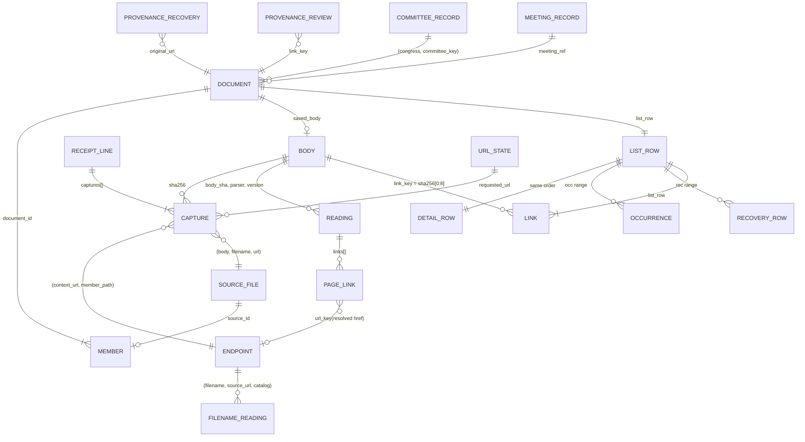

# Congressional Document Archive: Data Model

**Editor's Draft, 2026-10-24**

## Abstract

This specification defines the schemas of the system described in [[ARCHITECTURE]]: the raw records (body objects, receipt lines and provenance records), the five lake tables, the model profile and registries, the derivations that produce the model's relations, the release files the site and the capture job read, the keys that connect the layers, and the invariants a conforming implementation must satisfy.

## Status of This Document

This is an Editor's Draft. It is the column-level companion to [[ARCHITECTURE]], which defines the system and its processes. This document is the single home of every schema, derivation, order and registry; the architecture cites it rather than restating it. Sizes are measured on the 2026-10-19 snapshot unless marked *est.* Comments should be directed to the editor.

## Table of Contents

1. [Introduction](#1-introduction)
2. [Conformance](#2-conformance)
3. [Terminology](#3-terminology)
4. [Type Conventions](#4-type-conventions)
5. [Raw Records](#5-raw-records)
6. [Lake Tables](#6-lake-tables)
7. [Model Derivations](#7-model-derivations)
8. [Release Files](#8-release-files)
9. [Keys Between Layers](#9-keys-between-layers)
10. [Invariants](#10-invariants)
11. [References](#11-references)

## 1. Introduction

*This section is non-normative.*

Data flows through four layers. Raw records (§5) are the only truth. Lake tables (§6) hold one row per expensive per-item computation. The model (§7) is one SQL plan over the lake, the provenance records and the registries, at the versions one model profile pins. Release files (§8) are what the site and the capture job read. §9 names the keys between layers, and §10 lists the invariants tests assert.

## 2. Conformance

Sections marked "This section is non-normative", and all examples and diagrams, are non-normative. Everything else is normative.

The key words MAY, MUST, MUST NOT and SHOULD in this document are to be interpreted as described in BCP 14 [[RFC2119]] [[RFC8174]] when, and only when, they appear in all capitals, as shown here.

The conformance classes are those of [[ARCHITECTURE]] §2: raw writer, lake producer, publisher, reader and engine. Each class conforms by producing or reading the records, tables and files this document assigns to it, with the columns, types, keys and derivations given here, and by satisfying the invariants in §10 that apply to it.

## 3. Terminology

Terms are defined in [[ARCHITECTURE]] §3. This document adds:

**PK**
: The uniqueness a test asserts.

**logical body key**
: The string `bodies/sha256/<aa>/<sha>.gz` for a body, whatever its physical key. It is the body's input to the ID formulas.

**physical key**
: A body's object key: `bodies/sha256/<aa>/<sha>` plus a suffix of `''`, `.gz` or `.pdf`.

**compact JSON**
: JSON encoded as UTF-8 with no whitespace, `,` and `:` as separators, `null` for a missing value and no NaN. Only `"`, `\` and U+0000–U+001F are escaped, as `\"`, `\\`, `\b`, `\f`, `\n`, `\r`, `\t` where those exist and `\u00xx` in lowercase hex otherwise; `/` and non-ASCII characters are written as themselves. This is the output of Python's `json.dumps(value, ensure_ascii=False, separators=(",", ":"), allow_nan=False)`.

## 4. Type Conventions

**Lake tables (§6) use Iceberg types:** `string`, `int`, `long`, `boolean`, `date`, `timestamptz` (microseconds), `fixed[n]`, `list` and `struct`. Iceberg has no 16-bit integer and no dictionary type. Dictionary encoding is a writer setting, on by default.

**Model relations and release files (§7–8) use Arrow types:** `fsb(n)` is `fixed_size_binary(n)`; `dict` is a string written with a dictionary; `ts` is `timestamp[us, UTC]`; `int16` is INT32 annotated as 16-bit; `date32` is a day-precision date.

**Folds.** A fold is `list<struct<field: string, value: string>>`, one value per element, with the field repeated for multi-valued facts. A fold MUST hold display-only facts; anything the model filters, joins or sorts on, or the site acts on, MUST be a native column. Filename metadata stays typed facets plus a fold: on 5,000 real filenames it is flat (164 distinct fields, median 2 values per file) and every value is a string by design. Parquet's variant type is not used.

**Hashes** are binary (`fixed[32]`, `fixed[16]`, `fsb(32)`, `fsb(8)`) everywhere except in `list.parquet`, which carries no ID, and in `detail`'s fold, where `document_id` is hex for display.

## 5. Raw Records

### 5.1 Body Object

| Item | Value |
|---|---|
| Key | `bodies/sha256/<aa>/<sha>` for new writes. Older: `…/<sha>.gz` (every body written before this specification, 1.04M) and `…/<sha>.pdf` (uncompressed copies of older gzip PDFs, 261,055 objects, about 403 GB). |
| Stored bytes | Original bytes, gzip-compressed when the media type compresses (HTML, XML, JSON, text), as-is otherwise. |
| HTTP metadata | `Content-Type` is the original media type; `Content-Encoding: gzip` when compressed; `ETag` is the MD5 of the stored bytes. Older `.gz` objects carry `Content-Type: application/gzip` and no encoding. |
| Custom metadata | None: identity is the key, integrity is the ETag. |
| Recorded where | Every capture entry records the suffix its body is stored under (`stored_suffix`, §5.2). A `.pdf` copy is recorded by its verification record (§5.3). |
| Size | 1,036,256 bodies, 0.70 TB stored; largest 1.19 GB; none above 5 GB. |

### 5.2 Receipt Line

A run writes one or more numbered files, `receipts/<family>/<write-date>/<run>-<seq>.jsonl.gz`, one JSON object per fetch attempt or recovery import. A line is about 1 KB.

**Every line**

| Field | Type | Meaning |
|---|---|---|
| `run_id` | string | Writer run. Older lines carry it as `source_file`. |
| `mode` | `fetch` \| `retained_import` | A real fetch, or recovered content imported for another link. |
| `family` | string | Source family (21 today). |
| `requested_url`, `url` | string | Requested and final URL. |
| `retrieved_at` | RFC 3339 | Fetch time. Archive members take their line's time. For recovery imports, the recovered copy's own original time. |
| `http_status` | int or null | The publisher's status. Synthetic 200 for imports. |
| `provider_status` | int or null | A fetching provider's own status, when the fetch went through one. |
| `outcome` | `stored` \| `unchanged` \| `failed` \| `retry_later` \| `size_limit` \| `request_failed` | The last two mean incomplete. `retry_later` is a 429 or 503 response, or any response carrying `Retry-After`. |
| `complete` | bool | The one definition of a complete fetch: true when every byte of one entity was received, so the stored length equals the declared length (`Content-Length`, or the total in `Content-Range`), whether in one response or assembled from ranges whose every request carried `If-Range` with the first response's strong `ETag` or its `Last-Modified`, so a changed entity would have come back whole; false otherwise. Older lines carry no field; the ingest mapping derives it from their recorded sizes, false for the bodies older runs cut off at 64 MiB. |
| `transport` | string | `direct`, `zyte`, … |
| `response_headers` | object | Allowlisted only: `content-type`, `content-length`, `content-disposition`, `last-modified`, `etag`, `content-encoding`, `retry-after`, `date`, `cache-control`, `accept-ranges`. |
| `redirects` | list of {url, http_status} | — |
| `prior_attempts` | list of {url, retrieved_at, transport, http_status, sha256} | Earlier tries in the same run. |
| `source_context.observations` | list of {url, source, pointer} | Why the URL was requested. |
| `writer` | {job, commit, lockfile_digest} | Writer identity. |
| `captures[]` | list | One entry per body the line references (median 1, max 22,354). |

**`captures[]` entry**

| Field | Type | Meaning |
|---|---|---|
| `pointer` | JSON path | Where in the record the body sits, such as `["content","body"]` or `["archive_members", i, …]`. |
| `context_url` | string | The URL this body is evidence for: the container's URL for archive members. |
| `member_path` | string or null | Path inside an archive. Older lines carry it as `original_path`. |
| `entry_index` | int or null | Position inside the archive, recorded as evidence. Older lines carry it in `record.archive_members[i]`, reached through the entry's `pointer`. |
| `expansion` | string or null | On an archive's own entry: `expanded`, or why expansion was refused (a limit of the archive-limit registry, an encrypted or unsupported member). |
| `sha256` | hex | Identity: the entity after its transfer `Content-Encoding` is removed. |
| `bytes` | int | Original size. |
| `media_type` | string or null | The server's claim; MUST NOT be used to classify. |
| `sniffed_format`, `sniff_version` | string | The format sniffed from the first bytes (values in §6.2), and the sniff code's version, which also versions `intact`. |
| `intact` | bool or null | For a PDF, the sniff code's check of the spooled body: true when `%%EOF` appears in its last 8 KB, else when the pinned PDF reader opens it within the reader's size limit; false when neither holds; null for other formats and for a PDF over that limit. |
| `stored_suffix` | `''` \| `.gz` | The physical key's suffix, known from the PUT, its 412, or the older-copy check ([[ARCHITECTURE]] §7.1). |
| `stored_md5`, `stored_bytes` | hex, int | Only on the line that stored the body. |
| `fidelity` | `exact-bytes` \| `saved-text` \| `saved-record` \| `retained-file` | How faithful the stored bytes are. |

**Recovery imports only** (`mode = retained_import`)

| Field | Type | Meaning |
|---|---|---|
| `publisher_requested` | bool | Always false. |
| `recovery_evidence.original_url` | string | The link this content recovers. |
| `recovery_evidence.imported_at` | RFC 3339 | — |
| `recovery_evidence.match_basis` | string | Such as `user_accepted_url_variant`. |
| `recovery_evidence.acquisition.{prior_access_category, match, source, recovered_url, section_link, evidence_sha256, observed_capture_timestamp}` | mixed | `prior_access_category` decides the display kind (§7.8). |
| `recovery_evidence.acquisition.body_path` | string | The retained file's name: on older lines a local path, cut to its last segment by the cleanup below. `retained_name` (§6.1) comes from it. |

New lines MUST NOT carry: credential parameters in any recorded URL (`requested_url`, `url`, `redirects[]`, `prior_attempts[]`), as the credential-parameter registry lists them; cookies or authorization; local file paths; `links` (derivable from the body, §6.2); `download_state` and `preserve_download_state`; full provider metadata and header copies; `response_header_items`; per-capture copies of `retrieved_at`, `http_status` and `family`. Older lines that carry `links` keep them; the model does not read them.

Older receipts were cleaned once, before `receipts/` was locked. In recorded response headers, `Set-Cookie`, `Cookie` and `Authorization` values were removed; credential parameters were removed from recorded URLs; and absolute local paths were cut to their last segment in the named fields that hold them, which each verification record lists (a 195-line sample shows five: `recovery_evidence.acquisition.body_path`, `recovery_evidence.acquisition.representations[].body_path`, `recovery_evidence.acquisition.evidence_file`, `recovery_evidence.representation.body_path` and `retained_probe_evidence.response_file`). Every other value, including every URL, `links[].href`, `redirects[]`, `prior_attempts[]` and `pointer`, stayed byte-identical. Each cleaned receipt has a verification record (§5.3), and the private backup taken before the cleanup keeps the originals.

### 5.3 Provenance Records

`provenance/<kind>/<ts>.jsonl`, append-only. A correction is a new record that supersedes an old one by `id`.

| Kind | Fields | Read by |
|---|---|---|
| `recoveries` | `id`, `original_url`, `recovered_url`, `recovered_filename`, `body_sha256`, `kind`, `match_basis`, `evidence_sha256`, `identity_note`, `decided_by`, `decided_at`, `supersedes` | `recoveries` (§7.8); the filename-reading work list (§6.3) |
| `url_variants` | `id`, `canonical_url`, `variant_url`, `basis`, `decided_at`, `supersedes` | `url_key`'s last step (§7.2) |
| `reviews` | `id`, `target` (a link key), `verdict` (`hide`, `duplicate_of`, `title_override`, `kind_override`, `withdraw`), `value`, `note`, `reviewer`, `decided_at`, `supersedes` | `reviews` (§7.9) |
| `verification` | `key`, `size`, `etag`, `sha256_verified`, `checked_at`, `job`; for a cleaned receipt also `original_size`, `original_etag` and the counts of cookies, paths and credential parameters removed | the weekly check; `saved_suffix` for `.pdf` copies (§7.5). Written by the one-time re-hash, by the re-hash of any body with no creating line, by the PDF-copy job for each `.gz` source and `.pdf` copy it verifies, and by the one-time receipt cleanup. |

## 6. Lake Tables

Iceberg tables in Basin Catalog, append-only ([[ARCHITECTURE]] §8).

**Table properties.** Iceberg format version 2; `write.target-file-size-bytes` 128 MB; `write.parquet.compression-codec` zstd at level 3; `commit.retry.num-retries` 0, because the producer's own retry recomputes its work list ([[ARCHITECTURE]] §8.1); `gc.enabled` true and `write.metadata.delete-after-commit.enabled` true, so Basin's expiration deletes unreferenced files and old metadata.

**Writer settings** for the files producers write: row groups of 131,072 rows for `captures` and 65,536 for the other tables, chunk statistics, no Bloom filters. Files Basin compacts follow the table properties. Nothing depends on sort order. The PKs below MAY be declared as identifier fields. *(Note: these sizes assume the engine's remote write caps go; [[IMPLEMENTATION-PLAN]] M1 decides, and this note goes with it.)*

**Schema growth.** `readings`, `filename_readings`, `committee_records` and `meeting_records` gain a column only as an optional one, at the root or inside a list's element struct, by a metadata-only schema update; older rows read null, and the parser version that fills it backfills it. `captures` changes columns only with a new ingest mapping version (§7.1), because its history must be re-read.

**Completion rows.** `committee_records` and `meeting_records` carry `is_completion boolean`. For a response that yields no records, the producer writes one row with `is_completion = true`, its `body_sha` and `parser_version` set, its other PK columns at their type's zero value (`''` or `0`) and every other column null, in the same commit as its outputs. Every non-PK column of these two tables is nullable for that reason. The model skips completion rows. `readings` and `filename_readings` write one row per input with a status, so they need none.

**Versions.** `readings` and `filename_readings` hold every version ever produced. The model reads only the versions its profile pins (§7.1).

### 6.1 `captures`

One row per `captures[]` entry, and one per line without a body. It holds a receipt field only when a rule, an invariant or a job reads it; every other field stays in the receipt, and a new ingest mapping version brings one in when a rule needs it.

| Column | Type | Notes |
|---|---|---|
| `receipt_key` | string | — |
| `receipt_line` | int | — |
| `capture_index` | int | Position in `captures[]`. A line whose `captures[]` is empty yields one line-only row with index 0 and a null `sha256`: 1,041,863 of 2,596,054 lines. |
| `run_id` | string | — |
| `family`, `mode`, `outcome` | string | — |
| `fidelity` | string | `exact-bytes`, `saved-text`, `saved-record` or `retained-file`; the saved-file order prefers `exact-bytes` within a format (§7.5). |
| `complete` | boolean | §5.2. |
| `requested_url`, `url`, `context_url` | string | — |
| `member_path` | string, nullable | The endpoint is `(context_url, member_path)`. |
| `expansion` | string, nullable | On an archive's own row: `expanded`, or why expansion was refused. |
| `h_content_disposition` | string, nullable | The download-name header, which names many files (§7.4). |
| `retry_after` | timestamptz, nullable | The `Retry-After` deadline, resolved against `retrieved_at`. |
| `retained_name` | string, nullable | For an older import line, its `recovery_evidence.acquisition.body_path` (§5.2). |
| `retrieved_at` | timestamptz, nullable | The line's time, copied to every row of the line; null when the line has none. |
| `http_status` | int, nullable | — |
| `sha256` | fixed[32], nullable | — |
| `bytes` | long | — |
| `media_type` | string, nullable | The server's claim; never used to classify. |
| `sniffed_format`, `sniff_version` | string, nullable | Null on older rows; their format comes from the `sniff` reading. |
| `intact` | boolean, nullable | §5.2; null on older rows, whose integrity comes from the `sniff` reading. |
| `stored_suffix` | string, nullable | `''` or `.gz`; `.gz` for every row from an older receipt. |
| `stored_md5` | fixed[16], nullable | Creating line only. |
| `stored_bytes` | long, nullable | — |
| `recovery_category`, `original_url`, `recovered_url`, `match_basis`, `evidence_sha256`, `imported_at` | string, string, string, string, fixed[32], timestamptz | Import rows only; `recovery_category` is the receipt's `prior_access_category`. |
| `writer_job`, `writer_commit` | string | Constant within a run. |

- **PK:** `(receipt_key, receipt_line, capture_index)`.
- The line fields `requested_url`, `retrieved_at`, `http_status`, `outcome` and `mode` are on every row, so every attempt keeps its status, including bodiless lines.
- No `body_key` (derivable from `sha256` and `stored_suffix`) and no `stored_sha256` (replaced by MD5).
- **Older lines.** The ingest mapping derives `complete` (§5.2) and sets `expansion = 'expanded'` on an older archive line whose members were captured.
- Not partitioned; sorted within a commit by `(url, retrieved_at)`.
- **Work list:** receipt keys not yet ingested, listed from date-shaped prefixes ([[ARCHITECTURE]] §8.2).
- **Size:** 157 MB compact; 315 KB on a normal day.

### 6.2 `readings`

One row per `(body, parser, parser_version)`. Parsers record facts, not classifications; the model classifies them (§7.3).

| Column | Type | Notes |
|---|---|---|
| `body_sha` | fixed[32] | — |
| `parser` | string | `sniff`, `html`, `xml`, `json`, `fingerprint`; later `pdf_text` (§6.6). |
| `parser_version` | string | — |
| `status`, `error_type` | string | `completed`, `error` or `size_limit`, with the error's type. |
| `format` | string | `pdf`, `zip`, `xml`, `html`, `json`, `vtt`, `m3u8`, `docx`, `doc`, `text`, `image`, `warc`, `other`, `empty`. |
| `xml_root` | string, nullable | The XML root element. |
| `title`, `heading` | string, nullable | HTML `<title>` and first heading. |
| `text_bytes` | int, nullable | Visible-text size. |
| `text_head` | string, nullable | The first 2 KB of visible text, for the body-marker check. |
| `intact` | boolean, nullable | From `sniff`, for a PDF: the same check as a new capture's (§5.2). |
| `named_meetings` | list<struct<chamber string, event_id long>> | Meetings a source record names, such as a GovInfo MODS record's event IDs; empty otherwise. |
| `link_count`, `link_text_bytes` | int, nullable | Number of links in an HTML page and bytes of their text. |
| `content_date` | date, nullable | A date read from the content (HTML and XML metadata or a dated heading; PDF text from `pdf_text` when it exists). Null unless exactly one date qualifies. |
| `base_href` | string, nullable | The page's `<base href>`, as written. |
| `links` | list<struct<href string, text string, tag string, basis string, group_path string, doc_type string, add_date string, publish_date string, remove_date string>> | Every link in an HTML or XML page, in document order, with its `href` as written; empty when there are none. The model resolves each `href` (§7.2). `group_path` is the indexed path of the nearest grouping ancestor (`li`, `tr`, `meeting-document`, `witness-document`, `document`), or null. For an XML document list, a link's `text` is its entry's description. `doc_type`, `add_date`, `publish_date` and `remove_date` (a committee's removal of the document from its hearing page) are kept as the publisher wrote them. |
| `fingerprint` | fixed[32], nullable | Normalized-text digest (below). |
| `fields` | fold | Everything else. |

- **PK:** `(body_sha, parser, parser_version)`; partitioned by `(parser, parser_version)`; sorted by `body_sha`.
- A reading depends only on its body and its parser version.
- **`sniff`** reads every body whose capture rows carry no sniff at the pinned sniff version (in practice, every older body): one ranged read of its first bytes, decompressing the start of a gzip-stored body, and for a PDF one ranged read of the last 8 KB of its uncompressed `.pdf` copy (so `sniff` runs after the PDF copies exist); only when that read finds no `%%EOF` does it open the PDF with the pinned reader, within the reader's size limit. A new sniff version re-reads about 1.04M bodies and can change the format parsers' work lists, so the profile moves them together.
- **`html`, `xml`, `json`** read every body of their format once per version, and write each page's fingerprint on their own reading in the same pass. Links come from this pass: *est.* 4.2M links (from an 80-body sample) over 287,765 bodies the server labels HTML or XML, stored once per page body, not per fetch.
- No parser reads embedded PDF titles; names stay filename-based.
- **`fingerprint`** reads the candidates: the bodies at endpoints with two or more distinct real bodies, by `real_files` (§7.3) over the current lake; *est.* 300 to 1,800 bodies today, about 300 of them PDFs (up to 13 GB of text extraction, most of it in about 120 PDFs over 50 MB) and up to 1,400 ZIPs fingerprinted from their captured members. It never reads a format the page parsers read, so each body's fingerprint comes from exactly one reading. A registry change that adds candidates makes publish refuse until they are fingerprinted (§7.1). The model reads fingerprints only for the candidates under the pinned profile, so a fingerprint left over from an earlier profile never changes grouping, and an incrementally maintained lake groups exactly as a clean rebuild does. For a ZIP, the fingerprint is the SHA-256 of its members' hex SHA-256s, sorted and newline-joined, taken from `captures` when the archive's `expansion` is `expanded` (older archive lines with captured members ingest as `expanded`, §6.1), and read from the archive otherwise. For any other format, it is the SHA-256 of its text (PDF text from the pinned extractor; visible text for HTML, XML and other text formats), NFKC-normalized, with whitespace runs collapsed to one space and trimmed. Empty text or a failed extraction gives `status = error` and no fingerprint.
- **Size:** 491,710 rows fold to 16.5 MB, before links and `text_head` (*est.* 100 MB per HTML and XML parser version).

### 6.3 `filename_readings`

One row per `(filename, source_url, catalog_version)`.

| Column | Type | Notes |
|---|---|---|
| `filename` | string | The effective filename (§7.4). 32,574 source files have a filename that is not their URL's last segment. |
| `source_url` | string | The exact URL, because the filename parser matches some rules on it; `''` when the source file has no URL (331,985 source rows). |
| `catalog_version` | string | Covers the filename parser's version, every vocabulary passed in, the typed-field derivations and the effective-filename rule; a change to any of them is a new version. |
| `status`, `error_type` | string | Extraction outcome. An input the filename parser cannot read gets a row with `status = error`, so it is not retried every run. |
| `valid` | boolean | Strict naming-convention validity. |
| `document_kind`, `document_family`, `committee_code` | list<string> | Facets, every value kept: 24,202 source files have more than one kind, 3,637 more than one family and 5,229 more than one committee code. |
| `congress` | int, nullable | — |
| `date_token`, `measure_type`, `measure_number` | string, nullable | — |
| `filename_date` | date, nullable | `meeting_date`, else the single date candidate, else null. |
| `measure_keys` | list<string> | Bills and resolutions as `{congress}-{type}-{number}`, from the measure fields, measure references and `congress`. |
| `bioguide_ids` | list<string> | Member IDs from `bioguide_token` and `sponsor_bioguide_id`. |
| `gpo_package_id` | string, nullable | A GovInfo package ID when the filename stem follows a GPO pattern. |
| `fields` | fold | The rest (about 215 field names), as the filename parser's literal strings. |

- **Scalars take one value or none.** `congress`, `date_token`, `measure_type`, `measure_number` and `filename_date` are set only when the filename parser returns exactly one value; otherwise they are null and every value stays in `fields`. List columns keep every value.
- **Typed keys are composed once, by the producer.** The model MUST NOT unnest `fields`.
- **PK:** `(filename, source_url, catalog_version)`; partitioned by `catalog_version`. The model joins a source file on `(filename, coalesce(source_url, ''))`.
- **Work list:** the distinct `(effective filename, source URL)` pairs of every capture row and of every provenance recovery's original link, with no row for the pinned catalog version: 1,392,681 pairs today. The producer computes the effective filename itself, from the same SQL definition the model uses (§7.4), so the work list depends on no model decision; a change to the filename-parameter registry adds the new pairs it names. A full backfill takes 7–18 minutes.
- **Size:** *est.* 32 MB per catalog version.

### 6.4 `committee_records`

One row per committee in a Congress.gov committee API response.

| Column | Type | Notes |
|---|---|---|
| `body_sha` | fixed[32] | The response. |
| `parser_version` | string | — |
| `congress` | int | — |
| `system_code` | string | Congress.gov's committee code, such as `hsag03`. |
| `chamber`, `name` | string | — |
| `parent_system_code` | string, nullable | For subcommittees. |
| `is_completion` | boolean | §6. |

- **PK:** `(body_sha, parser_version, congress, system_code)`.
- **Producer:** the JSON parser, once per response and version. A few thousand rows.
- **Current record:** per `(congress, system_code)`, the record from the response whose latest good fetch (§7.3) is newest, in the order `(that fetch's retrieved_at desc nulls last, body_sha)`. Recency comes from `captures`, so a response fetched again counts again.

### 6.5 `meeting_records`

One row per meeting record.

| Column | Type | Notes |
|---|---|---|
| `body_sha` | fixed[32] | The response. |
| `parser_version` | string | — |
| `chamber` | string | — |
| `event_id` | long | The meeting ID shared by docs.house.gov, Congress.gov and the committee explorer. |
| `congress` | int | — |
| `title` | string | The hearing or markup title. |
| `meeting_date` | date | — |
| `meeting_type` | string | Hearing, markup, meeting, and so on. |
| `committee_keys` | list<string> | Congress.gov system codes. |
| `is_completion` | boolean | §6. |

- **Sources:** the Congress.gov meeting JSON and its XML fallback, for both chambers, and the House meeting inventories. Senate committee pages carry no meeting ID, so they supply documents, not meeting records.
- **PK:** `(body_sha, parser_version, chamber, event_id)`.
- **Producer:** the JSON and XML parsers, once per response and version. Tens of thousands of rows.
- **Current record:** per `(chamber, event_id)`, by the same recency rule as §6.4.

### 6.6 `pdf_text` (deferred)

`body_sha` fixed[32], `parser_version` string, `page_count` int, `text_fingerprint` fixed[32], `text` string. PK `(body_sha, parser_version)`. One read of about 403 GB when full-text extraction is scheduled; *est.* 1–5 GB compressed. Its text MUST stay off hash-join build sides. Fingerprint candidates do not wait for it (§6.2).

## 7. Model Derivations

One SQL plan over `captures c`, `readings r`, `filename_readings f`, `committee_records`, `meeting_records`, provenance `p` and the registries, at the versions the model profile pins (§7.1). Completion rows are excluded from every input. The relations below exist only inside the plan; the release files (§8) are what is written.

### 7.1 Model Profile and Registries

The **model profile** is the set of versions one publish reads: the model SQL version (the SHA-256 of the model's SQL files), the engine revision, the `captures` ingest mapping, one version per parser, the catalog version, one version per registry, and the release writer settings (§8.1). A new ingest mapping version is a new `captures` table, named by a short label that the profile maps to the version's digest, and rebuilt from the receipts; the old table is dropped once neither the live nor the last-good release's profile names it.

- A parser or catalog version is the SHA-256 of its code and data: its source files, the vocabularies it reads and its locked dependencies. A change to any of them is a new version.
- The model reads only the parser and catalog versions the profile pins.
- A new version is backfilled while the profile still pins the old one. The profile moves to it only when its work list is empty. The daily run produces every pinned version for new inputs.
- Publish MUST refuse when a pinned version's work list is not empty at the pinned snapshot.

A **registry** is a list a rule depends on. Each is one versioned file beside the model SQL in the application repository; its version is the SHA-256 of its bytes. Each entry carries a real sample that a test checks. Registries are never stored in the lake, so a registry change rewrites nothing there. *Versioned by* says whose version a registry belongs to: a profile registry is a profile change, applied in the model unless its row names a producer or the fetchers; a raw-writer registry is versioned with the raw writer's code.

| Registry | Holds | Used by | Versioned by |
|---|---|---|---|
| file shapes | Regular expressions over the locator that mark a link as pointing at a file | `real_files` (§7.3) | profile |
| error words | Generic error words for a title or heading (access denied, forbidden, not found, retry later, service unavailable, error), and body markers of challenge and soft-error pages | record roles (§7.3) | profile |
| error URLs | URL patterns that only ever serve error or placeholder pages | record roles | profile |
| listing thresholds | The minimum link count and link-text share of a listing page | record roles | profile |
| source-record roots | XML roots of metadata records: METS, MODS, PREMIS, meeting and witness records | record roles | profile |
| API endpoints | URL patterns of API JSON: api.congress.gov, api.govinfo.gov, the YouTube Data API, the Wayback CDX API | record roles | profile |
| URL wrappers | Redirect and archive wrapper patterns | `url_key` (§7.2) | profile |
| strip-list | Tracker parameters on any host; page-state parameters on named hosts | `url_key` | profile |
| generic stems | Filename stems never grouped: index, document, download, file, default, … | renditions (§7.5) | profile |
| format preference | The document formats, in order for the saved file and alternates, PDF first | saved file, alternates and renditions (§7.5) | profile |
| recheck intervals | `(family, interval)` for every family, with age bands where a family's pages change with a meeting's age | `url_state` (§7.7) | profile |
| capture scope | URL patterns capture follows from links, and the exclusions: media, refused hosts, crawler traps such as calendar archives, and forms | `url_state`; the fetchers, from the live release's copy (§8.1) | profile |
| URL repairs | Repairs of malformed links seen in real pages, such as `ttps://`, concatenated URLs and browser-extension prefixes | link targets (§7.2) | profile |
| filename parameters | Query parameters that name a file, in priority order: `filename`, `file`, `document`, `attachment`, `name` | effective filename (§7.4), in the filename producer and the model | profile |
| publisher kinds | Publisher link labels (a link's `doc_type`, else its text) and XML document-type codes → document kind | `document_kind` (§7.5) | profile |
| feed roots | XML roots and URL patterns of feeds and sitemaps | record roles (a feed is a listing); `linked_from` (§7.10) | profile |
| archive limits | Archive, member and total size, and member count | archive expander | raw writer |
| credential parameters | Query parameters that carry credentials, such as `api_key`, `apikey`, `access_token`, `token` | receipt writer; the `url_state` queue (§7.7) | raw writer |
| host pacing | Per-host gaps and backoffs | fetcher | raw writer |
| source families | URL patterns → source family (21 today) | receipt writer (`family`) | raw writer |
| committee codes | Filename committee code → Congress.gov system code: `hs`, `ss` and `js` prefixes, `hl` for Intelligence and the select committees, and the joint, commission and two-letter forms | `committee_key` (§7.5) | profile |
| import runs | `run_id` and date of each bulk import run | dates (§7.4) | profile |
| recovery kinds | `prior_access_category` → display kind | `recoveries` (§7.8) | profile |

### 7.2 `url_key`

```
url_key(url) := unwrap(url), then:
                drop the scheme, so http and https match; lowercase the host;
                drop "www.", the default port, the fragment and a trailing slash;
                normalize percent-encoding [RFC3986 §6.2.2]: uppercase escape hex,
                decode escapes of unreserved characters, and encode spaces and other
                characters outside the URI character set as %XX, so 'a b.pdf' and
                'a%20b.pdf' match;
                keep the path's case; drop the strip-list parameters;
                sort the remaining parameters and keep them all;
                then, once: if provenance url_variants names the result as a variant,
                replace it with the canonical URL normalized by the steps above

unwrap(url)  := apply the URL-wrapper registry at most twice: a redirect wrapper gives
                its inner URL (such as Proofpoint urldefense ?u=, with its -XX and _
                decoding); an archive wrapper gives the archived URL (such as
                web.archive.org/web/<ts>[modifier]/<url>)

strip-list   := the strip-list registry: trackers on any host (such as utm_*, gclid,
                fbclid) and page-state parameters on named hosts only (such as
                congress.gov q)

copy_urls(f) := the url_keys of source file f's source URL and of the requested URL of
                each good fetch that saved it
```

- **Link targets.** Links resolve once per distinct `(page body, context)`, where a context is an endpoint the page body was good-fetched at (§7.3). Each `href` is first repaired by the URL-repair registry, once; a repair may split one concatenated `href` into several, kept in `href` order, each its own link. In each context, a relative `base_href` is first resolved against the context; then each `href` is resolved, by reference resolution [[RFC3986]] §5, against the resolved base when there is one, else against the context. An archive member's relative links give endpoints in the same container. Every resolved link keeps its page body, context and link index, so the same page saved at two addresses yields both sets of targets and each set stays attributed to its own address. A target path that several members of one archive share matches each of them. Placeholder bodies' links are not resolved. Pages average 1.3 contexts (277,642 contexts over 214,041 good-fetched HTML and XML bodies), so about 4.2M links give *est.* 5.5M targets.
- Every link join MUST use `url_key`: resolved link targets to source files through `copy_urls` and to endpoints, recoveries' original links to source files through `copy_urls`, the `url_state` queue, and endpoint matching, which compares `(url_key(context_url), member_path)`. Endpoint comparisons are null-safe (`IS NOT DISTINCT FROM`), since `member_path` is null for every top-level page.
- Identity keeps the exact URL: `source_id`, `requested_url`, `url_state`'s key and link URL keys (§8.2) MUST NOT use `url_key`.
- Only trackers and the listed page-state parameters are stripped. Other query parameters almost always select a different file (`download=1`, `file_id=`, `docid=`, `?p=` and the like), so they are kept.
- The model reports URLs still wrapped after two passes. A test rejects any `url_variants` record whose canonical URL is itself a variant, so the variant step cannot chain.

### 7.3 Record Roles and Real Files

```
good_fetch  := rows of c where mode = 'fetch' and complete
               and outcome in ('stored', 'unchanged') and http_status between 200 and 299
               (import-run rows included; capture dates exclude them, §7.4)
format      := r[sniff].format at the pinned sniff version,
               else c.sniffed_format when c.sniff_version is that version
intact      := r[sniff].intact at the pinned sniff version,
               else c.intact when c.sniff_version is that version
reading     := the body's html, xml or json reading at the pinned version
record_role := 'caption'         when format = 'vtt'
               'playlist'        when format = 'm3u8'
               'damaged'         when format = 'pdf' and intact is not true
               'api'             when api_row
               null              when format in ('html', 'xml', 'json')
                                 and the reading is missing or not completed
               'source_record'   when format = 'xml'
                                 and reading.xml_root is in the source-record registry
               'error_response'  when format = 'html' and (error_signs(reading)
                                 or the capture's URL matches the error-URL registry)
               'listing'         when format = 'html' and listing_signs(reading),
                                 or format = 'xml' and (reading.xml_root or the capture's
                                 URL) matches the feed-root registry
               'document'        otherwise
api_row     := format = 'json' and the capture's URL matches the API-endpoint registry
error_signs(x)   := x.text_bytes < 2048,
                    or an error-word registry entry in x.title or x.heading,
                    or a body-marker entry of that registry in x.text_head
listing_signs(x) := x.link_count >= the registry's minimum link count
                    and x.link_text_bytes >= the registry's link-text share × x.text_bytes
placeholders := bodies whose capture rows, in any mode, span more than
                k = 100 distinct context_url values

real_files  := rows of good_fetch where
    sha256 is not null and bytes > 0
    and sha256 not in placeholders
    and record_role = 'document'
    and (format <> 'html' or not file_shaped(locator))

locator     := the member path for an archive member, else the URL
real_body   := a body with at least one real_files row
```

- Every condition is joined by `and`, so no row skips the fetch, completeness, status or size checks.
- A format no parser reads (PDF, ZIP, Office files, images, web archives) is a document unless it is a caption or playlist. A PDF whose `intact` is not true is `damaged`: it stays as evidence, and capture fetches it again on its recheck schedule. A parsed format whose reading is missing or did not complete has no role, so it is never a real file.
- Listing pages (hearing indexes, press-release lists), error pages and metadata records stay in the lake; their links still count.
- `file_shaped(locator)` is true when an entry of the file-shape registry matches. The narrow list (`.pdf`, `.zip`, `.doc`, `.docx`, `.xml`, `/download/`, `download=1`, `file_id=`) marks 16,775 HTML bodies file-shaped; a broader list (adding `/files/`, `/uploadedfiles/`, `/media/doc/` and more extensions) marks 44,047.
- *k* = 100 selects 18 placeholder bodies (22 at 50, 12 at 200); the most widespread is a 57-byte caption file at 87,161 URLs.
- Archive members are judged by their own path: about 34,000 HTML members sit at successful ZIP URLs.
- The model reports the bodies that have no role, by format and error type; the damaged PDFs, with those over the reader's size limit apart; and the bodies that newly crossed the placeholder threshold in each release.

### 7.4 `filenames`

One row per source file.

| Column | Type | Derivation |
|---|---|---|
| `source_id` | fsb(32) | SHA-256 of the compact JSON array `[logical body key, filename, source_url]`, with `null` for a missing body key or URL |
| `body_sha` | fsb(32), nullable | — |
| `filename` | string | The effective filename (below) |
| `source_url` | string, nullable | — |
| `record_role` | dict | §7.3 |
| `is_real_file` | bool | The source file has at least one capture row in `real_files` |
| `first_fetched`, `last_fetched` | ts, nullable | Over its `mode = fetch` rows from runs not in the import-run registry |
| `in_archive_since` | date32, nullable | The registry date of its earliest import run, when all its fetch rows come from import runs |

- **Derivation:** the distinct `(body, effective filename, source URL)` triples in `captures`; plus one bodiless row per URL that never yielded a body; plus, if not already present, one bodiless row per recovery that needs a document of its own (§7.8).
- **Effective filename.** The first non-empty name, in this order; the filename producer (§6.3) and the model evaluate the same SQL definition of it:
  1. the `recovered_filename` of the recovery decision whose `original_url` equals the import row's own, as an exact string;
  2. the member basename, for an archive member;
  3. the `h_content_disposition` filename, `filename*` [[RFC6266]] first;
  4. the value of the first filename-parameter registry entry present in the final URL's query, else in the requested URL's, at its first occurrence;
  5. the final URL's last path segment;
  6. the requested URL's last path segment;
  7. for an older import line, its `retained_name`.
- **Decoding.** URL segments and query values are percent-decoded once, as strict UTF-8, with `+` kept literal; a sequence that is not valid UTF-8 stays encoded.
- **One name per capture row.** Each capture row gives one effective name. When fetches of one body at one URL offered different names, each name is its own source file, and they join through the same-body edge; the other names a row was offered stay in its receipt. The document shows the saved file's name.
- **Grain:** two archive members with the same body and name at different paths are one source file; `occurrences` keeps each member path.
- 1,683,430 source files today.

### 7.5 Edges and Documents

```
ambiguous_bodies := real bodies at an edition-ambiguous endpoint: an endpoint holding two
                    or more distinct real bodies whose fingerprints differ or are missing
edition_bodies   := ambiguous_bodies, plus every candidate body (§6.2) whose fingerprint
                    equals that of a body in ambiguous_bodies

same_body      := source files that each have a real_files row, sharing a real_body
                  (web pages included); one node per body
same_text      := source files at one endpoint whose real files have equal fingerprints;
                  one node per (endpoint, fingerprint)
same_rendition := real source files that are one document in different formats:
                  (a) the publisher groups them: links resolved in one context of one page
                      body (§7.2) with the same non-null group_path; one node per
                      (page body, context, group_path);
                  (b) otherwise, the same directory and filename stem, in formats the
                      format-preference registry lists, the stem not in the generic-stem
                      registry; a directory is the source URL's host and
                      path up to its last '/', or for an archive member its container's
                      URL and the member path up to its last '/';
                  bodies in edition_bodies never join a group, and a group draws edges
                  only if its remaining real bodies all differ in format, one body per
                  format (several names of one body count once)
review_edge    := a reviewer's duplicate_of between two link keys (§7.9)

components     := ConnectedComponents over source files and the nodes above
listed         := components with at least one real file or at least one recovery

saved-file order := (format preference, exact-bytes before other fidelity,
                    first_fetched desc nulls last, body_sha, source_id)
recovery order := (kind: recovered copy, official substitute, hearing-record excerpt;
                  imported_at desc; body_sha; the import row's receipt_key, receipt_line,
                  capture_index)
saved_file     := the component's first real source file in the saved-file order;
                  for a recovery-only document, its first recovery in the recovery
                  order, with saved_kind = 'recovery'
suffix(body)   := '.pdf' when the body is a PDF with a verified .pdf copy (§5.3);
                  else '' when a capture row recorded stored_suffix ''; else '.gz';
                  used for the saved file, alternates and recoveries alike
alternates     := for each other format, its first real source file in the saved-file
                  order: (format, body, suffix, size), in format-preference order

first_captured := min(first_fetched) over its real files
last_captured  := max(last_fetched) over its real files
in_archive_since := min(in_archive_since) over its real files, when first_captured is null
document_date  := the saved file's filename_date, else its content_date, else the earliest
                  meeting_date among its meetings, else null
document_date_source := 'filename', 'content' or 'meeting'; null when document_date is null
document_id    := SHA-256 of the compact JSON array ["bodies", sorted distinct logical body
                  keys of its real files], or ["sources", sorted distinct source_id hex
                  strings] when it has none
```

- No body of a contested edition takes a rendition edge, and neither does a copy the model recognizes by its fingerprint, so mirrors cannot join two editions through a shared XML. A re-packaged copy that never shared an endpoint with another real body has no candidate fingerprint and is not recognized. A reviewer's merge still joins any two documents.
- Renditions never share bytes or text, so `same_rendition` is what joins them: about 16,000 groups are split across about 32,500 documents today. Several files of one format listed together, such as a witness's testimony, disclosure form and biography, stay separate documents.
- The model reports the largest components by edge kind.
- *est.* 0.5–0.7M listed documents: today's 1.24M catalog rows less 454k caption snippets, 98k metadata records, 10k playlists, 1k API responses and the listing pages among about 200k HTML rows, before untyped bodies are sniffed and renditions merge.
- About 30% of listed documents are expected to have no capture date: 2.7M of 3.9M capture rows come from older receipt lines that carry no time. 102,427 saved files carry only an import run's date.

**Meetings, committees and official records**

```
publisher_links    := resolved links (§7.2) from good-fetched pages to a source file, through
                      its copy_urls, each with its page body, context, text, doc_type and
                      dates
file_meetings      := per source file, every meeting (struct<chamber string, event_id int64>)
                      named by: its source URL (docs.house.gov/meetings/<C>/<SC>/<date>/
                      <eventId>/ or congress.gov/<congress>/meeting/<chamber>/<eventId>/);
                      a publisher_links page that is a meeting page or a House meeting XML
                      record; a source record's named_meetings, which a GovInfo MODS record
                      gives to the source files of its package, matched by the package ID in
                      both URLs; a House meeting ID drops its four-letter prefix (HHRG,
                      HMKP, HMTG) to give the event ID
meeting_refs       := the union of its members' file_meetings
meeting_keys       := 'chamber:event_id' for each entry of meeting_refs
committee_key      := the committee-code registry's system code for the code
                      (AG03 → hsag03, IG00 → hlig00); a code it does not list is unmapped
committee_name     := the current committee record's name on (congress, committee_key),
                      else the name in the most recent congress that has the code
govinfo_package_id := the package ID in a member's govinfo URL, else the saved file's
                      gpo_package_id
measure_keys, bioguide_ids := the union over its members' filename readings
document_kind      := the saved file's filename-reading kinds; when those are empty, the
                      kinds the publisher-kind registry gives for its publisher_links'
                      doc_type, else their text
removed_on         := when every House meeting XML page that lists any of its source files
                      carries, at that page's latest good fetch, a remove_date on each such
                      link, the earliest of those dates; else null, so a re-added document
                      is not removed; an unparseable date is ignored and reported
```

Every list column MUST be written in a fixed order, so exports stay byte-identical: `meeting_refs` and `meeting_keys` by `(chamber, event_id)`, `measure_keys` and `bioguide_ids` as strings, `alternates` as above. The model reports unmapped committee codes with counts.

**Columns:** `document_id` fsb(32), `list_row` int32, `filename`, `saved_body` fsb(32), `saved_suffix` dict (the saved body's suffix), `saved_media_type` dict, `saved_kind` dict (`original` or `recovery`), `first_captured`, `last_captured` and `in_archive_since` date32 nullable, `hidden` bool, `review_note` string nullable, `review_decided_at` date32 nullable, `removed_on` date32 nullable, `document_date` date32 nullable, `document_date_source` dict nullable, `meeting_refs` List<Struct<chamber dict, event_id int64>>, `govinfo_package_id` string nullable, `measure_keys` and `bioguide_ids` List<string>, `n_members` int32, and the facets from the saved file's filename reading.

### 7.6 `members`

`(document_id, source_id)`, each fsb(32). Every source file of a listed document appears exactly once.

### 7.7 `url_state`

One row per requested URL: `requested_url` string, `attempts` int32, `last_attempt` ts nullable, `last_status` int16 nullable, `last_outcome` dict nullable, `next_attempt_at` ts nullable.

- Aggregated over distinct `(receipt_key, receipt_line)`, so an attempt counts once however many bodies its line references.
- The latest `mode = fetch` attempt wins, in the total order `(retrieved_at nulls first, receipt_key, receipt_line)`. Import rows MUST NOT appear.
- `next_attempt_at` is the later of `last_attempt` and the attempt's `retry_after` for a retryable outcome (`retry_later`, `size_limit`, `request_failed`), so it is due now unless the server asked for a delay, capped at `last_attempt` plus the family's recheck interval; otherwise it is `last_attempt` plus that interval.
- **The queue.** Each resolved URL target (§7.2; archive-member targets are endpoints, not fetchable URLs) from a good-fetched page whose role is not `error_response`, that matches the capture-scope registry, and whose `url_key` matches neither the requested nor the final URL of any `mode = fetch` row, adds one row with `attempts = 0` and null `next_attempt_at` (due now): one row per `url_key`, under its byte-wise least target, with its credential parameters removed, since `url_state` is published. A recovery import therefore never hides a URL that was never fetched. 16,753 such URLs wait today.
- No body hash: the 412 tells capture whether a body is new.
- 1,158,426 rows plus the queue, *est.* 10 MB.

### 7.8 `recoveries`

One row per import row: `document_id`, `original_url`, `kind` dict, `body_sha` fsb(32), `suffix` dict, `recovered_url`, `match_basis`, `evidence_sha256`, `identity_note`, `imported_at`, `decision_id`. `recovered_url` and `evidence_sha256` come from the import row; the decision's values apply only where the row has none.

- **PK:** the import row's `(receipt_key, receipt_line, capture_index)`.
- **Decision:** the latest remaining provenance `recoveries` record, by `(decided_at, id)`, whose `body_sha256` is the row's body and whose `url_key(original_url)` is the row's; null when none matches. One import row therefore yields exactly one recovery, however many decisions match it. The model reports decisions that match no import row.

| `prior_access_category` | Display kind |
|---|---|
| `recovered_document` | Recovered copy |
| `requested_content_in_official_hearing` | Excerpt from the official hearing record |
| Any official-substitute category (updated revision, introduced-bill counterpart, recorded votes, official report, complete statement, alternate amendment) | The named official substitute |

The mapping is the recovery-kind registry. An import that carries no category takes its decision's `kind`; this fallback goes once every import row carries a category ([[IMPLEMENTATION-PLAN]] B7). An unmapped category, or an import with neither, MUST fail the build, so a new kind is never shown unlabeled.

**Attachment.** A recovery attaches to the listed document whose source files' `copy_urls` hold its original link (§7.2) when exactly one listed document holds it. When none does, or several do because the link came back as different editions, the recovery gets a document of its own, built from a bodiless source file for its original link.

### 7.9 `reviews`

- **Target:** a link key, so a review follows its file through merges and splits.
- **Supersession:** a record whose `supersedes` names an earlier record replaces it. A `withdraw` record supersedes one and applies nothing.
- **`duplicate_of`:** `value` is another link key. Every remaining `duplicate_of` record is a `review_edge`, applied before grouping, so no requested merge is lost. The model reports a review whose target or value no longer resolves to a document.
- **`hide`, `title_override`, `kind_override`:** applied after grouping. For each of these verdicts, the latest remaining record by `(decided_at, id)` among the records that target any of a document's link keys applies to the document, so two files that later merge keep one title.
- **`hide`** keeps the document in the release so its links still resolve, but sets `hidden`: it drops out of search and facet counts, and its page shows a "removed by review" note with `review_note` and `review_decided_at`.
- **Overrides** replace the displayed title or kind; the original stays in the fold.

### 7.10 Occurrences

One row per distinct `(source_id, member_path)` of a listed document's members: where each copy was seen.

- `url` is the source URL; `outcome` is the latest attempt's outcome at that endpoint, in `url_state`'s attempt order (§7.7); `first_fetched` and `last_fetched` are over its fetch rows outside import runs.
- **`linked_from`:** the earliest resolved link (§7.2) to the occurrence, at its endpoint or, for a top-level copy, at any of its `copy_urls`, giving the link's context (the linking page's address), its `text`, `doc_type` and `add_date` (parsed; an unparseable date becomes null). Repeated fetches of one `(page body, context)` reduce to its first good fetch before the join, so the join grows with links times contexts, not with fetches. Links are ordered by `(that first good fetch's retrieved_at nulls last, context, page body, link index)`. Links on feed and sitemap pages (the feed-root registry) never give link context.
- `ordinal` follows `(is_saved desc, first_fetched nulls last, url, member_path, source_id)`.
- *est.* 1.7M occurrences, sized from today's catalog (1,695,040 rows; its largest document has 455).

## 8. Release Files

### 8.1 Files

**Order.** `list` is ordered by `(filename, document_date nulls last, first_captured nulls last, document_id)`, which MUST be unique; `detail` follows the same order.

**Shared writer settings.** Parquet 2.0 data pages and ZSTD; fixed row counts per row group, flushed on row count only; chunk statistics; footers under 512 KB, so one request reads the metadata; no Bloom filters; a pinned `created_by`. These settings, and the per-file settings below, are part of the model profile.

**Writer profiles.** Each file uses one of three, named in its row, plus only its own settings: *whole*, read in one go, with no page index; *ranged*, read by row range, with an offset index on every leaf, 64 KB data pages, a 1,024-row page limit and write batches of 1,024 rows; *lookup*, read by key, with an offset index and a column index on the key, 16 KB pages and one row group.

Sizes are *est.* at about 0.65M listed documents, scaled from measurements on today's 1.24M catalog rows.

| File | Columns | Order | Writer settings | Size |
|---|---|---|---|---|
| `list.parquet` | `filename` string; `document_kind`, `document_family`, `committee_name` (List<dict>, every value); `congress` int16 nullable; `format` dict; `document_date` date32 nullable; `first_captured` date32 nullable; `date_kind` dict (`captured` when `first_captured` is set, `import_day` when only `in_archive_since` is, else `unknown`); `saved_kind` dict; `hidden` bool; `meeting_keys` (List<dict>; usually empty or one; 1.7% of documents with a meeting have several, up to 9). No ID. | list order | Whole; `filename` with dictionary off and `DELTA_BYTE_ARRAY` encoding; facets and dates keep dictionaries; 65,536-row groups | 2–3 MB |
| `detail.parquet` | Typed core: `link_key` fsb(8) (the saved body's key, or for a recovery-only document the link URL key of its first recovery in the recovery order), `saved_body` fsb(32), `saved_suffix` dict, `saved_media_type` dict, `occ_start`, `occ_len`, `rec_start`, `rec_len` int32, `alternates` List<Struct<format dict, body fsb(32), suffix dict, size int64>>, `meeting_refs` List<Struct<chamber dict, event_id int64>>, `govinfo_package_id` string, `measure_keys` and `bioguide_ids` List<string>. One fold of display-only facts, dates as ISO `YYYY-MM-DD`: `document_id` (hex), `source_url`, `saved_kind`, `first_captured`, `last_captured`, `in_archive_since`, `document_date_source`, `review_note`, `review_decided_at`, `removed_on`, `member_count`, the saved file's reading (`r.title`, `r.heading`, `r.content_date` and `r.fields`, not its links) and filename reading (`f.*`). | list order | Ranged; 65,536-row groups | 55–70 MB (recomputed from measured column sizes at 1.24M rows); a view reads about 19 pages, 50–90 KB |
| `links.parquet` | `link_key` fsb(8), `list_row` int32 | `link_key` | Lookup; the indexes are about 25 KB together | 7–9 MB |
| `occurrences.parquet` | `list_row` int32, `ordinal` int32, `url`, `member_path`, `filename`, `outcome`, `linked_from`, `link_text`, `doc_type` (all string), `first_fetched`, `last_fetched`, `add_date` (all date32), `is_saved` boolean | `(list_row, ordinal)` | Ranged | 8–12 MB |
| `recoveries.parquet` | `list_row` int32, `ordinal` int32, `kind` dict, `body` fsb(32), `suffix` dict, `imported_at` date32, `recovered_url` string, `match_basis` dict, `evidence_sha256` fsb(32), `identity_note` string | `(list_row, ordinal)`, ordinal in the recovery order of §7.5 | Ranged | 1–3 MB |
| `meetings.parquet` | `chamber` dict, `event_id` int64, `title` string, `meeting_date` date32, `meeting_type` dict, `committee_names` List<dict>; every meeting a listed document references, from its current record | `(chamber, event_id)` | Whole; one row group | 1–2 MB |
| `url_state.parquet` | §7.7 | `requested_url` | Whole | 10 MB |
| `capture_scope.json` | The capture-scope registry at the profile's version, which the fetchers apply | — | Content only | Under 50 KB |
| `manifest.json` | `schema_version`; `files[]` {name, sha256, md5, size, rows, row_range, shard}; `facet_counts` over the non-hidden rows of `list`; `release_id` | — | Deterministic, content only | 5–20 KB |
| `inputs/<input_digest>.json` | The input identity (§8.3), the pinned snapshot IDs and the run | — | One per input identity | About 2 KB |
| `viewer-publications/manifest.json` (the pointer) | `release_id`, `previous_release_id` (null until the second flip) | — | `no-store`; written only by the flip, with `If-Match` | Under 1 KB |

`detail` and `occurrences` MAY be split into fixed row-range shards, which the manifest lists with their row ranges.

### 8.2 `link_key`

- **Body keys:** the first 8 bytes of the SHA-256 of every real body of every listed document.
- **Link URL keys:** for each distinct original link of a recovery, the first 8 bytes of `sha256('url:' || original_url)` over the exact URL, so no registry or provenance change ever moves a published key. A link URL key resolves by the attachment rule (§7.8), which matches by `url_key`, so two spellings of one link give two keys that open the same row. The key stays stable when the original link finally downloads.
- Recovery bodies MUST NOT be keys.
- The export MUST refuse if two keys derived from different inputs (two bodies, two original URLs, or a body and an original URL) are byte-equal.

### 8.3 Input Identity

The input identity is the SHA-256 of the compact JSON of: the sorted receipt keys ingested into `captures`; the sorted keys and ETags of the provenance records; and the model profile (§7.1).

Equal identities mean equal model inputs. Every other lake row the model reads is a deterministic function of a body or filename pair named by those captures and provenance records and of a version the profile pins, and publish refuses unless every pinned version is complete at the pinned snapshot (§7.1). Snapshot IDs are excluded, because compaction changes them without changing content.

## 9. Keys Between Layers

*The diagram is non-normative; the key table is normative.*



| From → to | Key |
|---|---|
| raw → lake | `(receipt_key, receipt_line, capture_index)` |
| body ↔ everything | `sha256`, binary |
| lake → model | `sha256` for readings, committee and meeting records; `(filename, source_url)` for filename readings; `(context_url, member_path)` for endpoints; `url_key` for every link join |
| model → release | `list_row` |
| public → release | `link_key` |
| release → raw | `saved_body` with `saved_suffix` (the physical key), and occurrence URLs |

## 10. Invariants

A conforming implementation MUST satisfy, and SHOULD test, each of the following.

**Raw and lake**

1. Every lake PK is unique. `captures` rebuilt from all receipts equals the appended table. A parser version re-run on a sample of its inputs reproduces its rows, links included. Every completed HTML reading has `text_bytes`, `text_head`, `link_count` and `link_text_bytes`, and every completed XML reading has `xml_root`.
2. Every `sha256` in `captures` has a body object under its recorded suffix; every body's size and ETag equal its creating line's `stored_bytes` and `stored_md5`; no body ETag contains `-`, so none was a multipart upload; a body with no creating line has a verification record.
3. New receipt keys are date-shaped; every `stored` line carries `stored_md5`; every new capture row with a body carries `sniffed_format`, `sniff_version` and `stored_suffix`, and `intact` when it is a PDF; every new row carries `writer_job` and `writer_commit`. No receipt line carries a credential parameter in a recorded URL, a cookie or a local file path, and every cleaned older receipt has a verification record.
4. Every version the model profile pins has an empty work list at the pinned snapshot, and a maintained lake and a clean rebuild from the same raw at the same profile give byte-identical releases.
5. Every committee and meeting response a producer has read has at least one row: an output or a completion row.

**Model**

6. Every source file of a listed document is in exactly one document; every listed document has at least one member, and at least one real file or recovery.
7. Every `real_body` belongs to exactly one document, web pages included.
8. No document's body set contains a non-2xx, incomplete, empty or placeholder body, a recovery import, or a body whose `record_role` is not `document`, so no listing page, error page, damaged PDF or failed reading.
9. `document_id` and `source_id` recompute from their formulas (golden vectors).
10. `saved_body` is the first real source file in the saved-file order, and `alternates` hold the first real source file of each other format in that order; a recovery-only document has `saved_kind = 'recovery'` and a recovery body. Every physical key a release names (saved, alternate or recovery) is recorded by a capture's `stored_suffix` or a verification record.
11. `first_captured` ≤ `last_captured`, and neither comes from an import run or a recovery import; `document_date_source` is set exactly when `document_date` is.
12. `url_state` has one row per requested URL and no import rows; each queue row's `url_key` matches no fetch row's requested or final URL, and no queue row carries a credential parameter.
13. Every import row yields exactly one recovery, which has a display kind and resolves to a listed document or is reported as orphaned; no recovery body is a link key; a recovery body is a saved file only for a recovery-only document.
14. Without a review edge, no component holds two real bodies from one edition-ambiguous endpoint whose fingerprints differ. No rendition group joins two different bodies of the same format or a body in `edition_bodies`.
15. A hidden document has no search or facet presence, and its links resolve to its "removed by review" note.

**Release**

16. `rows(list) = rows(detail)`; every `list_row` in `links`, `occurrences` and `recoveries` is below `rows(list)`; every meeting in a `detail` row's `meeting_refs` appears in that `list` row's `meeting_keys` and in `meetings`.
17. `list` is sorted by its order, unique and not empty.
18. The occurrence ranges partition `occurrences` exactly and the recovery ranges partition `recoveries` exactly; a recovery-only document's recovery range is not empty.
19. Every `link_key` resolves to exactly one row, and keys are unique; a link URL key resolves by the attachment rule (§7.8).
20. Manifest digests equal the uploaded objects'; `release_id = sha256(file list, schema_version)`; facet counts equal counts over the non-hidden rows of `list`; an inputs record exists; `url_state` decodes; the pointer's `release_id`, and its `previous_release_id` when set, name releases whose files exist.
21. A 404 on a release file makes the reader re-read the pointer.

## 11. References

### 11.1 Normative References

**[RFC2119]**
: S. Bradner. *Key words for use in RFCs to Indicate Requirement Levels.* BCP 14, RFC 2119, March 1997. https://www.rfc-editor.org/rfc/rfc2119

**[RFC8174]**
: B. Leiba. *Ambiguity of Uppercase vs Lowercase in RFC 2119 Key Words.* BCP 14, RFC 8174, May 2017. https://www.rfc-editor.org/rfc/rfc8174

**[RFC3986]**
: T. Berners-Lee, R. Fielding, L. Masinter. *Uniform Resource Identifier (URI): Generic Syntax.* STD 66, RFC 3986, January 2005. https://www.rfc-editor.org/rfc/rfc3986

**[RFC6266]**
: J. Reschke. *Use of the Content-Disposition Header Field in the Hypertext Transfer Protocol (HTTP).* RFC 6266, June 2011. https://www.rfc-editor.org/rfc/rfc6266

**[PARQUET]**
: *Apache Parquet Format.* https://parquet.apache.org/docs/file-format/

**[ICEBERG]**
: *Apache Iceberg Table Spec.* https://iceberg.apache.org/spec/

**[ARCHITECTURE]**
: *Congressional Document Archive: Architecture.* Editor's Draft, 2026-10-24. `docs/engine-first-architecture.md`.

### 11.2 Informative References

**[IMPLEMENTATION-PLAN]**
: *Congressional Document Archive: Implementation Plan.* Note, 2026-10-24. `docs/plans/simplification-plan-20261024.md`.
