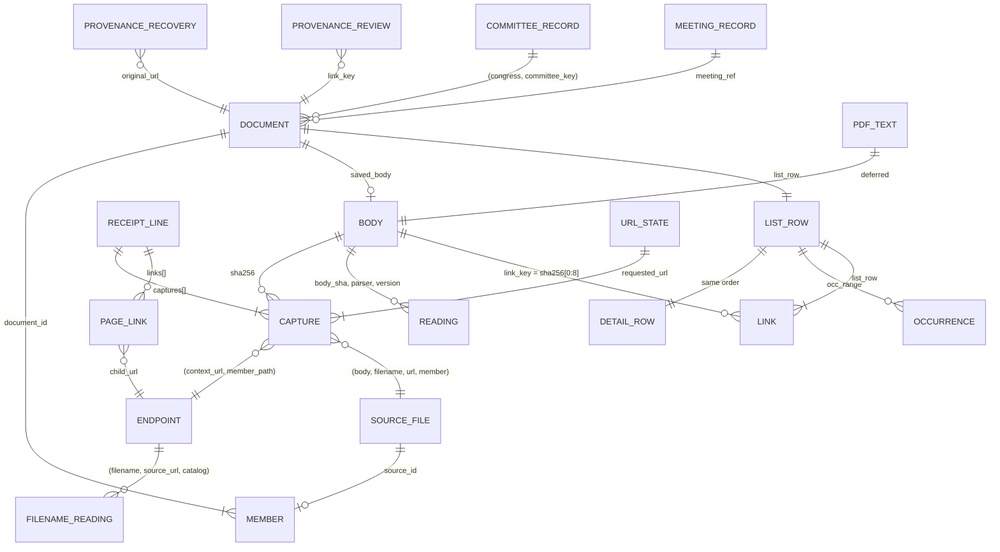

# Congressional Document Archive: Data Model

**Editor's Draft, 2026-10-24**

## Abstract

This specification defines the schemas of the system described in [[ARCHITECTURE]]: the raw records (body objects, receipt lines and provenance records), the six lake tables, the derivations that produce the model outputs, the release files the site reads, the keys that connect the layers, and the invariants a conforming implementation must satisfy.

## Status of This Document

This is an Editor's Draft. It is the column-level companion to [[ARCHITECTURE]], which defines the system, its rules and its processes; this document defines what each record, table, output and file contains and how each derived value is computed. Sizes are measured on the 2026-10-19 snapshot unless marked *est.* Comments should be directed to the editor.

## Table of Contents

1. [Introduction](#1-introduction)
2. [Conformance](#2-conformance)
3. [Terminology](#3-terminology)
4. [Type Conventions](#4-type-conventions)
5. [Raw Records](#5-raw-records)
6. [Lake Tables](#6-lake-tables)
7. [Model Derivations](#7-model-derivations)
8. [Release Files](#8-release-files)
9. [Keys Between Layers](#9-keys-between-layers)
10. [Invariants](#10-invariants)
11. [References](#11-references)

## 1. Introduction

*This section is non-normative.*

Data flows through four layers: raw records (§5) are the only truth; lake tables (§6) hold one row per expensive per-item computation; model derivations (§7) are one SQL plan over the lake and provenance; release files (§8) are what the site and the capture job read. §9 names the keys between layers and §10 lists the invariants tests assert.

## 2. Conformance

Sections marked "This section is non-normative", and all examples and diagrams, are non-normative. Everything else is normative.

The key words MAY, MUST, MUST NOT and SHOULD in this document are to be interpreted as described in BCP 14 [[RFC2119]] [[RFC8174]] when, and only when, they appear in all capitals, as shown here.

The conformance classes are those of [[ARCHITECTURE]] §2: raw writer, lake producer, publisher, reader and engine. Each class conforms by producing or reading the records, tables and files this document assigns to it, with the columns, types, keys and derivations given here, and by satisfying the invariants in §10 that apply to it.

**Registries.** Several rules depend on lists: the page-shape patterns, error words, generic filename stems, source-record XML roots, API endpoints, URL wrappers and strip-list, listing-page thresholds, the format preference order, the recheck intervals, the import runs and the recovery-kind mapping. Each is a versioned SQL table in the application repository, incorporated here by reference, and each entry carries a real sample that a test checks. A registry change is a model version change.

## 3. Terminology

Terms are defined once, in [[ARCHITECTURE]] §3. This document adds:

**PK**: the uniqueness a test asserts.
**logical body key**: the string `bodies/sha256/<aa>/<sha>.gz` for a body, whatever its physical key; it is the body's input to the ID formulas.
**physical key**: a body's object key: `bodies/sha256/<aa>/<sha>` plus a suffix of `''`, `.gz` or `.pdf`.
**compact JSON**: JSON with no whitespace, `,` and `:` as separators, non-ASCII characters written as themselves (not escaped), `null` for a missing value and no NaN; encoded as UTF-8.

## 4. Type Conventions

**Lake tables (§6) use Iceberg types:** `string`, `int`, `long`, `boolean`, `date`, `timestamptz` (microseconds), `fixed[n]`, `list` and `struct`. Iceberg has no 16-bit integer and no dictionary type. Dictionary encoding is a writer setting, on by default; no lake column needs encoding tuning.

**Model outputs and release files (§7–8) use Arrow types:** `fsb(n)` is `fixed_size_binary(n)`; `dict` is a string written with a dictionary; `ts` is `timestamp[us, UTC]`; `int16` is INT32 annotated as 16-bit; `date32` is a day-precision date.

**Folds.** A fold is `list<struct<field: string, value: string>>`, one value per element, with the field repeated for multi-valued facts. A fold MUST hold display-only facts; anything the model filters, joins or sorts on, or the site acts on, MUST be a native column. House-naming metadata stays typed facets plus a fold: measured on 5,000 real filenames it is flat (164 distinct fields, median 2 values per file) and every value is a string by design. Parquet's variant type is not used ([[IMPLEMENTATION-PLAN]] §7 parks the revisit).

**Hashes** are binary (`fixed[32]`, `fixed[16]`, `fsb(32)`, `fsb(8)`) everywhere except in `list.parquet`, which carries no ID, and in `detail`'s fold, where `document_id` is hex for display.

## 5. Raw Records

### 5.1 Body Object

| Item | Value |
|---|---|
| Key | `bodies/sha256/<aa>/<sha>` for new writes. Older: `…/<sha>.gz` (every older body, 1.04M) and `…/<sha>.pdf` (the one-time uncompressed copies of older PDFs: 261,055 objects, about 403 GB). |
| Stored bytes | Original bytes, gzip-compressed when the media type compresses (HTML, XML, JSON, text), as-is otherwise. |
| HTTP metadata | `Content-Type` is the original media type; `Content-Encoding: gzip` when compressed; `ETag` is the MD5 of the stored bytes (single PUT only). Older `.gz` objects carry `Content-Type: application/gzip` and no encoding. |
| Custom metadata | None: identity is the key, integrity is the ETag. |
| Write | One create-only PUT (`If-None-Match: *`) with `Content-MD5`. A 412 means it exists. |
| Size | 1,036,256 bodies, 0.70 TB stored; largest 1.19 GB; none above 5 GB. |

### 5.2 Receipt Line

A run writes one or more numbered files, `receipts/<family>/<write-date>/<run>-<seq>.jsonl.gz`, one JSON object per fetch attempt or recovery import. A line is about 1 KB.

**Every line**

| Field | Type | Meaning |
|---|---|---|
| `run_id` | string | Writer run. Older lines carry it as `source_file`. Bulk import runs are listed in the import-run registry (§2). |
| `mode` | `fetch` \| `retained_import` | A real fetch, or recovered content imported for another link. |
| `family` | string | Source family (21 today). |
| `requested_url`, `url` | string | Requested and final URL. |
| `retrieved_at` | RFC 3339 | Fetch time. Archive members take their line's time. For recovery imports, the recovered copy's own original time, so recovery imports never feed capture dates. |
| `http_status` | int or null | Synthetic 200 for imports. |
| `outcome` | `stored` \| `unchanged` \| `failed` \| `retry_later` \| `size_limit` \| `request_failed` | The last two mean incomplete; capture retries them. |
| `complete` | bool | Body fully received. |
| `transport` | string | `direct`, `zyte`, … |
| `response_headers` | object | Allowlisted only: `content-type`, `content-length`, `last-modified`, `etag`, `content-encoding`, `date`, `cache-control`, `accept-ranges`. |
| `redirects` | list of {url, http_status} | — |
| `prior_attempts` | list of {url, retrieved_at, transport, http_status, sha256} | Earlier tries in the same run. |
| `links` | list of {url, basis, tag, text, attributes, source_xpath} | Links found in this body; they feed `page_links` (§6.4). |
| `source_context.observations` | list of {url, source, pointer} | Why the URL was requested. |
| `writer` | {job, commit, lockfile_digest} | Writer identity. |
| `captures[]` | list | One entry per body the line references (median 1, max 22,354). |

**`captures[]` entry**

| Field | Type | Meaning |
|---|---|---|
| `pointer` | JSON path | Where in the record the body sits, such as `["content","body"]` or `["archive_members", i, …]`. |
| `context_url` | string | The URL this body is evidence for: the container's URL for archive members. |
| `member_path` | string or null | Path inside an archive. Older lines carry it as `original_path`. |
| `sha256` | hex | Identity. |
| `bytes` | int | Original size. |
| `media_type` | string or null | The server's claim; MUST NOT be used to classify. |
| `sniffed_format` | see §6.2 | From the first bytes. |
| `stored_md5`, `stored_bytes` | hex, int | Only on the line that stored the body. |
| `fidelity` | `exact-bytes` \| `saved-text` \| `saved-record` \| `retained-file` | How faithful the stored bytes are. |

**Recovery imports only** (`mode = retained_import`)

| Field | Type | Meaning |
|---|---|---|
| `publisher_requested` | bool | Always false. |
| `recovery_evidence.original_url` | string | The link this content recovers. |
| `recovery_evidence.imported_at` | RFC 3339 | — |
| `recovery_evidence.match_basis` | string | Such as `user_accepted_url_variant`. |
| `recovery_evidence.acquisition.{prior_access_category, match, source, recovered_url, section_link, evidence_sha256, observed_capture_timestamp}` | mixed | `prior_access_category` decides the display kind (§7.7). |

New lines MUST NOT carry: `download_state` and `preserve_download_state`; full provider metadata and header copies; `response_header_items`; per-capture copies of `retrieved_at`, `http_status` and `family`; local file paths in import lines.

### 5.3 Provenance Records

`provenance/<kind>/<ts>.jsonl`, append-only. A correction is a new record that supersedes an old one by `id`.

| Kind | Fields | Read by |
|---|---|---|
| `recoveries` | `id`, `original_url`, `recovered_url`, `body_sha256`, `kind`, `match_basis`, `evidence_sha256`, `identity_note`, `decided_by`, `decided_at`, `supersedes` | `recoveries` (§7.7) |
| `url_variants` | `id`, `canonical_url`, `variant_url`, `basis`, `decided_at`, `supersedes` | endpoint canonicalization, beyond what `url_key` catches |
| `reviews` | `id`, `target` (a link key), `verdict` (`hide`, `duplicate_of`, `title_override`, `kind_override`), `value`, `note`, `reviewer`, `decided_at`, `supersedes` | `reviews` (§7.8) |
| `verification` | `key`, `size`, `etag`, `sha256_verified`, `checked_at`, `job` | the weekly check; the one-time re-hash of any body with no creating receipt line |

## 6. Lake Tables

Iceberg tables in Basin Catalog, append-only ([[ARCHITECTURE]] §8).

**Writer settings.** Every table uses Iceberg format version 2, a 128 MB target file size, zstd level 3, chunk statistics and no Bloom filters. Row groups hold 131,072 rows for `captures` and `page_links` and 65,536 for the other tables. Nothing depends on sort order. The primary keys below MAY be declared as identifier fields, for documentation only.

**Completion rows.** `page_links`, `committee_records` and `meeting_records` carry an `is_completion boolean` column. For an input that produced nothing they write one row with `is_completion = true`, in the same commit as their outputs; its PK columns take the sentinel values given in each table and its other columns are null. Readers skip completion rows. `readings` and `filename_readings` write one row per input with a status, so they need none.

### 6.1 `captures`

One row per `captures[]` entry, and one per line without a body.

| Column | Type | Notes |
|---|---|---|
| `receipt_key` | string | — |
| `receipt_line` | int | — |
| `capture_index` | int | Position in `captures[]` (up to 22,354). A line whose `captures[]` is empty yields one line-only row with index 0 and a null `sha256`: 1,041,863 of 2,596,054 lines. |
| `pointer` | string | Informative. |
| `run_id` | string | — |
| `family`, `mode`, `transport`, `outcome`, `fidelity` | string | — |
| `publisher_requested`, `complete` | boolean | — |
| `requested_url`, `url`, `context_url` | string | — |
| `member_path` | string, nullable | The endpoint is `(context_url, member_path)`. |
| `retrieved_at` | timestamptz, nullable | The line's time, copied to every capture row of the line; null only when the line has none. |
| `http_status` | int, nullable | — |
| `sha256` | fixed[32], nullable | — |
| `bytes` | long | — |
| `media_type` | string, nullable | The server's claim; never used to classify. |
| `sniffed_format` | string, nullable | Null on older rows; their format comes from `readings` parser `sniff`. |
| `stored_md5` | fixed[16], nullable | Creating line only. |
| `stored_bytes` | long, nullable | — |
| `recovery_category`, `original_url`, `match_basis`, `imported_at`, `observed_capture_ts` | string, string, string, timestamptz, timestamptz | Import rows only. |
| `h_content_type`, `h_last_modified`, `h_etag`, `h_content_length` | string, timestamptz, string, long | The header allowlist as columns; `Last-Modified` is parsed to a time, and the raw header stays in the receipt. |
| `writer_job`, `writer_commit` | string | Constant within a run. |

- **PK:** `(receipt_key, receipt_line, capture_index)`.
- The line fields `requested_url`, `retrieved_at`, `http_status`, `outcome` and `mode` are on every row, so every attempt keeps its status, including bodiless lines.
- No `body_key` (derivable) and no `stored_sha256` (replaced by MD5).
- Not partitioned; sorted within a commit by `(url, retrieved_at)`.
- **Work list:** receipt keys not yet ingested, listed from date-shaped prefixes.
- **Size:** 157 MB compact; 315 KB on a normal day.

### 6.2 `readings`

One row per `(body, parser, parser_version)`.

| Column | Type | Notes |
|---|---|---|
| `body_sha` | fixed[32] | — |
| `parser` | string | `sniff`, `html`, `xml`, `json`, `fingerprint`; later `pdf_text` (§6.7). |
| `parser_version` | string | — |
| `status`, `error_type` | string | — |
| `format` | string | `pdf`, `zip`, `xml`, `html`, `json`, `vtt`, `m3u8`, `docx`, `doc`, `text`, `image`, `warc`, `other`, `empty`. |
| `record_role` | string, nullable | `document`, `listing`, `source_record` (metadata XML such as MODS, PREMIS, meeting and witness records), `caption`, `playlist`, `api`, `error_response`. Written by the HTML, XML and JSON parsers, so the model never looks inside `fields`; formats no parser reads take their role from the format (§7.2). |
| `xml_root` | string, nullable | The XML root element, the parser's input for `record_role`. |
| `title`, `heading` | string, nullable | HTML `<title>` and first heading, for the error-sign check. |
| `text_bytes` | int, nullable | Visible-text size: the "tiny body" signal. |
| `link_count`, `link_text_bytes` | int, nullable | Number of links and bytes of link text in an HTML page: the listing-page signals. |
| `content_date` | date, nullable | A date the parser reads from the content (HTML and XML metadata or a dated heading now; PDF text once `pdf_text` exists), else null. Never a guess among several dates. |
| `error_signals` | list<string> | Generic error words found. |
| `fingerprint` | fixed[32], nullable | Normalized-text digest; for a ZIP, the digest of its sorted member hashes, taken from `captures` without reading the ZIP. |
| `fields` | fold | Everything else. |

- **PK:** `(body_sha, parser, parser_version)`; partitioned by `(parser, parser_version)`; sorted by `body_sha`.
- **`sniff`** runs once over every older body: one ranged read of the first bytes, decompressing the start of a gzip-stored body. New bodies are sniffed by the fetcher.
- **`fingerprint`** scope: bodies at endpoints with two or more distinct complete real files (148 endpoints, 297 bodies, about 1.4 GB). Its producer evaluates the model's `real_files` SQL over the current lake, before the publish run pins its snapshots, so fingerprints are never one publish behind. For a PDF candidate it extracts the text, so re-packaged PDFs merge without the deferred every-PDF pass.
- **Versions.** The model reads the newest complete version of each parser. A version is complete when its work list is empty at the pinned snapshot. While a new version backfills, the daily run applies the version the model reads to new bodies too, so that version stays complete.
- **Size:** 491,710 rows fold to 16.5 MB.

### 6.3 `filename_readings`

One row per `(filename, source_url, catalog_version)`.

| Column | Type | Notes |
|---|---|---|
| `filename` | string | The effective filename (§7.3). 32,574 differ from the URL's last segment. |
| `source_url` | string, nullable | Exact URL, because house-naming qualifies some readings by exact mirror URL (25 URLs in 7 lists in house-naming 3.2.7). 331,985 source rows have none; the key treats a missing URL as the empty string. |
| `catalog_version` | string | Covers the house-naming version, every vocabulary passed in, the typed-field derivations and the effective-filename rule (§7.3); a change to any of them is a new version. |
| `status`, `error_type` | string | Extraction outcome, separate from `valid`: an input house-naming cannot read gets a row with `status = error`, so it is not retried every run. |
| `valid` | boolean | Strict naming-convention validity. |
| `document_kind`, `document_family`, `committee_code` | list<string> | Facets, every value kept: 24,202 source files have more than one kind, 3,637 more than one family and 5,229 more than one committee code. |
| `congress` | int | — |
| `date_token`, `measure_type`, `measure_number` | string | — |
| `filename_date` | date, nullable | `meeting_date`, else the single date candidate, else null; never a guess among ambiguous candidates. |
| `measure_keys` | list<string> | Bills and resolutions as `{congress}-{type}-{number}`, from the measure fields, measure references and `congress`. |
| `bioguide_ids` | list<string> | Member IDs from `bioguide_token` and `sponsor_bioguide_id`. |
| `gpo_package_id` | string, nullable | A GovInfo package ID when the filename stem follows a GPO pattern. |
| `fields` | fold | The rest (about 215 field names), as house-naming's literal strings. |

- **Typed keys are composed once, by the producer.** The model MUST NOT unnest `fields`; the date and official record keys are derived here, once per key, and the literal strings stay unchanged in `fields`.
- **PK:** `(filename, coalesce(source_url, ''), catalog_version)`; partitioned by `catalog_version`.
- **Work list:** the effective filename and source URL of every source file (§7.3), applied by the producer as a lake-level rule, with no row for the current version (1,392,681 pairs). A full backfill takes 7–18 minutes.
- **Size:** *est.* 32 MB per catalog version. Superseded versions are kept; that cost is accepted.

### 6.4 `page_links`

One row per link found in a fetched body.

| Column | Type | Notes |
|---|---|---|
| `receipt_key`, `receipt_line`, `link_index` | string, int, int | PK. A completion row has `link_index = -1`. |
| `is_completion` | boolean | §6. |
| `parent_url` | string | The page the link sits on. |
| `parent_sha` | fixed[32] | The page body. |
| `retrieved_at` | timestamptz, nullable | When the page was fetched. |
| `child_url` | string, nullable | The linked URL; null only in a completion row. |
| `basis`, `tag` | string | How the link was found. |
| `source_xpath` | string | Where the link sits in the page; the model derives a publisher's rendition group from it (§7.4). |
| `text` | string | The link's label, such as "Witness testimony". |
| `doc_type`, `add_date`, `publish_date` | string | From the link's attributes where the page gives them, kept as the publisher wrote them. The model parses the dates for `occurrences`; an unparseable date becomes null. |

- Filled from receipts' `links[]`.
- **Work list:** receipt keys not yet in `page_links`, its own list and its own commit. The inputs record holds a digest of each table's ingested receipt keys (§8.1).
- **Size:** *est.* 3–5M rows, 60–120 MB.

### 6.5 `committee_records`

One row per committee in a Congress.gov committee API response.

| Column | Type | Notes |
|---|---|---|
| `congress` | int | — |
| `system_code` | string | Congress.gov's committee code, such as `hsag03`. |
| `chamber` | string | — |
| `name` | string | — |
| `parent_system_code` | string, nullable | For subcommittees. |
| `body_sha`, `retrieved_at` | fixed[32], timestamptz | The API response it came from. |
| `is_completion` | boolean | §6. A completion row has `congress = 0` and `system_code = ''`. |

- **PK:** `(body_sha, congress, system_code)`.
- **Producer:** the JSON parser, once per API body. The model takes one record per `(congress, system_code)` in the total order `retrieved_at` desc, then `body_sha`.
- **Work list:** committee API bodies with no rows yet; a body with no committees gets a completion row. A few thousand rows.

### 6.6 `meeting_records`

One row per meeting record.

| Column | Type | Notes |
|---|---|---|
| `chamber` | string | — |
| `event_id` | long | The meeting ID shared by docs.house.gov, Congress.gov and the committee explorer. |
| `congress` | int | — |
| `title` | string | The hearing or markup title. |
| `meeting_date` | date | — |
| `meeting_type` | string | Hearing, markup, meeting, and so on. |
| `committee_keys` | list<string> | Congress.gov system codes. |
| `body_sha`, `retrieved_at` | fixed[32], timestamptz | The response it came from. |
| `is_completion` | boolean | §6. A completion row has `chamber = ''` and `event_id = 0`. |

- **Sources:** the Congress.gov meeting JSON, its XML fallback and the House and Senate meeting inventories.
- **PK:** `(body_sha, chamber, event_id)`. The model takes one record per `(chamber, event_id)` by `retrieved_at` desc, then `body_sha`.
- **Producer:** the JSON and XML parsers, once per response; a response with no meetings gets a completion row. Tens of thousands of rows.

### 6.7 `pdf_text` (deferred)

`body_sha` fixed[32], `parser_version` string, `page_count` int, `text_fingerprint` fixed[32], `text` string. PK `(body_sha, parser_version)`. One read of about 403 GB when full-text extraction is scheduled; *est.* 1–5 GB compressed. Its text MUST stay off hash-join build sides. Fingerprint candidates do not wait for it (§6.2).

## 7. Model Derivations

One SQL plan over `captures c`, `readings r`, `filename_readings f`, `page_links l`, `committee_records`, `meeting_records`, provenance `p` and the registries (§2). Completion rows are excluded from every input.

### 7.1 `url_key`

```
url_key(url) := unwrap(url), then:
                drop the scheme, so http and https match; lowercase the host;
                drop "www.", the default port, the fragment and a trailing slash;
                decode percent-escapes of unreserved characters;
                keep the path's case; drop the strip-list parameters;
                sort the remaining parameters and keep them all

unwrap(url)  := repeat until nothing changes:
                redirect wrappers → their inner URL: Proofpoint urldefense ?u=
                (with its -XX and _ decoding), Constant Contact rs6.net/tn.jsp ?p=,
                exit.asp ?link=;
                archive wrappers → the archived URL:
                web.archive.org/web/<ts>[modifier]/<url>,
                webharvest.gov/<collection>/<ts>[modifier]/<url>

strip-list   := trackers on any host: utm_*, _gl, gclid, fbclid, mc_cid, mc_eid, _ga;
                page state on known hosts only: congress.gov q, s, r, overview;
                SharePoint formmode, resultindex; twitter.com and x.com s
```

- Every link join MUST use `url_key`: `page_links.child_url` to member URLs, recoveries' original links to source files, and endpoint matching, which compares `(url_key(context_url), member_path)`.
- Identity keeps the exact URL: `source_id`, `requested_url` and `url_state` MUST NOT use `url_key`.
- Only trackers and the listed page-state parameters are stripped. Other query parameters almost always select a different file (`download=1`, `file_id=`, `docid=`, `?p=` and the like), so they are kept.
- The wrapper patterns and the strip-list are registries (§2), applied in the model rather than stored, so changing them rewrites nothing in the lake.
- Provenance `url_variants` adds accepted variants beyond what normalization catches.

### 7.2 `real_files`

```
format      := coalesce(c.sniffed_format, r[sniff].format)
record_role := coalesce(r.record_role, role_from_format(format))
               r.record_role is written by the HTML, XML and JSON parsers:
                 source-record XML roots (registry) → source_record;
                 error-like HTML → error_response;
                 link-dominant HTML (link_text_bytes and link_count above the
                   listing-page thresholds, registry) → listing;
                 else document
role_from_format := vtt → caption; m3u8 → playlist; every other format → document
api_row     := format = 'json' and the capture's URL matches the API-endpoint registry:
               api.congress.gov, api.govinfo.gov, the YouTube Data API and the Wayback
               CDX API

real_files  := rows of c where
    mode = 'fetch' and complete and outcome in ('stored', 'unchanged')
    and http_status between 200 and 299
    and sha256 is not null and bytes > 0
    and sha256 not in placeholders      -- bodies at more than 100 distinct context URLs
    and record_role = 'document' and not api_row
    and (format <> 'html' or (page_shaped(locator) and not error_signs(r)))

locator     := the member path for an archive member, else the URL
real_body   := a body with at least one real_files row
```

- Every condition is joined by `and`, so no HTML row skips the fetch, completeness, status or size checks.
- Formats no parser reads (PDF, ZIP, Office files, images, web archives, archive members) take their role from the format, so they are documents unless they are captions or playlists.
- A **listing page** (a hearing index, a press-release list: mostly links to other files) is not a document. It stays in the lake and still supplies link context through `page_links`.
- `page_shaped(locator)` is the page-shape registry: regular expressions over the locator. The narrow list (`.pdf`, `.zip`, `.doc`, `.docx`, `.xml`, `/download/`, `download=1`, `file_id=`) marks 16,775 HTML bodies file-shaped; a broader list (adding `/files/`, `/uploadedfiles/`, `/media/doc/` and more extensions) marks 44,047. The final list is fixed after sampling the bodies between the two, and any count quoted elsewhere names the list it used.
- `error_signs(r)` := `text_bytes < 2048`, or a generic error word in `title` or `heading`, or a placeholder body.
- `placeholders` are bodies whose capture rows, in any mode, span more than *k* = 100 distinct `context_url` values. *k* = 100 selects 18 bodies (22 at 50, 12 at 200); the most widespread is a 57-byte caption file at 87,161 URLs.
- Archive members are judged by their own path: about 34,000 HTML members sit at successful ZIP URLs.

### 7.3 `filenames`

One row per source file.

| Column | Type | Derivation |
|---|---|---|
| `source_id` | fsb(32) | SHA-256 of the compact JSON array `[logical body key, filename, source_url]` |
| `body_sha` | fsb(32), nullable | — |
| `filename` | string | The effective filename: the recovered name if provenance says so, else the member basename for an archive member, else the URL's last segment |
| `source_url`, `member_path` | string | The endpoint |
| `record_role` | dict | As in §7.2 |
| `is_real_file` | bool | The source file has at least one capture row in `real_files` |
| `first_fetched`, `last_fetched` | ts, nullable | Over `mode = fetch` rows that are not from an import run |
| `in_archive_since` | date32, nullable | The earliest import run's date, for a source file whose rows all come from import runs |
| `first_run` | dict | `run_id` of the earliest row, in the order `(retrieved_at nulls last, receipt_key, receipt_line, capture_index)` |

- **Derivation:** the distinct `(body, filename, endpoint)` triples in `captures`, plus one bodiless row per URL that never yielded a body, plus one bodiless row per recovery that needs a document of its own (§7.7).
- **ID serialization.** `source_id` hashes the compact JSON array of the three inputs, with `null` for a missing body key or URL. The 32 digest bytes are stored; hex appears only for display. Golden vectors from today's code test the formula.
- **Grain:** a source file is `(body, effective filename, source URL)`. Two members with the same body and name at different paths in one archive are one source file; `occurrences` keeps each member path.
- 1,683,430 source files today.

### 7.4 Edges and `documents`

```
same_body      := source files that each have at least one capture row in real_files,
                  sharing a real_body (web pages included)
same_text      := source files at the same endpoint whose real files have equal fingerprints
same_rendition := real files that are one document in different formats:
                  (a) the publisher groups them: links on the same parent page whose
                      source_xpath shares the nearest <li> or <document> ancestor
                      (group_key := parent_sha plus that ancestor's xpath, computed in SQL);
                  (b) otherwise, same directory and same filename stem with document
                      extensions (pdf, xml, htm, html, doc, docx, txt), excluding the
                      generic-stem registry (index, document, download, file, default, …);
                  a group joins only if its files all have different formats, one file
                  per format; any other group draws no edge;
                  never at an edition-ambiguous endpoint
review_edge    := a reviewer's duplicate_of between two documents' link keys (§7.8)

components     := ConnectedComponents over source files plus one node per body,
                  fingerprint and rendition group; each source file links to its nodes
                  (edges = same_body ∪ same_text ∪ same_rendition ∪ review_edge)
listed         := components with at least one real file or at least one recovery
saved_file     := the component's first real file in the order
                  (format preference with PDF first, first_fetched desc nulls last, body_sha);
                  for a recovery-only document, its first recovery in the order
                  (kind: recovered copy, official substitute, hearing-record excerpt;
                  imported_at desc; body_sha), with saved_kind = 'recovery'
alternates     := the component's real files in formats other than the saved file's, one
                  per format: (format, body, suffix, size), in format-preference order
first_captured := min(first_fetched) over its real files
last_captured  := max(last_fetched) over its real files
in_archive_since := min(in_archive_since) over its real files, when first_captured is null
date_kind      := 'captured'   if first_captured is set
                  'import_day' if only in_archive_since is set
                  'unknown'    otherwise
document_date  := the saved file's filename_date, else its content_date, else the earliest
                  meeting_date among its meetings, else null
document_date_source := 'filename', 'content' or 'meeting'
document_id    := SHA-256 of the compact JSON array ["bodies", sorted distinct logical body
                  keys of its real files], or ["sources", sorted distinct source_id hex
                  strings] when it has none
```

- Renditions never share bytes or text fingerprints, so `same_rendition` is what joins them: about 16,000 groups are split across about 32,500 documents today. Several files of one format listed together, such as a witness's testimony, disclosure form and biography, stay separate documents.
- Only `listed` components become explorer documents: *est.* 0.6–0.7M, being today's 1.24M catalog rows less 454k caption snippets, 98k metadata records, 10k playlists and 1k API responses, before untyped bodies are sniffed and renditions merge.
- The model reports the largest components by edge kind. Before the real-file rule, the graph had 1.26M components, the largest with 456 source files.
- Import day is defined by the import-run registry, not by a date: 102,427 saved files carry only an import run's date, and 368,748 have no capture date at all.

**Meetings, dates and official records**

```
meeting_ref        := struct<chamber string, event_id int64> per source file, computed in SQL:
                      from the source URL (docs.house.gov/meetings/<C>/<SC>/<date>/<eventId>/
                      or congress.gov/<congress>/meeting/<chamber>/<eventId>/); else from the
                      page that linked it, when that page is a meeting page; else from a
                      House meeting XML record's document list, through page_links
meeting_refs       := the set of its members' meeting_refs
meeting_keys       := 'chamber:event_id' for each meeting_ref
meeting            := meeting_records' title, date, type and committees for each meeting_ref
committee_key      := 'hs' || lower(committee_code) for House codes (AG03 → hsag03);
                      Senate and joint codes map the same way ('ss…', 'js…') only where
                      sample tests confirm the form, and are otherwise unmapped
committee_name     := committee_records.name on (congress, committee_key), else the name
                      in the most recent congress that has the code
govinfo_package_id := the package ID in a member's govinfo URL, else the saved file's
                      gpo_package_id
measure_keys, bioguide_ids := the union over its members' filename readings, sorted
```

Every list column MUST be written in a fixed order, so exports stay byte-identical: `meeting_refs` and `meeting_keys` by `(chamber, event_id)`, `measure_keys` and `bioguide_ids` as strings, `alternates` as above. The model reports unmapped committee codes with counts.

**Columns:** `document_id` fsb(32), `list_row` int32, `filename`, `saved_body` fsb(32) nullable, `saved_suffix` dict (`''`, `.gz` or `.pdf`; with `saved_body` it gives the physical key), `saved_media_type` dict, `saved_kind` dict (`original` or `recovery`), `first_captured` and `last_captured` date32 nullable, `in_archive_since` date32 nullable, `date_kind` dict, `hidden` bool, `review_note` string nullable, `document_date` date32 nullable, `document_date_source` dict nullable, `meeting_refs` List<Struct<chamber dict, event_id int64>>, `govinfo_package_id` string, `measure_keys` and `bioguide_ids` List<string>, `n_members` int32, and the facets from the saved file's filename reading.

### 7.5 `members`

`(document_id, source_id)`, each fsb(32). Every source file of a listed document appears exactly once.

### 7.6 `url_state`

One row per requested URL: `requested_url` string, `attempts` int32, `last_attempt` ts nullable, `last_status` int16 nullable, `last_outcome` dict, `next_attempt_at` ts, `links_scanned` bool.

- Keyed by `requested_url`, the fetcher's own key.
- Aggregated over distinct `(receipt_key, receipt_line)`, so an attempt counts once however many bodies its line references.
- The latest `mode = fetch` attempt wins, in the total order `(retrieved_at nulls first, receipt_key, receipt_line)`. Import rows MUST NOT appear.
- Retryable outcomes (`retry_later`, `size_limit`, `request_failed`) are due now; a 2xx waits the family's recheck interval, from a `(family, interval)` policy table in the SQL.
- `links_scanned` is true when `page_links` holds a row (an output or a completion row) for the latest attempt's receipt line.
- No body hash: the 412 tells capture whether a body is new.
- 1,158,426 rows, *est.* 10 MB.

### 7.7 `recoveries`

One row per recovery: `document_id`, `original_url`, `kind` dict, `body_sha` fsb(32), `suffix` dict, `recovered_url`, `match_basis`, `evidence_sha256`, `identity_note`, `imported_at`, `observed_capture_ts`, `decision_id`. Joined from `captures` import rows and provenance `recoveries` on `(url_key(original_url), body_sha256)`.

| `prior_access_category` | Display kind |
|---|---|
| `recovered_document` | Recovered copy |
| `requested_content_in_official_hearing` | Excerpt from the official hearing record |
| Any official-substitute category (updated revision, introduced-bill counterpart, recorded votes, official report, complete statement, alternate amendment) | The named official substitute |

An unmapped category MUST fail the build, so a new kind is never shown unlabeled.

**Attachment.** A recovery attaches to the listed document that holds its original link (by `url_key`) when exactly one listed document holds it. When none does, or several do because the link is edition-ambiguous, the recovery gets a document of its own, built from a bodiless source file for its original link; its link key (§8.2) points there.

### 7.8 `reviews`

- **Target:** a link key, so a review follows its file through merges and splits.
- **Supersession:** a record whose `supersedes` names an earlier record replaces it. For each `(target, verdict)`, the latest remaining record by `(decided_at, id)` applies.
- **`hide`:** the document stays in the release so its links still resolve, but `hidden` is set; it drops out of search and facet counts, and its page shows a "removed by review" note with the reason and date.
- **`duplicate_of`:** `value` is another link key, and the two documents merge through `review_edge`.
- **`title_override`, `kind_override`:** replace the displayed title or kind of the (merged) document; the original stays in the fold.
- **Order:** duplicate edges apply before grouping; overrides and `hide` apply to the resulting document.

## 8. Release Files

### 8.1 Files

`list` order is `(filename, document_date nulls last, first_captured nulls last, document_id)` and MUST be unique. Shared writer settings: Parquet 2.0 pages, ZSTD, fixed rows per row group, chunk statistics, footer under 512 KB, no Bloom filters. Sizes are *est.* at about 0.65M listed documents, scaled from measurements on today's 1.24M catalog rows.

| File | Columns | Order | Writer settings | Size |
|---|---|---|---|---|
| `list.parquet` | `filename` string; `document_kind`, `document_family`, `committee_name` (List<dict>, every value); `congress` int16 nullable; `format` dict; `document_date` date32 nullable (dictionary); `first_captured` date32 nullable (dictionary); `date_kind` dict; `saved_kind` dict; `hidden` bool; `meeting_keys` (List<dict> of `chamber:event_id`, usually empty or one; 1.7% of documents with a meeting have several, up to 9, and the hearing filter matches on membership). No ID. | list order | `filename` with dictionary off and `DELTA_BYTE_ARRAY` encoding; facets keep dictionaries; 65,536-row groups so a phone can decode as it goes; no page index | about 2.2 MB |
| `detail.parquet` | typed core: `link_key` fsb(8), `saved_body` fsb(32), `saved_suffix` dict, `occ_start` int32, `occ_len` int32, `recoveries` List<Struct<kind dict, body fsb(32), suffix dict, imported_at date32, recovered_url string, match_basis dict, evidence_sha256 fsb(32), identity_note string>>, `alternates` List<Struct<format dict, body fsb(32), suffix dict, size int64>>, `meeting_refs` List<Struct<chamber dict, event_id int64>>, `govinfo_package_id` string, `measure_keys` and `bioguide_ids` List<string>; plus one fold of the display-only facts, dates as ISO `YYYY-MM-DD`: `document_id` (hex), `source_url`, `saved_media_type`, `saved_kind`, `first_captured`, `last_captured`, `in_archive_since`, `date_kind`, `document_date_source`, `review_note`, `member_count`, the saved file's reading (`r.*`) and filename reading (`f.*`) | list order | offset index on every leaf; 16 KB pages for the incompressible key columns (`link_key`, `saved_body`, hash list members) and 64 KB for the rest; write batches of 1,024 rows | *est.* 30–50 MB, measured in F0; about 15 page reads, roughly 120 KB, per view |
| `links.parquet` | `link_key` fsb(8), `list_row` int32 | `link_key` | offset index and column index (page-level statistics) on `link_key`, about 25 KB together, read once per session; 16 KB pages; one row group | 7–9 MB |
| `occurrences.parquet` | `list_row` int32, `ordinal` int32 (one document has 33,479), `url`, `member_path`, `filename`, `outcome`, `linked_from` (parent URL), `link_text`, `doc_type` (all string), `first_fetched`, `last_fetched`, `add_date` (all date32), `is_saved` boolean | `(list_row, ordinal)` | offset index on every column; 64 KB pages with a page row limit of 512–1,024 and the write batch no larger | 20–30 MB |
| `url_state.parquet` | §7.6 | `requested_url` | defaults | 10 MB |
| `manifest.json` | `schema_version`; `files[]` {name, sha256, md5, size, rows, row_range, shard}; `facet_counts`; `release_id` | — | deterministic, content only | 5–20 KB |
| `inputs/<input_digest>.json` | the input identity: a digest of the sorted set of receipt keys ingested into `captures` and into `page_links`; row counts per partition of `readings` (per parser version), `filename_readings` (per catalog version), `committee_records` and `meeting_records`; the provenance digest; the SQL, engine, parser, catalog and registry versions; plus the pinned snapshot IDs and the run | — | one per input identity | about 2 KB |
| `viewer-publications/manifest.json` (the pointer) | `release_id`, `previous_release_id`, `schema_version` | — | `no-store`; updated only by the flip, with `If-Match` | under 1 KB |

### 8.2 `link_key`

The first 8 bytes of each real body's SHA-256, one key per real body of every listed document; plus, for every recovery's original link, the first 8 bytes of `sha256('url:' || url_key(original_url))`. The URL key resolves by the attachment rule (§7.7): to the one listed document that holds the link, else to the recovery's own document. It is stable across the transition when the original link finally downloads. Recovery bodies MUST NOT be keys. The export MUST refuse if two keys from different inputs are byte-equal.

### 8.3 `linked_from`

For each member source file, its earliest `page_links` row matched on `url_key`, in the total order `(retrieved_at nulls last, parent_url, receipt_key, receipt_line, link_index)`, so "where each copy was seen" names the page and the label the same way every run.

### 8.4 Inputs and Snapshots

A publish run first brings every lake table up to date, each producer on its own work list, with `fingerprint` last because it reads `real_files`. Then it pins the current snapshots once, computes the input identity from them, applies the early skip, and runs the model against the same pinned snapshots. An empty `list` MUST NOT be published. Page sizes and row limits are layout settings, not gates; the canary enforces a heap budget only.

## 9. Keys Between Layers

*The diagram is non-normative; the key table is normative.*



| From → to | Key |
|---|---|
| raw → lake | `(receipt_key, receipt_line, capture_index)`; `(receipt_key, receipt_line, link_index)` |
| body ↔ everything | `sha256`, binary |
| lake → model | `sha256` for readings; `(filename, source_url)` for filename readings; `(context_url, member_path)` for endpoints; `(congress, system_code)` for committees; `(chamber, event_id)` for meetings |
| model → release | `list_row` |
| public → release | `link_key` |
| release → raw | `saved_body` with `saved_suffix` (the physical key) and occurrence URLs |

## 10. Invariants

A conforming implementation MUST satisfy, and SHOULD test, each of the following.

**Raw and lake**

1. Every lake PK is unique. `captures` and `page_links` rebuilt from all receipts equal the appended tables.
2. Every `sha256` in `captures` has a body object, and every body's size and ETag equal its creating line's `stored_bytes` and `stored_md5`. A body with no creating line has a verification record from a one-time re-hash.
3. New receipt keys are date-shaped; every `stored` line carries `stored_md5`; every new row carries `sniffed_format`, `writer_job` and `writer_commit`.
4. A parser version is complete when its work list is empty at the pinned snapshot; the model reads the newest complete version of each parser, and that version stays complete while a newer one backfills.
5. Every real file has a `format` and a `record_role`; every HTML real file has `title`, `heading`, `text_bytes`, `link_count` and `link_text_bytes` from the HTML parser version the model reads.

**Model**

6. Every source file of a listed document is in exactly one document; every listed document has at least one member, and at least one real file or recovery.
7. Every `real_body` belongs to exactly one document, web pages included.
8. No document's body set contains a non-2xx body, an incomplete body, a recovery import, a placeholder, an empty body, or a body whose `record_role` is not `document`.
9. `document_id` and `source_id` recompute from their formulas (golden vectors).
10. For a document with a real file, `saved_body` is its first real file in the order (format preference with PDF first, `first_fetched` desc nulls last, `body_sha`). For a recovery-only document, `saved_kind = 'recovery'` and `saved_body` is a recovery body. `first_captured` ≤ `last_captured`; neither comes from an import run or a recovery import. `date_kind = 'import_day'` only when `first_captured` is null and `in_archive_since` is set. `document_date_source` is set exactly when `document_date` is.
11. `url_state` has one row per URL and no import rows.
12. Every recovery resolves to a listed document or is reported as orphaned; every recovery has a display kind; no recovery body is a link key, and a recovery body is a saved file only for a recovery-only document.

**Release**

13. `rows(list) = rows(detail)`; every `list_row` in `links` and `occurrences` is below `rows(list)`; every meeting in a `detail` row's `meeting_refs` appears in that `list` row's `meeting_keys`.
14. `list` is sorted by `(filename, document_date nulls last, first_captured nulls last, document_id)` and unique.
15. The `occ_range`s partition `occurrences` exactly.
16. Every `link_key` resolves to exactly one row, and keys are unique; a recovery's URL key resolves by the attachment rule (§7.7).
17. Manifest digests equal the uploaded objects'; `release_id = sha256(file list, schema_version)`; facet counts equal counts over the non-hidden rows of `list`; an inputs record exists; `url_state` decodes; the pointer's `release_id` and `previous_release_id` name releases whose files exist.
18. A 404 on a release file makes the reader re-read the pointer.
19. Every input processed by `page_links`, `committee_records` and `meeting_records` has at least one row: an output or a completion row.
20. A hidden document has no search or facet presence, its links resolve to its "removed by review" note, and no rendition edge crosses an edition-ambiguous endpoint.
21. No rendition group joins two files of the same format.
22. No released `list` is empty, and no listing page is a real file.

## 11. References

### 11.1 Normative References

**[RFC2119]**
: S. Bradner. *Key words for use in RFCs to Indicate Requirement Levels.* BCP 14, RFC 2119, March 1997. https://www.rfc-editor.org/rfc/rfc2119

**[RFC8174]**
: B. Leiba. *Ambiguity of Uppercase vs Lowercase in RFC 2119 Key Words.* BCP 14, RFC 8174, May 2017. https://www.rfc-editor.org/rfc/rfc8174

**[PARQUET]**
: *Apache Parquet Format.* https://parquet.apache.org/docs/file-format/

**[ICEBERG]**
: *Apache Iceberg Table Spec.* https://iceberg.apache.org/spec/

**[ARCHITECTURE]**
: *Congressional Document Archive: Architecture.* Editor's Draft, 2026-10-24. `docs/engine-first-architecture.md`.

### 11.2 Informative References

**[IMPLEMENTATION-PLAN]**
: *Congressional Document Archive: Implementation Plan.* Note, 2026-10-24. `docs/plans/simplification-plan-20261024.md`.
