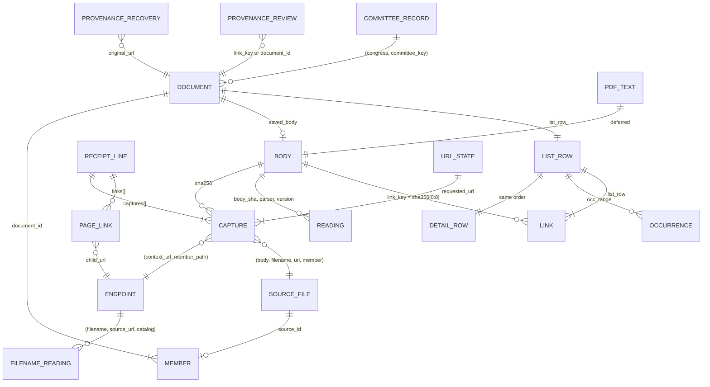

# Engine-first data model

Status: proposed, revision 5, 2026-10-24. The column-level companion to
`docs/engine-first-architecture.md` (cited as "design §n"). It starts from the CS300
reviewer's sketch (`docs/reviews/2026-10-24-design-review/cs300-data-model.md`), applies the
Iceberg/Parquet reviewer's four reviews of it (`iceberg-parquet-data-model-review.md`,
`iceberg-parquet-data-model-final-review.md`, `iceberg-parquet-data-model-types-review.md`,
`iceberg-parquet-metadata-keys-review.md`),
and applies the owner's decisions through
Oct 24. Sizes are measured on the Oct 19 snapshot unless
marked *est.*

Conventions:
- **Lake tables (§2) use Iceberg types,** because iceberg-rust 0.10.1 has no 16-bit
  integer and no dictionary type: `string`, `int`, `long`, `boolean`, `date`,
  `timestamptz` (microseconds), `fixed[n]`, `list` and `struct`. Dictionary encoding is a
  writer setting, on by default; no column needs encoding tuning (measured:
  `captures.sha256` is 48–50 MB with or without a dictionary).
- **Model outputs and release files (§3–4) use Arrow types:** `fsb(n)` is
  `fixed_size_binary(n)`, `dict` is a string written with a dictionary, `ts` is
  `timestamp[us, UTC]`, and `int16` is INT32 annotated as 16-bit.
- A fold is a list of `(field, value)` string structs, one value per element, with the
  field repeated for multi-valued facts. It holds display-only facts; anything the model
  filters, joins or sorts on, or the site acts on, is a native column. Parquet's variant
  type isn't usable in this stack yet (iceberg-rust 0.10.1, DataFusion 53 and docspec's
  parquet build lack it), so folds plus native hot fields stand in for it. The plan parks a revisit with its
  triggers (plan, track G).
- **House-naming metadata stays typed facets plus the fold, now and after any upgrade**
  (owner decision). Measured on 5,000 real filenames: it is flat (164 distinct fields,
  median 2 values per file), every value is a string by design, and the fold costs 16.4
  bytes per file against 15.3 for an unshredded variant stand-in. Variant would add an
  Iceberg v3 upgrade and engine upgrades for query convenience only. If variant ever comes,
  it fits genuinely nested, mixed-type sources such as Congress.gov API JSON and MODS or
  meeting XML trees.
- "PK" is the uniqueness a test asserts.

## 1. Raw log

### 1.1 Body object

| Item | Value |
|---|---|
| Key | `bodies/sha256/<aa>/<sha>` for new writes. Older: `…/<sha>.gz` (every older body, 1.04M) and `…/<sha>.pdf` (the one-time uncompressed copies of older PDFs: 261,055 objects, about 403 GB). |
| Stored bytes | Original bytes, gzip-compressed when the media type compresses (HTML, XML, JSON, text), as-is otherwise. |
| HTTP metadata | `Content-Type` is the original media type; `Content-Encoding: gzip` when compressed; `ETag` is the MD5 of the stored bytes (single PUT only). Older `.gz` objects carry `Content-Type: application/gzip` and no encoding. |
| Custom metadata | None: identity is the key, integrity is the ETag. |
| Write | One create-only PUT (`If-None-Match: *`) with `Content-MD5`. A 412 means it exists. |
| Size | 1,036,256 bodies, 0.70 TB stored; largest 1.19 GB; none above 5 GB. |

### 1.2 Receipt line

One file per run, `receipts/<family>/<write-date>/<run>.jsonl.gz`, one JSON object per fetch
attempt or recovery import. Today's lines are 6–9 KB of plain JSON, mostly provider metadata
and duplicated header lists. The target line keeps the fields below, about 1 KB.

**Every line**

| Field | Type | Meaning |
|---|---|---|
| `run_id` | string | Writer run. Older lines carry it as `source_file`. Defines "the Sept 29 import run" for date labels. |
| `mode` | `fetch` \| `retained_import` | A real fetch, or recovered content imported for another link. |
| `family` | string | Source family (21 today). |
| `requested_url`, `url` | string | Requested and final URL. |
| `retrieved_at` | RFC 3339 | Fetch time. For imports, the recovered copy's own original time, so imports never feed capture-date labels. |
| `http_status` | int or null | Synthetic 200 for imports. |
| `outcome` | `stored` \| `unchanged` \| `failed` \| `retry_later` \| `size_limit` \| `request_failed` | The last two mean incomplete; capture retries them. |
| `complete` | bool | Body fully received. |
| `transport` | string | `direct`, `zyte`, … |
| `response_headers` | object | Allowlisted only: `content-type`, `content-length`, `last-modified`, `etag`, `content-encoding`, `date`, `cache-control`, `accept-ranges`. |
| `redirects` | list of {url, http_status} | — |
| `prior_attempts` | list of {url, retrieved_at, transport, http_status, sha256} | Earlier tries in the same run. |
| `links` | list of {url, basis, tag, text, attributes, source_xpath} | Links found in this body; they feed `page_links` (2.4). |
| `source_context.observations` | list of {url, source, pointer} | Why the URL was requested. |
| `writer` | {job, commit, lockfile_digest} | New. |
| `captures[]` | list | One entry per body the line references (median 1, max 22,354). |

**`captures[]` entry**

| Field | Type | Meaning |
|---|---|---|
| `pointer` | JSON path | Where in the record the body sits, such as `["content","body"]` or `["archive_members", i, …]`. |
| `context_url` | string | The URL this body is evidence for: the container's URL for archive members. |
| `member_path` | string or null | Path inside an archive. Older lines carry it as `original_path`. |
| `sha256` | hex | Identity. |
| `bytes` | int | Original size. |
| `media_type` | string or null | The server's claim; never used to classify. |
| `sniffed_format` | see 2.2 | From the first bytes. New. |
| `stored_md5`, `stored_bytes` | hex, int | Only on the line that stored the body. |
| `fidelity` | `exact-bytes` \| `saved-text` \| `saved-record` \| `retained-file` | How faithful the stored bytes are. |

**Recovery imports only** (`mode = retained_import`)

| Field | Type | Meaning |
|---|---|---|
| `publisher_requested` | bool | Always false. |
| `recovery_evidence.original_url` | string | The link this content recovers. |
| `recovery_evidence.imported_at` | RFC 3339 | — |
| `recovery_evidence.match_basis` | string | Such as `user_accepted_url_variant`. |
| `recovery_evidence.acquisition.{prior_access_category, match, source, recovered_url, section_link, evidence_sha256, observed_capture_timestamp}` | mixed | `prior_access_category` decides the display kind (3.6). |

**Dropped from new lines:** `download_state` and `preserve_download_state` (the old raw
index's row); full provider metadata and header copies; `response_header_items`; per-capture
copies of `retrieved_at`, `http_status` and `family`; local file paths in import lines.

### 1.3 Provenance records

`provenance/<kind>/<ts>.jsonl`, append-only; a correction is a new record that supersedes
an old one by `id`.

| Kind | Fields | Read by |
|---|---|---|
| `recoveries` (from `accepted.json`) | `id`, `original_url`, `recovered_url`, `body_sha256`, `kind`, `match_basis`, `evidence_sha256`, `identity_note`, `decided_by`, `decided_at`, `supersedes` | `recoveries` |
| `url_variants` | `id`, `canonical_url`, `variant_url`, `basis`, `decided_at`, `supersedes` | endpoint canonicalization |
| `reviews` | `id`, `target` (`link_key` or `document_id`), `verdict` (not_a_document, duplicate_of, title_override, kind_override, hide), `value`, `note`, `reviewer`, `decided_at`, `supersedes` | `reviews` |
| `verification` | `key`, `size`, `etag`, `sha256_verified`, `checked_at`, `job` | the weekly check |

## 2. Lake

Iceberg tables in Basin Catalog, append-only (design §5).

**Writer settings.** Every table uses Iceberg format version 2 (every reader is
iceberg-rust 0.10.1), a 128 MB target file size, zstd level 3, chunk statistics and no
Bloom filters. Row groups hold 131,072 rows for `captures` and `page_links`, and 65,536 for
`readings` and `filename_readings`. Nothing depends on sort order, because Basin compaction
may not keep it. The primary keys below can be declared as identifier fields, for
documentation only.

### 2.1 `captures`: one row per capture entry, and one per line without a body

| Column | Type | Notes |
|---|---|---|
| `receipt_key` | string | — |
| `receipt_line` | int | — |
| `capture_index` | int | Position in `captures[]` (up to 22,354 today). A line whose `captures[]` is empty yields one line-only row with index 0 and a null `sha256`: 1,041,863 of 2,596,054 lines. |
| `pointer` | string | Informative. |
| `run_id` | string | — |
| `family`, `mode`, `transport`, `outcome`, `fidelity` | string | — |
| `publisher_requested`, `complete` | boolean | — |
| `requested_url`, `url`, `context_url` | string | — |
| `member_path` | string, nullable | The **endpoint** is `(context_url, member_path)`. |
| `retrieved_at` | timestamptz, nullable | Null for about 1.0M older rows. |
| `http_status` | int, nullable | — |
| `sha256` | fixed[32], nullable | — |
| `bytes` | long | — |
| `media_type` | string | — |
| `sniffed_format` | string, nullable | Null on older rows; their format comes from `readings` parser `sniff`. |
| `stored_md5` | fixed[16], nullable | Creating line only. |
| `stored_bytes` | long, nullable | — |
| `recovery_category`, `original_url`, `match_basis`, `imported_at`, `observed_capture_ts` | string, string, string, timestamptz, timestamptz | Import rows only. |
| `h_content_type`, `h_last_modified`, `h_etag`, `h_content_length` | string, timestamptz, string, long | The header allowlist as columns; `Last-Modified` is parsed to a time, and the raw header stays in the receipt. |
| `writer_job`, `writer_commit` | string | Constant within a run, so nearly free once encoded. |

- **PK:** `(receipt_key, receipt_line, capture_index)`.
- **Line fields on every row:** `requested_url`, `retrieved_at`, `http_status`, `outcome`
  and `mode` come from the line, so every attempt keeps its status. Today's index stores
  bodiless lines with a null status; the backfill from receipts restores them.
- No `body_key` (derivable) and no `stored_sha256` (replaced by MD5).
- Not partitioned; sorted within a commit by `(url, retrieved_at)`.
- **Work list:** receipt keys not yet ingested, listed from date-shaped prefixes.
- **Size:** 157 MB compact; 315 KB on a normal day.

### 2.2 `readings`: one row per `(body, parser, parser_version)`

| Column | Type | Notes |
|---|---|---|
| `body_sha` | fixed[32] | — |
| `parser` | string | `sniff`, `html`, `xml`, `json`, `fingerprint`; later `pdf_text` (2.6). |
| `parser_version` | string | — |
| `status`, `error_type` | string | — |
| `format` | string | `pdf`, `zip`, `xml`, `html`, `json`, `vtt`, `m3u8`, `docx`, `doc`, `text`, `image`, `warc`, `other`, `empty`. |
| `record_role` | string, nullable | `document`, `source_record` (metadata XML such as MODS, PREMIS, meeting and witness records), `caption`, `playlist`, `api`, `error_response`. Written by the parser, so the model never looks inside `fields`. |
| `xml_root` | string, nullable | The XML root element, the input the parser uses for `record_role`. |
| `title`, `heading` | string, nullable | HTML `<title>` and first heading, for the error-sign check. |
| `text_bytes` | int, nullable | Visible-text size: the "tiny body" signal. |
| `error_signals` | list<string> | Generic error words found. |
| `fingerprint` | fixed[32], nullable | Normalized-text digest; for a ZIP, the digest of its sorted member hashes. |
| `fields` | list<struct<field: string, value: string>> | Everything else. |

- **PK:** `(body_sha, parser, parser_version)`; partitioned by `(parser, parser_version)`;
  sorted by `body_sha`.
- **`sniff`** runs once over every older body: one ranged read of the first bytes,
  decompressing the start of a `.gz`. That is about 1.04M ranged GETs (about $0.37) and a few
  GB, under an hour. New bodies are sniffed by the fetcher.
- **`fingerprint`** scope: bodies at endpoints with two or more distinct complete real files.
  Today that is 148 endpoints, 297 bodies and 1.38 GB. For a PDF candidate it extracts the
  text (owner decision), so re-packaged PDFs such as BILLS-112hr1063ih merge without the
  deferred every-PDF pass.
- **Size:** today's 491,710 rows fold to 16.5 MB.

### 2.3 `filename_readings`: one row per `(filename, source_url, catalog_version)`

| Column | Type | Notes |
|---|---|---|
| `filename` | string | Basename or recovered name (32,574 differ from the URL's last segment). |
| `source_url` | string | Exact URL (the catalog qualifies 71 mirror URLs). |
| `catalog_version` | string | Covers every vocabulary passed in. |
| `valid` | boolean | Strict convention parse succeeded. |
| `document_kind`, `document_family`, `committee_code` | string | Facets; `list` shows the committee's name (3.3), not its code. |
| `congress` | int | — |
| `date_token`, `measure_type`, `measure_number` | string, string, string | — |
| `document_date` | date, nullable | `meeting_date`, else the single date candidate, else null; never a guess among ambiguous candidates (1.4% of files with candidates). |
| `measure_keys` | list<string> | Bills and resolutions as `{congress}-{type}-{number}`, from the measure fields, measure references and `congress`. |
| `bioguide_ids` | list<string> | Member IDs from `bioguide_token` and `sponsor_bioguide_id`. |
| `gpo_package_id` | string, nullable | A GovInfo package ID when the filename stem follows a GPO pattern. |
| `fields` | list<struct<field: string, value: string>> | The rest (about 215 field names), as house-naming's literal strings. |

- **Typed keys are composed once, by the producer** (owner decisions). The model never
  unnests `fields`, so house-naming's output is turned into the date and the official
  record keys here, once per `(filename, source_url, catalog_version)`. The literal strings
  stay unchanged in `fields`, which keeps house-naming's literal-source contract. Measured
  on 50,000 real pairs: `congress` on 34.7% of files, `meeting_date` on 16.0% (all
  `YYYYMMDD`), GPO publication fields on 14.2%, measure fields on 2–4%, member IDs on about
  3%.

- **PK:** `(filename, source_url, catalog_version)`; partitioned by `catalog_version`.
- **Work list:** `(filename, source_url)` pairs in `captures` with no row for the current
  version (1,392,681 pairs today).
- **Size:** *est.* 32 MB per catalog version.

### 2.4 `page_links`: one row per link found in a fetched body

| Column | Type | Notes |
|---|---|---|
| `receipt_key`, `receipt_line`, `link_index` | string, int, int | PK. |
| `parent_url` | string | The page the link sits on. |
| `parent_sha` | fixed[32] | The page body. |
| `retrieved_at` | timestamptz, nullable | When the page was fetched. |
| `child_url` | string | The linked URL. |
| `basis`, `tag` | string | How the link was found. |
| `source_xpath` | string | Where the link sits in the page. The model derives a publisher's format group from it (3.3). |
| `text` | string | The link's label, such as "Witness testimony". |
| `doc_type`, `add_date`, `publish_date` | string, string, string | From the link's attributes where the page gives them, kept as the publisher wrote them. The model parses the dates for `occurrences`; an unparseable date becomes null. |

- Filled from receipts' `links[]` (owner decision: show link context).
- **Work list:** receipt keys not yet in `page_links`, its own list and its own commit;
  Iceberg has no multi-table transaction. A `page_links` that lags `captures` means
  missing link context, not an error. Both tables' high-water marks go in the inputs
  record.
- **Size:** *est.* 3–5M rows, 60–120 MB.

### 2.5 `committee_records`: one row per committee record in a Congress.gov API response

| Column | Type | Notes |
|---|---|---|
| `congress` | int | — |
| `system_code` | string | Congress.gov's committee code, such as `hsag03`. |
| `chamber` | string | — |
| `name` | string | — |
| `parent_system_code` | string, nullable | For subcommittees. |
| `body_sha`, `retrieved_at` | fixed[32], timestamptz | The API response it came from. |

- **Source:** the Congress.gov committee API responses that `acquisition/committees.py`
  fetches. Today it writes them to its own output file; in the target it fetches through
  the raw writer like every other fetch, so committee names derive from raw.
- **PK:** `(body_sha, congress, system_code)`.
- **Producer:** the JSON parser, once per API body. The model takes one record per
  `(congress, system_code)` in a total order, `retrieved_at` desc then `body_sha`, so two
  fetches with the same timestamp can't make runs differ.
- **Work list:** committee API bodies with no rows yet. A few thousand rows.

### 2.6 `pdf_text` (deferred)

`body_sha` fixed[32], `parser_version` string, `page_count` int, `text_fingerprint`
fixed[32], `text` string. PK `(body_sha, parser_version)`. One read of about 403 GB when the owner
schedules full-text extraction. *Est.* 1–5 GB compressed. Keep its text off hash-join build
sides. Fingerprint candidates don't wait for it: the `fingerprint` parser reads their PDF
text already (2.2).

## 3. Model outputs

One SQL plan over `captures c`, `readings r`, `filename_readings f`, `page_links l` and
provenance `p`. The logical body key is the string `bodies/sha256/<aa>/<sha>.gz`.

### 3.0 `url_key`: the normalized URL every link join uses

```
url_key(url) := unwrap(url), then:
                lowercase scheme and host; drop "www.", the default port, the fragment
                and a trailing slash; keep the path's case; drop the strip-list
                parameters; sort the remaining parameters and keep them all

unwrap(url)  := repeat until nothing changes:
                redirect wrappers → their inner URL: Proofpoint urldefense ?u= (with
                its -XX and _ decoding), Constant Contact rs6.net/tn.jsp ?p=,
                exit.asp ?link=;
                archive wrappers → the archived URL: web.archive.org/web/<ts>[modifier]/<url>,
                webharvest.gov/<collection>/<ts>[modifier]/<url>

strip-list   := trackers on any host: utm_*, _gl, gclid, fbclid, mc_cid, mc_eid, _ga;
                page state on known hosts only: congress.gov q, s, r, overview;
                SharePoint formmode, resultindex; twitter.com and x.com s
```

- **Every link join uses it** (owner decision): `page_links.child_url` to member URLs,
  recoveries' original links to source files, and endpoint matching. On the Oct 19 data,
  64,860 of 1,158,426 captured URLs (5.6%) sit in groups that differ only by scheme,
  `www.`, case or a trailing slash, such as both `http://` and `https://docs.house.gov`.
- **Identity keeps the exact URL:** `source_id`, `requested_url` and `url_state` never use
  `url_key`.
- **Only trackers are stripped** (owner decision, from an aggregate of every captured
  query string). 13,930 captured URLs (1.2%) carry a query string, with dozens of keys
  across 22+ hosts. Where two URLs differ by one parameter, that parameter almost always
  changes the body: `download` in 916 of 916 groups (a Senate landing page against the
  `?download=1` PDF), `file_id`, `id`, `docid` and the rest in every case, and only `_gl`
  ever matched. A keep-list would need 40+ keys and would merge different documents for
  any key it missed; a strip-list can at worst miss a match. The tracker list is SQL,
  computed in the model rather than stored, so changing it rewrites nothing in the lake.
- **What the kept parameters are** (owner-reviewed samples): document identifiers on
  about 7,500 URLs (CMS `file_id=<GUID>` servers, GPO `getdoc.cgi?dbname=&docid=`,
  `DocumentID`, `NewsID`, WordPress `?p=`, THOMAS report ranges, `Download.aspx?file=`)
  and representation selectors on about 1,200 (`?download=1`, `format=json`). Both pick
  different files, so they stay.
- **Wrappers are unwrapped** (owner decision): 26 redirect wrappers and 620 archive
  wrappers. Links found on archived pages are Wayback-rewritten, so without unwrapping,
  recovered pages would never match captured files.
- **Page state is stripped on known hosts only** (owner decision): about 290 URLs, such as
  a congress.gov bill page reached from a search (`?q=…&s=3&r=1`).
- **Each list is SQL with a sample test:** the wrapper patterns and the strip-list sit in
  the E1 SQL beside `page_shaped`, and each entry has a real URL that must normalize as
  stated.
- **The rest of the normalization holds up:** 25,287 of 25,355 groups that differ only by
  scheme or `www.` (99.7%) served identical bytes.
- Provenance `url_variants` still adds accepted variants beyond what normalization
  catches.

### 3.1 `real_files` (a CTE)

```
format      := coalesce(c.sniffed_format, r[sniff].format)
record_role := r.record_role, written by the parser from the format and native reading
               columns (xml_root, the JSON shape, the error signals): vtt → caption;
               m3u8 → playlist; API-shaped JSON → api; MODS/PREMIS/meeting/witness XML
               roots → source_record; error-like HTML → error_response; else document.
               The model never unnests `fields`.

real_files  := rows of c where
    mode = 'fetch' and complete and outcome in ('stored', 'unchanged')
    and http_status between 200 and 299
    and sha256 is not null and bytes > 0
    and sha256 not in placeholders                    -- bodies seen at more than 100 URLs
    and record_role = 'document'
    and (format <> 'html' or (page_shaped(url) and not error_signs(r)))
```

Every condition is joined by `and`, so no HTML row skips the fetch, completeness, status or
size checks.

- Any content format counts (owner decision): PDF, ZIP, document XML, web pages, Word,
  web archives, images, text and others. Only the record roles above, error and landing
  pages, empty bodies and placeholders are excluded.
- `page_shaped(url)` is an exact list of regular expressions in the SQL. With only `.pdf`,
  `.zip`, `.doc`, `.docx`, `.xml`, `/download/`, `download=1` and `file_id=`, 16,775 HTML
  bodies are file-shaped; a broader list (adding `/files/`, `/uploadedfiles/`,
  `/media/doc/` and more extensions) gives 44,047. E1 starts from the broader list,
  samples the roughly 27k bodies between the two, and records the final count.
- `error_signs` := `text_bytes < 2048`, a generic error word in `title` or `heading`, or a
  placeholder body.

### 3.2 `filenames`: one row per source file

| Column | Type | Derivation |
|---|---|---|
| `source_id` | fsb(32) | `sha256(logical body key, filename, source_url)`, today's exact inputs |
| `body_sha` | fsb(32), nullable | — |
| `filename` | string | Recovered name if provenance says so, else the URL's last segment, else the member basename |
| `source_url`, `member_path` | string | The endpoint |
| `record_role` | dict | As in 3.1 |
| `is_real_file` | bool | `body_sha` in `real_files` |
| `first_fetched`, `last_fetched` | ts, nullable | Over `mode = fetch` rows only |
| `first_run` | dict | `run_id` of the earliest row |

1,683,430 source files today.

### 3.3 Edges and `documents`

```
same_body    := source files with the same body, where the body is a real file (web pages
                included: the same real page at several addresses is one document)
same_text    := source files at the same endpoint whose real files have equal fingerprints
same_rendition := real files that are one document in different formats:
                (a) the publisher groups them: links on the same parent page whose
                    source_xpath shares the nearest <li> or <document> ancestor
                    (group_key := parent_sha plus that ancestor's xpath, computed in SQL);
                (b) otherwise, same directory and same filename stem with document
                    extensions (pdf, xml, htm, html, doc, docx, txt), excluding generic
                    stems (index, document, download, file, default and similar)
components   := ConnectedComponents(nodes = source files,
                                    edges = same_body ∪ same_text ∪ same_rendition)
listed       := components with at least one real file or at least one recovery
document_id  := sha256(sorted logical body keys of the component's real files),
                or sha256(sorted source_ids) when it has none
saved_file   := the component's real file ordered by format preference (PDF first, then
                the other formats), then first_fetched desc nulls last, then body_sha
alternates   := the component's other real files in other formats: (format, key, size)
first_captured := min(first_fetched) over its real files
last_captured  := max(last_fetched) over its real files
date_kind    := 'captured'   if the saved file has a fetch date from a non-import run
                'import_day' if its only rows come from the Sept 29 import run
                'unknown'    otherwise
```

- **One entry for all formats** (owner decision): 16,156 groups share a folder and a
  filename stem but differ in format, such as a bill's `.pdf` and `.xml`, and today they
  are split across 32,547 documents. Renditions never share bytes or text fingerprints,
  so `same_rendition` is what joins them. The page offers the PDF first and lists the other
  formats as alternates; a link to any rendition opens the same entry.
- Only `listed` components become explorer documents: *est.* about 0.5M. Captions,
  metadata records, playlists, API bodies and links that never yielded a real file stay in
  the lake and feed `url_state`.
- Import day is defined by run, not by date: 102,427 saved files carry only the import
  run's timestamp.

**Meetings, dates and official records** (owner decisions):

```
meeting_ref  := struct<chamber string, event_id int64> per source file, computed in SQL:
                from the source URL (docs.house.gov/meetings/<C>/<SC>/<date>/<eventId>/
                or congress.gov/<congress>/meeting/<chamber>/<eventId>/); else from the
                page that linked it, when that page is a meeting page; else from a House
                meeting XML record's document list, through page_links
meeting_refs := the set of its members' meeting_refs
document_date      := the saved file's filename_readings.document_date
committee_key      := 'hs' || lower(committee_code) for House codes (AG03 → hsag03)
committee_name     := committee_records.name on (congress, committee_key), else the name
                      in the most recent congress that has the code
govinfo_package_id := the package ID in a member's govinfo URL, else the saved file's
                      gpo_package_id
measure_keys, bioguide_ids := the union over its members' filename readings
```

- House event IDs and Congress.gov House meeting IDs are one ID space (4,715 of 6,550
  overlap), the same event ID the committee explorer uses. On the Oct 19 data, 45,761
  documents carry a docs.house.gov meeting URL (6,551 events) and 142,997 a Congress.gov
  one (11,634 meetings); 141,694 carry a govinfo package (36,943 packages). Nothing new is
  stored in the lake: `meeting_ref` is derived, like `url_key`.
- `document_date` stays separate from `first_captured`: one is when the document is
  dated, the other when we first fetched it.
- **Committee names, not codes** (owner decision): `list` facets and `detail` show the
  name; the code stays in the fold. This matches the committee explorer's filters. The
  model reports unmapped codes with counts.

**Columns:** `document_id` fsb(32), `list_row` int32, `filename`, `saved_body` fsb(32)
nullable, `saved_media_type` dict, `saved_key` string (physical key: `<sha>`, `<sha>.gz` or
`<sha>.pdf`), `saved_kind` dict (`original` or `recovery`), `first_captured` and
`last_captured` date32, `date_kind` dict, `document_date` date32, `meeting_refs`
List<Struct<chamber dict, event_id int64>>, `govinfo_package_id` string, `measure_keys` and
`bioguide_ids` List<string>, `n_members` int32, and the facets from the saved file's
filename reading.

### 3.4 `members`

`(document_id, source_id)`, each fsb(32). Every source file of a listed document appears
exactly once.

### 3.5 `url_state`: one row per requested URL

`requested_url` string, `attempts` int32, `last_attempt` ts, `last_status` int16,
`last_outcome` dict, `next_attempt_at` ts, `links_scanned` bool.
- Keyed by `requested_url`, the fetcher's own key.
- Aggregated over distinct `(receipt_key, receipt_line)`, so an attempt counts once however
  many bodies its line references.
- The latest `mode = fetch` attempt wins, in the total order `(retrieved_at nulls first,
  receipt_key, receipt_line)`. Retryable
outcomes (`retry_later`, `size_limit`, `request_failed`) are due now; a 2xx waits the
family's recheck interval. No body hash: the 412 tells capture whether a body is new.
1,158,426 rows, *est.* 10 MB.

### 3.6 `recoveries`: one row per recovery

`document_id`, `original_url`, `kind` dict, `body_sha` fsb(32), `saved_key`,
`recovered_url`, `match_basis`, `evidence_sha256`, `identity_note`, `imported_at`,
`observed_capture_ts`, `decision_id`. Joined from `captures` import rows and provenance
`recoveries` on `(original_url, body_sha256)`.

| `prior_access_category` | Display kind | Oct 15 run |
|---|---|---|
| `recovered_document` | Recovered copy | 5,154 |
| `requested_content_in_official_hearing` | Excerpt from the official hearing record | 341 |
| Any official-substitute category (updated revision, introduced-bill counterpart, recorded votes, official report, complete statement, alternate amendment) | The named official substitute | 92 |

An unmapped category fails the build, so a new kind is never shown unlabeled.

### 3.7 `reviews`

Provenance `reviews` resolved to a `document_id` through `links` or directly; the latest
record per `id` wins.

## 4. Release files

`list` order is `(filename, first_captured nulls last, document_id)`, unique. Shared writer
settings: Parquet 2.0 pages, ZSTD, fixed rows per row group, chunk statistics, footer under
512 KB, no Bloom filters. Sizes are *est.* at about 0.5M listed documents, from measurements
at 1.24M.

| File | Columns | Order | Writer settings | Size |
|---|---|---|---|---|
| `list.parquet` | `filename`, `document_kind`, `document_family`, `committee_name` (dictionary), `congress`, `format`, `document_date` and `first_captured` (date32, dictionary), `date_kind`, `saved_kind`, `meeting_event_ids` (List<int64>, usually empty or one ID; dictionary-encoded, about 1 MB; the hearing filter matches on membership, since 1.7% of documents with a meeting have several, up to 9). No ID. | list order | `filename` with dictionary off and `DELTA_BYTE_ARRAY` encoding (2.54 MB against 3.22 MB with a dictionary, measured on 1.13M sorted filenames); facets keep dictionaries; 65,536-row groups so a phone can decode as it goes; no page index | about 1.5 MB |
| `detail.parquet` | typed core: `document_id` fsb(32), `link_key` fsb(8), `saved_key` string, `occ_start` int32, `occ_len` int32, `recoveries` List<Struct<kind dict, key string, imported_at date32>>, `alternates` List<Struct<format dict, key string, size int64>>, `meeting_refs` List<Struct<chamber dict, event_id int64>>, `govinfo_package_id` string, `measure_keys` and `bioguide_ids` List<string>; plus one fold of the display-only facts, dates written as ISO `YYYY-MM-DD`: `source_url`, `saved_media_type`, `saved_kind`, `first_captured`, `last_captured`, `date_kind`, `member_count`, the saved file's readings (`r.*`) and filename reading (`f.*`) | list order | offset index on every leaf; 64 KB pages, write batches of 1,024 rows | 30–40 MB (74 MB measured at 1.24M for the fold alone); offset index about 100 KB; about 10 concurrent page reads per view |
| `links.parquet` | `link_key` fsb(8), `list_row` int32 | `link_key` | offset index and column index (page-level statistics) on `link_key`, about 25 KB together and read once per session, so hyparquet's `$eq` lookup skips to one page; 16 KB pages; one row group | 5–7 MB |
| `occurrences.parquet` | `list_row` int32, `ordinal` int16, `url`, `member_path`, `filename`, `outcome`, `linked_from` (parent URL), `link_text`, `doc_type` (all string), `first_fetched`, `last_fetched`, `add_date` (all date32), `is_saved` boolean | `(list_row, ordinal)` | offset index on every column; 64 KB pages with a page row limit of 512–1,024 and the write batch no larger | *est.* 15–25 MB with link context |
| `url_state.parquet` | 3.5 | `requested_url` | defaults | 10 MB |
| `manifest.json` | `schema_version`; `files[]` {name, sha256, md5, size, rows, row_range, shard}; `facet_counts`; `release_id` | — | deterministic, content only | 5–20 KB |
| `inputs/<input_digest>.json` | receipt-keys digest, row counts per parser version and catalog version, provenance digest, versions, snapshot IDs, run | — | one per input identity | about 2 KB |

- **`link_key`:** the first 8 bytes of a real file's SHA-256, one key per real file of
  every listed document. A document with no real file (recovery only) uses its
  `document_id`'s prefix. Recovery bodies are never keys.
- **`linked_from`:** for each member source file, its earliest `page_links` row matched on
  `url_key`, by `(retrieved_at, parent_url)`, so "where each copy was seen" names the page
  and the label.
- **No per-view byte budget** (owner decision): the canary enforces the heap budget only;
  page sizes and row limits are layout settings, not gates.
- A day with changes uploads about 70 MB.

## 5. Relationships and invariants



**Keys between layers:**
- raw → lake: `(receipt_key, receipt_line, capture_index)` and `(receipt_key, receipt_line,
  link_index)`;
- body ↔ everything: `sha256`, binary;
- lake → model: `sha256` for readings, `(filename, source_url)` for filename readings,
  `(context_url, member_path)` for endpoints;
- model → release: `list_row`;
- public → release: `link_key`;
- release → raw: `saved_key` and occurrence URLs.

**Invariants a test asserts**

Raw and lake:
1. Every lake PK is unique. `captures` and `page_links` rebuilt from all receipts equal the
   appended tables.
2. Every `sha256` in `captures` has a body object, and every body's size and ETag equal its
   creating line's `stored_bytes` and `stored_md5`.
3. New receipt keys are date-shaped; every `stored` line carries `stored_md5`; every new
   row carries `sniffed_format`, `writer_job` and `writer_commit`.
4. A parser version is complete when its work list is empty; the model reads only complete
   versions.
5. Every real file has a `format` and a `record_role`; every HTML real file has `title`,
   `heading` and `text_bytes` for the current HTML parser version.

Model:
6. Every source file of a listed document is in exactly one document; every listed
   document has at least one member, and at least one real file or recovery.
7. Every real body belongs to exactly one document, web pages included.
8. No document's body set contains a non-2xx body, an incomplete body, a recovery import, a
   placeholder, an empty body, or a body whose `record_role` isn't `document`.
9. `document_id` and `source_id` recompute from today's formulas (golden vectors).
10. `saved_body` is in the body set; it is a PDF whenever the document has a PDF real
    file, and otherwise its newest real file. `first_captured` ≤
    `last_captured`. `date_kind = 'import_day'` only when every row of the saved body comes
    from the import run; recovery imports never set a date.
11. `url_state` has one row per URL and no import rows.
12. Every recovery resolves to a listed document or is reported as orphaned; every recovery
    has a display kind; no recovery body is a saved file or a link key.

Release:
13. `rows(list) = rows(detail)`; every `list_row` in `links` and `occurrences` is below
    `rows(list)`; every meeting in a `detail` row's `meeting_refs` appears in that `list`
    row's `meeting_event_ids`.
14. `list` is sorted by `(filename, first_captured nulls last, document_id)` and unique.
15. The `occ_range`s partition `occurrences` exactly.
16. Every `link_key` resolves to one row, and keys are unique (the export refuses
    collisions).
17. Manifest digests equal the uploaded objects'; `release_id = sha256(file list,
    schema_version)`; facet counts equal counts over `list`; an inputs record exists;
    `url_state` decodes.
18. A 404 on a release file makes the reader re-read the pointer.
