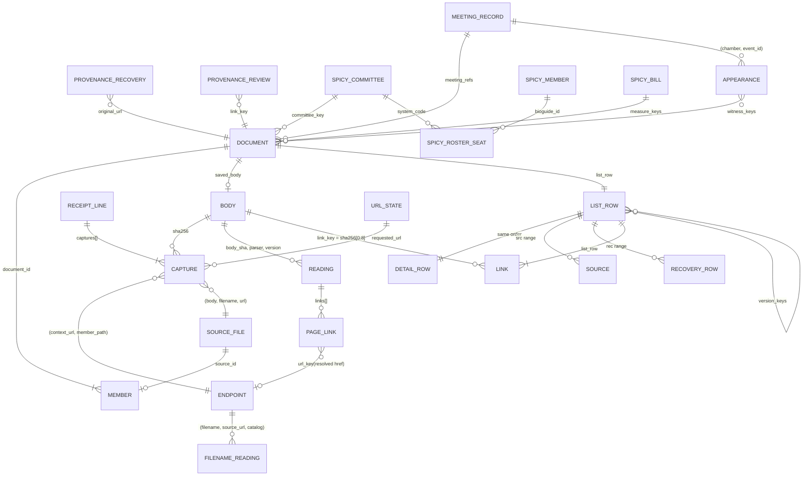

# Congressional Document Archive: Data Model

**Editor's Draft, 2026-10-24**

## Abstract

- **Single home** of every schema, derivation, order, registry, key between layers and invariant of the [[ARCHITECTURE]] system.
- **Goals:** lake rows rebuild from raw; expensive work runs once per item and version; rebuilds are byte-identical (invariant 4).
- **Every reader must know:**
  - lake tables (§6) hold one row per expensive per-item computation;
  - the model (§7) is one engine job at the versions one model profile pins;
  - every receipt line today is an older line, read through a versioned per-shape mapping (§6.1);
  - a document is a connected component of source files, listed when it has a real file or a recovery (§7.5);
  - a public link carries a `link_key`: the first 8 bytes of a real body's SHA-256, or of `sha256('url:' || original_url)` for a recovery's original link (§8.2);
  - release files carry only what a reader acts on, to find, open, trust and connect documents (§8); forensic detail stays in the lake.
- **Elsewhere:** behavior, [[ARCHITECTURE]]; order of work and measurements, [[IMPLEMENTATION-PLAN]].

## Status of This Document

Sizes are measured on the 2026-10-19 snapshot and its receipts unless marked *est.*

## Table of Contents

1. [Introduction](#1-introduction)
2. [Conformance](#2-conformance)
3. [Terminology](#3-terminology)
4. [Type Conventions](#4-type-conventions)
5. [Raw Records](#5-raw-records)
6. [Lake Tables](#6-lake-tables)
7. [Model Derivations](#7-model-derivations)
8. [Release Files](#8-release-files)
9. [Keys Between Layers](#9-keys-between-layers)
10. [Invariants](#10-invariants)
11. [References](#11-references)

## 1. Introduction

*This section is non-normative.*

Layers: §5 → §6 → §7 → §8, keyed by §9.

## 2. Conformance

Sections marked "This section is non-normative", and all examples and diagrams, are non-normative; everything else is normative.

The key words MAY, MUST, MUST NOT and SHOULD in this document are to be interpreted as described in BCP 14 [[RFC2119]] [[RFC8174]] when, and only when, they appear in all capitals, as shown here.

The conformance classes are those of [[ARCHITECTURE]] §2. Each conforms by producing or reading what this document assigns it and satisfying the invariants of §10 that apply to it.

## 3. Terminology

Terms are defined in [[ARCHITECTURE]] §3; this section adds the primitives its rules use.

**PK**
: The uniqueness a test asserts.

**logical body key**, **physical key**
: The string `bodies/sha256/<aa>/<sha>.gz` for a body, whatever its physical key: the body's input to the ID formulas. The physical key is its object key, `bodies/sha256/<aa>/<sha>` plus a suffix of `''`, `.gz` or `.pdf`.

**older line**, **creating line**
: A receipt line written before this specification, whose shapes the ingest mapping reads (§6.1); and the line that stored a body, with its `stored_md5` and `stored_bytes`.

**attempt**
: One HTTP exchange within a fetch line: the final response, or one of the line's `prior_attempts`. Each capture entry names its attempt.

**source URL**
: A top-level capture row's final `url`; for a recovery's bodiless source file (§7.8), its original link. An archive member has none; its container is its `context_url`.

**recovery row**, **recovery body**
: A capture row of a `retained_import` line; and a body some recovery row holds. A recovery body is also a real body only when a real fetch saved it (§7.3).

**fingerprint candidate**
: A body at an endpoint that holds two or more distinct real bodies (§7.3).

**main content**
: A page's visible text without navigation, headers, footers and sidebars, as the pinned content extractor returns it.

**meeting page**
: A page whose source URL matches one of the meeting URL patterns of §7.5, or a House meeting XML record.

**catalog version**
: The filename parser's version (§6.3). Basin Catalog is always named in full.

**compact JSON**
: JSON encoded as UTF-8 with no whitespace, `,` and `:` as separators, `null` for a missing value and no NaN. Only `"`, `\` and U+0000–U+001F are escaped: as `\"`, `\\`, `\b`, `\f`, `\n`, `\r`, `\t` where those exist, and `\u00xx` in lowercase hex otherwise. `/` and non-ASCII characters are written as themselves. This is the output of Python's `json.dumps(value, ensure_ascii=False, separators=(",", ":"), allow_nan=False)`.

## 4. Type Conventions

**Lake tables** use Iceberg types: `string`, `int`, `long`, `boolean`, `date`, `timestamptz` (microseconds), `fixed[n]`, `list` and `struct`.

**Model relations and release files** use Arrow types: `fsb(n)` is `fixed_size_binary(n)`; `dict` is a string written with a dictionary; `ts` is `timestamp[us, UTC]`; `int16` is INT32 annotated as 16-bit; `date32` is a day-precision date.

**Folds.** A fold MUST hold only display-only facts; anything the model filters, joins or sorts on, or the site acts on, MUST be a native column.
- A fold is `list<struct<field, value: string>>`, one value per element, the field repeated for a multi-valued fact; `field` is a `string` in lake tables and a `dict` in release files.
- Filename metadata is flat (164 distinct fields on 5,000 real filenames, median 2 values each) and every value is a string, so it stays typed facets plus a fold. Parquet's variant type is not used.

**Hashes** are binary (`fixed[32]`, `fixed[16]`, `fsb(32)`, `fsb(8)`) everywhere; `list.parquet` carries no ID.

## 5. Raw Records

### 5.1 Body Object

| Item | Value |
|---|---|
| Key | `bodies/sha256/<aa>/<sha>` for new writes. Older: `…/<sha>.gz` (every body written before this specification, 1.04M), and `…/<sha>.pdf`, the uncompressed copies of older gzip PDFs (about 260,175 objects, about 403 GB). |
| Stored bytes | The original bytes, gzip-compressed when the media type compresses (HTML, XML, JSON, text), as-is otherwise. |
| HTTP metadata | `Content-Type` is the original media type; `Content-Encoding: gzip` when compressed; `ETag` is the MD5 of the stored bytes, except on 61 older `.gz` bodies over 200 MiB uploaded multipart on 2026-10-01 (`<md5>-<parts>`). Older `.gz` objects carry `Content-Type: application/gzip` and no encoding. |
| Custom metadata | None: identity is the key, integrity is the ETag. |
| Recorded where | A capture entry's `stored_suffix` (§5.2); a `.pdf` copy's verification record (§5.3). No older line records an MD5. |
| Size | 1,036,256 bodies, 0.70 TB stored; largest 1.19 GB; none above 5 GB. |

### 5.2 Receipt Line

One JSON object of about 1 KB per fetch line or recovery import; a run writes numbered files, `receipts/<family>/<write-date>/<run>-<seq>.jsonl.gz`.

**Every line**

| Field | Type | Meaning |
|---|---|---|
| `run_id` | string | Writer run, never reused. Older lines: `source_file`. |
| `mode` | `fetch` \| `retained_import` | A real fetch, or recovered content imported for another link. |
| `family` | string | Source family, from the source-family registry. |
| `requested_url`, `url` | string | Requested and final URL. |
| `retrieved_at` | RFC 3339 | Fetch time. Archive members take their line's time; a recovery import takes the recovered copy's original time. |
| `http_status` | int or null | The final response's status from the publisher; a synthetic 200 for imports. |
| `provider_status` | int or null | A fetching provider's own status. |
| `outcome` | `stored` \| `unchanged` \| `failed` \| `retry_later` \| `size_limit` \| `request_failed` | `retry_later` is a 429 or 503, or any response carrying `Retry-After`. The last two are incomplete. |
| `transport` | string | `direct`, `zyte`, … |
| `response_headers` | object | Allowlisted only: `content-type`, `content-length`, `content-disposition`, `last-modified`, `etag`, `content-encoding`, `retry-after`, `date`, `cache-control`, `accept-ranges`. |
| `redirects` | list of {url, http_status} | — |
| `prior_attempts` | list of {url, retrieved_at, transport, http_status, sha256} | Earlier attempts in the same line. |
| `source_context.observations` | list of {url, source, pointer} | Why the URL was requested. |
| `writer` | {job, commit, lockfile_digest} | Writer identity. |
| `captures[]` | list | One entry per body the line references (median 1, max 5,806). |

**`captures[]` entry**

| Field | Type | Meaning |
|---|---|---|
| `pointer` | JSON path | Where the body sits in the record, such as `["archive_members", i, …]`. |
| `attempt` | int | 0 for the final response, *i* for `prior_attempts[i-1]`; a member takes its archive's. |
| `complete` | bool | True when the attempt's transfer ended without error and its content decoding succeeded (below). A body cut off at a size limit is false. |
| `context_url` | string | The final `url`, or the container's `url` for an archive member: the URL the body is evidence for. |
| `member_path` | string or null | Path inside an archive. Older lines: `original_path`, on an archive member's entry only. |
| `entry_index` | int or null | Position inside the archive: evidence, not identity. Older lines hold it in `record.archive_members[i]`. |
| `expansion` | string or null | On an archive's own entry: `expanded`, or the reason expansion was refused (an archive-limit registry limit, an encrypted or unsupported member). |
| `sha256` | hex | Identity: the entity after its transfer `Content-Encoding` is removed. |
| `bytes` | int | Original size. |
| `media_type` | string or null | The server's claim. MUST NOT be used to classify. |
| `sniffed_format`, `sniff_version` | string | The format sniffed from the first bytes (values in §6.2) and the sniff code's version, which also versions `intact`. |
| `intact` | bool or null | For a PDF: true when `%%EOF` appears in its last 8 KB, else when the pinned PDF reader opens it within the reader's size limit; false otherwise. Null for other formats and for a PDF over that limit. |
| `stored_suffix` | `''` \| `.gz` | The physical key's suffix ([[ARCHITECTURE]] §7.1). |
| `stored_md5`, `stored_bytes` | hex, int | Only on the creating line. |
| `fidelity` | `exact-bytes` \| `saved-text` \| `saved-record` \| `retained-file` | How faithful the stored bytes are. |

Ended without error means read to its declared end, its final chunk or a clean end of stream, or by ranges each requested with `If-Range` on the first response's strong validator and together covering the declared total.

**Recovery imports only** (`mode = retained_import`)

| Field | Type | Meaning |
|---|---|---|
| `publisher_requested` | bool | False (123 older import lines say true; rules read `mode`). |
| `recovery_evidence.original_url` | string | The link this content recovers. |
| `recovery_evidence.imported_at` | RFC 3339 | — |
| `recovery_evidence.match_basis` | string | Such as `user_accepted_url_variant`. |
| `recovery_evidence.acquisition.{prior_access_category, match, source, recovered_url, section_link, evidence_sha256, observed_capture_timestamp}` | mixed | `prior_access_category` decides the display kind (§7.8). |
| `recovery_evidence.acquisition.body_path` | string | The retained file's name; on older lines a local path, cut to its last segment. |

New lines MUST NOT carry:
- credential parameters (as the credential-parameter registry lists them) in any recorded URL (`requested_url`, `url`, `redirects[]`, `prior_attempts[]`);
- cookies, authorization or local file paths;
- `links` (derivable from the body), `download_state`, `preserve_download_state`, full provider metadata, header copies or `response_header_items`;
- per-capture copies of `retrieved_at`, `http_status` and `family`.

Older lines keep their `links`; the model does not read them.

**The one-time cleanup** of older receipts, before `receipts/` was locked:
- removed the `Set-Cookie`, `Cookie` and `Authorization` values in recorded response headers and the credential parameters in recorded URLs;
- cut absolute local paths to their last segment in the values and key names a read-only scan of every receipt listed, never in a key a `pointer` passes through;
- left every other value and key byte-identical: a recorded URL changed only by losing a credential parameter;
- gave each cleaned receipt a verification record naming the fields it cut (§5.3); the private backup keeps every original.

### 5.3 Provenance Records

`provenance/<kind>/<ts>.jsonl`, append-only. A correction MUST be a new record that supersedes an old one by `id`.

| Kind | Fields | Read by |
|---|---|---|
| `recoveries` | `id`, `original_url`, `recovered_url`, `recovered_filename`, `body_sha256`, `kind` (a display kind, or `rejected`), `match_basis`, `evidence_sha256`, `identity_note`, `decided_by`, `decided_at`, `supersedes` | `recoveries` (§7.8); the effective filename and its work list (§6.3, §7.4) |
| `url_variants` | `id`, `canonical_url`, `variant_url`, `basis`, `decided_at`, `supersedes` | `url_key` (§7.2) |
| `reviews` | `id`, `target` (a link key), `verdict` (`hide`, `duplicate_of`, `title_override`, `kind_override`, `withdraw`), `value`, `note`, `reviewer`, `decided_at`, `supersedes` | `reviews` (§7.9) |
| `verification` | `key`, `size`, `etag`, `sha256_verified`, `checked_at`, `job`; more for a cleaned receipt | The maintenance job; `suffix` for `.pdf` copies (§7.5) |

- A cleaned receipt's record adds `original_size`, `original_etag`, the backup object compared, the fields cut, and the counts of cookies, credential parameters and paths removed.
- Written by the re-hash jobs, the PDF-copy job (for each `.gz` source and `.pdf` copy) and the receipt cleanup.

## 6. Lake Tables

Iceberg tables in Basin Catalog, append-only ([[ARCHITECTURE]] §8).

**Table properties.** Format version 2; `write.parquet.compression-codec` zstd and `write.parquet.compression-level` 3; `gc.enabled` and `write.metadata.delete-after-commit.enabled` true, so Basin's expiration ([[ARCHITECTURE]] §8.6) deletes unreferenced files and old metadata.

**Writer settings.** Row groups of 131,072 rows for `captures` and 65,536 for the other tables; chunk statistics; no Bloom filters. The PKs MAY be declared as identifier fields.

**Schema changes rebuild.** A lake table never changes schema in place.
- A new schema is a new table version, named by a short label the profile maps to its digest, built from raw and provenance while the old version stays pinned.
- The old version is dropped once neither the live nor the last-good release's profile names it.
- Lake rows are derived, so nothing older needs to stay readable; only raw does (§5).

**Completion rows.** For a response that yields no records, the producer of `meeting_records` MUST write, in the same commit as its outputs, one completion row:
- `is_completion = true`, with its `body_sha` and `parser_version` set;
- its other PK columns at their type's zero value (`''` or `0`) and every other column null, so every non-PK column of that table is nullable.

`readings` and `filename_readings` need none: they write one row per input with a status. `appearance_records` needs none: it is written in the same commit as its response's `meeting_records` rows.

**Versions.** `readings` and `filename_readings` keep every parser version produced; the model reads only pinned ones (§7.1).

### 6.1 `captures`

One row per body a line references (each `captures[]` entry or, on an older line whose `captures[]` is empty, each `file_references[]` entry), plus one row per line that references none. A receipt field is kept only when a rule, an invariant or a job reads it; the ingest mapping, versioned with the table (§6), maps every receipt shape to these columns, and a new version adds any field a rule comes to need.

| Column | Type | Notes |
|---|---|---|
| `receipt_key` | string | — |
| `receipt_line` | int | — |
| `capture_index` | int | Position in the list the row comes from; 0, with a null `sha256`, on the row of a line without a body (1,041,863 of 2,596,054 lines). |
| `run_id`, `family`, `mode`, `outcome` | string | — |
| `requested_url`, `url` | string | — |
| `http_status` | int, nullable | The line's final response status. |
| `attempt_status` | int, nullable | The row's attempt's status; equal to `http_status` for the final response and on a bodiless row. |
| `complete` | boolean, nullable | The row's attempt's (§5.2). |
| `context_url` | string, nullable | — |
| `member_path` | string, nullable | The endpoint is `(context_url, member_path)`. |
| `expansion` | string, nullable | §5.2. |
| `h_content_disposition` | string, nullable | The download-name header (§7.4). |
| `retry_after` | timestamptz, nullable | The `Retry-After` deadline, resolved against `retrieved_at`. |
| `retained_name` | string, nullable | An older recovery line's `recovery_evidence.acquisition.body_path`. |
| `retrieved_at` | timestamptz, nullable | The line's time. |
| `sha256` | fixed[32], nullable | — |
| `bytes` | long, nullable | — |
| `media_type`, `fidelity` | string, nullable | §5.2; the saved-file order reads `fidelity` (§7.5). |
| `sniffed_format`, `sniff_version`, `intact` | string, string, boolean; nullable | Null on older rows, which take them from the `sniff` reading. |
| `stored_suffix` | string, nullable | §5.2. |
| `stored_md5` | fixed[16], nullable | Creating line only. |
| `stored_bytes` | long, nullable | — |
| `recovery_category`, `original_url`, `recovered_url`, `match_basis`, `evidence_sha256`, `imported_at` | string, string, string, string, fixed[32], timestamptz; nullable | Recovery rows only; `recovery_category` is the receipt's `prior_access_category`. |
| `writer_job`, `writer_commit` | string, nullable | Constant within a run; null on older rows. |

- **PK:** `(receipt_key, receipt_line, capture_index)`.
- The line fields (`requested_url`, `retrieved_at`, `outcome`, `mode`, `http_status`) are on every row; with its own `attempt_status` and `complete`, a cut-off attempt never borrows its line's success.
- **Older lines** (all 2,596,054 today) keep their fields under `record`, in shapes the ingest mapping reads one by one. It:
  - sets `stored_suffix = '.gz'`;
  - maps each shape's outcome and mode into §5.2's values by a table versioned with the mapping:
    - a shape with no outcome derives one from its status and whether it references a body;
    - a value the table does not list fails the ingest;
    - 2.96M of 3.9M rows today carry no outcome; the rest use values such as `saved`, `html`, `captured` and `http_error`; most carry no mode;
  - takes each attempt's own status and completeness where the line records them, and a status from `status_code` where it has no `http_status`;
  - otherwise sets `complete` true unless the body is exactly 64 MiB or the outcome is `size_limit` or `request_failed`. Declared lengths are unused: about 61% of older 2xx HTML responses with full recorded headers declare none, and nearly all others name a `Content-Encoding`, so the length is the compressed transfer's;
  - takes the fetch time from the row's own entry or line: `retrieved_at`, or `captured_at` on Senate caption runs (on End of Term archive fetches both are the archive's capture time), else null;
  - reads headers from `response_headers`, `response_header_items` or `record.headers`, whichever the shape keeps;
  - sets `expansion = 'expanded'` on an archive line whose members were captured;
  - reads `pointer` elements as strings or integers, and a list-valued `record` (99 lines) element by element.
- Not partitioned; sorted within a commit by `(url, retrieved_at)`.
- **Work list:** receipt keys not yet ingested, listed from date-shaped prefixes ([[ARCHITECTURE]] §8.2).
- **Size:** 157 MB compact; 315 KB on a normal day.

### 6.2 `readings`

One row per `(body, parser, parser_version)`; a reading depends only on its body and its parser version.

| Column | Type | Notes |
|---|---|---|
| `body_sha` | fixed[32] | — |
| `parser` | string | `sniff`, `html`, `xml`, `json`, `fingerprint`; later `pdf_text` (§6.6). |
| `parser_version` | string | — |
| `status`, `error_type` | string | `completed`, `error` or `size_limit`, with the error's type. `error` is a deterministic rejection of the input; an operational failure (an object that could not be read) writes no row, so the input stays on the work list. |
| `format` | string | The sniffed format, on every row: `pdf`, `zip`, `xml`, `html`, `json`, `vtt`, `m3u8`, `docx`, `doc`, `text`, `image`, `warc`, `other`, `empty`. |
| `intact` | boolean, nullable | From `sniff`: the check of §5.2. |
| `xml_root` | string, nullable | — |
| `title`, `heading` | string, nullable | HTML `<title>` and first heading. |
| `text_bytes` | int, nullable | Visible-text size of the whole page. |
| `text_head` | string, nullable | The first 2 KB of visible text. |
| `link_count`, `link_text_bytes` | int, nullable | Links in an HTML page and the bytes of their text. |
| `content_date` | date, nullable | The one date read from the content (HTML and XML metadata or a dated heading; PDF text from `pdf_text` when it exists); null unless exactly one qualifies. |
| `named_meetings` | list<struct<chamber string, event_id long>> | Meetings a source record names, such as a GovInfo MODS record's event IDs; empty otherwise. |
| `base_href` | string, nullable | The page's `<base href>`, as written. |
| `links` | list<struct<href string, text string, tag string, basis string, group_path string, doc_type string, add_date string, publish_date string, remove_date string>> | Below; empty when the page has none. |
| `fingerprint` | fixed[32], nullable | Below. |
| `fields` | fold | Everything else. |

- **PK:** `(body_sha, parser, parser_version)`; partitioned by `(parser, parser_version)`.
- `links`: every link in an HTML or XML page, in document order, `href` as written, and every string in a JSON body that parses as an absolute http(s) URL, its key path as `tag`.
  - `group_path` is the indexed path of the nearest grouping ancestor (`li`, `tr`, `meeting-document`, `witness-document`, `document`), or null.
  - An XML document list's link `text` is its entry's description.
  - `doc_type` and the three dates are kept as the publisher wrote them; `remove_date` marks a committee's removal of the document from its hearing page.
- `sniff` reads every body whose capture rows carry no sniff at the pinned version:
  - one ranged read of its first bytes, decompressing the start of a gzip-stored body (a gzip original whose first member is a WARC or ARC record sniffs as `warc`).
  - for a PDF, one ranged read of the last 8 KB of its uncompressed object (the bare body, or an older body's verified `.pdf` copy), and the bounded reader only when that finds no `%%EOF`.
  - an older gzip PDF with no verified copy is read whole from its `.gz` and reported, so a copier miss costs one full read.
  - a new sniff version re-reads about 1.04M bodies and can change the format parsers' work lists, so the profile moves them together.
- `html`, `xml`, `json` read every body of their format once per version and record each body's fingerprint and links (*est.* 4.2M, from an 80-body sample, over 287,765 bodies the server labels HTML or XML, once per page body). No parser reads embedded PDF titles.
- `fingerprint` reads the fingerprint candidates of the formats the page parsers do not read: none on the 2026-10-19 snapshot, where an endpoint's other PDF or ZIP bodies are all cut-off attempts, size-limit bodies or recoveries.
  - Each body's fingerprint comes from exactly one reading.
  - The model reads fingerprints only for the candidates under the pinned profile.
  - A ZIP's fingerprint is the SHA-256 of its members' hex SHA-256s, sorted and newline-joined: from `captures` when `expansion` is `expanded`, else from a streaming walk of the archive.
  - Any other body's fingerprint is the SHA-256 of its text, NFKC-normalized, whitespace runs collapsed to one space, trimmed: an HTML page's main content, PDF text from the pinned extractor, and the visible text of XML and other text.
  - Empty text or a failed extraction gives `status = error` and no fingerprint.
- **Size:** 491,710 rows fold to 16.5 MB, before links and `text_head` (*est.* 100 MB per HTML and XML parser version).

### 6.3 `filename_readings`

One row per `(filename, source_url, catalog_version)`.

| Column | Type | Notes |
|---|---|---|
| `filename` | string | The effective filename (§7.4). |
| `source_url` | string | The exact source URL, because the filename parser matches some rules on it; `''` for a source file without one (331,985 rows). |
| `catalog_version` | string | Covers the filename parser, the vocabularies passed in, the typed-field derivations and the effective-filename rule. |
| `status`, `error_type` | string | Extraction outcome; an unreadable input gets a row with `status = error`, so it is not retried at that catalog version. |
| `valid` | boolean | Strict naming-convention validity. |
| `document_kind`, `document_family`, `committee_code` | list<string> | Every value: 24,202 source files have more than one kind, 3,637 more than one family, 5,229 more than one committee code. |
| `congress` | int, nullable | — |
| `date_token`, `measure_type`, `measure_number` | string, nullable | — |
| `filename_date` | date, nullable | `meeting_date`, else the single date candidate. |
| `measure_keys` | list<string> | `{congress}-{type}-{number}` with the type lowercase, the `bill_id` form spicy-regs uses (`119-hr-6028`), from the measure fields, measure references and `congress`. |
| `bioguide_ids` | list<string> | From `bioguide_token` and `sponsor_bioguide_id`. |
| `gpo_package_id` | string, nullable | When the filename stem follows a GPO pattern. |
| `fields` | fold | The rest (about 215 field names), as the filename parser's literal strings. |

- **The producer composes the typed keys.** The model MUST NOT unnest `fields`.
- **Scalars** (`congress`, `date_token`, `measure_type`, `measure_number`, `filename_date`) are set only when the parser returns exactly one value; otherwise they are null and every value stays in `fields`.
- **PK:** `(filename, source_url, catalog_version)`; partitioned by `catalog_version`. The model joins a source file on `(filename, coalesce(source_url, ''))`.
- **Work list:** the distinct `(effective filename, source URL)` pairs of every capture row and every provenance recovery's original link with no row at the pinned catalog version (§7.4): 1,392,681 pairs today, a 7–18 minute backfill.
- **Size:** *est.* 32 MB per catalog version.

### 6.4 Reference Inputs

Committees, members, their terms, current committee rosters and bills come from spicy-regs, which owns their raw records and provenance. They are not lake tables: each publish pins the current immutable generation of each family (`data.spicygov.ai/generations/<family>/<digest>/<table>.parquet`, named by the family's pointer), and the model reads those files directly.

| spicy-regs table | Columns the model reads | Gives |
|---|---|---|
| `committees` | `system_code`, `chamber`, `name`, `committee_type`, `parent_system_code`, `history` (official names with start and end dates), `website_url`, `is_current` | Every committee and subcommittee of every Congress, named for any date |
| `members` | `bioguide_id`, `name_first`, `name_last`, `lis_id`, `fec_ids`, `opensecrets_id`, `govtrack_id`, `icpsr_id`, `wikidata_id` | Every member since 1789, with identifiers in other datasets |
| `member_terms` | `bioguide_id`, `term_type`, `term_state`, `term_district`, `term_party`, `term_start`, `term_end` | Every term |
| `committee_assignments` | `congress`, `system_code`, `bioguide_id`, `position`, `rank`, `party` | Current-Congress seats from the House Clerk's and the Senate's files |
| `congress_bills` | `bill_id`, `title`, `short_title`, `sponsor_bioguide_id`, `introduced_date`, `latest_action_date`, `latest_action_text`, `stage`, `policy_area`, `subjects` | 422,011 measures from the 6th Congress, keyed `{congress}-{type}-{number}` with the type lowercase |

A change in these columns fails the model at its next publish rather than reading wrong values; the model SQL moves with the generation. Spicy-regs keeps each family's last three generations and every generation a consumer pins; the archive pins those of every release it keeps ([[ARCHITECTURE]] §10.3.7).

### 6.5 `meeting_records`

One row per meeting record.

| Column | Type | Notes |
|---|---|---|
| `body_sha` | fixed[32] | The response. |
| `parser_version` | string | — |
| `chamber` | string | — |
| `event_id` | long | The meeting ID docs.house.gov, Congress.gov and the committee explorer share. |
| `congress` | int | — |
| `session` | int, nullable | The Congress's session. |
| `title` | string | — |
| `meeting_date` | date | — |
| `meeting_type` | string | Hearing, markup, meeting, … |
| `status` | string, nullable | As the source states it: scheduled, postponed, cancelled, rescheduled, … |
| `sittings` | list<struct<start timestamptz, end timestamptz, room string, building string, address string>> | Each sitting with its place; most meetings have one. |
| `committees` | list<struct<system_code string, role string>> | Congress.gov system codes; `role` is host, joint or the source's own word. |
| `subject_keys` | list<string> | What the meeting covers: bills as `measure_keys` writes them, nominations `{congress}-pn-{number}[-{part}]`, treaties `{congress}-treaty-{number}`. |
| `videos` | list<struct<name string, url string>> | Recording links the source gives; the recordings are not captured. |
| `is_completion` | boolean | §6. |

- **Sources:** the Congress.gov meeting JSON and its XML fallback, for both chambers, and the House meeting XML. Senate committee pages carry no meeting ID, so they supply documents, not meeting records.
- **PK:** `(body_sha, parser_version, chamber, event_id)`. Produced by the JSON and XML parsers; tens of thousands of rows.
- **Current record:** per `(chamber, event_id)`, a House meeting XML record before a Congress.gov one, because it carries panels and witness documents; then the response whose latest good fetch in `captures` (§7.3) is newest, ordered by `(that fetch's retrieved_at desc nulls last, body_sha)`; a response fetched again counts again.

### 6.6 `pdf_text` (deferred)

`body_sha` fixed[32], `parser_version` string, `page_count` int, `text_fingerprint` fixed[32], `text` string; PK `(body_sha, parser_version)`. One read of about 403 GB when scheduled; *est.* 1–5 GB compressed. Its text MUST stay off hash-join build sides.

### 6.7 `appearance_records`

One row per witness appearance on one occasion: a meeting, or a printed hearing whose GovInfo MODS record names no meeting. Written by the meeting parsers in the same commit as `meeting_records`, and by the MODS parser for printed hearings. An appearance is keyed, not matched, so a later witness table keys on `witness_key`.

| Column | Type | Notes |
|---|---|---|
| `body_sha` | fixed[32] | The response. |
| `parser_version` | string | — |
| `chamber` | string | — |
| `event_id` | long, nullable | The meeting, when the source names one. |
| `package_id` | string, nullable | The GovInfo package, for a MODS row. |
| `witness_key` | fixed[8] | First 8 bytes of the SHA-256 of the compact JSON `["witness", occasion, name_key]`, where `occasion` is `chamber:event_id`, else the package ID; `name_key` is the recorded name, NFKC, casefolded, punctuation dropped, whitespace collapsed. It survives re-parsing and reordering; two spellings give two keys. |
| `name` | string | As recorded. |
| `honorific`, `given`, `middle`, `family`, `suffix` | string, nullable | When the source splits the name (House XML). |
| `position`, `organization`, `on_behalf_of`, `location` | string, nullable | As recorded. |
| `panel` | string, nullable | The panel's label. |
| `panel_order`, `display_order` | int, nullable | Source order. |
| `witness_type` | string, nullable | As recorded. |
| `testified` | boolean, nullable | Whether the source marks the witness as having testified. |
| `bioguide_id` | string, nullable | Given by the source for a member witness; never inferred. |
| `document_group_paths` | list<string> | The `group_path`s of the document groups the source assigns to this witness (House XML); the model joins them to the page's links (§7.11). |

- **PK:** `(body_sha, parser_version, witness_key)`; rows of one response sharing a `name_key` collapse to the first in source order.
- **Sources:** House meeting XML (split names, panels, witness documents, member bioguide IDs), the Congress.gov meeting JSON (name, position, organization; it lists no Senate witnesses), and GovInfo MODS records already in raw, which list a printed hearing's witnesses for both chambers, at granule level too.

## 7. Model Derivations

The model is one engine job of named steps ([[ARCHITECTURE]] §9.1) over `captures c`, `readings r`, `filename_readings f`, `meeting_records`, `appearance_records`, provenance `p`, the registries and the pinned spicy-regs reference inputs (§6.4), at the versions the model profile pins, with completion rows excluded. Its relations exist only inside the job; only the release files (§8) are written.

### 7.1 Model Profile and Registries

The **model profile** is the set of versions one publish reads. Publish MUST refuse when a pinned version's work list is not empty at the pinned snapshot.

- It pins: the model SQL (the SHA-256 of its files), the engine revision, each lake table version (§6), each parser, the catalog, each registry the model or a producer reads, and the release writer settings (§8.1).
- A parser or catalog version is the SHA-256 of its source files, the vocabularies it reads and its locked dependencies.
- A new version is backfilled while the profile still pins the old one; the profile moves only when the new version's work list is empty. The daily run produces every pinned version for new inputs.

A **registry** is a versioned list a rule depends on.
- One file beside the model SQL, its version the SHA-256 of its bytes, each entry with a real sample a test checks.
- Registries are never stored in the lake, so a change rewrites nothing there.
- *Versioned by* says which version a registry follows: the profile, the raw writer's code, or both, when the raw writer and the model both read it.
- A profile registry is applied in the model unless its row names a producer or the fetchers.

| Registry | Holds | Used by | Versioned by |
|---|---|---|---|
| file shapes | Regular expressions over the locator that mark a link as pointing at a file | `real_files` (§7.3) | profile |
| error words | Generic error words for a title or heading, such as "not found", and body markers of challenge and soft-error pages | record roles (§7.3) | profile |
| error URLs | URL patterns that only ever serve error or placeholder pages | record roles | profile |
| wrapper markers | Text markers of download-wrapper pages, such as "download will begin shortly" | record roles | profile |
| page thresholds | The near-empty text size, and the minimum link count and link-text share of a listing page | record roles | profile |
| source-record roots | XML roots of metadata records, such as METS, MODS and PREMIS | record roles | profile |
| API endpoints | URL patterns of API JSON, such as api.congress.gov | record roles | profile |
| feed roots | XML roots and URL patterns of feeds and sitemaps | record roles; `listed_on` (§7.10) | profile |
| URL wrappers | Redirect and archive wrapper patterns | `url_key` (§7.2) | profile |
| strip-list | Tracker parameters on any host, such as `utm_*`; page-state parameters on named hosts, such as congress.gov `q` | `url_key` | profile |
| URL repairs | Repairs of malformed links, such as `ttps://` and concatenated URLs | link targets (§7.2) | profile |
| generic stems | Filename stems never grouped, such as `index` and `download` | renditions (§7.5) | profile |
| format preference | The document formats, in order, PDF first | saved file, alternates and renditions (§7.5) | profile |
| filename parameters | Query parameters that name a file, in priority order | the effective filename (§7.4), in the filename producer and the model | profile |
| publisher kinds | Publisher link labels and XML document-type codes → document kind | `document_kind` (§7.5) | profile |
| display facts | Filename-reading fields a document page shows, by name | `detail`'s `facts` (§8.1) | profile |
| committee codes | Filename committee code → Congress.gov system code: `hs`, `ss` and `js` prefixes, `hl` for Intelligence and the select committees, and the joint, commission and two-letter forms | `committee_key` (§7.5) | profile |
| import runs | `run_id` and date of each bulk import run | dates (§7.4) | profile |
| recovery kinds | `prior_access_category` → display kind | `recoveries` (§7.8) | profile |
| recheck intervals | `(family, interval)` for every family, with age bands where pages change with a meeting's age | `url_state` (§7.7) | profile |
| capture scope | URL patterns capture follows from links, as an allowlist, and its exclusions: media, crawler traps such as calendar archives, and forms | `url_state`; the fetchers, from the live release's copy (§8.1) | profile |
| archive limits | Archive, member and total size, and member count | archive expander | raw writer |
| credential parameters | Query parameters that carry credentials, such as `api_key`; never a bare `key`, which YouTube caption URLs carry as a constant | receipt writer; the `url_state` queue | both |
| host pacing | Per-host gaps and backoffs | fetcher | raw writer |
| source families | URL patterns → source family | receipt writer | raw writer |

### 7.2 Link Targets and `url_key`

Every link join (link targets, recoveries' original links, the `url_state` queue) MUST use `url_key`. `source_id`, `requested_url`, `url_state`'s key and link URL keys (§8.2) MUST NOT use `url_key`.

```
url_key(url) := unwrap(url), then:
                drop the scheme, so http and https match; lowercase the host;
                drop "www.", the default port, the fragment and a trailing slash;
                normalize percent-encoding [RFC3986 §6.2.2]: uppercase escape hex,
                decode escapes of unreserved characters, and encode spaces and other
                characters outside the URI character set as %XX, so 'a b.pdf' and
                'a%20b.pdf' match;
                keep the path's case; drop the strip-list parameters;
                sort the remaining parameters and keep them all;
                then, once: if provenance url_variants names the result as a variant,
                replace it with the canonical URL normalized by the steps above

unwrap(url)  := apply the URL-wrapper registry at most twice: a redirect wrapper gives
                its inner URL (such as Proofpoint urldefense ?u=, with its -XX and _
                decoding); an archive wrapper gives the archived URL (such as
                web.archive.org/web/<ts>[modifier]/<url>)

copy_urls(f) := for a top-level source file, the url_keys of its source URL and of the
                requested URL of each good fetch that saved it; none for an archive member
```

- **Link targets.** Links resolve once per distinct `(page body, context)`, where a context is an endpoint the page body was good-fetched at (§7.3):
  - each `href` is first repaired by the URL-repair registry, once; a repair may split a concatenated `href` into several links, kept in `href` order;
  - a relative `base_href` is resolved against the context, then each `href` against that base, else against the context, by reference resolution [[RFC3986]] §5; an archive member's relative links give endpoints in the same container;
  - each resolved link keeps its page body, context and link index, so a page saved at two addresses yields two attributed sets of targets;
  - placeholder bodies' links are not resolved;
  - *est.* 5.5M targets: 4.2M links at 1.3 contexts per page (277,642 contexts over 214,041 good-fetched HTML and XML bodies).
- **Matching.** A link target matches:
  - a top-level source file through its `copy_urls`;
  - an archive member through its endpoint `(url_key(context_url), member_path)`, null-safe (`IS NOT DISTINCT FROM`); a target path that several members of one archive share matches each of them;
  - a target that matches an archive also stands for each of its members, so the link's context and publisher group reach them; 33,980 of the 34,196 good-fetched GovInfo ZIPs (one hearing's HTML and PDF; 112 more HTML only) join this way, and the one-body-per-format rule (§7.5) keeps the rest apart.
- The model reports URLs still wrapped after two passes. A test rejects a `url_variants` record whose canonical URL is itself a variant, so variants cannot chain.

### 7.3 Record Roles and Real Files

Each capture row takes one record role; a real file is a good fetch whose role is `document` (`real_files` below).

```
good_fetch  := rows of c where mode = 'fetch' and complete
               and outcome in ('stored', 'unchanged') and attempt_status between 200 and 299
               (import-run rows included; capture dates exclude them, §7.4)
format      := r[sniff].format at the pinned sniff version,
               else c.sniffed_format when c.sniff_version is that version
intact      := r[sniff].intact at the pinned sniff version,
               else c.intact when c.sniff_version is that version
reading     := the body's html, xml or json reading at the pinned version
record_role := per capture row, the first that applies:
               null              when format is null (no completed sniff)
               'caption'         when format = 'vtt'
               'playlist'        when format = 'm3u8'
               'envelope'        when format = 'warc'
               'damaged'         when format = 'pdf' and intact is not true
               'api'             when api_row
               null              when format in ('html', 'xml', 'json')
                                 and the reading is missing or not completed
               'source_record'   when format = 'xml'
                                 and reading.xml_root is in the source-record registry
               'error_response'  when format = 'html' and error_signs(reading, c.url)
               'wrapper'         when format = 'html'
                                 and a wrapper-marker entry appears in reading.text_head
               'listing'         when format = 'html' and listing_signs(reading),
                                 or format = 'xml' and (reading.xml_root or c.url)
                                 matches the feed-root registry
               'document'        otherwise
api_row     := format = 'json' and c.url matches the API-endpoint registry
error_signs(x, u) := an error-word entry in x.title or x.heading,
                     or a body-marker entry of that registry in x.text_head,
                     or u matches the error-URL registry,
                     or x.text_bytes is below the near-empty size
listing_signs(x)  := x.link_count >= the minimum link count
                     and x.link_text_bytes >= the link-text share × x.text_bytes
placeholders := bodies whose capture rows, in any mode, span more than
                k = 100 distinct context_url values

real_files  := rows of good_fetch where
    sha256 is not null and bytes > 0
    and sha256 not in placeholders
    and record_role = 'document'
    and (format <> 'html' or not file_shaped(locator))

locator     := the member path for an archive member (34,331 HTML members sit at
               good-fetched ZIP URLs), else the URL
real_body   := a body with at least one real_files row
```

- Bodies that are not real files stay in the lake as evidence; listing, wrapper and error pages and metadata records still supply links. A damaged PDF is fetched again on its recheck schedule.
- `file_shaped(locator)` is true when a file-shape registry entry matches; the labeled sample fixes the list ([[IMPLEMENTATION-PLAN]] E1).
- The model reports, per release, the bodies with no role by format and error type, the damaged PDFs (those over the reader's limit apart), and the bodies that newly crossed the placeholder threshold.
- Role sample, 3,021 pages; under 2 KB of visible text: 67% download wrappers, 11% hearing pages, 11% cover-only GovInfo pages, 9% soft errors, about 2% real documents, so length alone is no sign of an error.
- *k* = 100 selects 18 placeholder bodies (22 at 50, 12 at 200); the widest is a 57-byte caption file at 87,161 URLs.

### 7.4 `filenames`

One row per source file: 1,683,430 today.

| Column | Type | Derivation |
|---|---|---|
| `source_id` | fsb(32) | SHA-256 of the compact JSON array `[logical body key, filename, source_url]`, with `null` for a missing body key or URL |
| `body_sha` | fsb(32), nullable | — |
| `filename` | string | The effective filename (below) |
| `source_url` | string, nullable | §3 |
| `record_role` | dict | Its capture rows' role (§7.3); `document` when any row is a real file |
| `is_real_file` | bool | At least one of its capture rows is in `real_files` |
| `first_fetched`, `last_fetched` | ts, nullable | Over its `mode = fetch` rows outside import runs |
| `in_archive_since` | date32, nullable | The registry date of its earliest import run, when all its fetch rows come from import runs |

- **Derivation:** the distinct `(body, effective filename, source URL)` triples in `captures`; plus one bodiless row per URL that never yielded a body; plus one bodiless row per recovery that needs a document of its own (§7.8), unless present.
- **Effective filename:** the first non-empty name in this order, else `''`, by one SQL definition that the filename producer (§6.3) and the model share:
  1. the `recovered_filename` of the row's recovery decision (§7.8), unless the decision rejects it;
  2. the member basename, for an archive member;
  3. the `h_content_disposition` filename, `filename*` [[RFC6266]] first;
  4. the value of the first filename-parameter registry entry present in the source URL's query, else the requested URL's, at its first occurrence;
  5. the source URL's last path segment;
  6. the requested URL's last path segment;
  7. for an older recovery line, its `retained_name`.
- **Decoding:** URL segments and query values are percent-decoded once as strict UTF-8, `+` kept literal; an invalid sequence stays encoded.
- **One name per capture row.** When fetches of one body at one URL offered different names, each name is its own source file, joined by the same-body edge; the other names a row was offered stay in its receipt, and the document shows the saved file's name.
- **Grain:** two archive members with the same body and name at different paths are one source file; `sources` keeps each path.

### 7.5 Edges and Documents

Source files join into documents through four edges (same body, same text, same rendition, review), and an edition never joins another.

```
ambiguous_bodies := real bodies at an edition-ambiguous endpoint: an endpoint holding two
                    or more distinct real bodies whose fingerprints differ or are missing
edition_bodies   := ambiguous_bodies, plus every fingerprint candidate whose fingerprint
                    equals that of a body in ambiguous_bodies

same_body      := source files that each have a real_files row, sharing a real_body
                  (web pages included); one node per body
same_text      := source files at one endpoint whose real files have equal fingerprints;
                  one node per (endpoint, fingerprint)
same_rendition := real source files that are one document in different formats:
                  (a) the publisher groups them: links resolved in one context of one page
                      body (§7.2) with the same non-null group_path; one node per
                      (page body, context, group_path);
                  (b) for real source files in no publisher group: the same directory and filename
                      stem, compared bytewise, in formats the format-preference registry
                      lists, the stem not in the generic-stem registry; a directory is the
                      source URL's host and path up to its last '/', or for an archive
                      member its container's URL and the member path up to its last '/';
                  bodies in edition_bodies never join a group, and a group draws edges
                  only if its remaining real bodies all differ in format, one body per
                  format (several names of one body count once)
review_edge    := a reviewer's duplicate_of between two body link keys (§7.9)

components     := ConnectedComponents over source files and the nodes above
listed         := components with at least one real file or at least one recovery

saved-file order := (format preference, unlisted formats after listed by name;
                    exact-bytes before other fidelity; first_fetched desc nulls last;
                    body_sha; source_id)
recovery order := (kind: recovered copy, official substitute, hearing-record excerpt;
                  imported_at desc; body_sha; the recovery row's receipt_key,
                  receipt_line, capture_index)
saved_file     := the component's first real source file in the saved-file order
                  (saved_kind = 'original'); for a recovery-only document, its first
                  recovery in the recovery order (saved_kind = 'recovery')
saved_media_type := the media type of saved_file's format (a fixed map), else its
                  capture's media_type
suffix(body)   := '.pdf' when the body is a PDF with a verified .pdf copy (§5.3);
                  else '' when a capture row recorded stored_suffix ''; else '.gz';
                  for the saved file, alternates and recoveries alike
alternates     := for each other format, its first real source file in the saved-file
                  order: (format, body, suffix, size), in format-preference order

first_captured := min(first_fetched) over its real files
in_archive_since := min(in_archive_since) over its real files, when first_captured is null
document_date  := the saved file's filename_date, else its content_date, else the earliest
                  meeting_date among its meetings, else null
document_date_source := 'filename', 'content' or 'meeting'; null when document_date is null
document_id    := SHA-256 of the compact JSON array ["bodies", sorted distinct logical body
                  keys of its real files], or ["sources", sorted distinct source_id hex
                  strings] when it has none
title          := the applying title_override (§7.9), else the saved file's reading title,
                  else its heading; null when none
witness_keys   := the witness_keys whose document groups hold a link to its files (§7.11)
version_keys   := for each edition-ambiguous endpoint holding one of its real bodies, the hex
                  of the first 8 bytes of SHA-256 of the compact JSON [url_key(context_url),
                  member_path]; documents sharing a key are versions served at one address
```

- **Order of evaluation:**
  1. real files and source files (§7.3–7.4);
  2. the edges above and body-key review edges;
  3. components;
  4. recovery attachment (§7.8);
  5. review edges with a link URL key end, which merge the documents they resolve to;
  6. saved files, dates and keys.
- Only `same_rendition` joins renditions; several files of one format listed together, such as a witness's testimony, disclosure form and biography, stay separate documents.
- The model reports the largest components by edge kind.
- Rendition groups today: about 34,100 GovInfo ZIPs (rule a; 112 hold no PDF); about 560 same-stem groups (rule b; 732 on the old catalog's names).
- *Est.* 0.5–0.7M listed documents: 1.24M catalog rows less 454k caption snippets, about 150k metadata records (47,643 source records, 103,200 GovInfo metadata files), 10k playlists, 1k API responses and the listing pages among about 200k HTML rows.
- No capture date (expected): about 0.8% of listed documents with a real file (4,681 of 561,791 distinct non-caption bodies; the snapshot's 2.7M time-less rows are mostly caption segments whose lines carry `captured_at`), and every recovery-only document. 102,427 saved files carry only an import run's date.

**Meetings, committees and official records**

```
publisher_links    := resolved links (§7.2) from good-fetched pages to a source file,
                      each with its page body, context, text, doc_type and dates
file_meetings      := per source file, every meeting (struct<chamber string, event_id int64>)
                      named by: its source URL, matching docs.house.gov/meetings/<C>/<SC>/
                      <date>/<eventId>/ or congress.gov/<congress>/meeting/<chamber>/
                      <eventId>/; a publisher_links page that is a meeting page; or a source
                      record's named_meetings, which a GovInfo MODS record gives to the
                      source files of its package, matched by the package ID in the record's URL and in each
                      source file's source URL (an archive member's container URL).
                      A House meeting ID drops its four-letter prefix (HHRG, HMKP, HMTG)
                      to give the event ID
meeting_refs       := the union of its members' file_meetings
meeting_keys       := 'chamber:event_id' for each entry of meeting_refs
committee_key      := for each committee code, the committee-code registry's system code
                      (AG03 → hsag03, IG00 → hlig00); a code it does not list is unmapped
committee_name     := the name the pinned spicy-regs committees' history gives for the
                      document's date, else its current name
govinfo_package_id := the package ID in a member source file's source URL (an archive
                      member's container URL), else the saved file's
                      gpo_package_id
measure_keys, bioguide_ids := the union over its members' filename readings
document_kind      := the saved file's filename-reading kinds; when those are empty, the
                      publisher-kind registry's kinds for its publisher_links' doc_type,
                      else their text
removed_on         := the earliest remove_date when every House meeting XML page listing
                      any of its source files carries one on each such link at that page's
                      latest good fetch; else null, so a re-added document is not removed;
                      an unparseable date is ignored and reported
```

Every list and fold column MUST be written in a fixed order: structs by their fields, strings bytewise, folds by `(field, value)`, `alternates` in format-preference order. The model reports unmapped committee codes with counts.

**Columns:** the names derived above and, from the saved file, `format`, its filename reading's `congress` and `document_family`, and `facts`, the filename-reading fields the display-facts registry names, as a fold; typed as `detail` and `list` read them (§8.1), plus `document_id` fsb(32), `list_row` int32, `hidden` bool, `review_note` string nullable and `review_decided_at` date32 nullable.

### 7.6 `members`

`members` is `(document_id, source_id)`, each fsb(32): every source file of a listed document appears exactly once.

### 7.7 `url_state`

One row per requested URL, plus the queue: `requested_url` string, `attempts` int32, `last_attempt` ts nullable, `last_status` int16 nullable, `last_outcome` dict nullable, `last_good_at` ts nullable, `next_attempt_at` ts nullable.

- Aggregated over distinct `(receipt_key, receipt_line)`, so a fetch line counts once however many bodies it references.
- The latest `mode = fetch` line wins, in the order `(retrieved_at nulls first, receipt_key, receipt_line)`, and gives `last_status` from its `http_status`; `last_good_at` is the `retrieved_at` of its latest good fetch (§7.3). Recovery rows MUST NOT appear.
- **`next_attempt_at`:**
  - for a retryable outcome (`retry_later`, `size_limit`, `request_failed`), the later of `last_attempt` and the line's `retry_after`, but no later than `last_attempt` plus the family's recheck interval;
  - for any other outcome, `last_attempt` plus that interval;
  - null, and so due now, when `last_attempt` is null (about 25,500 requested URLs today, nearly all from two undated backfill shapes).
- **The queue:** every resolved URL target from a good-fetched page that is not an `error_response` (wrapper pages included), that matches the capture-scope registry, and whose `url_key` matches no `mode = fetch` row's requested or final URL (archive-member targets are not fetchable).
  - Each `url_key` adds one row under its byte-wise least target, with its credential parameters removed (`url_state` is public), `attempts = 0` and a null `next_attempt_at`.
- 1,158,426 rows plus the queue, *est.* 10 MB.

### 7.8 `recoveries`

One row per recovery row: `document_id`, `original_url`, `kind` dict, `body_sha` fsb(32), `suffix` dict, `recovered_url`, `identity_note`, `imported_at`, `decision_id`.

- **PK:** the recovery row's `(receipt_key, receipt_line, capture_index)`.
- **Decision:** the latest remaining provenance `recoveries` record, by `(decided_at, id)`, whose `body_sha256` is the row's body and whose `original_url` equals the row's as an exact string; null when none matches.
  - A decision whose `kind` is `rejected` drops the row's recovery; otherwise a recovery row yields exactly one recovery.
  - The model reports decisions that match no recovery row.
- `recovered_url` comes from the recovery row, and from the decision only where the row has none.
- **Kind:** the recovery-kind registry maps each category to one of three display kinds: recovered copy (`recovered_document`), excerpt from the official hearing record (`requested_content_in_official_hearing`), or, for an official-substitute category, the substitute it names. A row with no category takes its decision's `kind`. An unmapped category, or a row with neither, MUST fail the build.
- **Attachment:** a recovery attaches to the one listed document whose source files' `copy_urls` hold its original link. When none does, or several do because the link came back as different editions, it gets a document of its own, built from a bodiless source file for its original link.
- 3,690 of 11,792 recovery bodies today are also real bodies (§3).

### 7.9 `reviews`

- **Target:** a link key, so a review follows its file through merges and splits.
- **Supersession:** a record whose `supersedes` names an earlier one replaces it; a `withdraw` record supersedes one and applies nothing.
- **`duplicate_of`:** `value` is another link key; every remaining `duplicate_of` is a review edge, applied in the order of §7.5. The model reports a review whose target or value no longer resolves.
- **`hide`, `title_override`, `kind_override`:** applied after grouping; for each verdict, the latest remaining record by `(decided_at, id)` targeting any of a document's link keys applies to the document.
- **`hide`** keeps the document in the release, so its links resolve, but sets `hidden`: it leaves search and facet counts, and its page shows a "removed by review" note with `review_note` and `review_decided_at`.
- **Overrides** replace the displayed title or kind; the original stays in the readings.

### 7.10 Sources

One row per distinct address of a listed document's real files, `(url, member_path)`, where `url` is the source URL, or the container's for an archive member: where the document was published and which page listed it. Per-copy fetch history stays in `captures`.

- `is_saved`: the saved file's address. `first_seen`: the earliest `first_fetched` of the document's real files at that address, outside import runs.
- **`listed_on`:** the earliest link that matches the address (§7.2): the linking page's address, the link's `text` and `doc_type`, and its `add_date` (parsed; null when unparseable).
  - Repeated fetches of one `(page body, context)` reduce to its first good fetch before the join, which therefore grows with links times contexts, not with fetches.
  - Links are ordered by `(that first good fetch's retrieved_at nulls last, context, page body, link index)`.
  - Feed and sitemap pages never give link context.
- `ordinal` follows `(is_saved desc, first_seen nulls last, url, member_path)`.
- *Est.* under 1.7M rows: today's catalog has 1,695,040 (source file, path) pairs, counting each filename separately; its largest document is a 455-copy error page the target does not list, and the next has 27.

### 7.11 Witnesses, Members and Rosters

Witnesses, members, committees and rosters are the entities a reader explores beside documents: a hearing's witnesses and what they submitted, a member's committees and hearings, a committee's roster over time.

```
witnesses      := per occasion, the appearance_records of its highest-precedence source
                  that lists any: House meeting XML, then Congress.gov JSON, then MODS;
                  for a meeting, from its current record (§6.5)
witness_keys   := per document, the witness_key of every appearance whose
                  document_group_paths hold the group_path of a publisher link (§7.5)
                  from that meeting record's response body to one of the document's
                  source files, and of every MODS appearance whose package_id is the
                  document's govinfo_package_id
members        := per bioguide_id, the pinned members row and its member_terms, latest first
rosters        := the pinned committee_assignments: current-Congress seats only, because
                  spicy-regs keeps no roster history yet
committees     := the pinned committees, with their official names over time
bills          := the pinned congress_bills row of every bill_id a listed document's
                  measure_keys or a meeting's subject_keys names
```

- No witness is matched across meetings or sources beyond the current record; the witness table that matches them comes later and keys on `witness_key`.
- The model reports appearances whose `name_key` differs only by a title or initial within one meeting, as input for that table.

## 8. Release Files

Release files are what the site and the capture job read.

### 8.1 Files

**Order.** `list` is ordered by `(filename, document_date nulls last, first_captured nulls last, document_id)`, which MUST be unique; `detail` follows it.

**Shared writer settings:** Parquet 2.0 data pages and ZSTD; dictionary encoding only on `dict` columns; fixed row counts per row group, flushed on row count only; chunk statistics; footers under 512 KB, so one request reads the metadata; no Bloom filters; a pinned `created_by`.

**Writer profiles.** Each file names one of three profiles, then only its own settings:
- *whole*, read in one go: no page index;
- *ranged*, read by row range: an offset index on every leaf, 64 KB data pages, a 1,024-row page limit and write batches of 1,024 rows;
- *lookup*, read by key: an offset index on every leaf, a column index on the key, 16 KB pages, one row group.

Sizes are *est.* at about 0.65M listed documents, scaled from today's 1.24M catalog rows.

| File | Columns | Order | Writer settings | Size |
|---|---|---|---|---|
| `list.parquet` | Below. No ID. | list order | Whole; `filename` in `DELTA_BYTE_ARRAY`; 65,536-row groups | 4–5 MB |
| `detail.parquet` | Below. | list order | Ranged; 65,536-row groups | *est.* well under the earlier 55–70 MB, most of which was the dropped reading and filename folds; measured with F0 |
| `links.parquet` | `link_key` fsb(8), `list_row` int32 | `link_key` | Lookup | 7–9 MB |
| `sources.parquet` | `list_row` int32, `ordinal` int32, `url` string, `member_path` string nullable, `is_saved` boolean, `first_seen` date32 nullable, `listed_on` string nullable, `link_text` string nullable, `doc_type` string nullable, `posted` date32 nullable (the link's `add_date`) | `(list_row, ordinal)` | Ranged | *est.* under 10 MB |
| `recoveries.parquet` | `list_row` int32, `ordinal` int32, `kind` dict, `body` fsb(32), `suffix` dict, `imported_at` date32, `recovered_url` string, `identity_note` string | `(list_row, ordinal)`, ordinal in the recovery order | Ranged | 1–3 MB |
| `meetings.parquet` | `chamber` dict, `event_id` int64, `title` string nullable, `meeting_date` date32 nullable, `meeting_type` dict nullable, `session` int16 nullable, `status` dict nullable, `sittings` List<Struct<start ts, end ts, place string>>, `committees` List<Struct<system_code dict, role dict>>, `subject_keys` List<dict>, `videos` List<Struct<name string, url string>>; every meeting with a current record, and every meeting a listed document references (null fields when it has no record) | `(chamber, event_id)` | Whole; one row group | *est.* 2–4 MB |
| `witnesses.parquet` | `witness_key` fsb(8), `chamber` dict, `event_id` int64 nullable, `package_id` string nullable, `name` string, `position`, `organization`, `on_behalf_of`, `location`, `panel` (strings, nullable), `panel_order`, `display_order` int16 nullable, `witness_type` dict nullable, `testified` bool nullable, `bioguide_id` dict nullable | `(chamber, event_id, package_id, panel_order, display_order, witness_key)` | Whole | *est.* a few MB |
| `committees.parquet` | `system_code` dict, `name` string, `chamber` dict, `committee_type` dict nullable, `parent_system_code` dict nullable, `names` List<Struct<name string, start date32, end date32>>, `website` string nullable, `is_current` bool nullable | `system_code` | Whole | Under 1 MB |
| `members.parquet` | `bioguide_id` dict, `name` string, `terms` List<Struct<chamber dict, state dict, district int16, party dict, start date32, end date32>>, latest first, `cross_ids` Struct<lis, opensecrets, govtrack, icpsr, wikidata string; fec List<string>> | `bioguide_id` | Whole | *est.* about 2 MB |
| `rosters.parquet` | `congress` int16, `system_code` dict, `bioguide_id` dict, `title` dict nullable, `rank` int16 nullable, `party` dict nullable | `(system_code, rank, bioguide_id)` | Whole | Under 1 MB |
| `bills.parquet` | `bill_id` dict, `title` string nullable, `short_title` string nullable, `sponsor_bioguide_id` dict nullable, `introduced`, `latest_action_date` date32 nullable, `latest_action_text` string nullable, `stage` dict nullable, `policy_area` dict nullable | `bill_id` | Whole | *est.* a few MB |
| `url_state.parquet` | §7.7 | `requested_url` | Whole | 10 MB |
| `capture_scope.json` | The capture-scope registry at the profile's version | — | Content only | Under 50 KB |
| `manifest.json` | `schema_version`; `files[]` {name, sha256, md5, size, rows, row_range, shard}; `facet_counts` over the non-hidden rows of `list`; `release_id` | — | Deterministic, content only | 5–20 KB |
| `inputs/<input_digest>.json` | The input identity (§8.3), the pinned snapshot IDs and provenance set, and the run | — | One per input identity | About 2 KB |
| `viewer-publications/manifest.json` (the pointer) | `release_id`, `previous_release_id` (null until the second flip) | — | — | Under 1 KB |

- `list.parquet`: `filename` string; `document_kind`, `document_family`, `committee_name` (List<dict>, every value); `congress` int16 nullable; `format` dict; `document_date` date32 nullable; `first_captured` date32 nullable; `date_kind` dict (`captured` when `first_captured` is set, `import_day` when only `in_archive_since` is, else `unknown`); `saved_kind` dict; `hidden` bool; `meeting_keys`, `measure_keys`, `bioguide_ids`, `witness_keys` and `version_keys` List<dict> (each usually empty or one), the keys the site's hearing, bill, member, witness and version lookups scan.
- `detail.parquet`: `link_key` fsb(8) (the saved body's key, or for a recovery-only document the link URL key of its first recovery in the recovery order); `saved_body` fsb(32), `saved_suffix` dict, `saved_media_type` dict; `title` string nullable; `document_date_source` dict nullable; `in_archive_since` date32 nullable; `removed_on` date32 nullable; `review_note` string nullable, `review_decided_at` date32 nullable; `src_start`, `src_len`, `rec_start`, `rec_len` int32; `alternates` List<Struct<format dict, body fsb(32), suffix dict, size int64>>; `govinfo_package_id` string; and `facts`, a fold of the display-facts registry's fields, dates as `YYYY-MM-DD`.
- Nothing else is published: a document's ID, raw readings, every parsed field and per-copy fetch history stay in the lake, and a model run at a release's pinned inputs (`inputs/<input_digest>.json`) reproduces any grouping.
- `detail` and `sources` MAY be split into fixed row-range shards, which the manifest lists with their ranges.

### 8.2 `link_key`

- **Body keys:** the first 8 bytes of the SHA-256 of every real body of every listed document.
- **Link URL keys:** for each distinct original link of a recovery, the first 8 bytes of `sha256('url:' || original_url)` over the exact URL, so no registry or provenance change moves a published key. It resolves by the attachment rule (§7.8), so two spellings of one link give two keys to the same row, and the key stays the same when the link finally downloads.
- The export MUST refuse if two keys from different inputs (two bodies, two original URLs, or one of each) are byte-equal.

### 8.3 Identities

The **input identity** is the SHA-256 of the compact JSON of the sorted receipt keys ingested into `captures`, the sorted keys and ETags of the pinned provenance set ([[ARCHITECTURE]] §10.3.1), the pinned spicy-regs generation digests (§6.4), and the model profile (§7.1).
- Equal identities mean equal model inputs: every other lake row the model reads is a deterministic function of a body or filename pair those records name and of a pinned version, complete before publish (§7.1).
- Snapshot IDs are excluded, because compaction changes them without changing content.

The **release ID** is the SHA-256 of the compact JSON of `schema_version` and, for each `files[]` entry in order, its name, SHA-256, size and rows.

## 9. Keys Between Layers

*The key table is normative.*



| From → to | Key |
|---|---|
| raw → lake | `(receipt_key, receipt_line, capture_index)` |
| body ↔ everything | `sha256`, binary |
| lake → model | `sha256` for readings, committee and meeting records; `(filename, source_url)` for filename readings; `(context_url, member_path)` for endpoints; `url_key` for every link join |
| model → release | `list_row` |
| public → release | `link_key` |
| release → release | `list_row`; documents sharing a `version_keys`, `meeting_keys`, `measure_keys`, `bioguide_ids` or `witness_keys` entry; `(chamber, event_id)` from witnesses to meetings; `system_code` and `bioguide_id` across meetings, committees, members and rosters; `bill_id` from `measure_keys` and `subject_keys` to bills |
| release → raw | `saved_body` with `saved_suffix` (the physical key), and source URLs |

## 10. Invariants

A conforming implementation MUST satisfy, and SHOULD test, each of the following.

**Raw and lake**

1. Every lake PK is unique. `captures` rebuilt from all receipts equals the appended table. A parser version re-run on a sample of its inputs reproduces its rows, links included. Every completed HTML reading has `text_bytes`, `text_head`, `link_count` and `link_text_bytes`; every completed XML reading has `xml_root`.
2. Every `sha256` in `captures` has a body object under its recorded suffix; every body's size and ETag equal its creating line's `stored_bytes` and `stored_md5`, or its verification record's; no body a new line created has an ETag containing `-` (no multipart upload); a body with no creating line has a verification record.
3. New receipt keys are date-shaped; every `stored` line carries `stored_md5`; every new capture entry with a body carries `attempt`, `complete`, `sniffed_format`, `sniff_version`, `stored_suffix` and, for a PDF, `intact`; every new row carries `writer_job` and `writer_commit`. No receipt line carries a credential parameter in a recorded URL, a cookie or a local file path, and every cleaned older receipt has a verification record.
4. Every pinned version has an empty work list at the pinned snapshot, and a maintained lake and a clean rebuild from the same raw at the same profile give byte-identical releases.
5. Every meeting response a producer has read has at least one `meeting_records` row, an output or a completion row.

**Model**

6. Every source file of a listed document is in exactly one document; every listed document has at least one member, and at least one real file or recovery.
7. Every real body belongs to exactly one document.
8. Every body in a document's body set is a real body: none is non-2xx, incomplete, empty, a placeholder, known only from a recovery, or held only by rows whose role is not `document` (listing, wrapper, error, envelope, damaged or failed reading).
9. `document_id` and `source_id` recompute from their formulas (golden vectors).
10. `saved_body`, `alternates` and `saved_kind` recompute from §7.5. Every physical key a release names is recorded by a capture's `stored_suffix` or a verification record.
11. `first_captured` comes from neither an import run nor a recovery row; `document_date_source` is set exactly when `document_date` is.
12. `url_state` has one row per requested URL and no recovery rows; no queue row's `url_key` matches a fetch row's requested or final URL; no row carries a credential parameter.
13. Every recovery row its decision does not reject yields exactly one recovery, which has a display kind and resolves to a listed document; a body that only recovery rows hold is neither a link key nor the saved file of a document with real files.
14. Without a review edge, no component holds two real bodies from one edition-ambiguous endpoint whose fingerprints differ, and no rendition group joins two different bodies of one format or a body in `edition_bodies`.
15. A hidden document has no search or facet presence, and its links resolve to its "removed by review" note.

**Release**

16. `rows(list) = rows(detail)`; every `list_row` in `links`, `sources` and `recoveries` is below `rows(list)`; every `meeting_keys` entry is in `meetings`; every `witness_keys` entry is in `witnesses`; every `version_keys` entry appears on at least two `list` rows.
17. `list` is sorted by its order, unique and not empty.
18. The source and recovery ranges partition their files exactly; a recovery-only document's recovery range is not empty.
19. Every `link_key` resolves to exactly one row, and keys are unique; a link URL key resolves by the attachment rule.
20. Manifest digests equal the uploaded objects'; the release ID recomputes (§8.3); facet counts equal counts over the non-hidden rows of `list`; an inputs record exists; `url_state` decodes; the pointer's `release_id`, and `previous_release_id` when set, name releases whose files exist.
21. A 404 on a release file makes the reader re-read the pointer once.

## 11. References

### 11.1 Normative References

**[RFC2119]**
: S. Bradner. *Key words for use in RFCs to Indicate Requirement Levels.* BCP 14, RFC 2119, March 1997. https://www.rfc-editor.org/rfc/rfc2119

**[RFC8174]**
: B. Leiba. *Ambiguity of Uppercase vs Lowercase in RFC 2119 Key Words.* BCP 14, RFC 8174, May 2017. https://www.rfc-editor.org/rfc/rfc8174

**[RFC3986]**
: T. Berners-Lee, R. Fielding, L. Masinter. *Uniform Resource Identifier (URI): Generic Syntax.* STD 66, RFC 3986, January 2005. https://www.rfc-editor.org/rfc/rfc3986

**[RFC6266]**
: J. Reschke. *Use of the Content-Disposition Header Field in the Hypertext Transfer Protocol (HTTP).* RFC 6266, June 2011. https://www.rfc-editor.org/rfc/rfc6266

**[PARQUET]**
: *Apache Parquet Format.* https://parquet.apache.org/docs/file-format/

**[ICEBERG]**
: *Apache Iceberg Table Spec.* https://iceberg.apache.org/spec/

**[ARCHITECTURE]**
: *Congressional Document Archive: Architecture.* Editor's Draft, 2026-10-24. `docs/engine-first-architecture.md`.

### 11.2 Informative References

**[IMPLEMENTATION-PLAN]**
: *Congressional Document Archive: Implementation Plan.* Note, 2026-10-24. `docs/plans/simplification-plan-20261024.md`.
