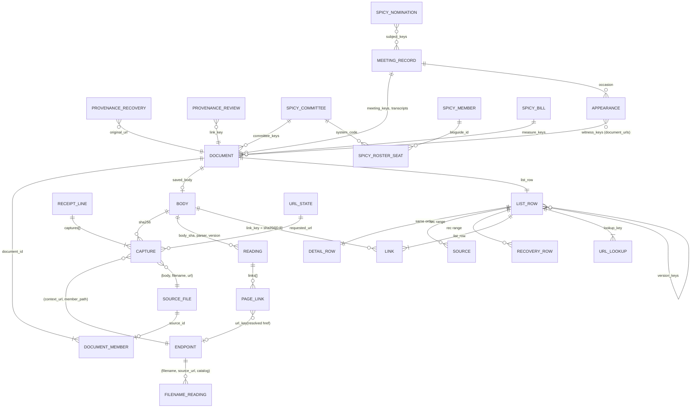

# Congressional Document Archive: Data Model

**Editor's Draft, 2026-10-24**

## Abstract

- **Single home** of every schema, derivation, order, registry, key between layers and invariant of the [[ARCHITECTURE]] system.
- **Goals:** lake rows rebuild from raw; expensive work runs once per item and version; rebuilds are byte-identical (invariant 4).
- **Every reader must know:**
  - lake tables (§6) hold one row per expensive per-item computation;
  - the model (§7) is one engine job at the versions one model profile pins;
  - every receipt line today is an older line, read through a versioned per-shape mapping (§6.1);
  - a document is a connected component of source files, listed when it has a real file or a recovery (§7.5);
  - a public link carries a `link_key`: the first 8 bytes of a real body's SHA-256, or of `sha256('url:' || original_url)` for a recovery's original link; any address a document was fetched from finds it through a lookup key (§8.2);
  - release files carry only what a reader acts on, to find, open, trust and connect documents (§8); forensic detail stays in the lake.
- **Elsewhere:** behavior, [[ARCHITECTURE]]; order of work and measurements, [[IMPLEMENTATION-PLAN]].
- **Sizes** are measured on the 2026-10-19 snapshot and its receipts unless marked *est.*

## 1. Introduction

*This section is non-normative.*

Layers: §5 → §6 → §7 → §8, keyed by §9.

## 2. Conformance

Sections marked "This section is non-normative", and all examples and diagrams, are non-normative; everything else is normative.

Key words are interpreted as [[ARCHITECTURE]] §2 says. The conformance classes are those of [[ARCHITECTURE]] §2. Each conforms by producing or reading what this document assigns it and satisfying the invariants of §10 that apply to it.

## 3. Terminology

Terms are defined in [[ARCHITECTURE]] §3; this section adds the primitives its rules use.

**PK**
: The uniqueness a test asserts.

**logical body key**, **physical key**
: The string `bodies/sha256/<aa>/<sha>.gz` for a body, whatever its physical key: the body's input to the ID formulas. The physical key is its object key, `bodies/sha256/<aa>/<sha>` plus a suffix of `''`, `.gz` or `.pdf`.

**older line**, **creating line**
: A receipt line written before this specification, whose shapes the ingest mapping reads (§6.1); and the line that stored a body, with its `stored_md5` and `stored_bytes`.

**attempt**
: One HTTP exchange within a fetch line: the final response, or one of the line's `prior_attempts`. Each capture entry names its attempt.

**source URL**
: A top-level fetch row's final `url`; for a recovery's source file (§7.4), its original link. An archive member has none; its container is its `context_url`.

**recovery row**, **recovery body**
: A capture row of a `retained_import` line; and a body some recovery row holds. A recovery body is also a real body only when a real fetch saved it (§7.3).

**fingerprint candidate**
: A body at an endpoint that holds two or more distinct real bodies (§7.3).

**main content**
: A page's visible text without navigation, headers, footers and sidebars, as the pinned content extractor returns it.

**meeting page**
: A page whose source URL matches one of the meeting URL patterns of §7.5, or a House meeting XML record.

**meeting key**, **chamber**
: A meeting is keyed by its `event_id` alone: docs.house.gov and Congress.gov share one number space, and no event ID names two chambers (invariant 15). `chamber` is an attribute, `house`, `senate` or `joint`; each input's spelling maps once where it is read: Congress.gov `House`/`Senate` and spicy-regs `House`/`Senate`/`Joint` lowercased, `rep`/`sen` to `house`/`senate`, GovInfo `h`/`s`/`j` to all three, and Congress.gov `NoChamber` to null, since its host committee, not the record, names one.

**catalog version**
: The filename parser's version (§6.3). Basin Catalog is always named in full.

**compact JSON**
: JSON encoded as UTF-8 with no whitespace, `,` and `:` as separators, `null` for a missing value and no NaN. Only `"`, `\` and U+0000–U+001F are escaped: as `\"`, `\\`, `\b`, `\f`, `\n`, `\r`, `\t` where those exist, and `\u00xx` in lowercase hex otherwise. `/` and non-ASCII characters are written as themselves. This is the output of Python's `json.dumps(value, ensure_ascii=False, separators=(",", ":"), allow_nan=False)`.

## 4. Type Conventions

**Lake tables** use Iceberg types: `string`, `int`, `long`, `boolean`, `date`, `timestamptz` (microseconds), `fixed[n]`, `list` and `struct`.

**Model relations and release files** use Arrow types: `fsb(n)` is `fixed_size_binary(n)`; `dict` is a string written with a dictionary; `ts` is `timestamp[us, UTC]`; `int16` is INT32 annotated as 16-bit; `date32` is a day-precision date.

**Dates.** A `ts`, or a spicy-regs instant such as `1977-02-04T04:59:00Z`, becomes a `date32` in America/New_York. The model uses the time-zone database pinned with the engine; a content-date parser uses its locked time-zone package, included in its parser version. A date interval is half-open, `[start, end)`.

**Folds.** A fold MUST hold only display-only facts; anything the model filters, joins or sorts on, or the site acts on, MUST be a native column.
- A fold is `list<struct<field, value: string>>`, one value per element, the field repeated for a multi-valued fact; `field` is a `string` in lake tables and a `dict` in release files.
- Filename metadata is flat (164 distinct fields on 5,000 real filenames, median 2 values each) and every value is a string, so it stays typed facets plus a fold. Parquet's variant type is not used.

**Hashes** are binary (`fixed[32]`, `fixed[16]`, `fsb(32)`, `fsb(8)`), except keys that `list` scans as strings (`witness_keys`, `version_keys`), which are the lowercase hex of the same bytes in every file that holds them; `list.parquet` carries no ID.

## 5. Raw Records

### 5.1 Body Object

| Item | Value |
|---|---|
| Key | `bodies/sha256/<aa>/<sha>` for new writes. Older: `…/<sha>.gz` (every body written before this specification, 1.04M), and `…/<sha>.pdf`, the uncompressed copies of older gzip PDFs (about 260,175 objects, about 403 GB). |
| Stored bytes | The original bytes, gzip-compressed when the media type compresses (HTML, XML, JSON, text), as-is otherwise. |
| HTTP metadata | `Content-Type` is the original media type; `Content-Encoding: gzip` when compressed; `ETag` is the MD5 of the stored bytes, except on 61 older `.gz` bodies over 200 MiB uploaded multipart on 2026-10-01 (`<md5>-<parts>`). Older `.gz` objects carry `Content-Type: application/gzip` and no encoding. |
| Custom metadata | None: identity is the key, integrity is the ETag. |
| Recorded where | A capture entry's `stored_suffix` (§5.2); a `.pdf` copy's verification record (§5.3). No older line records an MD5. |
| Size | 1,036,256 bodies, 0.70 TB stored; largest 1.19 GB; none above 5 GB. |

### 5.2 Receipt Line

One JSON object of about 1 KB per fetch line or recovery import; a run writes numbered files, `receipts/<family>/<write-date>/<run>-<seq>.jsonl.gz`.

**Every line**

| Field | Type | Meaning |
|---|---|---|
| `run_id` | string | Writer run, never reused. |
| `mode` | `fetch` \| `retained_import` | A real fetch, or recovered content imported for another link. |
| `family` | string | Source family, from the source-family registry. |
| `requested_url`, `url` | string | Requested and final URL. |
| `retrieved_at` | RFC 3339 | Fetch time. Archive members take their line's time; a recovery import takes the recovered copy's original time. |
| `http_status` | int or null | The final response's status from the publisher; a synthetic 200 for imports. |
| `provider_status` | int or null | A fetching provider's own status. |
| `outcome` | `stored` \| `unchanged` \| `failed` \| `retry_later` \| `size_limit` \| `request_failed` | `retry_later` is a 429 or 503, or any response carrying `Retry-After`. The last two are incomplete. |
| `transport` | string | `direct`, `zyte`, … |
| `error_type` | string, optional | Final transfer failure code; a stable identifier, never an exception message or local path. |
| `response_headers` | object | Allowlisted only: `content-type`, `content-length`, `content-disposition`, `last-modified`, `etag`, `content-encoding`, `retry-after`, `date`, `cache-control`, `accept-ranges`. |
| `redirects` | list of {url, http_status} | — |
| `prior_attempts` | list of {url, retrieved_at, transport, http_status, sha256} | Earlier attempts in the same line. |
| `source_context.observations` | list of {url, source, pointer} | Why the URL was requested. |
| `writer` | {job, commit, lockfile_digest} | Writer identity. |
| `captures[]` | list | One entry per body the line references (median 1, max 5,806; older `file_references[]` reach 22,354). |

**`captures[]` entry**

| Field | Type | Meaning |
|---|---|---|
| `pointer` | JSON path | Where the body sits in the record, such as `["archive_members", i, …]`. |
| `attempt` | int | 0 for the final response, *i* for `prior_attempts[i-1]`; a member takes its archive's. |
| `complete` | bool | True when the attempt's transfer ended without error and its content decoding succeeded (below). A body cut off at a size limit is false. |
| `context_url` | string | The final `url`, or the container's `url` for an archive member: the URL the body is evidence for. |
| `member_path` | string or null | Path inside an archive. |
| `entry_index` | int or null | Position inside the archive: evidence, not identity. |
| `expansion` | string or null | On an archive's own entry: `expanded`, or the reason expansion was refused (an archive-limit registry limit, an encrypted or unsupported member). |
| `sha256` | hex | Identity: the entity after its transfer `Content-Encoding` is removed. |
| `bytes` | int | Original size. |
| `media_type` | string or null | The server's claim. MUST NOT be used to classify. |
| `sniffed_format`, `sniff_version` | string | The format sniffed from the first bytes (values in §6.2) and the sniff code's version, which also versions `intact`. |
| `sniff_error` | string, optional | The sniffer's stable error code, such as `pdf_reader_size_limit`; resource failures propagate for retry and never become a damage verdict. |
| `intact` | bool or null | For a PDF: true when `%%EOF` appears in its last 8 KB, else when the pinned PDF reader opens it within its 16 MiB size limit; false when it rejects the file or that required read exceeds the limit (reported as `pdf_reader_size_limit`). A missing reader or resource failure is a failed reading, not a damage verdict. Null for other formats and for an older gzip PDF whose prefix alone was read. |
| `stored_suffix` | `''` \| `.gz` | The physical key's suffix ([[ARCHITECTURE]] §7.1). |
| `stored_md5`, `stored_bytes` | hex, int | Only on the creating line. |
| `fidelity` | `exact-bytes` \| `saved-text` \| `saved-record` \| `retained-file` | How faithful the stored bytes are. |

Ended without error means read to its declared end, its final chunk or a clean end of stream, or by ranges each requested with `If-Range` on the first response's strong validator and together covering the declared total.

**Recovery imports only** (`mode = retained_import`)

| Field | Type | Meaning |
|---|---|---|
| `publisher_requested` | bool | False; rules read `mode`. |
| `recovery_evidence.original_url` | string | The link this content recovers. |
| `recovery_evidence.imported_at` | RFC 3339 | — |
| `recovery_evidence.match_basis` | string | Such as `user_accepted_url_variant`. |
| `recovery_evidence.acquisition.{prior_access_category, match, source, recovered_url, section_link, evidence_sha256, observed_capture_timestamp}` | mixed | `prior_access_category` decides the display kind, else the match basis does (§7.8). `acquisition.kind` and `.category` hold file formats and are not read. |
| `recovery_evidence.acquisition.body_path` | string | The retained file's name. |

New lines MUST NOT carry:
- credential parameters (as the credential-parameter registry lists them) in any recorded URL (`requested_url`, `url`, `redirects[]`, `prior_attempts[]`);
- cookies, authorization or local file paths;
- `links` (derivable from the body), `download_state`, `preserve_download_state`, full provider metadata, header copies or `response_header_items`;
- per-capture copies of `retrieved_at`, `http_status` and `family`.

**The one-time cleanup** of older receipts, before `receipts/` is locked:
- removes every value of a recorded header named `authorization` or ending in `cookie`, as a header-object key or a `{name, value}` item, wherever it sits in a line;
- cuts absolute local paths to their last segment wherever they occur in a value or key name, never in a key a `pointer` passes through or in a URL;
- leaves every other value and key unchanged (a rewritten line may re-escape characters) and every recorded URL as it was: no older URL carries a credential parameter the registry does not exempt;
- gives each cleaned receipt a verification record naming what it cut (§5.3); the private backup keeps every original.

### 5.3 Provenance Records

`provenance/<kind>/<ts>.jsonl`, append-only, each job writing its records in batched files. A correction MUST be a new record that supersedes an old one by `id`. No other object is a record: the model never reads the whole `accepted.json` copy under `recoveries/`.

| Kind | Fields | Read by |
|---|---|---|
| `recoveries` | `id`, `original_url`, `recovered_url`, `recovered_filename`, `body_sha256`, `kind` (a display kind, or `rejected`), `match_basis`, `evidence_sha256`, `identity_note`, `decided_by`, `decided_at`, `supersedes` | `recoveries` (§7.8); the effective filename and its work list (§6.3, §7.4) |
| `url_variants` | `id`, `canonical_url`, `variant_url`, `basis`, `decided_at`, `supersedes` | `url_key` (§7.2) |
| `reviews` | `id`, `target` (a link key), `verdict` (`hide`, `duplicate_of`, `title_override`, `kind_override`, `withdraw`), `value`, `note`, `reviewer`, `decided_at`, `supersedes` | `reviews` (§7.9) |
| `verification` | `key`, `size`, `etag`, `sha256_verified`, `checked_at`, `job`; more for a cleaned receipt. A listing baseline records size and ETag, the size checked against the recorded stored size, with `sha256_verified` false until a whole read or the full re-hash verifies the body. A successful whole-read record may also carry `stored_sha256`, the measured digest of the stored bytes; a stored-digest repair requires this measurement to agree with its receipt evidence. A `.pdf` copy's record adds the end-marker check, `intact` | The maintenance job; `suffix` for `.pdf` copies (§7.5) and `intact` (§7.3) |
| `unreadable` | `id`, `body_sha256` (or `record_sha`), `parser`, `parser_version`, `reason`, `decided_by` (a person, or the producer after a second crash, §6), `decided_at`, `supersedes` | The parsers' work lists, which drop the input (§7.1); the model reports each per release |

- A cleaned receipt's record adds `original_size`, `original_etag`, the backup object compared, the fields cut, and the counts of cookies, credential parameters and paths removed.
- Written by the re-hash jobs, the PDF-copy job (for each `.gz` source and `.pdf` copy) and the receipt cleanup.

## 6. Lake Tables

Iceberg tables in Basin Catalog, append-only ([[ARCHITECTURE]] §8).

**Table properties.** Format version 2 and `gc.enabled` true; each PK is declared as the identifier fields, so its columns are required. The engine writes ZSTD-3 Parquet with chunk statistics and no Bloom filters, and Basin's compaction and snapshot expiration ([[ARCHITECTURE]] §8.6) set the files' final layout, so no rule reads row groups, file sizes or physical order.

**Schema changes rebuild.** A lake table never changes schema in place.
- A new schema is a new table version, named by a short label the profile maps to its digest, built from raw and provenance while the old version stays pinned.
- The old version is dropped once no kept release's profile names it ([[ARCHITECTURE]] §10.3.7).
- Lake rows are derived, so nothing older needs to stay readable; only raw does (§5).

**One row per input.** Every parser table (§6.2, §6.3, §6.5, §6.7) holds one row per input and version with a `status`, its many-valued outputs as lists, so an input that yields nothing still has its row and leaves the work list (§7.1).
- `status` is `completed`, `error` or `size_limit`. `size_limit` is decided before reading, from the input's size against the version's declared byte bound; `error` is a rejection of the input, with its `error_type`.
- Each input is parsed within the version's time and memory bounds. A parse that crashes, hangs or exceeds them is retried once in the run; a second failure writes an `unreadable` decision naming the producer (§5.3), so one bad input cannot hold the work list open. The decision is in raw, so a rebuild skips the same inputs even though a crash depends on the run; a new version retries them.
- A failure to read the input (raw, network or catalog) writes no row, so the input stays on the work list.

**Versions.** The model reads only pinned parser versions (§7.1); a table keeps the versions any kept release's profile names, and its next table-version rebuild omits the rest.

### 6.1 `captures`

One row per body a line references (each `captures[]` entry or, on an older line whose `captures[]` is empty, each `file_references[]` entry), plus one row per line that references none. A receipt field is kept only when a rule, an invariant or a job reads it. In phase 1 the table is a narrow index of the fields read in bulk by every release; other evidence stays in raw behind `(receipt_key, receipt_line, capture_index)` and is read when a case needs it. The ingest mapping is versioned with the table (§6) and reads every older receipt shape.

| Phase-1 column | Type | Notes |
|---|---|---|
| `receipt_key` | string | Immutable raw receipt key. |
| `receipt_line` | int | Source line, starting at 1. |
| `capture_index` | int | Position in the primary list; 0, with null `sha256`, on a line without a body. A file reference retained without a body also has null `sha256`. |
| `run_id`, `mode`, `outcome` | string | The producing run and final line facts; the mapping translates the older vocabulary. |
| `family` | string | The entry's family, else the line's, else the receipt key's `<family>` segment. |
| `requested_url`, `url` | string, nullable | Older lines take `_url`, `final_url`, `resolved_url` or `source_url`, the first present, when their ordinary address fields are absent. |
| `context_url` | string, nullable | The source endpoint for this body. |
| `member_path` | string, nullable | The endpoint is `(context_url, member_path)`. |
| `h_content_disposition` | string, nullable | The flat download-name header: `record.response_headers["content-disposition"]`, else `record.response_headers["Content-Disposition"]`. The existing filename function reads it (§7.4). |
| `http_status` | int, nullable | Final response status, from `http_status` or `status_code`; `capture_status` and `meetingStatus` are not HTTP statuses. |
| `complete` | boolean, nullable | The final line's explicit completeness; unknown older values remain null. Per-attempt completeness stays in raw. |
| `retrieved_at` | timestamptz, nullable | Fetch time, with the older-entry fallbacks below. |
| `sha256` | fixed[32], nullable | Digest of the referenced body. |
| `bytes` | long, nullable | Body size. |
| `media_type`, `fidelity` | string, nullable | §5.2; saved-file ordering reads `fidelity` (§7.5). |
| `sniffed_format`, `sniff_version`, `intact` | string, string, boolean; nullable | Capture-time reading reused by D2; unknown older values take a retained-body reading (§6.2). |
| `expansion` | string, nullable | §5.2; the ZIP fingerprint (§6.2) reads `expanded`. |
| `stored_suffix` | string, nullable | §5.2. |
| `stored_bytes` | long, nullable | Stored object size. |
| `stored_md5` | fixed[16], nullable | Creating line only. |
| `recovery_category`, `original_url`, `recovered_url`, `match_basis`, `evidence_sha256`, `imported_at` | string, string, string, string, fixed[32], timestamptz; nullable | Recovery rows only. `recovery_category` is `prior_access_category`; the older-line fallbacks set `original_url`, `match_basis` and `imported_at`. |
| `writer_job`, `writer_commit` | string, nullable | Required on new rows by invariant 3; null on older rows without writer identity. |

These values are **on demand, not phase-1 columns**:

| Raw evidence or derived value | Use |
|---|---|
| Prior attempts, their status and completeness | Read the pointed receipt when an individual attempt needs examination; bulk ingest does not expand or sort them. |
| Other response headers, header items and `retry_after` | Retained in raw. Bulk ingest reads only the two flat download-name paths; scheduling uses the phase-1 intervals (§7.7). |
| `record_sha` and inline meeting records | D4, phase 2 (§6.5): read the four `congress/meetings` receipt files (77 MB, 199,156 lines) once and compute the record hashes then. D1 stores only their pointers. |
| Other writer metadata and supplements | Raw receipts and pinned producer/profile metadata retain these facts. |

- **PK:** `(receipt_key, receipt_line, capture_index)`.
- The line's final status, completeness, mode and outcome accompany its referenced bodies. No bulk prior-attempt lookup fills a missing final fact.
- **Older lines** keep their fields under `record`, in shapes the mapping reads individually; §5.2 binds new lines. The narrow mapping:
  - uses `captures[]` for row grain when both lists exist, filling missing storage metadata only from `file_references[]` with the same body key and digest. A secondary non-null body absent from the primary list refuses ingest with its receipt and line. Conflicting storage facts also refuse; the 285 duplicate-reference lines in the pinned input do not create extra capture rows;
  - takes `run_id` from `source_file` and defaults the older stored suffix to `.gz`;
  - takes `member_path` from `original_path` only on a capture whose pointer passes through `archive_members`, never from a retained file reference's local path;
  - maps `retained_import` with association basis `direct_official_package` and `url == requested_url == source_associations[0].original_url` to `mode = fetch`, preserving its own fetch time. The owner identified 123 such pinned lines; the same rule applies to any matching source;
  - for other recoveries, takes `original_url` from the first source association, `match_basis` from its `basis`, and a missing `imported_at` from the receipt key's write date. The 5,587 recovery-run lines remain recoveries; `publisher_requested` is not used to classify them;
  - translates the versioned outcome/mode vocabulary, deriving a missing outcome from the final status and body presence. Unknown vocabulary refuses ingest rather than guessing success;
  - keeps recorded completeness. Otherwise it sets `complete` true unless the body is exactly 64 MiB or the outcome is `size_limit` or `request_failed`. Declared lengths are unused: about 61% of older 2xx HTML responses with full recorded headers declare none, and nearly all others name a `Content-Encoding`, so the length is the compressed transfer's. The pinned census has 657,713 2xx lines without recorded completeness (451,414 senate/captions and 125,245 documents); this derivation preserves their eligibility for `good_fetch`;
  - maps a confirmed legacy final response at its writer's 64 MiB cap with explicit `complete = false` to outcome `size_limit`, preserving an explicit more-specific outcome or error. Incomplete prior attempts and archive members do not trigger that inference when the final response completed;
  - keeps `expansion` and records `expanded` on an archive line whose members were captured; it keeps `writer_job` and `writer_commit` from the line's writer identity for invariant 3;
  - takes fetch time from the row's entry, then its line: `retrieved_at`, `captured_at`, `observed_at`, `parent_retrieved_at` or `_retrieved_at`, then `capture_date` at the start of its day, else null. `started_at`, `checked_at` and content dates are not fetch times. End of Term times remain the archive capture times;
  - accepts pointer elements as strings or integers and selects the corresponding narrow facts from a list-valued `record` (99 pinned lines), without changing primary row ordinals;
  - reads the two flat download-name paths only, excluding prior copies and `source_metadata`; no prior arrays, header-item expansion, inline meeting hashes, other writer supplements or `links` are read during bulk ingest.
- **Read once:** each consumer reads a raw object at most once, selecting only its needed fields. D1 reads every receipt line once; D4 reads the four meeting files once in phase 2.
- Not partitioned.
- **Work list:** receipt keys not yet ingested, listed from date-shaped prefixes ([[ARCHITECTURE]] §8.2). The backfill also reads non-date segments.

### 6.2 `readings`

One row per `(body, parser, parser_version)`; a reading depends only on its body and its parser version.

| Column | Type | Notes |
|---|---|---|
| `body_sha` | fixed[32] | — |
| `parser` | string | `sniff`, `html`, `xml`, `json`; later `pdf_text` (§6.6). |
| `parser_version` | string | — |
| `status`, `error_type` | string | §6; the byte bound is read against `stored_bytes`. |
| `format` | string, nullable | On `sniff` rows only, the sniffed format: `pdf`, `zip`, `xml`, `html`, `json`, `vtt`, `m3u8`, `docx`, `doc`, `text`, `image`, `warc`, `other`, `empty`. |
| `intact` | boolean, nullable | From `sniff`'s own read of a bare PDF: the check of §5.2. |
| `xml_root` | string, nullable | — |
| `title`, `heading` | string, nullable | HTML `<title>` and first heading. |
| `text_bytes` | int, nullable | Visible-text size of the whole page. |
| `text_head` | string, nullable | The first 2 KB of visible text. |
| `link_count`, `link_text_bytes` | int, nullable | Links in an HTML page and the bytes of their text. |
| `content_date` | date, nullable | The one date read from the content (HTML and XML metadata or a dated heading; PDF text from `pdf_text` when it exists); null unless exactly one qualifies. |
| `named_meetings` | list<long> | Event IDs a source record names, such as a GovInfo MODS record's; empty otherwise. |
| `base_href` | string, nullable | The page's `<base href>`, as written. |
| `links` | list<struct<href string, text string, tag string, basis string, group_path string, doc_type string, add_date string, publish_date string, remove_date string>> | Below; empty when the page has none. |
| `fingerprint` | fixed[32], nullable | Below. |
| `fields` | fold | Everything else. |

- **PK:** `(body_sha, parser, parser_version)`; partitioned by `(parser, parser_version)`.
- `links`: every link in an HTML or XML page, in document order, `href` as written, and every string in a JSON body that parses as an absolute http(s) URL, its key path as `tag`.
  - `group_path` is the path of the nearest grouping ancestor (`li`, `tr`, `meeting-document`, `witness-document`, `document`) as element names with 1-based sibling indexes from the root, or null; only rendition groups read it (§7.5).
    For markup in a JSON string, its path is prefixed by the script's element path, `@`, and the compact JSON key path, so different strings cannot share a group.
  - An XML document list's link `text` is its entry's description.
  - `doc_type` and the three dates are kept as the publisher wrote them; `remove_date` marks a committee's removal of the document from its hearing page.
- `sniff` reads every body whose capture rows carry no sniff at the pinned version, with one ranged read of its first bytes, decompressing the start of a gzip-stored body (a gzip original whose first member is a WARC or ARC record sniffs as `warc`). For a bare PDF it also reads the last 8 KB, and runs the bounded reader only when that finds no `%%EOF`; borrowed PDF checks join in the model (§7.3).
  - Only WARC/ARC is recognized through an original gzip layer; other gzip originals remain `other`. Storage compression is removed separately, so an older gzip-stored PDF still sniffs as `pdf`, with its integrity deferred or borrowed.
  - ZIP package detection shares the archive reader's bounds (64 MiB archive, 1 MiB directory, 1,024 entries). It currently reads the bounded archive to inspect root `[Content_Types].xml` or a bounded `mimetype` member naming an OpenDocument type; these packages sniff as `docx`, never from a URL or media type. An unsupported or over-limit ZIP is a failed reading, not an assumed generic archive. Stored gzip ZIPs obey the same decompressed limit.
  - a new sniff version re-reads about 1.04M bodies and can change the format parsers' work lists, so the profile moves them together.
- `html`, `xml`, `json` read every body of their format once per version and record each body's fingerprint and links. No parser reads embedded PDF titles.
- **Page populations**, nested, on one snapshot: the bodies the server labels HTML or XML (287,765); those of them with a 2xx good fetch (214,041), over which links resolve (§7.2); and the page readings' candidates, which add JSON and pages served under other labels (289,179). Links: *est.* 4.2M, from an 80-body sample, once per page body.
- **Fingerprints** come from what is already read; no parser runs for them:
  - the `html`, `xml` and `json` readings record each page's: the SHA-256 of its text, NFKC-normalized, whitespace runs collapsed to one space, trimmed (an HTML page's main content; the visible text of XML and other text); empty text or a failed extraction gives none;
  - a ZIP's is the SHA-256 of its members' hex SHA-256s, sorted and newline-joined, which the model computes from `captures` when `expansion` is `expanded`;
  - no other body is a fingerprint candidate on the 2026-10-19 snapshot (an endpoint's other PDF or ZIP bodies are all cut-off attempts, size-limit bodies or recoveries). A candidate without a fingerprint stays apart as an edition (§7.5); a `fingerprint` parser (the pinned PDF text extractor, a streaming walk of an unexpanded ZIP) is added only when one appears.
- **Size:** 491,710 rows fold to 16.5 MB, before links and `text_head` (*est.* 100 MB per HTML and XML parser version).

### 6.3 `filename_readings`

One row per `(filename, source_url, catalog_version)`.

| Column | Type | Notes |
|---|---|---|
| `filename` | string | The effective filename (§7.4). |
| `source_url` | string | The exact source URL, because the filename parser matches some rules on it; `''` for a source file without one (331,985 rows). |
| `catalog_version` | string | Covers the filename parser, the vocabularies passed in, the typed-field derivations, and the effective-filename rule with the filename-parameter registry it reads. |
| `status`, `error_type` | string | §6. |
| `valid` | boolean | Strict naming-convention validity. |
| `document_kind`, `document_family`, `committee_code` | list<string> | Every value: 24,202 source files have more than one kind, 3,637 more than one family, 5,229 more than one committee code. |
| `congress` | int, nullable | — |
| `date_token`, `measure_type`, `measure_number` | string, nullable | — |
| `filename_date` | date, nullable | `meeting_date`, else the single date candidate. |
| `measure_keys` | list<string> | `{congress}-{type}-{number}` with the type lowercase, the `bill_id` form spicy-regs uses (`119-hr-6028`), from the measure fields, measure references and `congress`. |
| `bioguide_ids` | list<string> | From `bioguide_token` and `sponsor_bioguide_id`. |
| `package_id` | string, nullable | The GovInfo package ID, when the filename stem follows a GPO pattern. |
| `fields` | fold | The rest (about 215 field names), as the filename parser's literal strings. |

- **The producer composes the typed keys.** The model MUST NOT unnest `fields`.
- **Scalars** (`congress`, `date_token`, `measure_type`, `measure_number`, `filename_date`) are set only when the parser returns exactly one value; otherwise they are null and every value stays in `fields`.
- **PK:** `(filename, source_url, catalog_version)`; partitioned by `catalog_version`. The model joins a source file on `(filename, coalesce(source_url, ''))`.
- **Work list:** the distinct `(effective filename, source URL)` pairs of every capture row and every provenance recovery's original link with no row at the pinned catalog version (§7.4): 1,392,681 pairs today, a 7–18 minute backfill.
- **Size:** *est.* 32 MB per catalog version.

### 6.4 Reference Inputs

Committees, members, terms, current rosters, bills, CBO estimates, floor votes and nominations come from spicy-regs, which owns their raw records and provenance. They are not lake tables: each publish pins each family's current immutable generation as spicy-regs' index `data.spicygov.ai/publication.v2.json` names it (the older `publication.json` names pruned generations), and the model reads the files that index lists for each table, `generations/<family>/<digest>/<table>.parquet`.

| spicy-regs table | Columns the model reads | Gives |
|---|---|---|
| `committees` | `system_code`, `chamber`, `name`, `committee_type`, `parent_system_code`, `history` (official names with start and end dates), `website_url`, `is_current` | Every committee and subcommittee of every Congress, named for any date |
| `members` | `bioguide_id`, `name_first`, `name_last`, `lis_id`, `fec_ids`, `opensecrets_id`, `govtrack_id`, `icpsr_id`, `wikidata_id` | Every member since 1789, with identifiers in other datasets |
| `member_terms` | `bioguide_id`, `term_type`, `term_state`, `term_district`, `term_party`, `term_start`, `term_end` | Every term |
| `committee_assignments` | `congress`, `system_code`, `bioguide_id`, `position`, `rank`, `party` | Current-Congress seats from the House Clerk's and the Senate's files |
| `congress_bills` | `bill_id`, `title`, `short_title`, `sponsor_bioguide_id`, `introduced_date`, `latest_action_date`, `latest_action_text`, `stage`, `policy_area` | 422,011 measures from the 6th Congress, keyed by `bill_id`, an opaque string: `{congress}-{type}-{number}` with the type lowercase, as `measure_keys` writes it |
| `bill_committees` | `bill_id`, `system_code` | The committees each bill was referred to: 286,721 rows over 167,162 bills of the 108th–119th Congresses |
| `amendments` | `amendment_id`, `purpose`, `sponsor_bioguide_id`, `latest_action_date`, `latest_action_text`, `amended_bill_id`, `amended_amendment_id` (all strings) | Amendments to a bill or to another amendment; the 119th Congress only until spicy-regs backfills |
| `bill_committee_activities` | `bill_id`, `system_code`, `activity_name`, `activity_date` (a UTC instant), `occurrence` | What each committee did on a bill and when (referred, hearings, markup, reported), as BILLSTATUS lists it; filling Congress by Congress |
| `cbo_cost_estimates` | `bill_id`, `publication_id`, `pub_date`, `description` | CBO cost estimates from the 108th Congress, 913–1,666 a Congress |
| `roll_call_votes` | `vote_id`, `chamber`, `vote_day`, `question`, `result`, `yea`, `nay`, `bill_id`, `documents` | Floor roll-call votes, House from the 101st Congress and Senate from the 108th, keyed `{congress}-{chamber}-{session}-{roll_number}`; a Senate vote's `documents` entry with `type = 'PN'` names a nomination by `number` `{number}[-{part}]`, in the vote's own Congress when the entry's is null |
| `bill_vote_references` | `bill_id`, `congress`, `chamber`, `session`, `roll_number` | Floor votes a bill's actions name, joined to `roll_call_votes` by building that `vote_id` (19,766 of 19,766) |
| `nominations` | `citation`, `congress`, `description`, `organization`, `received_date`, `latest_action_date`, `latest_action_text`, `committees_json` (referral system codes), `hearings_json` (printed hearings by jacket) | Nominations; the 119th Congress only until spicy-regs backfills |

A change in these columns fails the model at its next publish rather than reading wrong values; the model SQL moves with the generation. Spicy-regs keeps each family's last three generations and every generation a consumer pins; the archive pins those of every release it keeps ([[ARCHITECTURE]] §10.3.7).

### 6.5 `meeting_records`

One row per input and parser version: a Congress.gov meeting record, inline in a receipt line or a response body, or a House `committee-meeting` XML record, with the meetings it gives in `meetings`.

| Column | Type | Notes |
|---|---|---|
| `record_sha` | fixed[32] | The body's SHA-256, or an inline record's `record_sha` (§6.1). |
| `parser_version` | string | — |
| `status`, `error_type` | string | §6. |
| `source` | string | `congress_gov` or `house_xml`. |
| `meetings` | list<struct> | One element per meeting the input gives, usually one; empty when it gives none. Fields below. |

Each `meetings` element:

| Field | Type | Notes |
|---|---|---|
| `event_id` | long | The meeting key (§3). A House XML `meeting-id` drops its four-letter prefix (HHRG, HMKP, HMTG). |
| `chamber` | string, nullable | §3. |
| `congress` | int, nullable | — |
| `session` | int, nullable | The Congress's session. |
| `updated` | timestamptz, nullable | Congress.gov's `updateDate`. |
| `title` | string, nullable | — |
| `meeting_date` | date, nullable | — |
| `meeting_type` | string, nullable | Hearing, markup, meeting, … |
| `status` | string, nullable | As the source states it: scheduled, postponed, cancelled, rescheduled, … |
| `sittings` | list<struct<start timestamptz, end timestamptz, room string, building string, address string>> | Each sitting with its place; most meetings have one. |
| `committees` | list<struct<system_code string, role string>> | Congress.gov system codes; `role` is host, joint or the source's own word. |
| `subject_keys` | list<string> | What the meeting covers: bills as `measure_keys` writes them, nominations as `nomination_id` (§7.11, from a zero-padded `part`), treaties `{congress}-treaty-{number}`. |
| `transcript_jackets` | list<long> | GPO jacket numbers of the printed hearing, from `hearingTranscript[].jacketNumber` (§7.11). |
| `videos` | list<struct<name string, url string, video_key string>> | Recording links the source gives. `video_key` is `youtube:{id}` for a YouTube watch link and `senate:{filename}` for a senate.gov player link, else null; the recordings are not captured. |

- **Sources:** Congress.gov meeting records for both chambers (18,140 meetings, about 11 identical inline copies each, which `record_sha` collapses) and House `committee-meeting` XML. Senate committee pages carry no meeting ID; they give documents and appearances (§6.7).
- **Work list:** good-fetched bodies and inline records whose URL matches the meeting-source registry (§7.1) with no row at the pinned version.
- **PK:** `(record_sha, parser_version)`; tens of thousands of rows. The model unnests `meetings`.
- **Current records:** per `(event_id, source)`, the latest by `(updated desc nulls last, latest good fetch's retrieved_at desc nulls last, record_sha)`. Each field of a meeting comes from its current `house_xml` record when that states it, else its current `congress_gov` record.

### 6.6 `pdf_text` (deferred)

`body_sha` fixed[32], `parser_version` string, `page_count` int, `text_fingerprint` fixed[32], `text` string; PK `(body_sha, parser_version)`. One read of about 403 GB when scheduled; *est.* 1–5 GB compressed. Its text MUST stay off hash-join build sides.

### 6.7 `appearance_records`

One row per input and parser version, with the witnesses it lists in `appearances`. An appearance is keyed, not matched: the model gives it a `witness_key` (§7.11), which a later witness table keys on.

| Column | Type | Notes |
|---|---|---|
| `record_sha` | fixed[32] | The body's SHA-256, or an inline record's (§6.1). |
| `parser_version` | string | — |
| `status`, `error_type` | string | §6. |
| `source` | string | `house_xml`, `congress_gov`, `senate_page` or `mods`. |
| `appearances` | list<struct> | One element per witness, in source order; an input's entries sharing a `name_key` keep the first, so `witness_key` (§7.11) is unique per occasion. Empty when it lists none. Fields below. |

Each `appearances` element:

| Field | Type | Notes |
|---|---|---|
| `event_id` | long, nullable | The meeting, for a House witness list or a Congress.gov record. |
| `package_id` | string, nullable | The GovInfo package, for a MODS record. |
| `page_url` | string, nullable | The hearing page's source URL, for a Senate page. |
| `name_key` | string | The recorded name, NFKC, casefolded, punctuation dropped, whitespace collapsed. It survives re-parsing and reordering; two spellings give two keys. With no recorded name, `#` and the entry's 1-based position in the source's list, so unnamed witnesses stay apart. |
| `name` | string, nullable | As recorded. |
| `honorific`, `given`, `middle`, `family`, `suffix` | string, nullable | When the source splits the name (House XML). |
| `position`, `organization`, `on_behalf_of`, `location` | string, nullable | As recorded. |
| `panel` | string, nullable | The panel's label. |
| `panel_order`, `display_order` | int, nullable | Source order. |
| `witness_type` | string, nullable | As recorded. |
| `testified` | boolean, nullable | Whether the source marks the witness as having testified. |
| `bioguide_id` | string, nullable | Given by the source for a member witness; never inferred. |
| `document_urls` | list<string> | The witness's own document links, resolved against the source's URL as §7.2 resolves links: a House witness list's `witness-document` entries, a Senate page card's links. Empty for Congress.gov and MODS. |

- **Sources:**
  - House `witness-list` XML, beside the meeting's `committee-meeting` record: split names, panels, witness documents and member bioguide IDs;
  - Congress.gov meeting records: name, position and organization; they list no Senate witnesses (0 of 4,575 Senate events);
  - Senate committee hearing pages, whose layout puts each witness's links inside that witness's card: 90.7% of senate.gov testimony files;
  - GovInfo MODS records already in raw, which list a printed hearing's witnesses for both chambers, at granule level too.
- **Work list:** good-fetched witness lists, Congress.gov records and MODS records, and Senate hearing pages, matching the meeting-source registry (§7.1), with no row at the pinned version.
- **PK:** `(record_sha, parser_version)`; one input lists one meeting, page or package. The model unnests `appearances`.

## 7. Model Derivations

The model is one engine job of named steps ([[ARCHITECTURE]] §9.1) over `captures c`, `readings r`, `filename_readings f`, `meeting_records`, `appearance_records`, provenance `p`, the registries and the pinned spicy-regs reference inputs (§6.4), at the versions the model profile pins, with inputs settled by an `unreadable` decision excluded. Its relations exist only inside the job; only the release files (§8) are written.

### 7.1 Model Profile and Registries

The **model profile** is the set of versions one publish reads. Publish MUST refuse when a pinned version's work list is not empty, or a lake PK is duplicated, at the pinned snapshot, and the refusal names the inputs. An input that crashes its parser twice, or whose read always fails, is settled by a provenance `unreadable` decision (§5.3, §6), which removes it from that parser's work list.

- It pins: the model SQL (the SHA-256 of its files), the engine revision, each lake table version (§6), each parser, the catalog, each registry the model or a producer reads, and the release writer settings (§8.1); until the engine's export meets [[ARCHITECTURE]] §10.2 by itself (spicy-stack ss-iwqu), also the runner class and the engine's limits (threads, batch rows, batch bytes).
- A parser or catalog version is the SHA-256 of its source files, the vocabularies it reads and its locked dependencies.
- A new version is backfilled while the profile still pins the old one; the profile moves only when the new version's work list is empty. The daily run produces every pinned version for new inputs.

A **registry** is a versioned list a rule depends on.
- One file beside the model SQL, its version the SHA-256 of its bytes, each entry with a real sample a test checks. Lists read by the same rules at the same version share one registry as entry kinds.
- Registries are never stored in the lake, so a change rewrites nothing there.
- *Versioned by* says which version a registry follows: the profile, the raw writer's code, or both, when the raw writer and the model both read it.
- A profile registry is applied in the model unless its row names a producer or the fetchers.

| Registry | Holds | Used by | Versioned by |
|---|---|---|---|
| file shapes | Regular expressions over the locator that mark a link as pointing at a file | `real_files` (§7.3) | profile |
| page signals | Kinds: *error word*, generic error words for a title or heading, such as "not found", and body markers of challenge and soft-error pages; *error URL*, URL patterns that only ever serve error or placeholder pages; *wrapper marker*, text markers of download-wrapper pages, such as "download will begin shortly"; *threshold*, the near-empty text size and a listing page's minimum link count and link-text percent; *source-record root*, XML roots of metadata records, such as METS, MODS and PREMIS; *API endpoint*, URL patterns of API JSON, such as api.congress.gov; *feed root*, XML roots and URL patterns of feeds and sitemaps | record roles (§7.3); feed roots also `listed_on` (§7.10) | profile |
| URL rules | Kinds: *wrapper*, redirect and archive wrapper patterns; *strip*, tracker parameters on any host, such as `utm_*`, and page-state parameters on named hosts, such as congress.gov `q`; *repair*, repairs of malformed links, such as `ttps://` and concatenated URLs | `url_key` and link targets (§7.2) | profile |
| formats | Kinds: *preference*, the document formats in order, PDF first; *generic stem*, filename stems never grouped, such as `index` and `download` | saved file, alternates and renditions (§7.5) | profile |
| filename parameters | Query parameters that name a file, in priority order | the effective filename (§7.4), in the filename producer and the model | profile, through the catalog version (§6.3) |
| publisher kinds | Publisher link labels and XML document-type codes → document kind | `document_kind` (§7.5) | profile |
| display facts | Filename-reading fields a document page shows, by name | `detail`'s `facts` (§8.1) | profile |
| committee codes | Filename committee code → Congress.gov system code: `hs`, `ss` and `js` prefixes, `hl` for Intelligence and the select committees, and the joint, commission and two-letter forms | `committee_keys` (§7.5) | profile |
| meeting sources | URL patterns of meeting records (Congress.gov committee-meeting records, docs.house.gov `committee-meeting` and `witness-list` XML) and of Senate committee hearing pages | the meeting and appearance producers' work lists (§6.5, §6.7) | profile |
| recording sources | URL patterns of caption, subtitle and playlist files, how each names its video (such as a YouTube `v` parameter or a senate.gov filename), its format, and its language and production (publisher, human or automatic) where the URL says | `recordings` (§7.11) | profile |
| release schema | Each release file's columns with type and a one-line meaning, and each file's known coverage gaps, such as "rosters: current Congress only" | `schema.json` and the manifest's `coverage` (§8.1) | profile |
| import runs | `run_id` and date of each bulk import run | dates (§7.4) | profile |
| recovery kinds | `prior_access_category`, and match basis, → display kind | `recoveries` (§7.8) | profile |
| recheck intervals | `(family, interval)` for every family, with bands by meeting age where pages change as a meeting ages | `url_state` (§7.7) | profile |
| capture scope | URL patterns capture follows from links, as an allowlist, and its exclusions: media, crawler traps such as calendar archives, and forms | `url_state`; the fetchers, from the live release's copy (§8.1) | profile |
| archive limits | Archive, member and total size, and member count | archive expander | raw writer |
| credential parameters | Query parameters that carry credentials, such as `api_key`; never a bare `key`, which YouTube caption URLs carry as a constant | receipt writer; the `url_state` queue | both |
| host pacing | Per-host gaps and backoffs | fetcher | raw writer |
| source families | URL patterns → source family | receipt writer | raw writer |

### 7.2 Link Targets and `url_key`

Every link join (link targets, recoveries' original links, the `url_state` queue) MUST use `url_key`. `source_id`, `requested_url`, `url_state`'s key and link URL keys (§8.2) MUST NOT use `url_key`.

```
url_key(url) := unwrap(url), then parse/serialize with the WHATWG URL parser
                (including its dot-segment and whitespace normalization), then:
                drop the scheme, so http and https match; lowercase the host;
                drop "www.", the default port, the fragment and a trailing slash;
                normalize percent-encoding [RFC3986 §6.2.2]: uppercase escape hex,
                decode escapes of unreserved characters, and encode spaces and other
                characters outside the URI character set as %XX, so 'a b.pdf' and
                'a%20b.pdf' match;
                keep the path's case; drop the URL rules' strip parameters;
                sort the remaining parameters and keep them all;
                then, once: if provenance url_variants names the result as a variant,
                replace it with the canonical URL normalized by the steps above

unwrap(url)  := apply the URL rules' wrappers at most twice: a redirect wrapper gives
                its inner URL (such as Proofpoint urldefense ?u=, with its -XX and _
                decoding); an archive wrapper gives the archived URL (such as
                web.archive.org/web/<ts>[modifier]/<url>)

copy_urls(f) := for a top-level source file, the url_keys of its source URL and of the
                requested URL of each good fetch that saved it; none for an archive member
```

- **Link targets.** Links resolve once per distinct `(page body, context)`, where a context is an endpoint the page body was good-fetched at (§7.3):
  - each `href` is first repaired by the URL rules' repairs, once; a repair may split a concatenated `href` into several links, kept in `href` order;
  - a relative `base_href` is resolved against the context, then each `href` against that base, else against the context, by the URL parser of [[URL]], as browsers resolve them; an archive member's relative links give endpoints in the same container;
  - each resolved link keeps its page body, context, link index and split position, so a page saved at two addresses yields two attributed sets of targets;
  - placeholder bodies' links are not resolved;
  - *est.* 5.5M targets: 4.2M links at 1.3 contexts per page (277,642 contexts over the good-fetched page bodies of §6.2).
- **Matching.** A link target matches:
  - a top-level source file through its `copy_urls`;
  - an archive member through its endpoint `(url_key(context_url), member_path)`, null-safe (`IS NOT DISTINCT FROM`); a target path that several members of one archive share matches each of them;
  - a target that matches an archive also stands for each of its members, so the link's context and publisher group reach them; 33,980 of the 34,196 good-fetched GovInfo ZIPs (one hearing's HTML and PDF; 112 more HTML only) join this way, and the one-body-per-format rule (§7.5) keeps the rest apart.
- The model reports URLs still wrapped after two passes. A test rejects a `url_variants` record whose canonical URL is itself a variant, so variants cannot chain.

### 7.3 Record Roles and Real Files

Each capture row takes one record role; a real file is a good fetch whose role is `document` (`real_files` below).

```
good_fetch  := rows of c where mode = 'fetch' and complete
               and outcome in ('stored', 'unchanged') and attempt_status between 200 and 299
               (import-run rows included; capture dates exclude them, §7.4)
format      := r[sniff].format at the pinned sniff version,
               else c.sniffed_format when c.sniff_version is that version
intact      := for a PDF, the first set of: its .pdf copy's verification record (§5.3);
               r[sniff].intact at the pinned sniff version; c.intact when
               c.sniff_version is that version, or on an older row (§6.1)
intact_basis := 'copy', 'read' or 'capture', by which gave intact;
               'unchecked' when none did
reading     := the body's html, xml or json reading at the pinned version
record_role := per capture row, the first that applies:
               null              when format is null (no completed sniff)
               'caption'         when format = 'vtt'
               'playlist'        when format = 'm3u8'
               'envelope'        when format = 'warc'
               'damaged'         when format = 'pdf' and intact is not true
                                 and intact_basis <> 'unchecked'
               'api'             when api_row
               null              when format in ('html', 'xml', 'json')
                                 and the reading is missing or not completed
               'source_record'   when format = 'xml'
                                 and reading.xml_root is a source-record root
               'error_response'  when format = 'html' and error_signs(reading, c.url)
               'wrapper'         when format = 'html'
                                 and a wrapper-marker entry appears in reading.text_head
               'listing'         when format = 'html' and listing_signs(reading),
                                 or format = 'xml' and (reading.xml_root or c.url)
                                 matches a feed-root entry
               'document'        otherwise
api_row     := format = 'json' and c.url matches an API-endpoint entry
error_signs(x, u) := an error-word entry in x.title or x.heading,
                     or an error-word body marker in x.text_head,
                     or u matches an error-URL entry,
                     or x.text_bytes is below the near-empty threshold
listing_signs(x)  := x.link_count >= the minimum link count
                     and 100 × x.link_text_bytes >= the link-text percent × x.text_bytes
placeholders := bodies whose capture rows, in any mode, span more than
                k = 100 distinct context_url values

real_files  := rows of good_fetch where
    sha256 is not null and bytes > 0
    and sha256 not in placeholders
    and record_role = 'document'
    and (format <> 'html' or not file_shaped(locator))

locator     := the member path for an archive member (34,331 HTML members sit at
               good-fetched ZIP URLs), else the URL
real_body   := a body with at least one real_files row
```

- On the 2026-10-16 snapshot, 229,038 of 261,125 older PDF candidates carry a check from their capture (15,476 on 2026-10-01 lines alone, which the copy's whole read re-checks). The other 32,087 (about 950 are HTML by the old readings) are unchecked and count as documents until their `.pdf` copy has a verification record (`measurements/review9-20261026/`). The old readings' PDF opens are not borrowed: an `intact` true and an unchecked PDF give the same role.
- Bodies that are not real files stay in the lake as evidence; listing, wrapper and error pages and metadata records still supply links. A damaged PDF is fetched again on its recheck schedule.
- `file_shaped(locator)` is true when a file-shape registry entry matches; the labeled sample fixes the list.
- The model reports, per release, the bodies with no role by format and error type, the damaged PDFs (those over the reader's limit apart), and the bodies that newly crossed the placeholder threshold.
- Role sample, 3,021 pages; under 2 KB of visible text: 67% download wrappers, 11% hearing pages, 11% cover-only GovInfo pages, 9% soft errors, about 2% real documents, so length alone is no sign of an error.
- *k* = 100 selects 18 placeholder bodies (20 at 50, 11 at 200); the widest is a 57-byte caption file at 87,161 URLs.

### 7.4 `filenames`

One row per source file: 1,683,430 today.

| Column | Type | Derivation |
|---|---|---|
| `source_id` | fsb(32) | SHA-256 of the compact JSON array `[logical body key, filename, source_url]`, with `null` for a missing body key or URL |
| `body_sha` | fsb(32), nullable | — |
| `filename` | string | The effective filename (below) |
| `source_url` | string, nullable | §3 |
| `record_role` | dict | Its capture rows' role (§7.3); `document` when any row is a real file |
| `is_real_file` | bool | At least one of its capture rows is in `real_files` |
| `first_fetched`, `last_fetched` | ts, nullable | Over its `mode = fetch` rows outside import runs |
| `in_archive_since` | date32, nullable | The registry date of its earliest import run, when all its fetch rows come from import runs |

- **Derivation:** the distinct `(body, effective filename, source URL)` triples over `mode = fetch` rows in `captures`; plus one bodiless row per URL that never yielded a body; plus one bodiless row per distinct recovery original link, whose source URL is that link. Recovery rows make no other source files, because their `url` is the recovered copy's address (11,950 of 12,106 lines).
- **Effective filename:** the first non-empty name in this order, else `''`, by one SQL definition that the filename producer (§6.3) and the model share:
  1. the `recovered_filename` of the row's recovery decision (§7.8), unless the decision rejects it;
  2. the member basename, for an archive member;
  3. the `h_content_disposition` filename, `filename*` [[RFC6266]] first;
  4. the value of the first filename-parameter registry entry present in the source URL's query, else the requested URL's, at its first occurrence;
  5. the source URL's last path segment;
  6. the requested URL's last path segment.
- **Decoding:** URL segments and query values are percent-decoded once as strict UTF-8, `+` kept literal; an invalid sequence stays encoded.
- **One name per capture row.** When fetches of one body at one URL offered different names, each name is its own source file, joined by the same-body edge; the other names a row was offered stay in its receipt, and the document shows the saved file's name.
- **Grain:** two archive members with the same body and name at different paths are one source file; `sources` keeps each path.

### 7.5 Edges and Documents

Source files join into documents through four edges (same body, same text, same rendition, review), and an edition never joins another.

```
ambiguous_bodies := real bodies at an edition-ambiguous endpoint: an endpoint holding two
                    or more distinct real bodies whose fingerprints differ or are missing
edition_bodies   := ambiguous_bodies, plus every fingerprint candidate whose fingerprint
                    equals that of a body in ambiguous_bodies

same_body      := source files that each have a real_files row, sharing a real_body
                  (web pages included); one node per body
same_text      := source files at one endpoint whose real files have equal fingerprints;
                  one node per (endpoint, fingerprint)
same_rendition := real source files that are one document in different formats:
                  (a) the publisher groups them: links resolved in one context of one page
                      body (§7.2) with the same non-null group_path; one node per
                      (page body, context, group_path);
                  (b) for real source files in no publisher group: the same directory and filename
                      stem, compared bytewise, in formats the formats registry's preference
                      lists, the stem not one of its generic stems; a directory is the
                      source URL's host and path up to its last '/', or for an archive
                      member its container's URL and the member path up to its last '/';
                  bodies in edition_bodies never join a group, and a group draws edges
                  only if its remaining real bodies all differ in format, one body per
                  format (several names of one body count once)
review_edge    := a reviewer's duplicate_of between two body link keys (§7.9)

components     := ConnectedComponents over source files and the nodes above
listed         := components with at least one real file or at least one recovery

saved-file order := (format preference, unlisted formats after listed by name;
                    exact-bytes (any of its capture rows) before other fidelity;
                    first_fetched desc nulls last;
                    body_sha; source_id)
recovery order := (kind: recovered copy, official substitute, hearing-record excerpt;
                  imported_at desc; body_sha; the recovery row's receipt_key,
                  receipt_line, capture_index)
saved_file     := the component's first real source file in the saved-file order
                  (saved_kind = 'original'); for a recovery-only document, its first
                  recovery in the recovery order (saved_kind = 'recovery')
saved_media_type := the media type of saved_file's format (a fixed map), else its
                  capture's media_type
suffix(body)   := '.pdf' when the body is a PDF with a verified .pdf copy (§5.3);
                  else '' when a capture row recorded stored_suffix ''; else '.gz';
                  for the saved file, alternates and recoveries alike
alternates     := for each other format, its first real source file in the saved-file
                  order: (format, body, suffix, size), in format-preference order

first_captured := min(first_fetched) over its real files
in_archive_since := min(in_archive_since) over its real files, when first_captured is null
document_date  := the saved file's filename_date, else its content_date, else the earliest
                  meeting_date among its meetings, else null
document_date_source := 'filename', 'content' or 'meeting'; null when document_date is null
document_id    := SHA-256 of the compact JSON ["bodies", [k1, k2, …]], the distinct logical
                  body keys of its real files sorted bytewise, or ["sources", [h1, h2, …]],
                  its source_id hex strings sorted, when it has none
filename       := the saved file's effective filename
title          := the applying title_override (§7.9), else the saved file's reading title,
                  else its heading, else the text of its earliest listing link (§7.10);
                  null when none, and the site shows the filename
witness_keys   := §7.11
version_keys   := for each edition-ambiguous endpoint holding one of its real bodies, the hex
                  of the first 8 bytes of SHA-256 of the compact JSON [url_key(context_url),
                  member_path]; documents sharing a key are versions served at one address
```

- **Order of evaluation:**
  1. real files and source files (§7.3–7.4);
  2. the edges above and body-key review edges;
  3. components;
  4. recovery attachment (§7.8), with each recovery's original-link source file already in step 1;
  5. review edges with a link URL key end, which merge the documents they resolve to;
  6. saved files, dates and keys.
- Only `same_rendition` joins renditions; several files of one format listed together, such as a witness's testimony, disclosure form and biography, stay separate documents.
- The model reports the largest components by edge kind.
- Rendition groups today: about 34,100 GovInfo ZIPs (rule a; 112 hold no PDF); about 560 same-stem groups (rule b; 732 on the old catalog's names).
- *Est.* 0.5–0.7M listed documents: 1.24M catalog rows less 454k caption snippets, about 150k metadata records (47,643 source records, 103,200 GovInfo metadata files), 10k playlists, 1k API responses and the listing pages among about 200k HTML rows.
- No capture date (expected): about 0.8% of listed documents with a real file (4,681 of 561,791 distinct non-caption bodies), and every recovery-only document. Of the snapshot's 2.67M rows without `retrieved_at`, 0.74M carry another fetch time (§6.1); the 1.93M with none are mostly undated Senate caption segments (0.91M), undated document bundles (0.88M) and inline meeting records (0.2M). 102,427 saved files carry only an import run's date.

**Meetings, committees and official records**

```
publisher_links    := resolved links (§7.2) from good-fetched pages to a source file,
                      each with its page body, context, text, doc_type and dates
file_meetings      := per source file, every meeting's event_id named by: its source URL, matching docs.house.gov/meetings/<C>/<SC>/
                      <date>/<eventId>/ or congress.gov/<congress>/meeting/<chamber>/
                      <eventId>/; a publisher_links page that is a meeting page; or a source
                      record's named_meetings, which a GovInfo MODS record gives to the
                      source files of its package, matched by the package ID in the record's URL and in each
                      source file's source URL (an archive member's container URL).
                      A House meeting ID drops its four-letter prefix (HHRG, HMKP, HMTG)
                      to give the event ID
meeting_refs       := the union of its document members' file_meetings, and the meetings
                      whose transcripts (§7.11) hold it
meeting_keys       := the decimal event_id of each entry of meeting_refs
committee_keys     := for each committee code of its document members' filename readings,
                      the committee-code registry's system code (AG03 → hsag03,
                      IG00 → hlig00); a code it does not list is unmapped and reported
chambers           := the chamber of each committee_keys entry by its system code's first
                      letter (h, s, j), and of its meetings, distinct
package_id         := the package ID of the first document member in the saved-file order
                      whose source URL holds one (an archive member's container URL), else
                      the saved file's filename-reading package_id
measure_keys, bioguide_ids := the union over its document members' filename readings
document_kind      := the applying kind_override (§7.9), else the saved file's
                      filename-reading kinds; when those are empty, the publisher-kind
                      registry's kinds for its publisher_links' doc_type, else their text
removed_on         := the earliest remove_date when every House meeting XML page listing
                      any of its source files carries one on each such link at that page's
                      latest good fetch; else null, so a re-added document is not removed;
                      an unparseable date is ignored and reported
```

Every list and fold column MUST be written in a fixed order: structs by their fields, strings bytewise, folds by `(field, value)`, `alternates` in format-preference order. The model reports unmapped committee codes with counts.

**Columns:** the names derived above and, from the saved file, `format`, its filename reading's `congress` and `document_family`, and `facts`, the filename-reading fields the display-facts registry names, as a fold; typed as `detail` and `list` read them (§8.1), plus `document_id` fsb(32), `list_row` int32, `hidden` bool, and `review_note` and `review_decided_at`, the applying `hide` record's `note` and `decided_at` (§7.9).

### 7.6 `document_members`

`document_members` is `(document_id, source_id)`, each fsb(32): every source file of a listed document appears exactly once.

### 7.7 `url_state`

One row per requested URL, plus the queue: `requested_url` string, `attempts` int32, `last_attempt` ts nullable, `last_status` int16 nullable, `last_outcome` dict nullable, `last_good_at` ts nullable, `next_attempt_at` ts nullable.

- Aggregated over distinct `(receipt_key, receipt_line)`, so a fetch line counts once however many bodies it references.
- The latest `mode = fetch` line wins, in the order `(retrieved_at nulls first, receipt_key, receipt_line)`, and gives `last_status` from its `http_status`; `last_good_at` is the `retrieved_at` of its latest good fetch (§7.3). Recovery rows MUST NOT appear.
- **`next_attempt_at`:**
  - for a retryable outcome (`retry_later`, `size_limit`, `request_failed`), the later of `last_attempt` and the line's `retry_after`, but no later than `last_attempt` plus the family's recheck interval;
  - for any other outcome, `last_attempt` plus that interval; for a banded family, the band is the age at `last_attempt` of the URL's earliest meeting date (§7.5), else of the date in its docs.house.gov `/meetings/` path, else the family's shortest band applies, so the job's clock never enters.
  - null, and so due now, when `last_attempt` is null (about 25,500 requested URLs today, nearly all from two undated backfill shapes).
- **The queue:** every resolved URL target from a good-fetched page that is not an `error_response` (wrapper pages included), that matches the capture-scope registry, and whose `url_key` matches no `mode = fetch` row's requested or final URL (archive-member targets are not fetchable).
  - Each `url_key` adds one row under its byte-wise least target, with its credential parameters removed (`url_state` is public), `attempts = 0` and a null `next_attempt_at`.
- 1,158,426 rows plus the queue, *est.* 10 MB.

### 7.8 `recoveries`

One row per recovery row: `document_id`, `original_url`, `kind` dict, `body_sha` fsb(32), `suffix` dict, `bytes` int64, `recovered_url`, `identity_note`, `imported_at`, `decision_id`.

- **PK:** the recovery row's `(receipt_key, receipt_line, capture_index)`.
- **Decision:** the latest remaining provenance `recoveries` record, by `(decided_at, id)`, whose `body_sha256` is the row's body and whose `original_url` equals the row's as an exact string; null when none matches.
  - A decision whose `kind` is `rejected` drops the row's recovery; otherwise a recovery row yields exactly one recovery.
  - The model reports decisions that match no recovery row.
- `recovered_url` comes from the recovery row, and from the decision only where the row has none.
- **Kind:** one of three display classes: recovered copy (`recovered_document`, or `full_recording_recovered` for a recording), excerpt from the official hearing record (`requested_content_in_official_hearing`), or related retained material whose kind names its scope (official substitutes and download wrappers). The recovery-kind registry maps the row's category; a row with no category takes its decision's `kind`, else the registry's kind for its match basis, as on 6,519 older lines. When B7 authors a basis-only import, the registry must separately establish its `import_category`; a display fallback alone does not establish that fact. A value the registry does not list MUST fail the build.
- **Attachment:** a recovery attaches to the one listed document whose source files' `copy_urls` hold its original link. When none does, or several do because the link came back as different editions, it belongs to the document of its original link's own source file (§7.4); that source file is otherwise in no listed document.
- 3,690 of 11,792 recovery bodies today are also real bodies (§3).

### 7.9 `reviews`

- **Target:** a link key, so a review follows its file through merges and splits.
- **Supersession:** a record whose `supersedes` names an earlier one replaces it; a `withdraw` record supersedes one and applies nothing.
- **`duplicate_of`:** `value` is another link key; every remaining `duplicate_of` is a review edge, applied in the order of §7.5. The model reports a review whose target or value no longer resolves.
- **`hide`, `title_override`, `kind_override`:** applied after grouping; for each verdict, the latest remaining record by `(decided_at, id)` targeting any of a document's link keys applies to the document.
- **`hide`** keeps the document in the release, so its links resolve, but sets `hidden`: it leaves search and facet counts, and its page shows a "removed by review" note with `review_note` and `review_decided_at`.
- **Overrides** replace the displayed title or kind; the original stays in the readings.

### 7.10 Sources

One row per distinct address of a listed document's real files, `(url, member_path)`, where `url` is the source URL, or the container's for an archive member: where the document was published and which page listed it. Per-copy fetch history stays in `captures`.

- `is_saved`: true on each address of the saved file. `first_seen`: the earliest `first_fetched` of the document's real files at that address, outside import runs.
- **`listed_on`:** the earliest link that matches the address (§7.2): the linking page's address, the link's `text` and `doc_type`, and its `add_date` (parsed; null when unparseable).
  - Repeated fetches of one `(page body, context)` reduce to its first good fetch before the join, which therefore grows with links times contexts, not with fetches.
  - Links are ordered by `(that first good fetch's retrieved_at nulls last, context, page body, link index, split position)`.
  - Feed and sitemap pages never give link context.
- `ordinal` follows `(is_saved desc, first_seen nulls last, url, member_path)`.
- *Est.* under 1.7M rows: today's catalog has 1,695,040 (source file, path) pairs, counting each filename separately; its largest document is a 455-copy error page the target does not list, and the next has 27.

### 7.11 Hearings, Witnesses and Reference Entities

Hearings, witnesses, members, committees, bills and nominations are the entities a reader explores beside documents: a hearing's transcript, recording and witnesses and what each submitted, a member's committees and hearings, a bill's committees, cost and votes, a nomination's hearings and votes. Every relationship is one a publisher states; none is matched by name.

```
transcripts    := per meeting, each listed document whose package_id parses as
                  CHRG-{c}{h|s|j}hrg{digits} with {c} the meeting's congress, int({digits})
                  one of its transcript_jackets, and the letter its chamber's when it has
                  one; as (package_id, list_row). Jackets are matched as integers, never
                  formatted: 49104057 is CHRG-118shrg049104057
occasion       := 'meeting:{event_id}' for a House witness list or Congress.gov record;
                  for a MODS appearance, the meeting whose transcripts hold its package
                  when exactly one does, else 'package:{package_id}'; for a Senate page,
                  'page:' and the hex of the first 8 bytes of sha256(url_key(page_url))
witness_key    := the lowercase hex of the first 8 bytes of the SHA-256 of the compact
                  JSON ["witness", occasion, name_key]
witnesses      := per occasion, the appearances of its highest-precedence source that
                  lists any (House witness list, then Congress.gov, then MODS; a page is
                  its own occasion), each source's latest record for the occasion in the
                  order of §6.5
witness_keys   := per document, the witness_key of every appearance one of whose
                  document_urls matches one of its document members (§7.2 matching);
                  a printed hearing's witnesses are the transcript's, through its
                  package_id, never documents they submitted
members        := per bioguide_id, the pinned members row, named "{name_first}
                  {name_last}", and its member_terms, latest first, term_type mapped (§3)
rosters        := the pinned committee_assignments, rank as an integer when it is one:
                  current-Congress seats only, because spicy-regs keeps no roster history
committees     := the pinned committees, each with its official names from history as
                  half-open date intervals (§4), latest start first, then name bytewise;
                  a label for a date is the first name whose interval holds it, else the
                  current name
bills          := the pinned congress_bills row of every bill_id a listed document's
                  measure_keys or a meeting's subject_keys names, with its committees of
                  referral (bill_committees), its CBO estimates, and its floor votes once
                  each: votes whose bill_id is it (basis vote_record), then votes its
                  actions name (bill_vote_references, basis bill_action); its amendments,
                  by amended_bill_id or through amended_amendment_id to the bill the
                  chain reaches; and its committee activities, dated by §4
recordings     := per video_key a meeting's videos names, the caption, subtitle and
                  playlist bodies whose URLs the recording-source registry ties to it,
                  one per (format, language, production), from its latest good fetch;
                  a streamed track's segment files are not tracks
nomination_id  := '{congress}-pn-{number}', plus '-{int(part)}' unless the part is 0:
                  spicy-regs' citation form (PN730-2 is 119-pn-730-2)
nominations    := per nomination_id a meeting's subject_keys names, the pinned row whose
                  citation gives it, its referral committees, the packages its printed
                  hearings' jackets name (as transcripts parse them), and every Senate vote
                  whose documents name it, by (vote_day, vote_id)
```

- No witness is matched across occasions or sources beyond the current records and the transcript link; the witness table that matches them comes later and keys on `witness_key`.
- A name or role a later reading supplies, such as a structured transcript from captions, subtitles or `pdf_text`, is an attribute of the appearance and never part of `witness_key`, so links survive it.
- The model reports appearances whose `name_key` differs only by a title or initial within one occasion, as input for that table, and Senate page cards with no links.

## 8. Release Files

Release files are what the site and the capture job read: `list` for search, facets and sorting; `detail` for everything a document page acts on; `links` and `urls` to resolve a public link or a pasted address; `sources` and `recoveries` for where a document was published and what recovers it; the entity files for hearings, recordings, witnesses, committees, members, rosters, bills and nominations; `url_state` and `capture_scope.json` for the capture job; `schema.json` and the manifest for any other consumer, such as an MCP server.

### 8.1 Files

**Order.** `list` is ordered by `(filename, document_date nulls last, first_captured nulls last, document_id)`, which MUST be unique; `detail` follows it.

**Shared writer settings:** Parquet 2.0 data pages and ZSTD; dictionary encoding only on `dict` columns; fixed row counts per row group, flushed on row count only; chunk statistics; footers under 512 KB, so one request reads the metadata; no Bloom filters; a pinned `created_by`.

**Writer profiles.** Each file names one of three profiles, then only its own settings:
- *whole*, read in one go: no page index;
- *ranged*, read by row range: an offset index on every leaf, 64 KB data pages, a 1,024-row page limit and write batches of 1,024 rows;
- *lookup*, read by key: an offset index on every leaf, a column index on the key, 16 KB pages, one row group.

Sizes are *est.* at about 0.65M listed documents, scaled from today's 1.24M catalog rows.

| File | Columns | Order | Writer settings | Size |
|---|---|---|---|---|
| `list.parquet` | Below. No ID. | list order | Whole; `filename` and `title` in `DELTA_BYTE_ARRAY`; 65,536-row groups | 6–7 MB |
| `detail.parquet` | Below. | list order | Ranged; 65,536-row groups | Measured on the first converted release |
| `links.parquet` | `link_key` fsb(8), `list_row` int32 | `link_key` | Lookup | 7–9 MB |
| `urls.parquet` | `lookup_key` fsb(8), `list_row` int32 | `(lookup_key, list_row)` | Lookup | *est.* 12–20 MB |
| `sources.parquet` | `list_row` int32, `ordinal` int32, `url` string, `member_path` string nullable, `is_saved` boolean, `first_seen` date32 nullable, `listed_on` string nullable, `link_text` string nullable, `doc_type` string nullable, `posted` date32 nullable (the link's `add_date`) | `(list_row, ordinal)` | Ranged | *est.* under 10 MB |
| `recoveries.parquet` | `list_row` int32, `ordinal` int32, `kind` dict, `body` fsb(32), `suffix` dict, `bytes` int64 (original size), `imported_at` date32, `recovered_url` string, `identity_note` string nullable | `(list_row, ordinal)`, ordinal in the recovery order | Ranged | 1–3 MB |
| `meetings.parquet` | `event_id` int64, `chamber` dict nullable, `title` string nullable, `meeting_date` date32 nullable, `meeting_type` dict nullable, `session` int16 nullable, `status` dict nullable, `sittings` List<Struct<start ts, end ts, place string>> (`place`: room, building and address, comma-joined), `committees` List<Struct<system_code dict, role dict>>, `subject_keys` List<dict>, `transcripts` List<Struct<package_id string, list_row int32>>, `videos` List<Struct<name string, url string, video_key string>>; every meeting with a current record, and every meeting a listed document references (null fields when it has no record) | `event_id` | Whole; one row group | *est.* 2–4 MB |
| `witnesses.parquet` | `witness_key` string, `occasion` dict, `event_id` int64 nullable, `package_id` string nullable, `page_url` string nullable, `name` string nullable, `position`, `organization`, `on_behalf_of`, `location`, `panel` (strings, nullable), `panel_order`, `display_order` int16 nullable, `witness_type` dict nullable, `testified` bool nullable, `bioguide_id` dict nullable | `(occasion, panel_order, display_order, witness_key)` | Whole | *est.* a few MB |
| `recordings.parquet` | `video_key` string, `event_ids` List<int64>, `tracks` List<Struct<body fsb(32), suffix dict, format dict, language dict nullable, production dict nullable>> | `video_key` | Whole | *est.*, measured with S2 |
| `committees.parquet` | `system_code` string, `name` string, `chamber` dict, `committee_type` dict nullable, `parent_system_code` dict nullable, `names` List<Struct<name string, start date32, end date32>>, `website` string nullable, `is_current` bool nullable | `system_code` | Whole | Under 1 MB |
| `members.parquet` | `bioguide_id` string, `name` string, `terms` List<Struct<chamber dict, state dict, district int16, party dict, start date32, end date32>>, latest first, `cross_ids` Struct<lis, opensecrets, govtrack, icpsr, wikidata string; fec List<string>> | `bioguide_id` | Whole | *est.* about 2 MB |
| `rosters.parquet` | `congress` int16, `system_code` dict, `bioguide_id` dict, `title` dict nullable, `rank` int16 nullable, `party` dict nullable | `(system_code, rank, bioguide_id)` | Whole | Under 1 MB |
| `bills.parquet` | `bill_id` string, `title` string nullable, `short_title` string nullable, `sponsor_bioguide_id` dict nullable, `introduced`, `latest_action_date` date32 nullable, `latest_action_text` string nullable, `stage` dict nullable, `policy_area` dict nullable, `committees` List<dict> (system codes), `cbo_estimates` List<Struct<publication_id string, date date32, description string>>, `floor_votes` List<Struct<vote_id string, basis dict, chamber dict, date date32, question string, result string, yea int16, nay int16>>, `amendments` List<Struct<amendment_id string, purpose string, sponsor_bioguide_id dict, latest_action_date date32, latest_action_text string>>, `committee_activities` List<Struct<system_code dict, activity dict, date date32>> | `bill_id` | Whole | *est.* a few MB |
| `nominations.parquet` | `nomination_id` string, `description` string, `organization` string nullable, `received` date32 nullable, `latest_action_date` date32 nullable, `latest_action_text` string nullable (the outcome, such as a voice vote), `committees` List<dict>, `transcripts` List<string> (package IDs), `floor_votes` List<Struct<vote_id string, date date32, question string, result string, yea int16, nay int16>> (cloture, then confirmation, as cast) | `nomination_id` | Whole | Under 1 MB |
| `url_state.parquet` | §7.7 | `requested_url` | Whole | 10 MB |
| `capture_scope.json` | The capture-scope registry at the profile's version | — | Content only | Under 50 KB |
| `capture_profile.json` | Version 1; engine revision; `sql` with `url_normalized` and `url_keys`, each UTF-8 `text` and SHA-256; the URL-rule rows (`id`, `kind`, `host_pattern`, `pattern`, `replacement`, `decoder`); `url_variants_file` naming `url_variants.parquet` | — | Content only; capture uses this release's definitions | A few KB |
| `url_variants.parquet` | Active `canonical_url` and `variant_url` strings, after supersession and the URL-key conflict/chain checks; no other provenance fields | `(variant_url, canonical_url)` | Whole | Proportional to active variants |
| `schema.json` | Every file's columns, with type and meaning, from the release-schema registry | — | Content only | *est.* under 50 KB |
| `manifest.json` | `schema_version`; `files[]` {name, sha256, md5, size, rows, row_range, shard, producer, coverage}; `facet_counts` over the non-hidden rows of `list`; `release_id` | — | Deterministic, content only | 5–20 KB |
| `inputs/<input_digest>.json` | The input identity (§8.3); the pinned snapshot IDs, provenance set and spicy-regs generation digests; the SHA-256 of the receipt-key list; the run | — | One per input identity | About 2 KB |
| `inputs/receipts/<sha256>.json.gz` | The sorted unique receipt keys the identity hashes; SHA-256 hashes the uncompressed compact UTF-8 JSON array, gzip uses `mtime = 0`; the input record names it as `receipt_keys_sha256` | — | Content-addressed, inside the release prefix; retained with every kept input record | *est.* under 1 MB |
| `viewer-publications/manifest.json` (the pointer) | `release_id`, `previous_release_id` (null until the second flip) | — | — | Under 1 KB |

- `list.parquet`: `filename` string; `title` string nullable; `document_kind`, `document_family`, `committee_keys`, `chambers` (List<dict>, every value; the site labels committees from `committees.parquet`, since names collide across chambers and subcommittees); `congress` int16 nullable; `format` dict; `document_date` date32 nullable; `first_captured` date32 nullable; `date_kind` dict (`captured` when `first_captured` is set, `import_day` when only `in_archive_since` is, else `unknown`); `saved_kind` dict; `hidden` bool; `meeting_keys`, `measure_keys`, `bioguide_ids`, `witness_keys` and `version_keys` List<dict> (each usually empty or one), the keys the site's hearing, bill, member, witness and version lookups scan.
- `list` decodes whole on a phone, so its title column is the first thing the phone heap test can move back to `detail`.
- `detail.parquet`: `link_key` fsb(8) (the saved body's key, or for a recovery-only document the link URL key of its first recovery in the recovery order); `saved_body` fsb(32), `saved_suffix` dict, `saved_media_type` dict, `saved_bytes` int64 (original size, which the reader reads before opening an older gzip copy); `document_date_source` dict nullable; `in_archive_since` date32 nullable; `removed_on` date32 nullable; `review_note` string nullable, `review_decided_at` date32 nullable; `src_start`, `src_len`, `rec_start`, `rec_len` int32; `alternates` List<Struct<format dict, body fsb(32), suffix dict, size int64>>; `package_id` string nullable; and `facts`, a fold of the display-facts registry's fields, dates as `YYYY-MM-DD`.
- F0 fixture manifests MAY add `origin` with the pinned catalog identity or hand-fixture digest and the conversion gaps; metadata-only catalog rows keep null saved-file fields and make no body link. These fixtures are never published.
- Nothing else is published: raw readings, every parsed field and per-copy fetch history stay in the lake, and a document's ID is recomputed, not stored. The public capture profile and selected variant pairs let capture join against the same policy that produced `url_state` without lake access; both are immutable manifest-listed release files. A model run at a release's inputs record reproduces it: it reads `captures` filtered to the recorded receipt keys and every other table at the pinned versions, which no kept release's table versions drop (§6), so snapshot expiry does not matter.
- `detail` and `sources` MAY be split into fixed row-range shards, which the manifest lists with their ranges; the export writes none until [[ARCHITECTURE]] §10.1's growth rule calls for them.
- `producer` is `archive`, or `spicy-regs` with the generation digests the file is built from (`committees` through `nominations`), so a consumer of both projects never takes a spicy-regs fact back as the archive's. `coverage` is the file's Congress and date range over its rows, with the release-schema registry's gaps for it.
- A release MAY omit the entity files (`witnesses` through `nominations`) or carry `meetings` with keys only; the manifest lists what it has, and the reader offers a connection only when its file is present.

### 8.2 `link_key`

- **Body keys:** the first 8 bytes of the SHA-256 of every real body of every listed document.
- **Link URL keys:** for each distinct original link of a recovery, the first 8 bytes of `sha256('url:' || original_url)` over the exact URL, so no registry or provenance change moves a published key. It resolves by the attachment rule (§7.8), so two spellings of one link give two keys to the same row, and the key stays the same when the link finally downloads.
- **Lookup keys** (`urls.parquet`): the first 8 bytes of `sha256('lookup:' || lookup_url(u))` for the source URL of each of a listed document's real files, the requested URL of each good fetch that saved it (as `copy_urls` takes them, §7.2), and every recovery's original link. `lookup_url` is fixed by this document, never by a registry, so a key never moves: the URL with its scheme, a leading `www.`, the default port, the fragment and one trailing path slash dropped and its host lowercased; the query is unchanged. The site applies it to a pasted link. A key names every listed document fetched from or recovering that address, shown as versions by `first_captured`.
- The export MUST refuse if two keys from different inputs (two bodies, two original URLs, one of each, or two distinct `lookup_url` strings) are byte-equal.

### 8.3 Identities

The **input identity** is the SHA-256 of the compact JSON of the sorted receipt keys ingested into `captures`, the sorted keys and ETags of the pinned provenance set ([[ARCHITECTURE]] §10.3.1), the pinned spicy-regs generation digests (§6.4), and the model profile (§7.1).
- Equal identities mean equal model inputs: every other lake row the model reads is a deterministic function of a body or filename pair those records name and of a pinned version, complete before publish (§7.1).
- Snapshot IDs are excluded, because compaction changes them without changing content.

The **release ID** is the SHA-256 of UTF-8 compact JSON `[schema_version, [[name, sha256, size, rows], ...]]`, in `files[]` order. Content-only files have `rows = 0`. The manifest does not hash itself.

## 9. Keys Between Layers

*The key table is normative.*



| From → to | Key |
|---|---|
| raw → lake | `(receipt_key, receipt_line, capture_index)` |
| body ↔ everything | `sha256`, binary |
| lake → model | `sha256` for readings; `record_sha` for meeting and appearance records; `(filename, source_url)` for filename readings; `(context_url, member_path)` for endpoints; `url_key` for every link join |
| model → release | `list_row` |
| public → release | `link_key`; `lookup_key` from a pasted link |
| release → release | `list_row`, also from `meetings.transcripts`; documents sharing a `version_keys`, `meeting_keys`, `committee_keys`, `measure_keys`, `bioguide_ids` or `witness_keys` entry; `occasion` and `event_id` from witnesses to meetings; `package_id` from a transcript's `detail` to its witnesses; `system_code` and `bioguide_id` across documents, meetings, witnesses, committees, members, rosters and bills; `bill_id` from `measure_keys` and `subject_keys` to bills; `nomination_id` from `subject_keys` to nominations; `vote_id` and `video_key` lead out to spicy-regs and the recording |
| release → raw | `saved_body` with `saved_suffix` (the physical key), and source URLs |

## 10. Invariants

A conforming implementation MUST satisfy, and SHOULD test, each of the following.

**Raw and lake**

1. Every lake PK is unique. `captures` rebuilt from all receipts equals the appended table. A parser version re-run on a sample of its inputs reproduces its rows, links included. Every completed HTML reading has `text_bytes`, `text_head`, `link_count` and `link_text_bytes`; every completed XML reading has `xml_root`.
2. Every `sha256` in `captures` has a body object under its recorded suffix; every body's size and ETag equal its creating line's `stored_bytes` and `stored_md5`, or its verification record's; no body a new line created has an ETag containing `-` (no multipart upload); a body with no creating line has a verification record.
3. New receipt keys are date-shaped; every `stored` line carries `stored_md5`; every new capture entry with a body carries `attempt`, `complete`, `sniffed_format`, `sniff_version`, `stored_suffix` and, for a PDF, `intact`; every new row carries `writer_job` and `writer_commit`. No receipt line carries a credential parameter in a recorded URL, a cookie or a local file path, and every cleaned older receipt has a verification record.
4. Every pinned version has an empty work list at the pinned snapshot, and a maintained lake and a clean rebuild from the same raw at the same profile give byte-identical releases.
**Model**

5. Every source file of a listed document is in exactly one document; every listed document has at least one document member, and at least one real file or recovery.
6. Every real body belongs to exactly one document.
7. Every body in a document's body set is a real body: none is non-2xx, incomplete, empty, a placeholder, known only from a recovery, or held only by rows whose role is not `document` (listing, wrapper, error, envelope, damaged or failed reading).
8. `document_id` and `source_id` recompute from their formulas (golden vectors).
9. `saved_body`, `alternates` and `saved_kind` recompute from §7.5. Every physical key a release names is recorded by a capture's `stored_suffix` or a verification record.
10. `first_captured` comes from neither an import run nor a recovery row; `document_date_source` is set exactly when `document_date` is.
11. `url_state` has one row per requested URL and no recovery rows; no queue row's `url_key` matches a fetch row's requested or final URL; no row carries a credential parameter.
12. Every recovery row its decision does not reject yields exactly one recovery, which has a display kind and resolves to a listed document; a body that only recovery rows hold is neither a link key nor the saved file of a document with real files.
13. Without a review edge, no component holds two real bodies from one edition-ambiguous endpoint whose fingerprints differ, and no rendition group joins two different bodies of one format or a body in `edition_bodies`.
14. A hidden document has no search or facet presence, and its links resolve to its "removed by review" note.

**Release**

15. `rows(list) = rows(detail)`; every `list_row` in `links`, `sources` and `recoveries` is below `rows(list)`; every `meeting_keys` entry is in `meetings` and no `event_id` has records naming two chambers; every `committee_keys` entry is in `committees` when the release has it; every `witness_keys` entry is in `witnesses`; every `version_keys` entry appears on at least two `list` rows, or on one that a review edge merged; every `list_row` in `meetings.transcripts` and `urls` is below `rows(list)`.
16. `list` is sorted by its order, unique and not empty.
17. The source and recovery ranges partition their files exactly; a recovery-only document's recovery range is not empty.
18. Every `link_key` resolves to exactly one row, and keys are unique; a link URL key resolves by the attachment rule; every lookup key names at least one row.
19. Manifest digests equal the uploaded objects'; every file names its producer, and `schema.json` describes exactly the columns each file carries; the release ID recomputes (§8.3); facet counts equal counts over the non-hidden rows of `list`; an inputs record exists; `url_state` decodes; the pointer's `release_id`, and `previous_release_id` when set, name releases whose files exist.

## 11. References

### 11.1 Normative References

**[RFC3986]**
: T. Berners-Lee, R. Fielding, L. Masinter. *Uniform Resource Identifier (URI): Generic Syntax.* STD 66, RFC 3986, January 2005. https://www.rfc-editor.org/rfc/rfc3986

**[URL]**
: WHATWG. *URL Living Standard.* https://url.spec.whatwg.org/

**[RFC6266]**
: J. Reschke. *Use of the Content-Disposition Header Field in the Hypertext Transfer Protocol (HTTP).* RFC 6266, June 2011. https://www.rfc-editor.org/rfc/rfc6266

**[PARQUET]**
: *Apache Parquet Format.* https://parquet.apache.org/docs/file-format/

**[ICEBERG]**
: *Apache Iceberg Table Spec.* https://iceberg.apache.org/spec/

**[ARCHITECTURE]**
: *Congressional Document Archive: Architecture.* Editor's Draft, 2026-10-24. `docs/engine-first-architecture.md`.

### 11.2 Informative References

**[IMPLEMENTATION-PLAN]**
: *Congressional Document Archive: Implementation Plan.* Note, 2026-10-24. `docs/plans/simplification-plan-20261024.md`.
