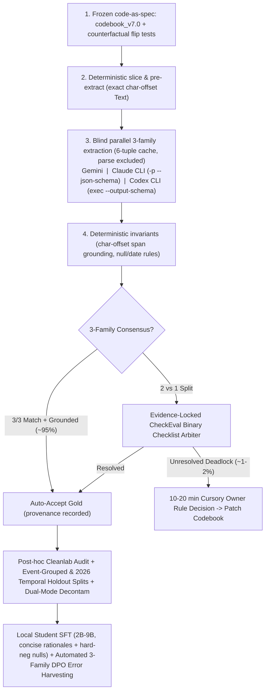

# DocMeta V7 Core Reset, Anti-Chaos 3-Family SOTA Factory & External Interoperability Plan

**Date:** November 22, 2026  
**Scope:** Consolidated external consulting recommendation (2024–2026 LLM dataset engineering research, active open-source GitHub pipelines, Apache Software Foundation governance, and U.S./international Congressional document schemas), grounded in the empirical Horizon 0 audit of the sealed V6.5 SSOT (`3,733` rows) and tailored to **unlimited 3-family frontier model access (Gemini + Claude CLI + Codex CLI)** with **low human review bandwidth**.

---

## 1. Executive Assessment & Locked Owner Decisions (2026-11-22)

An external architectural audit of the repository yields two clear conclusions:

1. **Your strategic bet and storage custody layer are strong — protect them:**
   - **Genuine domain whitespace:** No authoritative U.S. government, Library of Congress (LoC), international standards body, open-source repo, or academic dataset defines a unified schema/ontology for the full "around Congress" committee, hearing, and oversight ecosystem.
   - **Sound ASF "WAP-Lite" custody:** Content-addressed Parquet/DataFusion tables, byte-hashed parser pins, 6 model invariant suites, immutable backups, and sealed SHA-256 SSOT manifests already deliver ~90% of Apache Iceberg Write-Audit-Publish (WAP) discipline without cluster operations overhead.
2. **The V4–V6.5 labeling and repair loop hit a structural ceiling — pause training and reset at V7:**
   - **~1.68 MB (`1,676,992` bytes across 24 `*v[456]*.py` files, out of `2.16 MB` / 44 Python files) of compensating heuristic/repair sprawl** accumulated inside [packages/congress_docmeta/src/congress_docmeta/](../../packages/congress_docmeta/src/congress_docmeta/) (`normalize_gold_v6_5.py` `217 KB`, `gold_contract.py` `177 KB`, `hygiene_and_line_parsers_v6.py` `162 KB`, `zero_llm_bypass_v6.py` `138 KB`, `relational_rules_v6.py` `127 KB`, `citations_and_signals_v6.py` `121 KB`).
   - **47-way flat schema squeezed through one 2B constrained-JSON pass:** Mixing document genre, container packets (`multi_doc_packet`), media layout (`slides_or_visual`, `event_web_page`), and refusal/error states (`error_or_non_document`) in a single enum alongside 35+ conditional fields magnifies the small-model semantic gap.
   - **Empirical defects caught in Horizon 0:** `8.29%` ungrounded `personas` (`31.0%` inside `hearing_transcript`), `68.5%` House-event overlap between `heldout_v6_4` and `train` (`50.0%` in `blind_val48`), `+36.3` to `+68.9 pp` batch criteria drift, and `8.52%` (`307 / 3,603`) Cleanlab label issues.

### Locked Owner Decisions

| Decision | Locked Direction |
| :--- | :--- |
| **A1 — Horizon 0 Audit** | Execute read-only Cleanlab + dual-mode decontamination + grounding audit on the V6.5 SSOT first, and let those empirical findings drive documentation and tickets. *(Completed 2026-11-22; findings in Section 3.)* |
| **A2 — V6.5 vs. V7** | **Pause/supersede V6.5 training (`ct-flq8`, `ct-u3eh`)** and execute the **DocMeta V7 Core Reset** before training any new local student model. Do not waste GPU/eval cycles distilling ungrounded transcript targets, batch drift, or `multi_doc_packet` label noise. |
| **A3 — External Interoperability** | Bundle all three zero-retraining standards into upcoming public releases: **(1)** Static outward `doc_kind` crosswalk to `docs.house.gov` (18+4 types), `api.congress.gov/v3`, and LoC `LCGFT` URIs (`ct-rlw5`); **(2)** **Ban, Park & You (*APSR* 2023)** 9-parent / 18-child witness organization taxonomy inside Org Entities (`ct-6him`, `ct-lwxs`, `ct-lvdf`); **(3)** **MLCommons Croissant JSON-LD + W3C DCAT 3** release catalog manifest (`ct-rlw5`). |
| **A4 — Human Bandwidth** | Ultra-low human review bandwidth (**cursory owner reads + SOTA model adjudication**). Automate ~95–98% of consensus and invariant verification; reserve owner eyes strictly for rule/codebook decisions on rare ~1–2% 3-family deadlocks and a tiny 30–50-doc calibration anchor. |
| **A5 — Horizon 3 Priority** | **V7 Core Reset:** FRBR `Work`/`Expression`/`Manifestation` + Scheduled-vs-Realized Events (`ForeseenActivity` → `Activity`) + decomposed specialist extractors, retiring the ~1.68 MB `v4`–`v6.5` rule tangle. |
| **Unlimited 3-Family SOTA Scope** | Unlimited use of **Gemini (native Antigravity)**, **Claude CLI** (`/Users/mikewolfd/.local/bin/claude`, `2.1.328 (Claude Code)`), and **Codex CLI** (`/Users/mikewolfd/.nvm/versions/node/v22.22.2/bin/codex`, `codex-cli 0.169.0`) scoped for dataset engineering, blind consensus labeling, binary-checklist adjudication, counterfactual testing, and student distillation (while bulk archive sweep inference over 320,629+ documents stays on a fast pinned local student model + deterministic pre-extractors). |

---

## 2. Verified External Research Synthesis

### 2.1 SOTA LLM-Agent Dataset Engineering (2024–2026) — Seven Empirical Laws

| # | Empirical Law | Verified Evidence & Citations | Engineering Consequence for V7 |
| :--- | :--- | :--- | :--- |
| **1** | **Expect criteria drift; treat codebooks & rubrics as versioned, counterfactually tested code.** | *EvalGen* (UIST 2024, [arXiv:2404.12272](https://arxiv.org/abs/2404.12272)); *Baumann et al.* (Sep 2025, [arXiv:2509.08825](https://arxiv.org/abs/2509.08825): ~31% erroneous downstream conclusions under unverified prompt edits); *Asgari et al.* (Oct 2026, [arXiv:2610.24971](https://arxiv.org/abs/2610.24971): rubric wording swings pass rates 2%→100%; closed-form Shapley attribution); *Bagaria et al.* (EMNLP 2026, [arXiv:2609.02942](https://arxiv.org/abs/2609.02942)). | No live prompt whack-a-mole. Lock `codebook_v7.0` in Git; gate edits on counterfactual flip tests + Golden Regression set. |
| **2** | **Never let one model family act as sole teacher and sole judge.** | Perplexity self-preference & self-refinement bias amplification: *Panickssery et al.* (NeurIPS 2024, [arXiv:2404.13076](https://arxiv.org/abs/2404.13076)), *Wataoka et al.* ([arXiv:2410.21819](https://arxiv.org/abs/2410.21819)), *Xu et al.* (ACL 2024, [arXiv:2402.11436](https://arxiv.org/abs/2402.11436)). Cross-family juries + binary checklists fix this: **PoLL** ([arXiv:2404.18796](https://arxiv.org/abs/2404.18796)), **CheckEval** (EMNLP 2024, [arXiv:2403.18771](https://arxiv.org/abs/2403.18771)), **Autorubric** ([arXiv:2603.00077](https://arxiv.org/abs/2603.00077)). | Run **Gemini + Claude CLI + Codex CLI** blindly in parallel; resolve 2-vs-1 splits via evidence-locked binary Yes/No checklists (`CheckEval`). |
| **3** | **Gate automation statistically—never on vibes or raw accuracy alone.** | *Norman et al.* (UC Berkeley, Jun 2026, [arXiv:2606.19544](https://arxiv.org/abs/2606.19544): 33–41 pp kappa deflation); *Rao & Callison-Burch* (Jun 2026, [arXiv:2606.00093](https://arxiv.org/abs/2606.00093)); **Alt-Test** (ACL 2025, [arXiv:2501.10970](https://arxiv.org/abs/2501.10970): non-inferiority $\omega \ge 0.5$); **AltRA-Test** (Nov 2026, [arXiv:2611.26073](https://arxiv.org/abs/2611.26073)). | Always report raw confusion tables, Macro-F1, multi-class κ, **and** multi-class Gwet's $\text{AC}_1$ together (avoiding the binary rare-class Kappa Paradox). |
| **4** | **Audit noiseless/high-confidence errors post-hoc via Confident Learning.** | **Confident Learning** (Northcutt et al., [arXiv:1911.00068](https://arxiv.org/abs/1911.00068)); token/NER extensions ([arXiv:2210.03920](https://arxiv.org/abs/2210.03920)); **`cleanlab/cleanlab`**; **Semantic Entropy** (*Nature* 2024, [DOI](https://www.nature.com/articles/s41586-024-07421-0)). | Run out-of-fold Confident Learning (`cleanlab`) after every labeling batch—and check a small owner anchor to catch correlated 3-family blind spots (**Artificial Hivemind**, *Jiang et al.* [arXiv:2510.22954](https://arxiv.org/abs/2510.22954)). |
| **5** | **Design targets for small-model (2B–9B) learnability, not frontier verbosity.** | Constrained decoding enforces 100% syntax while masking a **scale-dependent semantic gap** (*JSONSchemaBench* [arXiv:2501.10868](https://arxiv.org/abs/2501.10868), *Chavan* Sep 2026 [arXiv:2609.23742](https://arxiv.org/abs/2609.23742)); verbose frontier CoTs hurt sub-7B students (*Li et al.* ACL 2025 [arXiv:2502.12143](https://arxiv.org/abs/2502.12143)); fixes: **UniversalNER** ([arXiv:2308.03279](https://arxiv.org/abs/2308.03279)), **GoLLIE** ([arXiv:2310.03668](https://arxiv.org/abs/2310.03668)), **CRANE** ([arXiv:2502.09061](https://arxiv.org/abs/2502.09061)), **SLOT** ([arXiv:2505.04016](https://arxiv.org/abs/2505.04016)), **AbstentionBench** ([arXiv:2506.09038](https://arxiv.org/abs/2506.09038)), **ADELIE** ([arXiv:2405.05008](https://arxiv.org/abs/2405.05008)), **ReaderLM-v2** ([arXiv:2503.01151](https://arxiv.org/abs/2503.01151)). | Split 47-way schema into coarse genre + 5 tight specialist schemas; enforce verbatim span grounding; distill concise rationales + explicit `null` hard negatives + offline DPO on harvested student failures. |
| **6** | **Cache raw completions by content hash—and deliberately exclude `parse()`.** | **`bespokelabsai/curator`** 6-tuple cache key excluding `parse()`; **`google/langextract`** exact character-offset grounding; **`allenai/dolma`** non-destructive sidecars; **`argilla`** immutable `Suggestion` vs `Response`; **`pydantic-ai`** bounded `ModelRetry`; **`dspy` `GEPA`** (ICLR 2026 Oral, [arXiv:2507.19457](https://arxiv.org/abs/2507.19457)). | Replaying normalization/post-processing fixes across 10K+ cached 3-family CLI responses takes seconds at zero re-inference latency. |
| **7** | **Seal releases with WAP immutability and dual-mode decontamination.** | *Yang et al.* ([arXiv:2311.04850](https://arxiv.org/abs/2311.04850): 8%–18% paraphrased leakage passes n-grams); **`allenai/open-instruct`** dual n-gram + dense vector filter; *LiveBench* ([arXiv:2406.19314](https://arxiv.org/abs/2406.19314)); **Apache Iceberg/DataFusion/Hamilton/Burr** + **MLCommons Croissant RAI 1.0**. | Never split per document. Split strictly by **event + cluster + temporal cutoff**, verify via dual 8/13-gram + MiniLM decontamination, and seal releases with Croissant + DCAT 3. |

**ASF Governance & Dead-End Disambiguation (Late 2026 Verified):**
- **Active ASF TLPs/Incubating relevant to our Python/DataFusion/Parquet stack:** Apache DataFusion (TLP Apr 2024), Apache Arrow/Parquet, **Apache Hamilton** (Incubating Apr 2025 — zero-infra Python micro-DAG with `code_version`+`data_version` cache & `@check_output`), **Apache Burr** (Incubating May 2025 — persisted agent state machines), plus **Apache Iceberg / Polaris** (TLP Feb 2026) / **Gravitino** (TLP Jun 2025) if we ever outgrow Parquet WAP-lite (>1M multi-team docs).
- **Skip / Avoid:** `databricks/lilac` (archived Jul 25, 2025), `instructlab/sdg` (archived Apr 30, 2026), `lakeFS >= v1.87.0` (BSL 1.1 since Sep 22, 2026), Label Studio Enterprise paywall, and OpenMetadata split-licensing.

### 2.2 U.S. & International Congressional Schema Landscape

**Verified Boundary:** **No single, unified schema or ontology exists for all documents in and around the U.S. Congress.**
- **Standardized:** Core statutes/bills/amendments (**GPO `usgpo/uslm` XSD `2.0.x`/`2.1.0`**; `proposed` adds `<committeeReport>` + CBO scores), bill actions (**`bill-status` `v3.0.0`**), floor roll calls, Lobbying Disclosure Act (`lda.senate.gov`), GovInfo `MODS`/`PREMIS` archival wrappers (`CHRG`, `CRPT`, `CPRT`, `CREC`, `CMR`), and **`api.congress.gov/v3/committee-meeting`** (**18 meeting doc types + 4 witness doc types**, anchored upstream to **`docs.house.gov`** XML & `HHRG` filenames — House-only, no XSD, unstructured PDFs).
- **Coarse Library Genre Fallback:** LoC **`LCGFT`** has `Legislative hearings` ([gf2013025047](http://id.loc.gov/authorities/genreForms/gf2013025047)) and `Legislative bills` ([gf2011026360](http://id.loc.gov/authorities/genreForms/gf2011026360)), but lumps committee prints, reports, journals, statements, QFRs, and TTFs into one umbrella term (`Legislative materials`, [gf2011026362](http://id.loc.gov/authorities/genreForms/gf2011026362)).
- **Unstandardized Open Gap ("Around Congress"):** Senate committee packets, structured Truth-in-Testimony Rule XI disclosures, structured QFR Q&A threads, unanimous-consent exhibits/statements for the record, markup/ANS diffs, attendance/vote sheets, oversight letters/subpoenas, cross-lifecycle hearing identity (notice → video → PDFs → bound `CHRG`), speaker-turn `CHRG` markup, and persistent authority IDs for non-member witnesses/orgs.

**What to Borrow vs. Skip:**
- **Borrow Conceptual Models (Implement in Pydantic + Parquet, NOT OWL/XML):**
  1. **UK Parliament Ontologies** ([ukparliament.github.io/ontologies](https://ukparliament.github.io/ontologies/)): **`Record`** (FRBR `Work`/`Expression`/`Manifestation`/`Collection`), **`Submission`** (`CallForEvidence`, `CallForOralEvidence`, `Compelled` subpoenas, `CallForRecords`, written `Contribution`), and **`Reporting`**.
  2. **EU ELI-DL** ([data.europarl.europa.eu](https://data.europarl.europa.eu)): **`ForeseenActivity` → `Activity`** (separates scheduled meeting notices/postponements/cancellations from realized convened sittings).
  3. **Official U.S. & Validated Research Crosswalks:** Keep **`docs.house.gov`** (`WS`, `WT`, `WB`, `WD`, `SD`, `CV`, `ANS`, `QFR`) and **`api.congress.gov/v3/committee-meeting`** (18+4 enum) as external crosswalk targets; adopt **Ban, Park & You (*APSR* 2023, [DOI:10.1017/S0003055422000405](https://doi.org/10.1017/S0003055422000405))** 9-parent / 18-child witness-org taxonomy (linking cleanly with **MIT BICAM** [DOI:10.1038/s41597-025-05737-8](https://doi.org/10.1038/s41597-025-05737-8), **C-QUERI** [arXiv:2509.21548](https://arxiv.org/abs/2509.21548), **CoCoHD** [arXiv:2410.03099](https://arxiv.org/abs/2410.03099), **Levin Center CORD**); borrow **ParlaMint** (`#chair`/`#regular`/`#guest`) & **Canada `ourcommons.ca`** (`Affiliation`, `Timestamp`, `InCameraNote`) transcript patterns in Horizon 3+.
- **Skip:** Akoma Ntoso 3.0 XML as storage (USLM isn't AKN-validatable; Westminster-plenary biased), OWL-DL/SPARQL triple stores (2005–2012 U.S. Congressional RDF efforts died of ops friction), `LCGFT` as an internal operational taxonomy (map outward only), and Open Civic Data `EventDocument` (flat URL pointer).

---

## 3. Empirical Horizon 0 Audit Report (`docmeta_gold_v6_5.jsonl`)

**Target audited (read-only):** `.cache/archive-release/docmeta-v65-raretypes-20261118/ssot/docmeta_gold_v6_5.jsonl`  
**Manifest SHA-256:** `72f9d446dbe3850078c27757efdb1eecfeff6e14257a1ba29c044af39b28093a` (`3,733` rows: `train=3,268`, `heldout_v6_4=180`, `test_gapfill=179`, `excluded=50`, `blind_val48=48`, `blind_docs8=8`; `3,603` non-excluded `usable` rows across `47` `primary_kind`s).

### Finding 1 — Ungrounded Gold Targets Would Teach the 2B Student to Hallucinate

Checking exact verbatim substring / token presence of gold targets inside the pure `Text:` input slice (`n = 3,603`):

| Gold Field | Ungrounded Count | Rate | Observed Failure Mechanism & Examples |
| :--- | :---: | :---: | :--- |
| **`personas[].name`** | **`594 / 7,167`** | **`8.29%`** | **`569 / 594` (`31.0%` of `1,833` transcript personas across `126` docs)** live in **`hearing_transcript`** — witnesses/questioners pulled from pages 3–80 or upstream metadata absent from p1–2 `Text:` (e.g., `949d388efed943f8`, `b59415a3daac2294`). |
| **`verbatim_title`** | **`243 / 2,028`** | **`11.98%`** | Exact-substring misses (`15 / 2,028` / `0.74%` even `<80%` token overlap) — synthesized em-dash headings (`"COMMITTEE ON THE JUDICIARY — HOUSE OF REPRESENTATIVES — ..."` in `3a6e375029455b2a`, `"Durbin 1st degree #1"` in `f2f40847798e60aa`). |
| **`date_spans`** | **`52 / 3,837`** | **`1.36%`** | Schema defines `date_spans` as *"verbatim date substrings copied from p1-2 BEFORE ISO normalization"*, yet `52` entries contain raw ISO dates (`2022-01-13` in `fe46fde127b02f6f`, `2011-05-25` in `67a3360853ab4cdc`) leaked from `Advisory known metadata`. |
| **`issuer_org`** | **`21 / 447`** | **`4.70%`** | Unmentioned acronyms expanded from world knowledge (`IRS` → `"Internal Revenue Service"` in `5e64a90967b526a9`, `"Government Accountability Office"` in `93515c014758c608`, `"U.S. Energy Information Administration"` in `bd54a49488c9f8a5`). |

### Finding 2 — Severe Same-Hearing Event, Template & Temporal Leakage Across Splits

Exact `saved_body_hex`, `text_sha256`, `link_key_hex`, `doc_key`, and normalized-text overlap between `train` and all `415` eval rows is **`0`**. Because splits were drawn per document instead of by hearing event + temporal cutoff, structural leakage is severe:

| Eval Split (`n`) | Shares House Hearing/Meeting Event w/ `train` | Same Event **AND** Same `primary_kind` | `13-gram ≥ 0.50` | `8-gram ≥ 0.50` | `TF-IDF ≥ 0.80` | `MiniLM Emb ≥ 0.90` |
| :--- | :---: | :---: | :---: | :---: | :---: | :---: |
| **`heldout_v6_4`** (`180`) | **`63 / 92` (`68.5%`)** | **`51`** | `13` | `16` | `15` | `22` |
| **`test_gapfill`** (`179`) | `14 / 67` (`20.9%`) | `6` | `25` | `31` | `31` | `34` |
| **`blind_val48`** (`48`) | **`9 / 18` (`50.0%`)** | **`7`** | `2` | `5` | `4` | `1` |
| **`blind_docs8`** (`8`) | `0 / 3` (`0.0%`) | `0` | `1` | `1` | `0` | `2` |
| **All Eval (`415`)** | **`86 / 180` (`47.8%`)** | **`64`** | **`41` (`9.9%`)** | **`53` (`12.8%`)** | **`50` (`12.0%`)** | **`59` (`14.2%`)** |

- **Template & semantic-only collisions:** `30` semantic-only eval-vs-train pairs (`MiniLM ≥ 0.85` with `8-gram < 0.25`) slipped past n-grams—including `0e0a5b312644348b` (`test_gapfill`, `external_submission_letter`) vs `97584087007ce901` (`train`, `witness_statement`), sharing identical organization letterhead with opposite labels. `blind_val48` `0617b3d4503a5415` (`CRPT-119-FA00-Vote043-202509`) shares the same markup day and committee template as `train` `1866586207caba5d` (`CRPT-119-FA00-Vote110-202509`, `TF-IDF=0.96`, `8-gram=0.73`).
- **No temporal holdout:** `train` spans straight through `2025` (`156` docs) and `2026` (`138` docs), co-mingled with `2025`–`2026` docs in every eval split.

### Finding 3 — Severe Criteria Drift Between Labeling Batches (`v6_4_old` vs `v6_5_gapfill`)

Comparing field fill rates on the **same `primary_kind`** (`31` kinds with ≥ 8 rows in both batches) proves 36–69 pp supervision shifts inside the same sealed file:

| `primary_kind` | Field | `v6_4_old` Fill | `v6_5_gapfill` Fill | Delta |
| :--- | :--- | :---: | :---: | :---: |
| `explanatory_statement` | `date_spans` | `11.1%` (`n=9`) | `80.0%` (`n=10`) | **`+68.9 pp`** |
| `witness_statement` | `issuer_org` | `11.8%` (`n=670`) | `67.6%` (`n=34`) | **`+55.9 pp`** |
| `legal_or_investigative_filing` | `subkind` | `14.3%` (`n=14`) | `70.0%` (`n=10`) | **`+55.7 pp`** |
| `public_comment_or_submission` | `issuer_org` | `38.9%` (`n=18`) | `94.4%` (`n=18`) | **`+55.6 pp`** |
| `bill_or_draft` | `subkind` | `53.0%` (`n=117`) | `0.0%` (`n=11`) | **`-53.0 pp`** |
| `committee_rules` | `event_type` | `6.2%` (`n=16`) | `58.8%` (`n=17`) | **`+52.6 pp`** |
| `witness_invitation` | `secondary_kinds` | `3.2%` (`n=31`) | `50.0%` (`n=10`) | **`+46.8 pp`** |
| `external_submission_letter` | `issuer_org` | `52.6%` (`n=38`) | `88.9%` (`n=9`) | **`+36.3 pp`** |

### Finding 4 — Cleanlab Confident Learning Pinpoints Broken Taxonomy Classes & Real Gold Errors

A 5-fold pure-text linear probe (`0.65` word 1–2-gram TF-IDF + `0.35` pinned local `all-MiniLM-L6-v2`; **zero** filenames, **zero** known metadata, **zero** LLM) scored **Accuracy = `0.8368`, Macro-F1 = `0.7136`, Weighted-F1 = `0.8167`, Cohen's κ = `0.8184`, Gwet's AC₁ = `0.8336`**. Running `cleanlab.filter.find_label_issues(filter_by="both")` flagged **`307 / 3,603` (`8.52%`)** rows (`35` high-confidence contradictions where `p_pred ≥ 0.55` & `p_given ≤ 0.15`):

- **Flagged rate by split & batch:** `train` `258/3197 (8.1%)` (`v6_4_old` `7.8%`, `v6_5_gapfill` **`11.2%`**), `heldout_v6_4` `16/175 (9.1%)`, `test_gapfill` `22/175 (12.6%)`, `blind_val48` **`11/48 (22.9%)`**, `blind_docs8` `0/8 (0.0%)`.
- **Taxonomy classes empirically broken (Confident Joint & OOF F1):**
  - **`multi_doc_packet`** (`n=16`, **F1 = `0.000`**): Drives **14 of the top 20 collision pairs** (`74×` w/ `witness_statement`, `31×` w/ `member_opening_statement`, `23×` w/ `external_submission_letter`, `23×` w/ `qfr_response`, `22×` w/ `hearing_memo_or_charter`). It is a container attribute, not a genre.
  - **`slides_or_visual`** (`n=24`, **F1 = `0.065`**): A media layout format (`10×` w/ `witness_statement`, `9×` w/ `error_or_non_document`), not a genre.
  - **`error_or_non_document`** (`n=19`, **F1 = `0.480`**): Explicitly contradicts `status = "usable"`.
  - **`press_release_or_fact_sheet`** (`n=32`, **F1 = `0.000`**), **`public_comment_or_submission`** (`0.286`), **`member_or_floor_statement`** (`0.348`), **`qfr_response`** (`0.391`), and **`external_submission_letter`** (`0.429`) suffer chronic overlapping definitions.
  - **Metric trap confirmed:** On `multi_doc_packet` (`F1=0.000`, `κ=0.000`), binary 1-vs-46 Gwet's `AC₁` reads `0.996` due to 99.5% true negatives — report multi-class `κ` + multi-class `AC₁` + Macro-F1 + per-class F1 together.
- **Concrete gold errors exposed:** `1c972fa59dbbe8a3` (`-TTF-` slug fooled gold into `truth_in_testimony_disclosure` on an invitation letter; 101 docs across the top filename-slug mismatch patterns contradict their House slug), `3f47a2b0b2996a65` (prose testimony labeled `slides_or_visual`), `7186b08230ab4a06` (testimony labeled `multi_doc_packet`), `239cfeeb8e375af4` (Ukrainian UN Commission statement in `other`), `7f4bab1e32ea8d4b` (letter to White House labeled `public_comment_or_submission`).

### Finding 5 — 47-Class Eval Sparsity & Empirically Discovered V7 Specialist Clusters

- **Eval sparsity:** `25 / 47` kinds have `< 30` training examples (`11 < 20`; `revenue_or_cost_estimate = 10`); `33 / 47` have `< 3` rows in `heldout_v6_4`; **`25 / 47` have zero rows** in `blind_val48 + blind_docs8`; the top 3 classes alone (`witness_statement` `655`, `witness_biography` `521`, `hearing_transcript` `295`) account for `45.0%` (`1,471 / 3,268`) of training rows.
- **Observed field-fill structure yields 5 tight V7 specialist families + 3 orthogonal flags:**

| V7 Specialist Family | Defining Sparse Fields (Measured SSOT Fill Rate) | Collapsed V6.5 Genres |
| :--- | :--- | :--- |
| **1. Hearing & Event Logistics** | `venue` (`86–98%`), `event_time`, `venue_kind`, `event_title` (`87–96%`) | Hearing notices, markup notices, hearing memos/charters, witness lists |
| **2. Testimony, Bios & Disclosures** | `personas` (`93–100%`), `disclosure` (`94%` on TTF only), `prior_roles`/`education` | Witness statements, bios, Truth-in-Testimony forms, member statements, nominee APQs |
| **3. Transcripts, Votes & Attendance** | `members_present`/`staff_present` (transcripts), `action_summary` (`65–99%`) | Hearing transcripts, committee votes, meeting results, attendance/quorum sheets, resolutions |
| **4. Correspondence, QFRs & Oversight** | `correspondence_flow` (`91–100%`), `signatory_count` (`38–47%`), `due_date` (`31–94%`) | Oversight letters, QFR requests/responses, witness invitations, external/support/public letters |
| **5. Legislation, Reports & Fiscal** | `short_titles` (`55–95%`), `refs` (`96–100%`), `fiscal_years` (`42–95%`), `issuer_org` (`77–92%`) | Bills/drafts, amendments, comparative prints, section-by-sections, committee/CRS/GAO/external reports, budget/revenue/explanatory statements |

Plus three orthogonal properties extracted **out** of the genre enum: `status` (absorbs `error_or_non_document`), `is_packet` / `contains_kinds[]` (replaces `multi_doc_packet`), and `media_format` (`prose` | `slides` | `web_page` | `table_or_form` — replaces `slides_or_visual` and `event_web_page` as document genres).

---

## 4. V7 Architecture & Unlimited 3-Family SOTA Factory Design

### 4.1 Target Schema & Conceptual Model (V7.1)

Implement clean conceptual separation from **UK Parliament Ontologies + EU ELI-DL** directly in **Pydantic v2 + Parquet + DataFusion** (no OWL triple stores, no Akoma Ntoso XML):

1. **FRBR `Work` → `Expression` → `Manifestation`:** Decouple logical intellectual artifact (e.g., witness testimony) from revisions and exact captured bytes/checksums (`saved_body_hex`).
2. **Scheduled (`ForeseenActivity`) → Realized (`Activity`) Event + `Demand` → `Submission` → `Disposition`:** Model postponed/cancelled/multi-day/joint hearings and separate institutional triggers (notices, invitations, QFR requests, subpoenas) from submissions and dispositions cleanly.
3. **Two-Stage Decomposed Extraction:**
   - **Stage 0 (Deterministic `Apache Hamilton` / `DataFusion` pre-extract):** Extract `HHRG`/GPO filename tokens, statutory/bill `refs`, `date_spans`, and HTML/XML/cover wrappers in pure Python before any LLM runs.
   - **Stage 1 (Core Envelope Triage):** Emit orthogonal `status`, `media_format`, `is_packet`, `primary_genre` (~12–15 non-overlapping genres), `subkind`, and core bibliographic fields (`verbatim_title`, `doc_date`, `committees`, `chamber`).
   - **Stage 2 (Specialist Extractors):** Route `usable` docs to one of the **5 tight specialist Pydantic schemas**, keeping per-call schema size small enough for a fine-tuned 2B–9B student with decoupled concise rationales (`CRANE`/`SLOT` pattern).
4. **Outward Interoperability Layer:** Maintain a checked-in crosswalk projecting V7 genres outward to `api.congress.gov/v3/committee-meeting` (18+4 values), `docs.house.gov` codes (`WS`/`WT`/`WB`/`WD`/`SD`/`CV`/`ANS`/`QFR`), and LoC `LCGFT` URIs, plus a generated **MLCommons Croissant JSON-LD + W3C DCAT 3** manifest on release. Add the **Ban, Park & You** 9-parent / 18-child taxonomy inside the parallel Org Entities track.

### 4.2 Low-Bandwidth "Unlimited 3-Family SOTA Factory" (V7.2 → V7.3)

Because **Gemini (Antigravity) + Claude CLI + Codex CLI** are unlimited for this task while owner review bandwidth is tight (**A4**):

- **Verified Headless CLI Invocation Contracts:**
  - **Claude CLI** (`/Users/mikewolfd/.local/bin/claude`, `2.1.328 (Claude Code)`): `claude -p --output-format json --json-schema '<schema>'`
  - **Codex CLI** (`/Users/mikewolfd/.nvm/versions/node/v22.22.2/bin/codex`, `codex-cli 0.169.0`): `codex exec -s read-only --output-schema <schema.json> -o <out.json> -`
  - **Gemini (Antigravity):** Native model execution using identical frozen prompt + schema.
- **6-Tuple Disk Cache Excluding `parse()` (`bespokelabsai/curator` pattern):** Key every CLI call by `(input_sha256, codebook_version, model_id, prompt_hash, schema_hash, slice_spec)` under `.cache/archive-release/` (never workspace-local `/tmp`). Kept for speed, retry resilience, reproducibility, and zero-cost `parse()` replay—while **deleting** token-budget complexity (`HyPAC` cost cascades, Batch API wait queues, `HyPER`/`MOAR`).
- **Automated Quality Without Human Drudgery:**
  1. **100-doc stratified 3-family pilot first:** Measure 3-family raw consensus, multi-class κ, Gwet's AC₁, and owner check on a 30–50-doc calibration anchor (to detect correlated *Artificial Hivemind* drift) before scaling to `10K–15K` balanced docs (`150–300` verified docs per V7 genre/specialist family).
  2. **Clean-slate re-label + balanced mining:** Discard `v6_4_old` vs `v6_5_gapfill` drift by re-labeling all `3,733` existing docs plus fresh rare-genre samples from the `320,629`-body corpus under one frozen `codebook_v7.0`.
  3. **Automated Counterfactual Stress Tests & Post-Hoc Cleanlab:** Generate synthetic edge perturbations (misleading `-TTF-` filenames, stripped `Present:` blocks, packet covers, absent fields) to verify rules flip verdicts; run `cleanlab` + dual-mode decontamination before every split seal.
  4. **Sealed Event + Temporal Evaluation & Automated DPO:** Hold out `≥ 500` event-isolated + post-cutoff **2026 temporal** docs (`≥ 25` per genre, zero hearing-event or template overlap with train). Harvest failing student predictions on 5,000+ unseen archive docs against 3-family gold to run offline **DPO** (*ADELIE* / *ReaderLM-v2*), and then retire the legacy ~1.68 MB `v4`–`v6.5` heuristic stack (`V7.4`).

### 4.3 Keep / Adopt / Defer / Kill Summary

| Decision | Concrete Artifacts & Practices |
| :--- | :--- |
| **KEEP** | Parquet/DataFusion lake, byte-hashed parser pins, 6 model invariant suites, sealed SHA-256 manifests, existing Cloudflare Desk UI (optional deadlock viewer), Org Entities pipeline (`ct-6him` → `ct-w34j`/`ct-lwxs` → `ct-lvdf`) running in parallel. |
| **ADOPT NOW** | 3-family blind consensus (`Gemini` + `Claude CLI` + `Codex CLI`), 6-tuple parse-decoupled cache, deterministic character-offset span grounding, `CheckEval` binary checklists, `cleanlab` OOF auditing, dual-mode (8/13-gram + MiniLM) decontamination, event-grouped + 2026 temporal splits, `Gwet's AC₁ + κ + Macro-F1`, Ban-Park-You 9/18 org taxonomy, `docs.house.gov`/`LCGFT` outward crosswalk, **Croissant JSON-LD + DCAT 3** release manifest, **`Apache Hamilton`** micro-DAG for deterministic pre-extract, offline **DPO** on harvested student errors. |
| **DEFER / REMOVED** | Token-cost cascades (`HyPAC`, Batch API wait queues, `HyPER`/`MOAR` cost search — unnecessary with unlimited SOTA), online RL/GRPO (until SFT + hard-negative nulls + offline DPO plateau), full Apache Iceberg/Polaris/Gravitino/Airflow 3 clusters (unnecessary below ~1M labeled docs). |
| **KILL / SKIP** | V6.5 training (`ct-flq8`/`ct-u3eh`), Akoma Ntoso 3.0 XML storage, OWL-DL/SPARQL triple stores, `LCGFT` as an operational taxonomy, Open Civic Data `EventDocument`, Label Studio Enterprise, `lakeFS >= v1.87.0` (BSL 1.1), archived `lilac`/`instructlab-sdg`, and single-family prompt whack-a-mole. |

---

## 5. Execution Roadmap & `.tickets/` Graph

### Track A — DocMeta V7 Core Reset (Sequential Critical Path)
- **Superseded / Closed:** `ct-flq8` (V6.5 owner hand review) & `ct-u3eh` (V6.5 LoRA retrain) — linked to `ct-o7j0` and closed with Horizon 0 audit findings & decision A2.
- **`ct-o7j0` (Epic):** *DocMeta V7 Core Reset: FRBR/ELI-DL decomposed schema & 3-family SOTA dataset factory*
  1. **`ct-mqf8` (V7.1)** — *Codebook RFC, FRBR/ELI-DL decomposed specialist schemas & outward crosswalks*
  2. **`ct-02x5` (V7.2)** (depends on `ct-mqf8`) — *3-family SOTA labeling factory (Gemini + Claude CLI + Codex CLI) & 100-doc pilot*
  3. **`ct-so28` (V7.3)** (depends on `ct-02x5`) — *Clean-slate 10K+ 3-family corpus build, Cleanlab audit & local student SFT/DPO*
  4. **`ct-f2ai` (V7.4)** (depends on `ct-so28`) — *Retire legacy v4–v6.5 heuristic tangle (~1.68 MB) & migrate deterministic pre-extract*
- **`ct-rlw5`** (rewired from `ct-u3eh` to depend on `ct-so28`) — *Publish DocMeta structured metadata in the release, MCP and site* (includes outward `docs.house.gov` / `api.congress.gov/v3` / `LCGFT` crosswalk + Croissant JSON-LD / DCAT 3 manifest).

### Track B — Parallel User-Value Delivery (Unblocked Today)
- **`ct-0a35`** (P1) — *Verify selected text through the user's release-bound SereneDB search*.
- **`ct-6him` → `ct-w34j` + `ct-lwxs` → `ct-lvdf`** — Org Entities track enriched with the **Ban, Park & You (*APSR* 2023)** 9-parent / 18-child witness organization taxonomy (`ct-39u8` Wikidata stays P3; News Lake stays P4).
