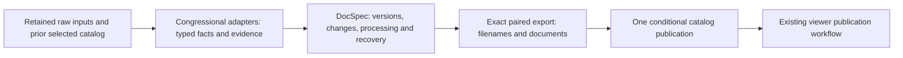

# Move catalog processing to DocSpec Rust

Current application feature adoption is tracked in [the 20 October plan](docspec-application-adoption-20261020.md), including shared archive/news runtime, exact release use and actual local/R2 capability limits. Older capability descriptions below are historical.

Status: **postponed** on 16 October 2026 in favor of repository cleanup and branch integration. Do not start implementation until it is explicitly resumed. The links below to the `catalog-hearing-relations` worktree no longer resolve, because that worktree has since been removed. Re-pin the reference executable from the integrated branch when this plan resumes.

## Updated requirement — 19 October 2026

The user requires incremental updates across raw storage, catalog processing, delivery and the viewer, with no operational full-rebuild requirement. This supersedes the full-rebuild fallback and the assumption below that complete-file exports can remain on the routine update path. A global rule change can affect every record, but must proceed in bounded resumable batches that retain completed work. Unknown dependency scope must produce a specific error, not a reset of the corpus.

The implementation work is tracked in [ct-czsd](../../.tickets/ct-czsd.md). These tickets apply evolutionary refactoring: preserve domain behavior, replace only representations that prevent incremental work, reuse maintained owners, measure the complete changed path, and remove superseded internal routes after migration.

- [ct-l5q1](../../.tickets/ct-l5q1.md): prove a maintained change-storage boundary on one retained package.
- [ct-365w](../../.tickets/ct-365w.md): append raw changes without rewriting history.
- [ct-si9g](../../.tickets/ct-si9g.md): recompute affected catalog records and groups.
- [ct-v5kb](../../.tickets/ct-v5kb.md): publish reusable partitions and migrate readers.
- [ct-ihve](../../.tickets/ct-ihve.md): update viewer assets and reviews by stable identity.
- [ct-dat9](../../.tickets/ct-dat9.md): integrate one resumable update path and retire rebuild routing.
- [ct-2ukk](../../.tickets/ct-2ukk.md): qualify snapshot adoption and complete-path costs.

This updates the requirement and work plan; it does not resume the postponed DocSpec migration, establish that its historical capability gaps are resolved, or start a production cutover. The first ticket must recheck the maintained capabilities against current code before choosing an implementation owner.

## Original proposal and historical evidence

Original status: planning only, 13 October 2026. Migration implementation and qualifying benchmarks wait for the current recovery to finish and pass its final checks. The user subsequently authorized one small isolated benchmark during recovery; its [results](../experiments/docspec-catalog-benchmark-20261013.md) are recorded separately. It found equal elapsed time at 8,197 rows, lower CPU/disk use and higher sampled memory for DocSpec, with exact selected-value parity. It does not establish a full-rebuild speedup or authorize migration.

## Decision and intended result

Use the existing `docspec-rs` engine for retained dataset versions, incremental updates, reusable processing, evidence, recovery and export preparation. Keep congressional acquisition and document interpretation in the congressional application. Replace the large, disposable SQLite staging workspace rather than creating another dataset lifecycle alongside DocSpec.

The intended result is a faster, recoverable catalog update that preserves the same document identities, source evidence, availability states and viewer behavior. Faster execution is an acceptance requirement, not an assumed consequence of choosing Rust.

This plan does not authorize changing the running recovery, restarting it, acquiring more archive content, publishing a replacement catalog, or deploying a migration. The current recovery's writer and watcher remain responsible for its catalog, report and local viewer.

## Start condition: finish recovery first

Before implementation, record the existing run's verified completion:

1. Writer completion and actual exit 0; writer and children physically absent; launchd not running with last exit 0. Preserve completed body uploads and both verified import passes.
2. Selected catalog, exact paired Parquet files, complete readback hashes, raw-input versions, download-state coverage and catalog ID verified.
3. Existing watcher, report and local viewer refresh complete; their actual exits and the live viewer's generation and record count agree.
4. Final source/payload/pin checks and completion report saved. Original paused jobs remain stopped.
5. Send the selected generation and exact paired/readback paths to the already authorized viewer chat. Record ownership of any subsequent lineage overlay before choosing the migration baseline.

Use the recovered catalog as the semantic baseline. If the coordinated lineage overlay publishes afterward, deliberately freeze that newer verified generation and include its lineage fields. Do not silently compare one generation while migrating another. The completed archive search's unvalidated candidates remain outside content holdings.

Current evidence lives under [run-07](../../.cache/document-recovery-finish-20261013T1136Z/run-07/). Its completion must be checked from actual final evidence, not inferred from this plan or a heartbeat.

## Existing behavior to preserve

The active implementation is in the pinned `catalog-hearing-relations` runtime, which includes deliberate edits beyond its Git HEAD. Preserve both the committed version and the accepted file hashes when freezing the reference executable.

| Requirement | Meaning for the migration |
| --- | --- |
| Raw archive authority | Existing bodies, capture receipts and download-state records remain authoritative. Derived processing never changes original failures into successes merely because a variant exists. |
| Exact identity | Keep the current `source_id` and `document_id` algorithms, original URLs, body keys, filenames, format distinctions and representative-row rules. Equal basenames on different endpoints do not prove identity. |
| Evidence | Preserve nested source occurrences, receipt locators, hearing resources, native API associations, candidate associations, provenance basis and explicit unknowns. Metadata records do not become transcripts. |
| Grouping | Endpoint aliases and qualified body identities form transitive groups. Both merges and splits must work, including deletion of a connecting edge. |
| Interpretation | Routine updates preserve saved interpretations across code changes. Explicit repair applies new rules; document-body inspection remains a separate explicit choice. |
| Coverage | Preserve URL rows with no captured body, failures, unsupported formats and state-only rows. Carry the exact download-state digest and row count into the final catalog. |
| Paired publication | `document-filenames.parquet` and `documents.parquet` share one catalog ID and are selected together by one conditional `indexes/catalog.json` update. |
| Consumers | Preserve schema, field meanings, required ordering and metadata for the local viewer, static publication, filters, source lookup, hearing links and downstream readers. |

References: [current rebuild](/Users/mikewolfd/.codex/worktrees/catalog-hearing-relations/congressional-tech/packages/congress_api/src/congress_api/retention/raw_catalog.py), [identity and interpretation](/Users/mikewolfd/.codex/worktrees/catalog-hearing-relations/congressional-tech/packages/congress_api/src/congress_api/retention/document_index.py), [grouping/staging](/Users/mikewolfd/.codex/worktrees/catalog-hearing-relations/congressional-tech/packages/congress_api/src/congress_api/retention/catalog_staging.py), [paired publication](/Users/mikewolfd/.codex/worktrees/catalog-hearing-relations/congressional-tech/packages/congress_api/src/congress_api/retention/catalog_publication.py).

## Target ownership and data flow

**Congressional adapters** retain responsibility for URL rules, archive validity, parser behavior, document kinds, hearing relationships and availability policy. Begin with the maintained Python functions where practical. Emit bounded Arrow/Parquet batches; do not recreate the pickle-backed working database behind a new adapter.

**DocSpec** owns admitted typed inputs, operation identity, completed processing, exact version bindings, evidence associations and reusable results. Use its existing CLI or local HTTP services initially; a new Python binding, scheduler or distributed service is unnecessary for the first integration. Pin its source revision, binary, dependency lockfile and operation definitions.

**Catalog delivery** owns the application-specific two-table format and the existing R2 selection. A DocSpec completion identifies a prepared immutable result; `indexes/catalog.json` identifies the application-visible delivered pair. Those are distinct states. A restart must reconcile delivery of the same exact result, never recompute it or select whichever DocSpec dataset happens to be newest.

**Viewer publication** continues to read the selected pair through its maintained command. Its separate `viewer-publications/` selection must never modify the raw catalog selector. Reuse the viewer team's interface and stale-publication checks; do not create another viewer deployment path.

**Execution durability** is a separate acceptance boundary. The intended scheduled entry point remains the existing workflow and its `raw-source-mirror` exclusion. A fresh GitHub Actions runner cannot recover a previous runner's local DocSpec catalog merely because the output Parquet files are in R2. Qualify the required remote DocSpec operations with R2 and a supported REST catalog before using disposable runners, or make an explicit persistent-host decision with tested restore. Copying a live SQLite catalog into object storage is not a substitute for either design. Local worker-restart tests alone do not establish cross-host recovery.

Proposed typed relations are capture references, current URL state, source rows, source occurrences, hearing-resource associations, alias edges, interpretation results, group membership and grouped documents. Final physical table boundaries follow the compatibility proof; avoid one dataset or lifecycle transaction per row. Keep original locators and field types. If nested values are normalized, preserve occurrence identity, multiplicity, ordering where meaningful, and null-versus-empty distinctions with a round-trip check.

Raw body bytes stay in their existing retained location. Admit the typed facts required for processing and preserve evidence references to the exact raw objects. Do not copy or reupload all raw bodies merely to adopt DocSpec. Where DocSpec requires owned admitted files, use its maintained admission path and account for that one-time cost.

## Capability fit and gaps to resolve first

DocSpec was inspected at revision `91eb44f520221ec91897403e930d23f491b5ffd0`. Recheck its current qualification and freeze the actual implementation revision before the proof.

| Capability | Current evidence | Planned treatment |
| --- | --- | --- |
| Typed batches and durable versions | Arrow/DataFusion and Iceberg/Parquet are the existing implementation. | Reuse; keep SQLite only if required by the embedded Iceberg catalog. No separate application SQL ledger. |
| Source corrections and deletion | Complete-key replacement/deletion against an exact base, unchanged-file sharing and retained completed work exist. | Map source and state changes to these operations; preserve duplicate occurrences. |
| Joins and summaries | Qualified incremental equality joins and bounded aggregate forms exist. General incremental SQL is deferred. | Use supported operations where semantics match. Full processing remains explicit for unsupported changes. |
| Document connected components | No equivalence to the current alias/body graph has been established. | Prove a narrow domain grouping transform. A single changed edge may affect an entire old/new component; a simple changed-row join is insufficient. |
| Nested catalog export | Current `ExportPolicy` permits flat primitive columns and omits source metadata. | This is a compatibility blocker. Qualify nested values, required Parquet metadata and paired export before promising a drop-in migration. Never flatten or drop evidence to fit the existing exporter. |
| Different output cardinalities | Source rows and grouped documents have different row counts. | Do not treat them as row-aligned field groups. Evaluate two exact result versions with DocSpec's existing generation seal; qualify one export operation binding the complete pair. A seal alone is not payload validation or application publication. |
| Remote execution | Remote source-only paths have scoped qualification; computed/related paths have narrower limits. | Prove the local engine first. R2 export of a qualified local result does not establish a fully remote DocSpec processing deployment. |
| Scheduled worker replacement | Local completion depends on retained local engine/catalog state; the existing workflow uses replaceable runners. | Require actual fresh-host recovery for the chosen deployment. Keep this as a production gate, not an operational assumption. |
| Restartable delivery | Existing engine export is for one authorized primitive result; current congressional publication selects two files. | Specify and fault-test the paired nested export and delivery handoff. Prefer a narrowly scoped extension of maintained DocSpec completion/export services over a second recovery ledger. |

DocSpec references: [architecture decisions](/Users/mikewolfd/Work/spicy-stack/docspec-rs/AGENTS.md:64), [implementation plan](/Users/mikewolfd/Work/spicy-stack/docspec-rs/docs/PLAN.md:9), [qualification boundaries](/Users/mikewolfd/Work/spicy-stack/docspec-rs/docs/STATUS.md:72), [export types](/Users/mikewolfd/Work/spicy-stack/docspec-rs/src/export.rs:15), [generation seals](/Users/mikewolfd/Work/spicy-stack/docspec-rs/README.md:853), [incremental refresh](/Users/mikewolfd/Work/spicy-stack/docspec-rs/README.md:955).

The fit proof must settle the public API and exact durable completion record for the domain transform and paired export. Merely calculating values in Python and importing them afterward would leave expensive preprocessing outside DocSpec recovery; that is not a completed migration.

## Implementation sequence after the start condition

### 1. Freeze the comparison inputs and executable

Record the chosen selected manifest and both files, capture/state versions and hashes, seed inputs, interpretation settings, runtime files, DocSpec revision and consumer schema expectations. Reuse existing verified local copies. Admit only missing required evidence through a separately bounded step.

Create a deterministic small corpus of complete connected document groups plus adversarial fixtures. Include high-fanout URLs, large nested evidence, aliases, nulls, same-filename/different-body cases, state-only rows and hearing associations. Preserve source/capture order where the current semantics depend on it.

Deliverable: an offline frozen fixture and reference pair, with a semantic comparison that checks every field and duplicate multiplicity. Ignore only explicitly documented volatile generation/operation metadata; do not broadly exclude provenance, parser versions or table metadata.

### 2. Prove the integration and export boundaries

Run an isolated, local-only DocSpec path over the frozen fixture. Prove typed admission, exact version reads, domain transform completion, nested evidence round-trip, generation binding and paired export. Keep the current production selector read-only.

Use existing DocSpec services where possible. If the export/transform boundary is missing, design the smallest maintained extension and review it against the promised congressional case. Do not introduce arbitrary incremental SQL or a generic workflow platform to solve this migration.

Deliverable: a concrete capability decision and runnable vertical slice, including kill/restart after processing and between the two export files. No production migration until all semantic blockers above have a tested resolution.

### 3. Replace the full rebuild path

Process typed batches through the dependency order: admit facts, associate context, resolve retained captures, annotate availability, reuse or compute interpretation, group documents, write paired output. Preserve the existing domain semantics and use explicit resource budgets for the whole process and child workers.

Retain completed useful stages through DocSpec. Resolve reusable work before reading payloads. Remove the corresponding SQLite staging operations from the candidate implementation; keep the old implementation only as the independent reference and temporary rollback path.

Deliverable: a complete offline rebuild with exact output parity and phase-level timing, memory, scratch and I/O measurements.

### 4. Add qualified incremental catalog updates

Classify changes: new captures, corrections/deletions, state-only changes, new evidence for existing values, hearing relationships, grouping edges and explicit interpretation changes. Track affected dependencies separately from body/filename interpretation reuse.

For graph changes, recompute the full affected old/new component closure and prove merges and splits against a fresh full rebuild. If history, transform support or scope cannot establish that closure, require an explicit correct full rebuild. Do not silently claim incremental work when the implementation scans/reconstructs everything.

Preserve routine-update behavior across code changes. Reuse keys bind actual input hashes and material dependencies; a new parser version alone does not silently reinterpret preserved metadata. Explicit repair gets a separately recorded definition.

Deliverable: unchanged, small-delta, correction, deletion, evidence-only and graph-change results matching the full reference.

### 5. Qualify delivery and consumers

Bind both prepared files, schema metadata, input coverage and hashes to one completed export identity. Retain immutable uploads and reconcile uncertain replies. Check raw-input versions and expected catalog selection before conditional promotion; stale or competing work must not overwrite a newer catalog.

Persist the exact publication intent through the maintained lifecycle before its external effect: completed result pins, export hashes, expected selector, input coverage, definition and publisher ownership. Do not let a stale operation obtain a fresh expected selector and thereby pass the conditional write. Define recovery for an accepted external selector write whose local acknowledgment was lost.

Exercise failures before/after each upload, after selector acceptance but before acknowledgment, between DocSpec completion and application delivery, and during viewer publication. A retry reuses the exact prior completion or reports supersession. It never advances a stale cursor or mixes two generations.

Use an isolated staging prefix for remote qualification after the offline proof. Test actual R2 conditional behavior and readback, then exercise the existing viewer workflow against the candidate pair. Remote qualifications include nested/related data actually used by this application.

Rebase integration work onto the viewer team's released workflow only after current recovery completion and ownership handoff. Their future `update_catalog_after_capture` job and the public viewer publication must both call the maintained entry points, with no duplicate rebuild dispatch and no raw writes on push-validation runs. Verify the actual merged revision rather than the mutable primary checkout used during this planning session.

### 6. Controlled cutover and retirement

After the acceptance report passes, select a final current baseline under the existing single-writer ownership. Run shadow comparisons with no second production selector writer. Switch the maintained catalog entry point to the pinned DocSpec adapter and perform one guarded publication. Verify both the local reader and public viewer publication against the selected generation.

Keep the prior immutable generation and reference executable available for rollback. Rollback is a guarded publication decision that accounts for any captures/state changes since cutover; it must not overwrite new raw facts or regress the viewer silently. Do not automatically delete old evidence, workspaces or native files. Retire the old staging path only after successful update and recovery cases establish the new owner.

## Acceptance and measurement

Correctness gates:

- Full row/schema comparison for both tables with duplicate multiplicity, stable IDs, required ordering and all nonvolatile metadata preserved.
- Complete download-state URL coverage, body-versus-metadata distinctions, failed and unsupported cases, exact-versus-candidate associations, nested provenance and hearing resources.
- Alias bridge insertion/removal, group merge/split, repeated receipts, null/empty values, correction/deletion and adversarial high fanout.
- Unchanged update performs no receipt/body rereads, no dataset rewrite and no catalog publication, apart from required small identity/eligibility checks.
- Real worker termination and lost-reply cases prove completed expensive work is retained and no stale or mixed generation becomes visible.
- A fresh host can recover the chosen deployment's exact accepted work, or the accepted deployment explicitly uses a persistent host with independently tested restore. An ephemeral runner never relies on missing local catalog state.
- Concurrent selection contenders produce one winner; the loser retains its prepared work and reports conflict/supersession.
- Existing consumer integration checks pass, including lineage fields added by the coordinated viewer work.

Performance protocol:

1. Measure the current pinned implementation and candidate on the same frozen inputs, hardware, worker allocation, memory budget and interpretation options. Do not benchmark during recovery or unrelated heavy jobs.
2. Separate cold bootstrap, no-change, 0.1% and 1% deltas, evidence-only/state-only changes, grouping changes and explicit full repair. Keep cache conditions explicit and use at least three fresh-process paired runs for qualifying comparisons.
3. Include admission, processing, evidence, validation and paired export in local elapsed time. Measure actual remote upload/readback and viewer delivery separately, then report complete end-to-end time. Optional deep comparisons run equally for both arms and have their cost reported separately.
4. Record aggregate resident memory, temporary and retained bytes, files scanned/rewritten/reused, object reads/writes, network bytes and retry work. Attribute the native catalog's metadata costs separately from data processing.
5. Proposed targets are at least 2× faster complete local rebuild and 5× faster 1% update, with the existing Linux aggregate-memory budget preserved and lower temporary disk use. These are targets to test, not predicted results. If they fail, retain the measurements and revise the design before cutover; do not lower correctness or quietly redefine the timed path.

A single-file Parquet export of each complete table still costs work proportional to its output size. The existing public viewer also builds a complete publication. Account for these floors rather than advertising changed-row-only end-to-end cost. Changing consumer format to incremental partitions is a separate decision if these costs dominate.

Recorded DocSpec Comments benchmarks and earlier congressional sample improvements demonstrate capabilities in their own scopes; neither establishes a speedup for this migration. Relevant prior evidence: [catalog simplification results](../experiments/core-catalog-simplification/RESULTS.md), [full-workflow qualification](../core-workflow-qualification.md), and the current run's performance diagnosis files.

## Planning conclusion

Proceed with DocSpec as the intended processing and lifecycle owner. Resolve three concrete risks early: exact document-component updates, nested paired export with retained completion, and the handoff from a completed result to one R2 catalog selection. Preserve the existing viewer interface initially so processing improvements can be measured without a simultaneous product migration.

No migration implementation or performance claim is complete yet. The immediate next milestone is verified recovery completion, followed by the frozen offline compatibility proof described above.
