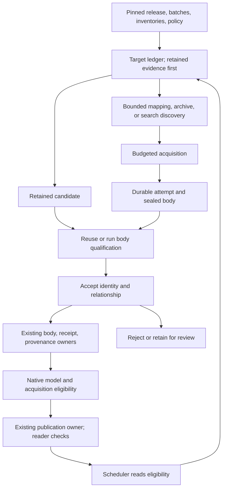

# Holistic Corpus Recovery & Acquisition Architecture

**Updated:** 2026-10-31
**Directly reviewed baseline:** `72d0349838de7a0a9c5fceb9030d4a23dd34dc2c`
**Status:** All seven fixes are implemented and locally verified. Independent review findings are resolved; the final combined run passed 630 tests, including browser/reader, scheduler, crash/restart and resource acceptance. Production corpus totals remain unverified. See the [implementation and verification record](holistic-recovery-execution-20261031.md).

## Decision and scope

Recover useful congressional documents through the existing acquisition, retention, provenance, native-model, and publication owners. Start with retained evidence, qualify new bodies once, establish identity before accepting a recovery, and feed accepted decisions back into scheduling. Prove durable restart and resource limits before adding paid acquisition.

Inputs are a pinned release, selected capture batches, retained inventories, source metadata, and recovery policy. Outputs are qualified bodies, immutable receipts and recovery decisions, a published release, and a scheduler queue reflecting those decisions. A downloaded body alone is not completion.

The modules, fields, and command options below now have implementations in the integration checkout. Their acceptance criteria remain the completion gates. This document does not authorize production acquisition, publication, or credential changes. The existing storage, scheduler, and release-pointer owners remain authoritative.

## Finding 1 — Replace inconsistent totals with a reproducible baseline

**Verified:** The original plan's arithmetic is inconsistent. The named `publish_v20` and `capture_rust_batch1..10` inputs were not located during the bounded review, so these discrepancies do not establish the correct production count.

| Original claim | Sum of listed components | Difference |
| --- | ---: | ---: |
| Total corpus: 1,201,754 | 1,202,991 across four top-level cohorts | +1,237 |
| Redundant XML probes: 17,272 | 17,573 across listed subtypes | +301 |
| Walled calendar pages: approximately 3,975 | 4,585 across listed hosts | +610 |
| Purged documents: approximately 5,809 | 7,338 across listed hosts, including 301 witness URLs | +1,529 |

The five proposed target categories sum to 17,926, but their distinctness, membership, and completeness were not proved. Former host counts, 26 local filename matches, DNS/status assertions, and recovery yields are leads to verify, not execution targets.

**Fix — owner: `corpus_recovery`.** Add a thin `corpus_recovery.campaign` planner using the existing [inventory](../../packages/corpus_recovery/src/corpus_recovery/inventory.py) and native-query facilities:

1. Require explicit locations and immutable identities for the selected release, batches, provenance, registries, and retained inventories. Save `input-manifest.json`. Missing baseline inputs block numerical claims and execution against that baseline; local implementation can continue.
2. Define the universe as distinct literal target URLs from those inputs. Report later-batch additions separately. Preserve normalized keys alongside literal URLs; normalization must not silently merge versions or reduce the denominator.
3. Write `url-dispositions.parquet` with one primary disposition per target: `usable_direct`, `accepted_recovery`, `acquisition_excluded`, `retained_candidate_pending`, `needs_acquisition`, or `unresolved`. Include policy, reason, and evidence IDs. Store overlapping attributes separately. A counterpart satisfies a target only when its explicit requirement allows that relationship.
4. Derive all counts from that ledger, saving `counts.json` and exact queries. Check duplicate, overlapping, unassigned, and evidence-free rows. Begin with metadata joins; do not scan or rehash the whole body store to produce counts.

**Acceptance:** Each target has exactly one disposition; its evidence supports that disposition; primary totals equal the distinct universe; host/subtype subtotals reconcile. Repeated planning over identical pins produces identical memberships with zero acquisition requests. Changed pins invalidate affected results. Replace the original estimates only after these checks pass.

## Workflow and artifact lifetime

| Artifact | Reuse and lifetime |
| --- | --- |
| Input manifest and target ledger | Reuse while input/policy identities match; retain with the campaign audit |
| Discovery responses and candidate lists | Key by source, query, time window, and policy; preserve incomplete/negative evidence and explicit freshness rules |
| Encoded response and partial body | Charge to scratch limits; release after durable decoded-body custody or an explicit abandoned-attempt decision |
| Sealed body and qualification | Reuse by verified body identity and validator version; preserve pending data until import acknowledgment is reconciled |
| Identity decision, receipt, provenance | Immutable; supersede decisions instead of overwriting them |
| Model inputs/output and release | Existing publication owner; preserve inputs and completed stages needed for continuation |
| Validator/render scratch | Bounded workers; remove after durable results, never while referenced by an active or uncertain attempt |

## Finding 2 — Establish identity before reconciliation

**Verified:** [reconcile.py](../../packages/corpus_recovery/src/corpus_recovery/reconcile.py) consumes an accepted decision; it does not establish title, witness, or meeting alignment. A native fixture with contradictory accepted and captured identity metadata still reached `ready_for_owner_import`. The original plan assigned semantic validation to the wrong component.

**Fix — owner: `corpus_recovery`.** Add `corpus_recovery.acceptance` before reconciliation. Bind the target URL and requirement to the candidate URL, body identity, receipt, source/archive time, qualification, proposed relationship, and supporting evidence. Return `accepted`, `rejected`, or `review_required`, with a versioned rule and evidence digest.

- Require positive source-native identifiers and version evidence where available: bill/package, Congress/session, meeting, document, date, and witness/title context. Contradictory authoritative identifiers reject automatic acceptance; missing or ambiguous evidence leaves the target unresolved.
- Treat repaired prefixes, scheme changes, filename matches, and de-hashed search stems as candidate discovery. An XML-to-PDF sibling needs evidence of the requested content; changing its extension is insufficient.
- Preserve distinctions in [recovery-kinds.json](../../model/registries/recovery-kinds.json): original document, content inside a hearing/report, official counterpart, and updated revision. A newer or related document must not become the missing historical original.
- Store structured identity evidence, referenced through `evidence_sha256`. Use the existing recovery fields `kind`, `match_basis`, `decided_by`, `decided_at`, and `supersedes`; keep `identity_note` explanatory. Version the exact-field provenance schema and native inputs together if additional structured fields are needed.
- Keep the target requirement in pinned policy, for example `historical_exact`, `requested_content`, or `current_official_counterpart`. Derive whether the accepted relationship satisfies that requirement; avoid a universal recovery boolean.

**Acceptance:** Wrong witness/meeting, same title with a different date, changed bill version, and filename collision fixtures cannot enter reconciliation as accepted. A supported alias can pass; an updated counterpart remains explicitly classified. The contradictory review fixture must fail at acceptance, while valid previously accepted decisions still use the existing importer without repeating semantic inference.

## Finding 3 — Feed recovery and scope decisions into scheduling

**Verified:** [archive_url_state.py](../../packages/viewer_publication/src/viewer_publication/archive_url_state.py) derives ordinary acquisition history from `mode='fetch'`. A valid ordinary `retained_import` did not remove the failed original from the actual scheduler's due queue. URL-rule kinds are `wrapper`, `strip`, and `repair`, not `retire`; editorial reviews do not govern acquisition.

**Fix — owners: `viewer_publication` and acquisition.** Preserve HTTP history and derive eligibility separately:

1. Add proposed native output fields `capture_disposition` (`eligible`, `satisfied`, `excluded`), `capture_reason`, and `capture_decision_id`, evaluated for the selected requirement and policy version. Retain actual status, attempt, and retry history; do not fabricate a successful fetch for a recovered original.
2. Extend typed inputs in [archive_provenance.py](../../packages/viewer_publication/src/viewer_publication/archive_provenance.py), join current non-superseded acceptance and qualified-body evidence, and export eligibility through [archive_model.py](../../packages/viewer_publication/src/viewer_publication/archive_model.py). Unmatched, rejected, or ambiguous decisions cannot suppress acquisition. Counterparts satisfy only policies that allow them.
3. Apply eligibility in [capture_scheduler.py](../../packages/congress_api/src/congress_api/acquisition/capture_scheduler.py) before due-time selection and budget reservation. Withdraw acceptance through a superseding recovery decision with `kind='rejected'`, which the current native selection already recognizes; do not repurpose editorial reviews. Restore eligibility when no satisfying evidence remains. Keep historical recovery separate from ongoing freshness. Pinned requirements carry `refresh_policy`: `historical_only` permits satisfaction to suppress acquisition; `refresh_live` remains eligible for ordinary refresh even with an accepted recovery. Missing refresh intent defaults to `refresh_live`.
4. Version [archive_profile.py](../../packages/congress_api/src/congress_api/models/archive_profile.py) and producer/consumer schemas together. Recovery campaigns refuse releases lacking the required semantics. Preserve legacy scheduling only as an explicit compatibility path.
5. Check [capture-scope.json](../../model/registries/capture-scope.json) before adding narrow media exclusions. Keep expired stream records discoverable and in-scope captions/document attachments eligible. Do not introduce `retire` URL rewrites or use display reviews to control acquisition.

**Acceptance:** Import a retained recovery, build/publish local URL state, and run the real scheduler against that release. The failed original leaves the historical queue without changing its HTTP history. Wrong identity or an unsatisfying counterpart remains eligible. Test withdrawal, supersession, excluded streams, allowed captions, and live-page refresh. Verify published-reader output as well as SQL results.

## Finding 4 — Provide real execution paths

**Verified:** `scripts/corpus_recovery/import_corpus_recovery_batch.py` does not exist. `govinfo.prepare_packages` prepares previously acquired packages. `webharvest_cdx.py` parses/caches data but is not an archive-query command. Web Harvest fetching admits exact indexed `webharvest.gov` replays, not general Wayback URLs; its Firecrawl branch requested `rawHtml` for the probed PDF candidate.

**Fix:** Reuse the following owners and implement only the missing adapters and thin campaign entry points.

| Work | Existing capability | Required addition |
| --- | --- | --- |
| Retained lookup | [inventory.py](../../packages/corpus_recovery/src/corpus_recovery/inventory.py), [reconcile.py](../../packages/corpus_recovery/src/corpus_recovery/reconcile.py) | Campaign metadata joins and identity acceptance; open payloads only for missing evidence |
| GovInfo/legacy URLs | [govinfo.py](../../packages/corpus_recovery/src/corpus_recovery/govinfo.py) prepares retained packages | Source-specific candidate mappings with identifier/version evidence, then existing direct acquisition if bytes are absent |
| Web Harvest discovery | [webharvest_index_remaining.py](../../scripts/webharvest/webharvest_index_remaining.py) queries CDX; [webharvest_cdx.py](../../scripts/webharvest/webharvest_cdx.py) handles parsing/cache | Adapt the maintained query path to campaign inputs and shared budgets; its historical-input CLI is not directly reusable |
| Wayback replay | Existing Web Harvest checks are intentionally narrower | Separate adapter validating replay host, original URL, timestamp, identity replay form, pagination, and available digest evidence |
| Binary acquisition | [raw_adapters.py](../../packages/congress_api/src/congress_api/transport/raw_adapters.py) owns spool-based transport | Raw-byte PDF/provider paths and shared qualification; never substitute `rawHtml` for PDF bytes |
| Relocated-document discovery | Retained lookup and acquisition can consume candidates | Scoped search adapter, deduplicated queries, bounded candidates, and retained search evidence |
| Body import | `python -m corpus_recovery.reconcile stage/import`; `import_retained(writer, source)` | Campaign wrapper passes accepted sealed local bodies or retained references through this importer |
| Recovery decisions | [provenance CLI](../../packages/congress_api/src/congress_api/cli/provenance.py) stages/applies validated records | Feed accepted records through it; reconcile uncertain writes by immutable identity |
| Publication | [archive_publish_job.py](../../packages/viewer_publication/src/viewer_publication/archive_publish_job.py) owns publication | Invoke with pinned receipt/provenance inputs; read back release and scheduler results |

Retain the source families as discovery work: House XML/PDF siblings and local aliases; Thomas/beta Congress packages; internal CMS and meeting URLs; migrated CloudFront files; walled publishers; and missing committee documents. Verify mappings individually. Legacy URLs need not have deterministic successors, and an old 404 does not establish permanent absence.

Use the implemented capture `--campaign` selector limiting execution to the pinned target/candidate set. Current `--cutoff-urls` is priority/reporting input, not an include-only boundary. Check candidates against retained inventory and the attempt journal before fetching; prevent rediscovery loops. Incomplete, denied, rate-limited, or unpaginated archive searches leave targets unresolved. A complete negative result establishes only no match in the queried index/time window.

**Acceptance:** Every documented entry point has a real parser and local journey. Cover partial CDX results, Web Harvest/Wayback replay identity, binary preservation, invalid hosts, duplicate discovery, and GovInfo version mismatch. Never fetch an out-of-campaign due URL. A retained candidate and a downloaded candidate must each reach acceptance, existing import, publication, and queue readback.

## Finding 5 — Make attempts, imports, and publication restartable

**Verified:** Capture work directories require fresh creation, and per-URL temporary spools are removed on failure. Injected receipt-write failure left a stored body without a completed receipt; a new run fetched again. Lost receipt acknowledgment produced another fetch and receipt on retry. These probes establish those failures, not SIGKILL behavior or production publication loss. Publication continuation was unspecified.

**Fix — owners: acquisition runner and existing retention/publication writers.** Reuse persistence patterns from [Web Harvest recovery](../../scripts/webharvest/webharvest_recovery.py) in shared helpers, then add a durable journal to the existing runner. Avoid a second scheduler.

Derive an operation ID from campaign, target/candidate, request definition, rung/redirect position, and explicit refresh generation. Record each attempt before its network call. Persist these phases:

| Phase | Resume behavior |
| --- | --- |
| `started` | Reconcile provider operation/result where supported. Unknown outcomes retain cost reservations and require a recorded bounded retry decision; do not claim exactly-once remote execution |
| `downloaded` | Reuse sealed spool and established digest/custody; no refetch |
| `qualified` | Reuse matching qualification; continue identity acceptance/import |
| `receipt_prepared` | Reuse frozen bytes and stable key; reconcile uncertain PUT against that identity |
| `receipt_stored` | Reconcile body/provenance acknowledgments, then continue model/publication |
| `published` | Verify the selected release contains the accepted inputs; return without new acquisition |

Extend [ReceiptWriter](../../packages/congress_api/src/congress_api/retention/receipt_writer.py) with an optional stable operation/receipt identity. Freeze timestamps and serialized bytes before the first write. Use create-only storage and compare identity on uncertain acknowledgment; apply the same rule to provenance batches. Conflicts fail instead of overwriting evidence.

Move completed downloads into campaign-owned durable spools before marking `downloaded`. On restart, reconcile sealed files whose phase update was interrupted. Cleanup requires acknowledged body custody and durable downstream records; preserve active/uncertain inputs and bound quarantined/abandoned storage.

Persist publication spec, exact input identities, and completed-stage references, including acknowledged upload identities. Reconcile those assets through local custody and remote metadata before reopening payloads. Restart an unfinished native model in a fresh owned stage while preserving its interrupted attempt. Resume through the existing publication owner, reconciling an already selected release before executing again. Implement any missing continuation in that owner; do not add another release pointer or assume today's fresh-work CLI already resumes.

**Acceptance:** Inject fresh-process failures at download seal, body acknowledgment, receipt preparation, lost receipt acknowledgment, provenance acknowledgment, model output, and release selection. Completed downloads require zero additional acquisition; repeated import creates one logical receipt/decision. Unknown remote outcomes remain explicit, conflicting identities fail, and cleanup preserves active inputs. Include process-kill testing before claiming crash durability.

## Finding 6 — Bound the whole ladder and measure capacity

**Verified:** The existing two-rung request accounting is bounded; a third provider requires revised bounds. Current behavior defers on 429/503 or `Retry-After`, contrary to parts of the original escalation diagram. Capture has no dollar cap; separate Web Harvest acquisition already has conservative request/dollar limits. No current overspend or request-budget violation was demonstrated.

One-worker decoder probes measured approximately **52.9 MiB** peak process resident memory for a **2 MiB** decoded body and **97.7 MiB** for **32 MiB**, with approximately **4.8 MiB** traced Python allocation in each. Memory-mapped pages explain why bounded Python buffers do not establish constant total resident memory. This does not qualify 16 workers or production throughput.

**Fix — owners: transport adapters and capture runner.** Keep spool-based transport and implement one explicit transition policy with shared campaign limits:

| Result | Proposed action |
| --- | --- |
| Successful response and acceptable media type | Seal and qualify before accepting recovery |
| Direct 401/403, supported wall evidence, or file/HTML mismatch | Try Zyte when scope and budgets allow |
| Equivalent Zyte refusal or classified recoverable provider failure | Try Firecrawl when policy and budgets allow |
| Origin 429/503 or applicable `Retry-After` | Defer the origin; do not immediately bypass cooldown through another provider |
| Provider quota/rate limit, exhausted credits, or invalid credentials | Stop admission to that provider and defer; no automatic fallback spend |
| Unknown provider completion/timeout | Reconcile attempt and reservation before a bounded retry |
| Clean origin 404/410 at any rung | Preserve response; proceed to bounded archive/discovery without more scrape calls on that URL |
| Out-of-scope redirect, invalid provider response, or resource ceiling | Stop the attempt with a recorded reason |
| Exhausted allowed rungs/discovery | Leave unresolved with evidence and retry/review status |

Implement these supporting changes:

- **Bounded classification:** Add a versioned 64 KiB prefix classifier beside the fetcher, using maintained [page signals](../../model/registries/page-signals.json) and [file shapes](../../model/registries/file-shapes.json). Gate ambiguous refusal terms by status/context and detect HTML at file-shaped URLs. PDF magic skips HTML classification, not qualification. Share overlapping fixtures with publication SQL; a prefix classifier cannot promise full-body coverage.
- **Adapter boundaries:** Keep direct/Zyte redirects explicit and scope-checked; Zyte requests raw bytes with `followRedirect: false`. Pin and test the proposed Firecrawl options `formats: ["rawBase64"]`, `parsers: []`, `maxAge: 0`, `storeInCache: false` against the supported API before rollout. Validate returned status, final URL, encoding, and byte limits; redact credentials. Count opaque provider calls honestly without claiming visibility into internal origin requests. Require a stricter path where that opacity violates source policy.
- **Requests and spend:** Derive reservations from configured rungs/redirect limits instead of the current fixed two-rung bound. Share actual-call accounting across acquisition, CDX pages, search, and candidate fetches. Reuse the Web Harvest cost-reservation approach: version conservative unit costs/credit limits and enforce `spent + reserved + next_upper_bound <= cap` before dispatch. Reserve atomically under the campaign's single admission owner so concurrent workers cannot oversubscribe a cap. Persist reservations; unknown outcomes retain them. Missing price bounds disable paid execution.
- **Memory and disk:** Reserve encoded/decoded bytes, pending spools, validator scratch, and process memory together. Include validator processes and native threads in total concurrency. Stop admission before exhausting disk reserve. The default capture and qualification input ceiling is 16 MiB; the acceptance fixture verifies a successful body and shared qualification with one worker. Larger inputs or higher concurrency need separate capacity validation. Do not infer a 16-worker limit from a one-worker run. Consider incremental JSON/base64 parsing or windowed mapping only if measured limits cannot otherwise meet the workload.
- **Dependency scope:** Prefer a thin provider adapter using maintained components. The lockfile participates in receipt/sniff identity; a dependency change needs explicit version/invalidation treatment, but does not itself prove all historical bodies need rereading. Avoid importing an entire sibling application or duplicating transport infrastructure.

**Acceptance:** Mixed successes, redirects, throttling, timeouts, and multiple rungs obey tiny request/dollar caps across restart. Measure peak resident memory, temporary/pending disk, bytes read/written, requests, and reservations at the largest admitted body and configured concurrency, including validators/native threads. Record versions, input sizes, cache conditions, concurrency, and stopping limits. Set operational limits from that run; claim throughput improvements only with comparable measurements.

## Finding 7 — Qualify documents beyond sniffing

**Verified:** [sniff.py](../../packages/congress_api/src/congress_api/retention/sniff.py) accepts `%PDF-1.7\nnot a PDF object structure\n%%EOF\n` as `intact=True`; the fixture fails parsing and the maintained Web Harvest validator. Sniffing is intentionally weaker than document readability and cannot be final recovery acceptance.

**Fix — owner: shared recovery qualification.** Move maintained checks from [webharvest_validation.py](../../scripts/webharvest/webharvest_validation.py) into `corpus_recovery.qualification`, retaining the script as a caller. All newly accepted recovered PDFs, regardless of acquisition route, require:

- Complete transfer, appropriate bytes, no qualifying wall/error result, and sealed body identity.
- `pypdf` page traversal/content-stream decoding, recording strict-parser failure and any permitted lenient fallback.
- Successful `pdfinfo`, bounded all-page Poppler rendering, nonzero pages, and the existing EOF check. Optional preview rendering remains separate.
- A qualification result keyed by body digest, validator implementation/configuration, and reader-tool versions. Timeout, missing tools, or resource exhaustion means incomplete qualification and an unresolved target.

Check the cache before opening a body. Replace the helper's preliminary whole-file hash/header/tail read with established digest/custody and bounded prefix/tail reads. Bound parser/render workers separately. Changed or untrusted local files must regain verified custody before cache reuse. Parsing and rendering remain justified for a new candidate; shared bodies should not repeat that work for every URL.

Use format-specific checks for HTML and other supported formats. Readability does not prove requested identity. Preserve original historical sniff versions; this fix does not require replaying the corpus.

**Acceptance:** Fake/truncated PDFs, corrupt page streams, wall HTML at PDF URLs, and resource-exhausting inputs cannot be accepted. Valid bodies from direct, provider, retained, and archive paths use the same qualification. Duplicate bodies reuse results; body/validator changes invalidate them. An intact wrong document still fails identity acceptance.

## Delivery order and completion gates

| Gate | Deliverable | Proof required |
| --- | --- | --- |
| 1. Baseline | Pinned metadata and target ledger | Reconciled memberships/totals; zero acquisition |
| 2. Retained recovery | Shared qualification/cache, identity acceptance, existing importer | Wrong-document rejection and valid import without new acquisition |
| 3. Scheduler feedback | Native eligibility, scope, versioned schemas | Published reader and real queue reflect acceptance, withdrawal, exclusions, and freshness |
| 4. Durable execution | Attempt journal, stable writes, qualification integration, publication continuation | Failure/restart and cleanup checks before paid execution |
| 5. Missing adapters | Scoped mappings, binary provider, archive/search, campaign selection | Local journeys and resource qualification; small live samples before scale |
| 6. Campaign execution | Remaining-target acquisition and publication | Per-target dispositions, reconciled requests/costs, release and queue readback |

Retained reconciliation need not wait for new providers. Prioritize publisher-native documents and relationships; acquire index/calendar pages when they are targets or necessary source evidence. Do not spend on a later rung when retained evidence already satisfies the target.

Scan selected metadata once where possible. Limit payload work to new candidates and unresolved evidence. Account for every reread/hash/copy/decode; use manifests and custody to reuse completed stages. Publish accepted-input checkpoints through the existing owner, not once per candidate. Release scratch only after durable continuation is secured, reporting remaining retained files and their purpose.

A campaign can finish with unresolved targets. Report reasons, evidence, and retry/review status; execution completion is not complete historical recovery. Correct production counts, recovery yield, provider costs, and capacity remain unknown until their gates pass.

## Direct validation record

The review ran **9 targeted probes and 95 existing regression tests, all passing**, against the reviewed code. The probes assert the seven gaps; passing them does not establish that the proposed fixes exist. Regressions covered engine recovery import, URL state, capture scheduling, and raw fetcher behavior.

Local evidence remains at `/tmp/holistic-review-validation-20261031-wdj3_yrb/`. `validation-index.json` maps findings to artifacts/limits; `inputs.json` pins reviewed files and the original plan; `probes.xml` and `regressions.xml` record results; `plan-before-update.md` preserves the original plan. These temporary files are local review evidence, not a durable repository test suite. This revised plan intentionally differs from the original hash.

Native probes used DocSpec revision `eb40c5457a450c3820900583af5b4da13313ca96`, binary SHA-256 `8d33f1d03540fb0bc8160eac18e0121c0cde428feaeb77b4e815abf805f2d819`, with 512 MiB memory, 256 MiB scratch, and two native threads. Memory probes used one fresh process per size and one repetition, with no cold-cache or throughput claim. No paid acquisition or production publication was performed.

The original temporary probe harness hardcodes the primary checkout. Its passing
results establish the baseline findings, not the integrated implementation. Use
the maintained tests and runtime setup in the [execution record](holistic-recovery-execution-20261031.md)
for current acceptance. The ninth probe checked the original plan's arithmetic;
`plan-before-update.md` and `f1-arithmetic.json` preserve its input and result.

Production membership, live source/provider acceptance, current provider prices,
remote upload capacity, and 16-worker throughput remain outside the local proof.
A campaign may complete with explicitly unresolved targets; local implementation
completion does not establish complete historical recovery.
