# DDK replacement: proposed design and delivery boundary

Status: implementation in progress, November 7, 2026. Direct standard-catalog
consumers and a shared native request/finalization boundary are under acceptance.
The full replacement remains incomplete. The release prerequisite is the
parent-owned `implementationReady` value in
`/Users/mikewolfd/Work/artifacts/ddk-replacements-20261106/release-status.json`.
It was false at first inspection. The parent subsequently changed it to true
after verifying dev2's local release and explicitly removed external publication
as a prerequisite. Local replacement implementation is now authorized; shared
runtime changes still require separate qualification.

## Outcome and scope

The user selected a greenfield migration with every producer and consumer
updated together. The new public DDK catalog is mandatory. Old reader formats,
metadata fallbacks and importers for old controller/journal state are outside
acceptance. Retained originals and native results remain reusable when their
exact identity, interpretation and custody are established. New-stack recovery,
qualification, protection and coherent release membership remain required.

The replacement must carry every maintained source through its existing domain
interpretation into exact, recoverable versions that the existing user journeys
can consume. It must also replace the duplicated definition, execution-control,
and catalog infrastructure in that path. A DDK description of the old stack does
not meet this outcome. Preserve domain logic and supported upstream formats when
they already meet the requirement.

Scope includes the congressional archive, Explorer/site, API and MCP, news lake,
YouTube capture/analysis/captions and reporting, committee export, and inflation
CSV/Sheets workflows. Existing intentionally unavailable or retired surfaces are
recorded as such. Supported source behavior, known defects, planned improvements,
and observed deployed behavior are separate facts. A source bug does not become
an accepted business rule merely because parity testing reproduces it.

The code baseline is `a06eb64bf3caa4a44e12a89bdd08939323de3092` in
`codex/ddk-congress-replacement-20261106`. Main is independently active. Recheck its
changes before implementation and merge relevant behavior deliberately; do not
continually move the comparison baseline. Main's dirty files remain untouched.

## What goes in, what happens, what comes out, how we check it

| Boundary | Input and action | Output and owner | Decisive check |
| --- | --- | --- | --- |
| Acquisition | Explicit source scope, request parameters and source policy; execute maintained fetch/domain adapters | Original bytes, source occurrences, attempt receipts and dispositions owned by acquisition | Raw-record expectations, source census and two-way receipt accounting; refusal, empty, partial and unknown outcomes stay distinct |
| Interpretation | Exact retained body and parser/tool/policy identity; run maintained parsers, OCR and reading logic | Typed source readings and pending/refused outcomes; domain code owns meaning, DocSpec owns durable execution | Independently read raw records, planted wrong values, nonauthor confirmation and declared unread cases |
| Model | Exact source versions, curated corrections and relationships; execute declared SQL/domain components | Native table groups and derived relationships with original field IDs, multiplicity and retained history | Exact typed multiset comparisons, reference/cardinality checks, six model invariant suites and consumer examples |
| Qualification and release | Candidate versions, complete required rules, exact upstream versions and consumer obligations | Native accepted evidence and one coherent selected release; publication records own external membership | Missing/wrong-version/unknown checks refuse selection; lost response reconciles the original operation |
| Consumption | Resolve an exact release and its supported representations before reading | API/MCP responses, search, site journeys, news queries, reports and Sheets values | Real local consumers against the same candidate identity, compared with independent expectations and authentic records |
| Change and recovery | Append, correction, explicit empty replacement, deletion, policy change, or restart | Selective work and preserved previous results until complete successors qualify | Unchanged rerun, fixed-size delta, interrupted phases, cold restart and historical readback; instrument what is actually reread/rebuilt |

Acquisition and consumer capability inventories enumerate the required details.
Every row remains unverified until its own executable acceptance evidence exists.
Cross-table joins and user journeys can require several rows; passing one row
does not imply the others passed.

## One owner per decision

1. **DDK definitions and checks.** Maintain reusable ODPS product and ODCS dataset
   meaning, component interfaces, design dependencies and policy definitions.
   Generate service discovery, dictionaries, consumer metadata and catalog views
   from those owners. During conversion, adopt existing definitions explicitly;
   retire competing hand-maintained copies once the generated form passes parity.
   Native schemas remain the authority for physical types and field/element IDs;
   DDK records their exact mapping, never invents replacement IDs.
2. **Domain code.** Keep supported acquisition adapters, parsing rules, semantic
   SQL, correction rules, identity and occurrence logic. Extract reusable logic
   from wrappers only when needed. Do not touch byte-hashed parser files for
   formatting. Intentional changes require the existing pin-update procedure and
   separate source-grounded acceptance.
3. **DocSpec execution.** Use its native admission, protection, durable phases,
   computation identity, update/reconciliation and guarded selection. Extend the
   owning runtime where the released profile is insufficient. DDK passes original
   request references and composes evidence; it does not keep a parallel lifecycle
   database, phase key, retry controller or mutable current pointer.
4. **Publication and applications.** Native selection identifies a complete data
   result. The application publication owner composes its exact membership and
   makes required representations available. Existing external publication has
   its own conditional-write/reconciliation semantics; the replacement must use
   those semantics through a single supported native/application boundary.
   Catalog assembly records that selection. Consumer caches key by the selected
   release. Prior versions produced by the new stack remain explicitly bound.

The concrete request, qualification and per-workflow activation boundaries are
specified in [operation seams](operation-seams.md). That document records target
requirements, supported existing mechanisms and unresolved upstream APIs separately.
It does not assert that an owner assignment makes a missing API available.

These boundaries follow DDK specification `DDK-ARCH-001`, `DDK-LOCK-005`,
`DDK-ADAPTER-011` through `014`, and `DDK-CATALOG-001` through `010` in the
parent-owned DDK repository. Runtime integration documents alone do not qualify
an operation. The concrete required extensions are in [runtime gaps](runtime-gaps.md).

The final application command composes declared components and supported native
operations. It must not invoke the incumbent controller wholesale and relabel the
receipt as DDK execution. Retained original outputs remain comparison evidence.
The old model controller is removed; external activation remains unavailable
until the replacement path can preserve its required publication guarantees.

## Ownership and complete lifecycle

This is the greenfield production path. Boxes assign responsibility; they do not
assert that every connection is implemented. The implementation and qualification
state remains in [status](status.json). DDK has no independent execution journal
or mutable selection. Every reader uses the same current catalog format.
The inner native boundary marks the source25 local-file gate and the source09
local snapshot/reuse development cases. Seven installed SDK binding checks now
preserve original accepted producer evidence without payload reads. SDK3 is now
installed with the private source path and explicit host process-group option.
Its shared qualification passed 703 tests across 13 profiles; Congress passed
seven retained-proof checks and five application cases with fake transport.
Both original JobSpec schema checks remain valid on the unchanged native runtime.
The existing host watchdog now requires positive evidence that its owned process
group is empty. Cleanup errors and unavailable process inventory fail the run,
including when the command itself exited successfully. All 29 focused cases
passed; this is a two-file test result, not a full application qualification.
Original-provider and data qualification remain open.
Dashed boxes identify producer adoption, prerequisite enforcement and publication
capabilities still required for production. Congress has staged the exact source
facts, observed schemas, current jobs and required counter policies against a
frozen Git head. Staging does not establish native adoption or acceptance.
Acquisition adoption and full application acceptance also remain open.

```mermaid
flowchart TB
    sources["External sources and retained originals"]

    subgraph definitions["DDK — definitions and bindings"]
        define["1. Define products, datasets, components and required rules"]
        frozen["Capture current definitions and execution profile once; keep original producer identity"]
        check["2. Check definitions and bind the exact request"]
        define --> frozen --> check
    end

    subgraph domain["Application — source and domain meaning"]
        acquire["3. Acquire and interpret through domain adapters"]
        logic["Parsers, correction rules and transformation SQL"]
        observed["Read exact selected native metadata; preserve original schema and field IDs"]
        producer_definition["Freeze original Git/source/version facts, observed schemas, both JobSpecs and exact required policies"]
        prepared_bytes["Retain exact JobSpec and policies; bind schema evidence to the final runtime"]
        local_pins["Pin all local file bytes separately from their JobSpec paths"]
        recovery_choice["Human choice: verified recovered originals and continuing official updates"]
        recovery_population["Bind all 24,028 selected historical targets, every candidate and unchanged provenance"]
        recovery_obligations["Maintained planner: 24,028 exact-original and live-refresh requirements bound; every qualification remains unresolved"]
        capture_policy["Require pinned recovery requirements and matching version-2 capture profile"]
        request["Verify runtime, original preparation bytes, accepted proof and local input paths"]
        source_config["Pass an optional private source configuration at execution; keep it outside saved requests"]
        retry["Retry presents that same request and digest"]
    end

    subgraph host["Host — process lifetime and resource bounds"]
        process_limits["Existing watchdog owns the native process group; explicit resource limits and remaining stage time"]
        process_cleanup["Require empty-group evidence; cleanup errors or unknown inventory fail the run — 29 focused cases passed"]
        process_limits --> process_cleanup
    end

    subgraph native["DocSpec — execution, native evidence and data authority"]
        acquisition_admit["Admit acquisition request and budgets before external effects — pending"]
        adopt["Trusted local owner adopts exact producer definition under existing dataset authority — pending"]
        proof_admit["Admit the exact proof request, active definition and budgets before effects"]
        source_access["Native resolves private settings and credentials; preserve original URIs — synthetic checks pass, original provider pending"]
        admit["Admit the exact model request, active definition and budgets before effects"]
        retain["Seal originals, receipts and exact input versions"]
        native_custody["Own or reuse exact inputs and observed native schemas under the same owner — local development proof only"]
        static_proof["Check original record bytes, namespace/key, version facts and selected metadata lineage before payload work — pending"]
        proof_counts["Population proof: materialize one aggregate per input; reuse it for required and informational reports — pending"]
        proof_accept["Accept all 9 required zero counters; retain 7 informational history counts — pending"]
        input_admission["Model admission resolves exact accepted proof, both policies and inherited input custody — pending"]
        file_binding["Compare every local input's bytes with the adopted definition, including selected recovery requirements — pending"]
        subgraph local_jobs["Local runtime evidence — original-data validation pending"]
            prepare["4. Infer exact proof and model schemas on final runtime — passed; no data admitted"]
            counter_policy["Bind all 225 original counters to inferred schemas; actual null or nonzero values still refuse"]
            compute["5. Execute the captured JobSpec over admitted exact inputs"]
            candidate["Retain candidate, required reports and useful checkpoints"]
            verify["Check the original SQL reports under their declared rules"]
            accept["6. Accept complete native report evidence"]
            select["8. Select the checked candidate under original authority"]
        end
        first_intent["First intent admission requires the accepted candidate to be the current native selection — pending"]
        intent["Freeze result, qualification, inventory, destination and original authority; exact replay survives later selection — pending"]
        lifetime["Release transient admission and computation resources after their last consumer; protect retained data obligations"]
        retain --> static_proof --> native_custody --> proof_counts --> proof_accept
        input_admission --> file_binding --> compute --> candidate
        retain --> observed --> prepare --> counter_policy --> prepared_bytes
        counter_policy --> producer_definition
    end

    subgraph catalog["DDK — generated metadata"]
        proof_binding["Installed DDK helper checked: exact proof inputs, schema bytes and current custody; adopted prerequisite order"]
        schema_binding["Bind observed native schemas to captured dataset definitions"]
        rule_binding["Match authored fields and keys to accepted export counters"]
        first_receipt["Retain exact accepted receipt bytes beside the request"]
        assemble["7. Check exact schemas, required values and keys"]
        artifacts["Freeze the explicitly disclosed catalog and companions"]
        local_catalog["Freeze a separate local catalog from the original accepted evidence"]
        discovery["Local discovery and lineage views"]
        first_receipt --> schema_binding --> assemble
        rule_binding --> assemble --> artifacts
        assemble --> local_catalog --> discovery
    end

    subgraph publication["Application publisher — external release authority"]
        files["Name retained export paths and separate control files"]
        permission["Verify actual publisher permission and restore fence — owner integration pending"]
        upload["9a. Deliver exact assets and run release checks"]
        generation_pins["Add generation protection with a conditional union — source checked"]
        publish["9b. Activate the exact pointer with the expected token"]
        observation["Record the original attempt's observed outcome separately"]
        retirement["Existing maintenance: require complete intent, upload and reader obligations before retirement — pending"]
        upload --> generation_pins --> publish
        publish --> observation
    end

    subgraph readers["Consumers — one exact release"]
        consume["10. Resolve one catalog and file inventory: API, MCP and site"]
        present["Read current typed fields; join published IDs and preserve unknown values"]
        raw_rows["Page original columns and exact types with bounded file verification, physical positions and file identity"]
        consume --> present
        consume --> raw_rows
    end

    check --> capture_policy --> request --> admit
    process_limits -.-> adopt
    process_limits -.-> proof_admit
    process_limits -.-> admit
    prepared_bytes --> request
    recovery_choice --> recovery_population --> recovery_obligations --> local_pins --> capture_policy
    frozen --> producer_definition --> adopt --> proof_admit
    local_pins --> file_binding
    retry --> request
    check --> acquisition_admit --> acquire
    proof_admit --> source_access --> static_proof
    source_config --> source_access
    proof_accept --> proof_binding --> request
    admit --> input_admission
    sources --> acquire
    acquire --> retain
    logic -.-> compute
    check --> prepare
    frozen -.-> verify
    candidate -->|"Counters read the exact completed exports"| verify --> accept
    accept --> first_receipt
    frozen -.-> schema_binding
    candidate -->|"Exact output identities and schemas"| schema_binding
    frozen -.-> rule_binding
    accept -->|"Original SQL, complete output coverage and accepted results"| rule_binding
    artifacts --> files
    files -->|"Controls finalized after local qualification"| select
    candidate -->|"Retained paths; no export copy"| files
    select --> first_intent --> intent --> permission --> upload
    publish --> consume
    observation -.-> discovery
    artifacts -.-> discovery
    admit -.-> lifetime
    compute -.-> lifetime
    candidate -.-> lifetime
    request -.->|"Retained input paths stay live through uncertain outcomes"| lifetime
    observation -.-> lifetime
    generation_pins -.-> lifetime
    lifetime -.-> retirement
    present -.->|"Reader protection and release"| lifetime
    classDef pending stroke-dasharray: 5 5
    class acquisition_admit,adopt,static_proof,proof_counts,proof_accept,input_admission,file_binding,first_intent,intent,permission,retirement pending
```

The producer path uses the existing native dataset authority and retained job
owners. The proof has eight materialized aggregates, no exports, nine required
zero counters and seven informational history counts. The preserved policy-free
model has seven required report groups and 224 counters, but native schema
inference refused it: the current output requires capture fields that this old
graph does not emit. The application now requires explicit policy-bound version-2
preparation. The [maintained campaign planner](recovery-policy-decision.md) has
bound all 24,028 literal targets in the selected historical recovery cohort to
`historical_exact` plus `refresh_live`, retaining unmatched candidates and all
other relationships. Every target's history and qualification remain explicitly
unresolved. The regenerated model has 225 authored counters, including the
requirements check. Native schema inference completed in 8.25 seconds at
0.175 GiB sampled RSS without admitting inputs or executing rows. All eight
native schemas preserve their observed field IDs, types and nullability.
Comparison refused the earlier authored report schemas because the optimized
plan marks 217 of the 225 integer fields nullable. Names, order, types and
metadata agree. The maintained policy builder now binds the retained inferred
schemas; native qualification still requires exactly one complete row of
non-null integer zeros. The original policy and refused comparison remain
intact. This [inferred-policy successor](/Users/mikewolfd/Work/congressional-tech/.cache/archive-release/ddk-replacement-20261106/producer-authority-inferred-03/handoff.json)
changes no SQL, input, job or required counter. Producer adoption, population
proof and model execution remain pending.
The adopted definition must pin
both complete jobs and both exact policies; changing a policy requires a new
adoption in this profile. An earlier development candidate's policy-only
requalification is separate historical evidence.

The staged source facts bind Git head
`ab97bb17a2ba7d58188ed234c6ce36ed54d3defb`, 31 original producer identities across
13 historical commits, original anchor/store locations and all eight observed
schemas. They preserve 117 physical field/element-ID differences from local
declarations. Historical AST normalization uses Python 3.12.13; its exact bytes
are retained because host Python 3.15 produces different AST dumps. These facts
do not prove that the declared producer actually wrote every retained row.

Before real payload work, native admission still needs an exact manifest and
unique-file census, cumulative footer/index and inherited-evidence accounting,
output/partial/spill allowances and measured free space. Snapshot summary totals
alone cannot establish fit. The
[policy-bound successor](/Users/mikewolfd/Work/congressional-tech/.cache/archive-release/ddk-replacement-20261106/producer-authority-policy-02/final-handoff.json)
now has 44 local input inventories using the existing `JobFileInput` shape.
It replaces the empty recovery input with the two original provenance files and
adds the real requirements file. Native admission must compare every member key,
hash and size before existing custody work. The original proof and producer
authority remain unchanged; the successor separately records the current
model-generation source. This preparation does not establish native adoption,
enforcement or model acceptance.

The application composition now captures one immutable release request, uses the
maintained native `prepare`, `accept` and `select` calls, and requires a checked
DDK result before finalization. Its source now reads the pinned accepted producer
proof and exact adopted definition. The shared DDK helper supplies original
native selectors, Arrow schemas and current custody references. The adopted
definition supplies prerequisite order, which can differ from proof input order.
The application retains the receiving model's own epoch and selection conditions.
It preserves the first accepted receipt for
catalog assembly so a later observation cannot change the release's catalog
bytes. The catalog records that observation; it does not predict a later selection.
The finalizer joins the accepted native candidate to that exact qualification,
writes controls in a separate directory and preserves the original data paths.
Only then does the caller request native selection and return the complete file
inventory. Pending and failed observations preserve their evidence and return no
selected release.

For retained work, the preparation owner reuses original JobSpec, inference and
policy bytes after checking their hashes, runtime and native input schemas. It
requires every original local-file pin. Matching runtime evidence avoids another
inference; a changed runtime requires fresh schema-only evidence. Fresh model authoring includes the selected combined-readings version in
the semantic profile and publication input digest. Kept-release validation uses
recorded pins and refuses incomplete profiles before protection changes or
deletion; the old entity-parser exception is removed. Today's producer hashes do
not redefine historical rows. Native admission checks
the exact adopted job, policy and local-file inventory before payload work.
The 179 distinct focused checks cover proof metadata, request rendering, retained
preparation, selected daily versions, profile identity and maintenance refusal.
They are partial suites. The successor SDK is installed; actual v3 application
acceptance remains pending. These checks establish application metadata behavior only.

The [current execution preparation](/Users/mikewolfd/Work/congressional-tech/.cache/archive-release/ddk-replacement-20261106/original-data-execution-01/preparation/final-handoff.json)
captures committed source `e743ffdd`, the selected combined-readings version,
eight observed native schema identities and the successor execution runtime,
including its actual `remote`, `substrait` and `test-util` build features.
It preserves the original producer facts and all 45 local input members.
The current maintained renderer reproduces the original 52-input, 253-step model
JobSpec byte for byte. No payload, footer, provider or native read was needed.
The new definition capture has its own identity and must be reused at final
request preparation; its local source paths are part of DDK interpretation
identity. The [fresh schema checks](/Users/mikewolfd/Work/congressional-tech/.cache/archive-release/ddk-replacement-20261106/original-data-execution-01/handoff.json)
now bind both original jobs to native source `255c1848` and binary `e2ed2646`.
They preserve nine required proof counters, seven informational history fields
and all 225 required model counters. The model's inputs, steps, outputs and
reports use 293 distinct schemas. Its new stdout is byte-identical to the earlier inference,
but its new path, runtime and execution evidence remain separate. Both original
policies remain valid; the proof schema's IPC serialization differs while its
decoded schema, including metadata, is equal. Two independent reviews accepted
this schema-only result. Neither input admission nor row execution ran.

Fresh model execution and resume share one adapter constructor with explicit host
metadata limits. That forwarding passed two retained fake-transport cases and
independent static review. The installed SDK3 factory also passes
`new_process_group=False`; five current application cases verify source privacy
and forwarding, and the shared SDK qualification checks process behavior. All
131 other installed package versions are unchanged. The lock preserves all 134
other package names and versions; the publisher's dependency metadata also points
to the new DDK wheel. Native report buffers, the complete encoded reply and
SDK recovery records have separate limits; equal configured values do not prove
that the combined reply fits. The bounded run plan also accounts for Python
parsing, native conversion, input custody, spill and retained outputs. A timeout
or overflow keeps the original operation and its uncertain outcome for native
reconciliation. The next original-data run stops after producer-proof acceptance.
Full-model execution requires its own bounded plan and measured admission;
selection and external publication remain later integration steps.

Disclosure remains an explicit definition file. Native observations used for
local qualification do not automatically become public catalog facts. The
current public catalog may disclose definitions while withholding runtime facts;
withheld facts remain unknown to public consumers. No second public assembly
with current definitions, inferred identifiers or broad grants fills that gap.

The local viewer uses a separate standard DDK catalog assembled from the same
original captured definitions, interpretation sources, rules and accepted
receipt. The source20 handoff contains twenty-three dataset declarations,
seventeen exact versions and file representations, one run and 160 checks.
Its twenty catalog/report/lock/companion files passed schema and inventory checks;
all twenty-seven source records and all seventeen export bindings were verified.
The original forty release files and 1,089 source20 custody records stayed
unchanged. This metadata-only assembly took 2.2 seconds under the watchdog and
peaked at 0.096 GiB process RSS. It makes no new release, publication or selection
claim and does not alter public disclosure. Six declared datasets have no file
version in this fixture. The viewer connection is separate from this handoff.

The site reader accepts the current declared entity fields. Presentation values
come from explicit published relationships and dated records. It preserves
unknown meeting Congress and chamber, witness panel labels and source-null
titles. Member filters use the same service interval and actual committee seats;
recording and witness filters use the same linked meeting. Reader and UI names
share one dated committee-name resolver. These changes remove alternate input
decoders without adding a compatibility stage.

The same reader has a [raw-row interface](raw-row-reader.md) for the local viewer.
Its raw mode skips the browsing list decode and pages original file values with
exact schema, release identity and physical row positions. It reuses the existing
digest owner and byte cache; it adds no query engine or lifecycle controller.

The preserved small fixture has completed native computation, requalification,
acceptance, DDK qualification, control finalization and native selection. The
original runtime computed its eleven exports and five reports. A restricted
schema-preparation repair supplied corrected report schemas; the original runtime
then requalified the same candidate under a distinct policy. All eleven export
files and the completion record kept their original custody, and no data was
recomputed. The first failed observation remains retained. This qualifies reuse
of that captured fixture only; fresh development-runtime evidence follows below.

The source20 development runtime subsequently completed a fresh hand fixture
through that same selection boundary at the original limits. Its rich fixture
wrote all seventeen exports and five reports, then failed a native memory
reservation before acceptance. One retry using the exact original request,
runtime, policy and limits completed acceptance, DDK qualification and selection.
All twenty-two phase files, the view set and completion record kept identical
bytes and custody; no new phase files appeared. The selected forty-file inventory
then passed the rich entity Node reader scenario. The original failure remains
retained. This proves recovery independently of the fresh source22 result.

The source22 development runtime passed the current rich fixture on its first
fresh attempt through native preparation, execution, acceptance, DDK checking,
selection, manifest assertions and the entity Node reader scenario. It retained
seventeen exports, five reports and a forty-file inventory at the original
512 MiB memory and scratch limits with one compute thread. The watchdog measured
21.9 seconds and 0.354 GiB peak process RSS. This closes the reviewed fresh-path
resource lifetime failure for the bounded fixture. Transient native resource
ownership stays inside DocSpec, as shown above; the application adds no resource
or retry controller. Recorded identities, sizes, timestamps, modes and link
counts for all 1,089 source20 files stayed unchanged. This synthetic fixture has
no producer prerequisites; production admission remains a separate requirement.

Source25 subsequently passed the complete required native gate, all four
installed dev6 consumer cases and the fresh rich Congress fixture on its first
attempt. The fixture used the same limits and produced seventeen exports, five
reports and forty inventory files; its entity reader scenario passed. The
watchdog measured 26.3 seconds and 0.346 GiB peak process RSS. All 1,776 earlier
source20/source22 and local-catalog custody records stayed unchanged. The native
gate took 849.80 seconds and left no owned process running. Its closeout, gate,
consumer and Congress receipts were hash-verified. This closes the local-file
retained-job repair represented by the inner boundary above. Native package and
profile qualification, original native table custody, producer prerequisites and
publication intent remain separate. The production runtime pin and the original
runtime identities of earlier accepted releases are unchanged.

The original producer evidence is now retained locally for all eight selected
native tables: eight metadata objects, eighteen head/base records and eight
checked-in anchors. Existing static rules verified the exact selectors, original
record hashes, append lineage and producing Git commits. Reconstructing the
original producer definitions also reproduced all selected versions. No table
payload was read, and these observations do not supply native admission authority.

Observed native metadata exposes 117 field/element-ID differences from the local
authored schemas across seven tables. Names, types, order, nullability and logical
identifier paths match for all eight. The native admission boundary must return
the observed schema and preserve its IDs; local schema declarations cannot stand
in for an existing table's physical identity. This is why native custody feeds
schema preparation directly in the diagram.

The shared source09 development candidate now has fifteen passing public DDK
source adapter cases at the original 128 MiB native memory and 64 MiB scratch
limits. These cover the existing file/snapshot paths and input reuse from an
original operation through receiving and chained operations under the same
native owner. Renamed inputs and removal of original source/caller files preserve
exact values, field IDs and original identity. Cold replay, acceptance, selection
and malformed-reference refusals also pass. Native unit evidence separately
covers retirement of the supplying operation before receiver sealing and
retention of provenance when only results remain.

The handoff and its source, candidate, result, JUnit, resource, process and
inventory references were hash-verified; no matching owned process remained.
This establishes local input reuse without an application copy owner or reuse
controller. Original producer-definition adoption/prerequisites, installed
qualification, the successor's full gate, remote/deletes and publication intent
remain separate. Source25 and earlier accepted data retain their original
runtime identities.

The model entry now supplies explicit native selection authority, requires
original producer prerequisites and verifies the configured executable before
submission. Held local inputs survive uncertain admission. An explicit retry
consumes the original request and digest without rebuilding paths or capturing
new definitions. A requalification request may reference the original pinned
rules file in another request directory; catalog admission permits that exact
file, not its surrounding directory.

Custody for the actual remote inputs, application adoption of shared input authority,
qualified producer interpretation,
frozen publication intent and full application activation remain open shared
requirements. The incumbent model phase controller and daily checkpoint import
have been removed. The publisher verifies accepted native paths and retains its
conditional write and asset-reconciliation behavior. Its external activation
entry refuses before effects until the shared intent capability exists.
The intent must preserve the accepted result, qualification, exact inventory,
destination, expected token and real publisher authority even after a newer
dataset selection. The publisher still needs actual permission and restore
fencing; reading the latest selection cannot reconstruct an original attempt.

Acquisition admission precedes every new external attempt. A caller timeout does
not create another operation. The same native owner retains completed effects,
computation and accepted evidence; domain adapters retain their source semantics.
An existing materialized relation is not automatically a durable checkpoint.
Preserve the complete job's dependency and last-consumer information when choosing
which expensive completions survive a restart and when disposable bulk can retire.

Input admission checks the retained snapshot and its selected interpretation,
including original producer evidence, before model computation. Current extractor
readiness is a separate decision for new rows. A changed application lockfile is
full provenance; it neither proves a semantic change in retained rows nor proves
the current extractor equivalent. Freeze and qualify the exact selected reading
view, active refusals and pending work before retiring the old mutable version
resolver. Preserve original row stamps. Native phase dependencies bind this
admitted selection and the SQL, settings and upstream results actually used.

Congress uses a concrete native SQL evidence profile for its existing complete
invariant inventory. The selected verifier binds every required check instance to
all input and candidate views it used, exact SQL, trusted engine identity, completed
execution and observed outcomes. Supported Data Contract CLI rules use their own
qualified verifier. They do not require copying native data merely to repeat checks
already performed by the native job. Independent raw-data checks retain their
different evidence boundary. Catalog assembly consumes native accepted records;
it does not repeat the native acceptance decision.

Output schema checking has a separate purpose: bind the emitted fields and nested
types to the exact authored dataset definitions used for this execution. A passed
native counter policy alone does not prove that binding. DDK must retain the
captured production and dataset definitions with the native schema evidence;
unmapped columns, mismatched types or changed definitions cannot silently acquire
qualified status during a later catalog refresh.

Capture the small project, dataset, component and profile definitions before the
first assembly, then use the same captured set for the final assembly. The native
request retains their definition identity. Required row values and key uniqueness
also need exact bindings to accepted native report columns and the complete writer
relation. A nullable Arrow field does not establish whether rows contain nulls;
the qualified full-output null counter answers that question. Coverage metadata
does not itself prove a rule passed. Unsupported nested or value rules remain
unknown, and checking a different definition set cannot repair the candidate.

The native job exposes completed files to final reports as
`outputs."<exact output name>"`. Required-field and key counters read that
namespace, replacing their former reads of intermediate views. The same SQL
generator supplies the report and its authored-rule bindings; the explicit
application profile reproduces them from captured definitions and the original
job, including its actual writer and column selection. DDK verifies the accepted
counter evidence. This adds no second data-quality scan or execution controller.

The publication intent fixes the original attempt, accepted native result,
qualification, immutable release inventory and expected publisher token. The
first admission transaction must verify that this exact accepted candidate is
the current native selection. Once the native owner accepts that intent, later
native selection changes do not silently revoke it. External activation still requires the original publisher token: an
older attempt cannot replace a newer published release. A retry reconciles the
same intent and records uncertainty when retained evidence cannot settle the
historical outcome. This protocol adds no second publication controller.

The existing publisher now adds generation pins through one conditional union.
It reads the existing bytes and their ETag together, preserves all existing pins,
and refuses a conflicting or uncertain write before activation. Maintenance uses
the same writer and does not shrink protection it cannot account for. Commit
`55d08298` passed 106 focused cases; this is source and local test evidence, not
live publication acceptance. Pending release-prefix protection and complete
intent, upload and reader accounting still need the native lifetime boundary.

DocSpec's maintained `Engine::fence_operations(dataset, expected_epoch)` advances
native dataset authority. It does not revoke credentials, stop readers or exclude
old external writers during restore. Congress has no callable owner for that
external publication authority in the inspected publisher path. Destination
configuration, namespace generation and pointer ETag do not establish it. The
public entry remains closed until that owner and native intent integration exist.

The embedded catalog describes the candidate and facts already observed when its
bytes were frozen. The publisher never writes its eventual outcome back into
those bytes: catalog files participate in the release identity. Publication
observations refer to the frozen release and may feed a later discovery catalog
or lineage export. Finalization requires matching candidate, output and catalog
membership before activation; there is no absent-catalog or legacy-schema branch
in the completed replacement.

Publication receives one explicit inventory of names and local paths. Native
exports remain at their sealed locations; the application writes its catalog and
manifest to a separate controls directory. Comparison, reader probes and upload
all use this inventory. A common parent directory is unnecessary, and the
publisher does not copy every export or add files inside native-owned artifacts.

## Simplification is part of acceptance

The user clarified that the replacement must standardize and streamline the
whole catalog-to-validation stack. A successful migration reduces custom
machinery and maintenance work while preserving required behavior. Moving old
metadata into standard formats and adding another converter is insufficient.

The first uncommitted definition bridge exposed useful transcription and reader
compatibility facts, but it also added legacy object-member ordering annotations,
duplicate composite type descriptions, a reverse conversion to the old registry,
and another definition-validation pass. It expanded broad model hashes to include
description and recipe changes. That draft is a migration experiment, not the
accepted architecture; stop extending it as a permanent runtime path.

The next implementation increment must connect one real consumer to the standard
DDK catalog and required checking evidence, and remove the superseded current-path
code in the same increment. Its acceptance must show these concrete improvements:

- Physical types and native field/element IDs have one maintained owner. DDK
  references and checks the exact native mapping instead of keeping a second
  composite type language synchronized by application code.
- Standard DDK fields carry meaning, identities, relationships, recipes and
  product scope. Application extensions hold domain facts that the standard
  cannot express, with each missing reusable feature assigned to the
  shared DDK owner. Serialization maps and duplicated short-name translations
  leave the authored end-state.
- Current discovery and checking use one admitted catalog and one set of
  required results. Remove the reverse registry converter and duplicated
  definition validator from that path. Preserve independent raw-data checks;
  their different reading is deliberate evidence, not duplicated authority.
- Computation, qualification and publication metadata keep separate dependency
  identities. Description-only changes regenerate metadata; rule-only changes
  requalify the existing candidate; data changes recompute affected native work.
  Retain full provenance without making every provenance byte a compute trigger.
- One current catalog format serves all updated readers. Remove old-format
  decoders, schema fallbacks and compatibility-only aliases. Preserve meaning,
  ordered data, field IDs and multiplicity; old release bytes remain evidence
  without requiring new readers to decode them.
- Each migrated path names the old code and independently maintained definitions
  it retires. Acceptance is incomplete while both current implementations remain
  active or while the new route merely calls the old controller wholesale.

Claims of faster or more resource-efficient execution require measurements on
the same retained inputs and equivalent results. Compare a fresh run, unchanged
rerun, bounded data delta, metadata-only edit and qualification-only change.
Record work reread/recomputed, elapsed time, peak memory and retained bytes under
the repository resource controls. No speed improvement is established by the
current metadata experiment or static source review.

## Meaning that cannot be simplified away

- Keep source occurrence, content hash, interpretation version, native dataset
  version and release membership distinct. Identical bytes can have multiple
  occurrences. Linked documents, witness appearances and people have different
  grains. Preserve repeated values and meaningful nested order.
- Preserve raw literals beside corrections and normalization. Reuse the existing
  House committee-code owner and occurrence-v2 key rules. Do not repair counts by
  deleting conflicting observations or merging same-name people.
- Keep valid empty, absent, unsupported, refused, pending, superseded and unknown
  outcomes separate. Absence from a partial source is not a deletion. A request
  timeout is not evidence that the native operation failed or never started.
- Preserve exact field/element IDs, binary values, date precision, null/empty
  collections, schema versions and parser versions. Keep one applicable parser
  version per logical key when reusing historical readings.
- Preserve original document links, supported SQL dialect and result grains,
  release-bound cursors, search filters/ranking semantics, and historical keys.
  A metadata count or readable table is not proof of a complete user answer.

Current evidence for these requirements includes `AGENTS.md`,
`docs/engine-first-data-model.md`,
`docs/plans/congress-explorer-root-cause-remediation-20261104.md`, the native schemas,
registry and actual consumers cited in the inventories. The older remediation
plan favored retaining existing controllers; this new full-replacement request
changes that infrastructure choice while preserving its semantic obligations.

## Reuse and artifact lifetime

Resolve exact retained references and their completion evidence before opening
large bodies. Freeze a receipt-set/high-water boundary for each run. Later arrivals
are a later change; they cannot silently change an admitted request. Preserve
completed expensive readings, OCR, joins and exports where dependency identity and
custody still match. Qualification-only changes can reuse computation.

Raw originals, selected versions, useful expensive completions and failure
evidence retain their existing owner. New-stack reader bindings are protected.
Cheap disposable
scratch may retire only after the owning runtime checks readers, writers,
rollback pins and pending operations. No cleanup is authorized by this plan.
Do not copy a corpus into this worktree or export/reimport native data merely to
pass it through DDK. New durable run data belongs in main's
`.cache/archive-release/ddk-replacement-20261106/`.

Incremental work includes discovery, validation and export, not just parsing.
Measure a fixed change against growing retained populations and record files and
bytes touched. Keep exact predicate-scoped backfills where justified; otherwise
declare the broader recomputation. Candidate SHA semi-joins, materialized shared
steps, per-key grouping, small-side hash builds and single pinned reading versions
remain required by this repository's engine constraints.

## Resource and authorization boundary

Preparation uses source/metadata reads and bounded original inspection only.
Observed free disk fell from 37 GiB to 23 GiB and then 8.7 GiB during concurrent work; no value
is a reservation. No full-corpus replay, download, cargo build or multi-GB job is
needed to finish preparation. Native jobs and full suites must use
`archive_watchdog.py`, with current free memory, measured expected peak and a
separate total disk/coexistence budget. Coordinate heavy work with the parent and
SpicyRegs manager before starting; do not infer capacity from an engine limit.

Use this worktree's `uv sync --frozen` environment and `scripts/dev.py` test lanes.
MCP has its own maintained environment and runner. Before native tests, qualify
the chosen DDK/DocSpec tuple against the repository pin procedure; never overwrite
the shared immutable binary address or bypass doctor. The current runtime pin
(`b0342a73`, macOS digest `fed9ea73...`) is different from DDK's qualified tuple
(`b1270b2e`, digest `b89b43e2...`). This is an explicit compatibility obligation,
not proof of incompatibility.

The human enabled full access. Root can now write durable evidence and Git
metadata and communicate with the parent session. Earlier permission failures
remain historical evidence; they no longer block root work. Some existing agents
retain narrower permissions, so root executes durable-path checks centrally.
Use actual tool permissions and do not bypass a denied operation. Full access
does not authorize production cutover, external replacement publication, source
acquisition or changes to parent-owned shared DDK/runtime code.

## Completion and next work

After the release gate opens, verify its exact released tuple and refresh source
drift. Qualify the shared capability gaps with the parent, then implement the
complete declared path with independent acceptance work alongside it. Start with
a bounded authentic corpus to disprove a bad route cheaply; it is an experiment
within the full replacement, not the completed deliverable.

Completion requires every capability and consumer obligation resolved, authentic
end-to-end and lifecycle evidence, required complete test lanes, independent
architecture and code review, and retirement of superseded infrastructure within
the isolated branch. Record any intentionally changed behavior with its evidence.
No fixture-only pass, wrapper, metadata adapter, local package release or partial
suite can satisfy full replacement acceptance. Deployment remains separate.
