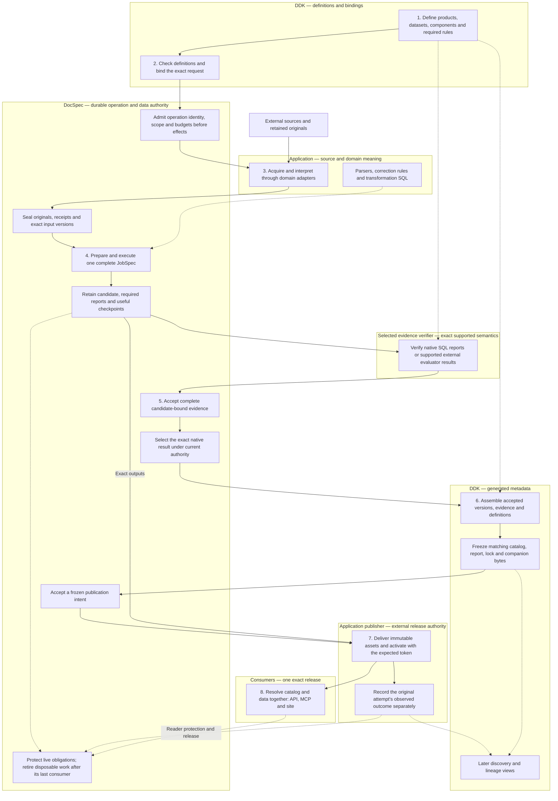

# DDK replacement: proposed design and delivery boundary

Status: implementation in progress, November 6, 2026. Direct standard-catalog
consumers and a shared native request/finalization boundary are under acceptance.
The full replacement remains incomplete. The release prerequisite is the
parent-owned `implementationReady` value in
`/Users/mikewolfd/Work/artifacts/ddk-replacements-20261106/release-status.json`.
It was false at first inspection. The parent subsequently changed it to true
after verifying dev2's local release and explicitly removed external publication
as a prerequisite. Local replacement implementation is now authorized; shared
runtime changes still require separate qualification.

## Outcome and scope

The user selected a greenfield migration with every producer and consumer
updated together. The new public DDK catalog is mandatory. Old reader formats,
metadata fallbacks and importers for old controller/journal state are outside
acceptance. Retained originals and native results remain reusable when their
exact identity, interpretation and custody are established. New-stack recovery,
qualification, protection and coherent release membership remain required.

The replacement must carry every maintained source through its existing domain
interpretation into exact, recoverable versions that the existing user journeys
can consume. It must also replace the duplicated definition, execution-control,
and catalog infrastructure in that path. A DDK description of the old stack does
not meet this outcome. Preserve domain logic and supported upstream formats when
they already meet the requirement.

Scope includes the congressional archive, Explorer/site, API and MCP, news lake,
YouTube capture/analysis/captions and reporting, committee export, and inflation
CSV/Sheets workflows. Existing intentionally unavailable or retired surfaces are
recorded as such. Supported source behavior, known defects, planned improvements,
and observed deployed behavior are separate facts. A source bug does not become
an accepted business rule merely because parity testing reproduces it.

The code baseline is `a06eb64bf3caa4a44e12a89bdd08939323de3092` in
`codex/ddk-congress-replacement-20261106`. Main is independently active. Recheck its
changes before implementation and merge relevant behavior deliberately; do not
continually move the comparison baseline. Main's dirty files remain untouched.

## What goes in, what happens, what comes out, how we check it

| Boundary | Input and action | Output and owner | Decisive check |
| --- | --- | --- | --- |
| Acquisition | Explicit source scope, request parameters and source policy; execute maintained fetch/domain adapters | Original bytes, source occurrences, attempt receipts and dispositions owned by acquisition | Raw-record expectations, source census and two-way receipt accounting; refusal, empty, partial and unknown outcomes stay distinct |
| Interpretation | Exact retained body and parser/tool/policy identity; run maintained parsers, OCR and reading logic | Typed source readings and pending/refused outcomes; domain code owns meaning, DocSpec owns durable execution | Independently read raw records, planted wrong values, nonauthor confirmation and declared unread cases |
| Model | Exact source versions, curated corrections and relationships; execute declared SQL/domain components | Native table groups and derived relationships with original field IDs, multiplicity and retained history | Exact typed multiset comparisons, reference/cardinality checks, six model invariant suites and consumer examples |
| Qualification and release | Candidate versions, complete required rules, exact upstream versions and consumer obligations | Native accepted evidence and one coherent selected release; publication records own external membership | Missing/wrong-version/unknown checks refuse selection; lost response reconciles the original operation |
| Consumption | Resolve an exact release and its supported representations before reading | API/MCP responses, search, site journeys, news queries, reports and Sheets values | Real local consumers against the same candidate identity, compared with independent expectations and authentic records |
| Change and recovery | Append, correction, explicit empty replacement, deletion, policy change, or restart | Selective work and preserved previous results until complete successors qualify | Unchanged rerun, fixed-size delta, interrupted phases, cold restart and historical readback; instrument what is actually reread/rebuilt |

Acquisition and consumer capability inventories enumerate the required details.
Every row remains unverified until its own executable acceptance evidence exists.
Cross-table joins and user journeys can require several rows; passing one row
does not imply the others passed.

## One owner per decision

1. **DDK definitions and checks.** Maintain reusable ODPS product and ODCS dataset
   meaning, component interfaces, design dependencies and policy definitions.
   Generate service discovery, dictionaries, consumer metadata and catalog views
   from those owners. During conversion, adopt existing definitions explicitly;
   retire competing hand-maintained copies once the generated form passes parity.
   Native schemas remain the authority for physical types and field/element IDs;
   DDK records their exact mapping, never invents replacement IDs.
2. **Domain code.** Keep supported acquisition adapters, parsing rules, semantic
   SQL, correction rules, identity and occurrence logic. Extract reusable logic
   from wrappers only when needed. Do not touch byte-hashed parser files for
   formatting. Intentional changes require the existing pin-update procedure and
   separate source-grounded acceptance.
3. **DocSpec execution.** Use its native admission, protection, durable phases,
   computation identity, update/reconciliation and guarded selection. Extend the
   owning runtime where the released profile is insufficient. DDK passes original
   request references and composes evidence; it does not keep a parallel lifecycle
   database, phase key, retry controller or mutable current pointer.
4. **Publication and applications.** Native selection identifies a complete data
   result. The application publication owner composes its exact membership and
   makes required representations available. Existing external publication has
   its own conditional-write/reconciliation semantics; the replacement must use
   those semantics through a single supported native/application boundary.
   Catalog assembly records that selection. Consumer caches key by the selected
   release. Prior versions produced by the new stack remain explicitly bound.

The concrete request, qualification and per-workflow activation boundaries are
specified in [operation seams](operation-seams.md). That document records target
requirements, supported existing mechanisms and unresolved upstream APIs separately.
It does not assert that an owner assignment makes a missing API available.

These boundaries follow DDK specification `DDK-ARCH-001`, `DDK-LOCK-005`,
`DDK-ADAPTER-011` through `014`, and `DDK-CATALOG-001` through `010` in the
parent-owned DDK repository. Runtime integration documents alone do not qualify
an operation. The concrete required extensions are in [runtime gaps](runtime-gaps.md).

The final application command composes declared components and supported native
operations. It must not invoke the incumbent controller wholesale and relabel the
receipt as DDK execution. Existing controllers remain a comparison oracle until
the complete replacement path passes; two production writers are not introduced.

## Ownership and complete lifecycle

This is the greenfield production path. Boxes assign responsibility; they do not
assert that every connection is implemented. The implementation and qualification
state remains in [status](status.json). DDK has no independent execution journal
or mutable selection. Every reader uses the same current catalog format.

Acquisition admission precedes every new external attempt. A caller timeout does
not create another operation. The same native owner retains completed effects,
computation and accepted evidence; domain adapters retain their source semantics.
An existing materialized relation is not automatically a durable checkpoint.
Preserve the complete job's dependency and last-consumer information when choosing
which expensive completions survive a restart and when disposable bulk can retire.

Congress uses a concrete native SQL evidence profile for its existing complete
invariant inventory. The selected verifier binds every required check instance to
all input and candidate views it used, exact SQL, trusted engine identity, completed
execution and observed outcomes. Supported Data Contract CLI rules use their own
qualified verifier. They do not require copying native data merely to repeat checks
already performed by the native job. Independent raw-data checks retain their
different evidence boundary. Catalog assembly consumes native accepted records;
it does not repeat the native acceptance decision.

The publication intent fixes the original attempt, accepted native result,
qualification, immutable release inventory and expected publisher token. Once the
native owner accepts that intent, later native selection changes do not silently
revoke it. External activation still requires the original publisher token: an
older attempt cannot replace a newer published release. A retry reconciles the
same intent and records uncertainty when retained evidence cannot settle the
historical outcome. This protocol adds no second publication controller.

The embedded catalog describes the candidate and facts already observed when its
bytes were frozen. The publisher never writes its eventual outcome back into
those bytes: catalog files participate in the release identity. Publication
observations refer to the frozen release and may feed a later discovery catalog
or lineage export. Finalization requires matching candidate, output and catalog
membership before activation; there is no absent-catalog or legacy-schema branch
in the completed replacement.

## Simplification is part of acceptance

The user clarified that the replacement must standardize and streamline the
whole catalog-to-validation stack. A successful migration reduces custom
machinery and maintenance work while preserving required behavior. Moving old
metadata into standard formats and adding another converter is insufficient.

The first uncommitted definition bridge exposed useful transcription and reader
compatibility facts, but it also added legacy object-member ordering annotations,
duplicate composite type descriptions, a reverse conversion to the old registry,
and another definition-validation pass. It expanded broad model hashes to include
description and recipe changes. That draft is a migration experiment, not the
accepted architecture; stop extending it as a permanent runtime path.

The next implementation increment must connect one real consumer to the standard
DDK catalog and required checking evidence, and remove the superseded current-path
code in the same increment. Its acceptance must show these concrete improvements:

- Physical types and native field/element IDs have one maintained owner. DDK
  references and checks the exact native mapping instead of keeping a second
  composite type language synchronized by application code.
- Standard DDK fields carry meaning, identities, relationships, recipes and
  product scope. Application extensions hold domain facts that the standard
  cannot express, with each missing reusable feature assigned to the
  shared DDK owner. Serialization maps and duplicated short-name translations
  leave the authored end-state.
- Current discovery and checking use one admitted catalog and one set of
  required results. Remove the reverse registry converter and duplicated
  definition validator from that path. Preserve independent raw-data checks;
  their different reading is deliberate evidence, not duplicated authority.
- Computation, qualification and publication metadata keep separate dependency
  identities. Description-only changes regenerate metadata; rule-only changes
  requalify the existing candidate; data changes recompute affected native work.
  Retain full provenance without making every provenance byte a compute trigger.
- One current catalog format serves all updated readers. Remove old-format
  decoders, schema fallbacks and compatibility-only aliases. Preserve meaning,
  ordered data, field IDs and multiplicity; old release bytes remain evidence
  without requiring new readers to decode them.
- Each migrated path names the old code and independently maintained definitions
  it retires. Acceptance is incomplete while both current implementations remain
  active or while the new route merely calls the old controller wholesale.

Claims of faster or more resource-efficient execution require measurements on
the same retained inputs and equivalent results. Compare a fresh run, unchanged
rerun, bounded data delta, metadata-only edit and qualification-only change.
Record work reread/recomputed, elapsed time, peak memory and retained bytes under
the repository resource controls. No speed improvement is established by the
current metadata experiment or static source review.

## Meaning that cannot be simplified away

- Keep source occurrence, content hash, interpretation version, native dataset
  version and release membership distinct. Identical bytes can have multiple
  occurrences. Linked documents, witness appearances and people have different
  grains. Preserve repeated values and meaningful nested order.
- Preserve raw literals beside corrections and normalization. Reuse the existing
  House committee-code owner and occurrence-v2 key rules. Do not repair counts by
  deleting conflicting observations or merging same-name people.
- Keep valid empty, absent, unsupported, refused, pending, superseded and unknown
  outcomes separate. Absence from a partial source is not a deletion. A request
  timeout is not evidence that the native operation failed or never started.
- Preserve exact field/element IDs, binary values, date precision, null/empty
  collections, schema versions and parser versions. Keep one applicable parser
  version per logical key when reusing historical readings.
- Preserve original document links, supported SQL dialect and result grains,
  release-bound cursors, search filters/ranking semantics, and historical keys.
  A metadata count or readable table is not proof of a complete user answer.

Current evidence for these requirements includes `AGENTS.md`,
`docs/engine-first-data-model.md`,
`docs/plans/congress-explorer-root-cause-remediation-20261104.md`, the native schemas,
registry and actual consumers cited in the inventories. The older remediation
plan favored retaining existing controllers; this new full-replacement request
changes that infrastructure choice while preserving its semantic obligations.

## Reuse and artifact lifetime

Resolve exact retained references and their completion evidence before opening
large bodies. Freeze a receipt-set/high-water boundary for each run. Later arrivals
are a later change; they cannot silently change an admitted request. Preserve
completed expensive readings, OCR, joins and exports where dependency identity and
custody still match. Qualification-only changes can reuse computation.

Raw originals, selected versions, useful expensive completions and failure
evidence retain their existing owner. New-stack reader bindings are protected.
Cheap disposable
scratch may retire only after the owning runtime checks readers, writers,
rollback pins and pending operations. No cleanup is authorized by this plan.
Do not copy a corpus into this worktree or export/reimport native data merely to
pass it through DDK. New durable run data belongs in main's
`.cache/archive-release/ddk-replacement-20261106/`.

Incremental work includes discovery, validation and export, not just parsing.
Measure a fixed change against growing retained populations and record files and
bytes touched. Keep exact predicate-scoped backfills where justified; otherwise
declare the broader recomputation. Candidate SHA semi-joins, materialized shared
steps, per-key grouping, small-side hash builds and single pinned reading versions
remain required by this repository's engine constraints.

## Resource and authorization boundary

Preparation uses source/metadata reads and bounded original inspection only.
Observed free disk fell from 37 GiB to 23 GiB and then 8.7 GiB during concurrent work; no value
is a reservation. No full-corpus replay, download, cargo build or multi-GB job is
needed to finish preparation. Native jobs and full suites must use
`archive_watchdog.py`, with current free memory, measured expected peak and a
separate total disk/coexistence budget. Coordinate heavy work with the parent and
SpicyRegs manager before starting; do not infer capacity from an engine limit.

Use this worktree's `uv sync --frozen` environment and `scripts/dev.py` test lanes.
MCP has its own maintained environment and runner. Before native tests, qualify
the chosen DDK/DocSpec tuple against the repository pin procedure; never overwrite
the shared immutable binary address or bypass doctor. The current runtime pin
(`b0342a73`, macOS digest `fed9ea73...`) is different from DDK's qualified tuple
(`b1270b2e`, digest `b89b43e2...`). This is an explicit compatibility obligation,
not proof of incompatibility.

The human enabled full access. Root can now write durable evidence and Git
metadata and communicate with the parent session. Earlier permission failures
remain historical evidence; they no longer block root work. Some existing agents
retain narrower permissions, so root executes durable-path checks centrally.
Use actual tool permissions and do not bypass a denied operation. Full access
does not authorize production cutover, external replacement publication, source
acquisition or changes to parent-owned shared DDK/runtime code.

## Completion and next work

After the release gate opens, verify its exact released tuple and refresh source
drift. Qualify the shared capability gaps with the parent, then implement the
complete declared path with independent acceptance work alongside it. Start with
a bounded authentic corpus to disprove a bad route cheaply; it is an experiment
within the full replacement, not the completed deliverable.

Completion requires every capability and consumer obligation resolved, authentic
end-to-end and lifecycle evidence, required complete test lanes, independent
architecture and code review, and retirement of superseded infrastructure within
the isolated branch. Record any intentionally changed behavior with its evidence.
No fixture-only pass, wrapper, metadata adapter, local package release or partial
suite can satisfy full replacement acceptance. Deployment remains separate.
