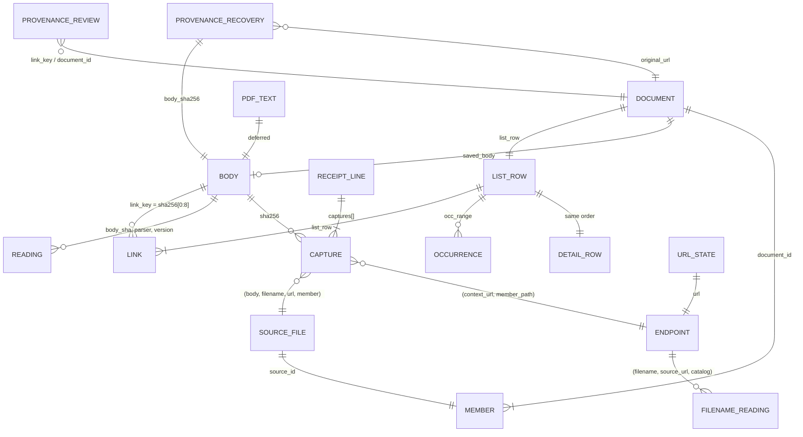

# The full data model, end to end (as it should be)

Companion to `cs300-rereview-rev5.md`. Design revision 5 (`69080fac`) is cited as **D5:line**,
plan revision 3 as **P3:line**. Sizes are measured on the Oct 19 snapshot unless marked
*est.* Measured today's document count is 1,241,157; the real-file rule (D5:275–295) reduces it
to roughly 0.5M (re-review §2 item 1), so release-file sizes are given at both scales.

Conventions: Arrow types; `fsb(n)` = `fixed_size_binary(n)`; `dict` = dictionary-encoded
`string`; `ts` = `timestamp[us, UTC]`. "PK" is the uniqueness a test asserts. Folds are
`List<Struct<field: dict, value: string>>` (one value per element; repeat the field for
multi-valued facts), the shape measured in the re-review.

---

## 1. Raw log

### 1.1 Body object

| Item | Value |
|---|---|
| Key | `bodies/sha256/<aa>/<sha>` for new writes (D5:98). Legacy: `…/<sha>.gz` (every older body, 1.04M) and `…/<sha>.pdf` (one-time decompressed copies of older PDFs, 261,055, ≈403 GB; D5:463–466, P3:215–220). |
| Stored bytes | Original bytes, gzip-compressed when the media type compresses (HTML, XML, JSON, text); as-is for PDF, images, archives (D5:100–103). |
| HTTP metadata | `Content-Type` = original media type; `Content-Encoding: gzip` when compressed; `Content-Length`; `ETag` = MD5 of stored bytes (single-part PUT only, D5:108–110). Legacy `.gz` objects carry `Content-Type: application/gzip` and no encoding (measured on the public origin). |
| Custom metadata | None needed: identity is the key, integrity is the ETag (D5:104–107). |
| Write | One create-only PUT (`If-None-Match: *`) with `Content-MD5`; 412 ⇒ exists (D5:108–114). |
| Sizes | 1,036,256 bodies, 0.70 TB stored; largest 1.19 GB; none > 5 GB. |

### 1.2 Receipt line

One file per run, `receipts/<family>/<write-date>/<run>.jsonl.gz`, one JSON object per fetch
attempt or import (D5:121–138). Today's lines (sampled: Oct 4 fetch line, Oct 15 import line)
are 6–9 KB plain, 0.5–1 KB gzipped, mostly provider metadata and duplicated header lists; the
target line below keeps the allowlisted subset. Types are JSON; the Arrow type the lake uses
is in §2.

**Fields common to both line kinds**

| Field | Type | Meaning |
|---|---|---|
| `run_id` (today `source_file`) | string | Writer run, e.g. `ci/20261004T061814Z-e37357cb5904`. Defines "the import run" for date labels. |
| `line_index` | int | Position in the file (today implicit: `receipt_line`). |
| `mode` | enum `fetch` \| `retained_import` | D5:132. |
| `family` | string | Source family (`documents`, `house/meeting-xml`, `senate/captions`, …; 21 today). |
| `requested_url`, `url` | string | Requested and final URL after redirects. |
| `retrieved_at` | RFC 3339 | Fetch time; for imports, the recovered copy's observed original timestamp (Oct 15 run: 2000–2026). |
| `http_status` | int \| null | Server status; synthetic 200 for imports (D5:133). |
| `outcome` | enum `stored` \| `unchanged` \| `failed` \| `retry_later` \| `size_limit` \| `request_failed` | D5:123–124; `size_limit`/`request_failed` mean incomplete (D5:115–119). |
| `complete` | bool | Body fully received. |
| `transport` | string | `direct`, `zyte`, … |
| `response_headers` | object | Allowlisted only: `content-type`, `content-length`, `last-modified`, `etag`, `content-encoding`, `date`, `cache-control`, `accept-ranges` (D5:127). |
| `redirects` | list of {url, http_status} | Chain. |
| `prior_attempts` | list of {url, retrieved_at, transport, http_status, sha256} | Earlier tries in the same run (e.g. a direct 403 before a provider fetch). Today each carries a full header copy; keep the five fields. |
| `links` | list of {url, basis, tag, text, attributes{…}, source_xpath, parent_url, parent_sha256} | Links discovered in this body (frontier and "where seen" context). Carried today; no lake table reads it (gap 3). |
| `source_context.observations` | list of {url, source, pointer} | Why the URL was requested (feed file and pointer). |
| `writer` | {job, commit, lockfile_digest} | D5:128. Not in today's lines. |
| `captures[]` | list (below) | One entry per body this line references. |

**`captures[]` entry** (one per referenced body; a line can carry many: median 1, max 22,354)

| Field | Type | Meaning |
|---|---|---|
| `pointer` | JSON path | Where in the record the body sits: `["content","body"]`, `["archive_members", i, …]`, `["segments", i, …]`, `["prior_attempts", i, …]`, provider/MODS references. Part of the unique key. |
| `context_url` | string | The URL this body is evidence for (the container's URL for archive members). |
| `member_path` (today `original_path`) | string \| null | Path inside an archive; null for direct bodies. Part of the endpoint key. |
| `sha256` | hex | Identity (the key suffix). |
| `bytes` | int | Original size. |
| `media_type` | string \| null | Server's claim. |
| `sniffed_format` | enum `pdf` \| `zip` \| `xml` \| `html` \| `json` \| `vtt` \| `m3u8` \| `docx` \| `doc` \| `text` \| `image` \| `warc` \| `other` \| `empty` | From the first bytes (D5:125–126, P3:179–181). New. |
| `stored_md5`, `stored_bytes` | hex, int | Only when this line stored the body (`outcome = stored`; D5:125–126). |
| `fidelity` | enum `exact-bytes` \| `saved-text` \| `saved-record` \| `retained-file` | How faithful the stored bytes are (today's values). |
| `string_encoding` | string | `utf-8` / `base64`. |
| `retrieved_at`, `http_status`, `family` | as above | Copied per capture today; derivable from the line. |

**Fetch-only fields:** `provider_metadata` (today: full Zyte response metadata; keep
`final_url`, `http_version`, `response_reason` only).

**Import-only fields** (`mode = retained_import`; D5:132–136; Oct 15 sample)

| Field | Type | Meaning |
|---|---|---|
| `publisher_requested` | bool | Always false for imports. |
| `recovery_evidence.imported_at` | RFC 3339 | When imported (2026-10-15…). |
| `recovery_evidence.original_url` | string | The link this content recovers. |
| `recovery_evidence.match_basis` | string | e.g. `user_accepted_url_variant`. |
| `recovery_evidence.current_publisher_status_not_tested` | bool | — |
| `recovery_evidence.acquisition.{kind, recovered_url, source, match, prior_access_category, evidence_file, evidence_sha256, identity_evidence, observed_capture_timestamp, at}` | mixed | `kind` is the representation type (`pdf`), **not** the display kind; `prior_access_category` (`recovered_document`) and `match`/`source` are the inputs to the three display kinds (D5:328–330): recovered copy, hearing-record excerpt, official substitute. The mapping is not written anywhere (gap 4). |
| `recovery_evidence.representation`, `.acquisition.representations[]` | {body_path, sha256, bytes, kind, recovered_url, section_link, at} | Local paths; keep sha256/bytes/kind/section_link only. |
| `source_associations[]` | {original_url, basis} | Links this content is evidence for. |
| `preserve_download_state`, `download_state{…}` | legacy | The old raw index's row; nothing in the target reads it (gap 8). |

### 1.3 Provenance records

`provenance/<kind>/<ts>.jsonl`, append-only, corrections supersede by id (D5:140–145). The
design names the kinds but not their fields; this is the proposed shape.

| Kind | Fields | Read by |
|---|---|---|
| `recoveries` (from `accepted.json`, P3:202–203, P5) | `id`, `original_url`, `recovered_url`, `body_sha256`, `kind` ∈ {recovered_copy, hearing_record_excerpt, official_substitute}, `match_basis`, `evidence_sha256`, `identity_note`, `decided_by`, `decided_at`, `supersedes` | model → `recoveries` |
| `url_variants` | `id`, `canonical_url`, `variant_url`, `basis`, `decided_at`, `supersedes` | model → endpoint canonicalization |
| `reviews` | `id`, `target` (`link_key` or `document_id`), `verdict` ∈ {not_a_document, duplicate_of, title_override, kind_override, hide}, `value`, `note`, `reviewer`, `decided_at`, `supersedes` | model → `reviews` |
| `verification` (D5:158–160) | `key`, `size`, `etag`, `sha256_verified` (bool), `checked_at`, `job` | weekly check |

---

## 2. Lake (Iceberg in Basin Catalog, append-only; D5:162–247)

### 2.1 `captures` — one row per capture entry

| Column | Arrow type | Notes |
|---|---|---|
| `receipt_key` | dict | File key. |
| `receipt_line` | int32 | Line index. |
| `capture_index` | int16 | Position in `captures[]`. **PK = (`receipt_key`, `receipt_line`, `capture_index`)**; D5:176's `(receipt_key, receipt_line)` is not unique (3,909,134 rows, 2,596,054 lines). |
| `pointer` | string | JSON path; informative. |
| `run_id` | dict | For import-day labels and per-run grouping. |
| `family` | dict | — |
| `mode` | dict | `fetch` / `retained_import` (D5:179–180). |
| `publisher_requested` | bool | — |
| `requested_url`, `url`, `context_url` | string | `context_url` is the endpoint URL (container for members). |
| `member_path` | string (nullable) | Endpoint = (`context_url`, `member_path`). |
| `retrieved_at` | ts | Null for ~1.0M legacy rows. |
| `transport` | dict | — |
| `http_status` | int16 (nullable) | — |
| `outcome` | dict | — |
| `complete` | bool | — |
| `sha256` | fsb(32) (nullable) | Null for metadata-only rows. |
| `bytes` | int64 | — |
| `media_type` | dict | Server's claim. |
| `sniffed_format` | dict (nullable) | From the receipt; filled for older bodies by `readings` parser `sniff` (§2.2). |
| `stored_md5` | fsb(16) (nullable) | Only on the creating line (D5:150–152). |
| `stored_bytes` | int64 (nullable) | — |
| `fidelity` | dict | — |
| `recovery_kind`, `original_url`, `match_basis`, `imported_at`, `observed_capture_ts` | dict, string, dict, ts, ts | Import rows only (D5:179–180). |
| `headers_content_type`, `headers_last_modified`, `headers_etag`, `headers_content_length` | dict/string/string/int64 | The allowlist, as columns. |

No `body_key` (derivable). Partition: none at this size (compaction handles files); sort within
a commit by `(url, retrieved_at)` (D5:176–177). **Work-list key:** `receipt_key` not yet
ingested, listed from date-shaped prefixes (D5:181–185). Size: 157 MB compact today; 315 KB
per normal day.

### 2.2 `readings` — one row per `(body, parser, parser_version)`

| Column | Arrow type | Notes |
|---|---|---|
| `body_sha` | fsb(32) | — |
| `parser` | dict | `sniff`, `html`, `xml`, `json`, `fingerprint`; later `pdf_text` (§2.5). |
| `parser_version` | dict | — |
| `status` | dict | `ok` / `error` / `skipped`. |
| `error_type` | dict (nullable) | — |
| `format` | dict | Sniffed format (every body has one; D5:207–209). |
| `title` | string (nullable) | HTML `<title>`; used by the error-signs check (D5:286–289). |
| `heading` | string (nullable) | First `<h1>`; same. |
| `text_bytes` | int32 (nullable) | Visible-text length; the "tiny body" signal. |
| `error_signals` | list<dict> | Generic error words found (D5:197–198). |
| `record_role` | dict (nullable) | `document` / `source_record` / `error_response` from the XML root or JSON shape (gap 2). |
| `fingerprint` | fsb(32) (nullable) | Normalized-text digest; for ZIPs the digest of sorted member hashes (D5:210–213). |
| `fields` | fold | Everything else (XML root, legis num, citations, source-record ids, …). |

**PK** `(body_sha, parser, parser_version)`. Partition `(parser, parser_version)`; sort
`body_sha` (D5:189–192). **Work-list key:** bodies in scope for a parser with no row for its
current version; scope by `format` and family (D5:196–213); `fingerprint` scope = bodies at
endpoints with ≥ 2 distinct complete real files (148 endpoints, 297 bodies, 1.38 GB today).
Size: today's 491,710 rows fold to 16.5 MB (15.5 MB is the 32-byte key).

### 2.3 `filename_readings` — one row per `(filename, source_url, catalog_version)`

| Column | Arrow type | Notes |
|---|---|---|
| `filename` | string | Basename or recovered name (32,574 differ from the URL's last segment). |
| `source_url` | string | Exact URL (71 catalog mirror URLs qualify readings; D5:223–226). |
| `catalog_version` | dict | Covers every vocabulary passed in (surnames if ever used). |
| `valid` | bool | Strict convention parse succeeded (README "Strict parsing results"). |
| `document_kind`, `document_family`, `congress`, `committee_code`, `date_token`, `measure_type`, `measure_number` | dict, dict, int16, dict, string, dict, string | Narrow typed core: the facets `list` shows. |
| `fields` | fold | The rest of `metadata` (≈106 field names, plus `_code`/`_label` variants). |

**PK** `(filename, source_url, catalog_version)`. Partition `catalog_version`; sort
`(filename, source_url)`. **Work-list key:** `(filename, source_url)` pairs in `captures` with
no row for the current version (D5:227–229). Size *est.* 32 MB per catalog version (8.1 pairs
per row measured on a 200k sample; 1,392,681 pairs).

### 2.4 Lake table proposed to close gap 3: `page_links`

One row per link discovered in a fetched body: `receipt_key`, `receipt_line`, `parent_sha`
fsb(32), `parent_url`, `child_url`, `basis` dict, `tag` dict, `text`, `attributes`
map<string,string> (`doc-type`, `add-date`, `publish-date`, …), `xpath`. From receipts'
`links[]`. PK `(receipt_key, receipt_line, ordinal)`. It is what "where each copy was seen"
needs beyond the URL, and what the committee explorer joins on (labels, meeting ids). *Est.*
3–5M rows, 60–120 MB. Optional under "documents only"; decide (gap 3).

### 2.5 Deferred: `pdf_text` (decision 22; D5:199–204, P3:362–364)

`body_sha` fsb(32), `parser_version` dict, `page_count` int32, `text_fingerprint` fsb(32),
`pages` list<large_string> (or `text` large_string). PK `(body_sha, parser_version)`;
partition `parser_version`; sort `body_sha`. One read of ≈403 GB (261,055 PDFs). *Est.* size:
at 20–80 KB of text per PDF, 5–20 GB raw, 1–5 GB ZSTD; keep text out of the model's hash-join
build sides (D5:514–516). Until it exists, PDFs have `format` from the sniff only and no
fingerprint, so same-endpoint PDF pairs (75 endpoints today) group as "no text: separate".

---

## 3. Model outputs (one SQL plan; D5:251–334)

All derivations below are over `captures c`, `readings r`, `filename_readings f`, provenance
`p`. "Logical body key" is the string `bodies/sha256/<aa>/<sha>.gz` (D5:265–269).

### 3.1 `real_files` (CTE, decision 13; D5:275–295)

```
real_files := rows of c where
  mode = 'fetch' and complete and outcome in ('stored','unchanged')
  and http_status between 200 and 299
  and sha256 is not null and bytes > 0
  and format in ('pdf','zip','xml','docx','doc')          -- document types
      or (format = 'html' and page_shaped(url) and not error_signs(r))   -- web pages
  and format not in ('json','m3u8','vtt')                  -- API metadata, playlists, captions
  and sha256 not in placeholders                           -- bodies at > 100 URLs
  and record_role(r, family) = 'document'                  -- not MODS/PREMIS/meeting/witness records (gap 2)
```
`format := coalesce(c.sniffed_format, r[parser='sniff'].format)`. `page_shaped(url)` is the
exact regex list (re-review §2 item 4). `error_signs` := `text_bytes < 2048` or `title`/
`heading` match the generic words or `sha256 in placeholders` (D5:286–289).

### 3.2 `filenames` — one row per source file

| Column | Type | Derivation |
|---|---|---|
| `source_id` | fsb(32) | `sha256(logical_body_key ‖ filename ‖ source_url)` with today's exact inputs (P3:306–309). |
| `body_sha` | fsb(32) (nullable) | — |
| `filename` | string | Recovered name if provenance says so, else URL last segment, else member basename. |
| `source_url` | string | `context_url`. |
| `member_path` | string (nullable) | — |
| `endpoint` | struct<url, member_path> | — |
| `is_real_file` | bool | `body_sha in real_files`. |
| `record_role` | dict | document / source_record / caption / playlist / error_response / unknown. |
| `first_fetched`, `last_fetched` | ts (nullable) | min/max `retrieved_at` over `mode = fetch` rows. |
| `first_run` | dict | `run_id` of the first row; import-day label when it is an import run. |

Derivation: `select distinct` over `c` of `(sha256, filename, context_url, member_path)` for
rows with `sha256`, plus one row per URL that never yielded a body (`body_sha` null). Today:
1,683,430 source files.

### 3.3 `edges` and `documents`

```
same_body   := pairs of source files with equal body_sha, where the body is a real file,
               format <> 'html', and not a placeholder                       (D5:271–274, 312–322)
same_text   := pairs of source files at the same endpoint whose bodies are real files and
               whose readings fingerprints are equal (or whose sha256 are equal)      (D5:307–311)
components  := ConnectedComponents(nodes = source_id, edges = same_body ∪ same_text)
document_id := sha256(sorted logical body keys of the component's real files),
               or sha256(sorted source_ids) when it has none                 (D5:261)
saved_file  := the component's real file with max(first_fetched), ties by body_sha  (D5:323–324)
first_captured, last_captured := min/max first_fetched over the component's real files
date_kind   := 'captured' if the saved file has a fetch date from a non-import run;
               'import_day' if its only rows come from the Sept 29 import run;
               'unknown' otherwise                                           (D5:354–360, re-review §2 item 7)
```
Columns: `document_id` fsb(32), `list_row` int32 (assigned after sorting), `filename` (of the
saved file), `saved_body` fsb(32) nullable, `saved_media_type` dict, `saved_key` string
(physical key: `<sha>`, `<sha>.gz` or `<sha>.pdf`), `first_captured` date32, `last_captured`
date32, `date_kind` dict, `has_saved_file` bool, `n_members` int32, `kind`/`family`/
`congress`/`committee_code` from `filename_readings` of the saved file (D5:234–235).
Measured with error roles, placeholders and HTML excluded but *before* the caption/record
rule: 1,260,423 components, largest 456 source files.

### 3.4 `members` — `(document_id fsb32, source_id fsb32)`; every source file in exactly one document.

### 3.5 `url_state` — one row per URL (D5:259, D5:485–487)

`url` string, `attempts` int32, `last_attempt` ts, `last_status` int16, `last_outcome` dict,
`next_attempt_at` ts, `links_scanned` bool. Derivation: `arg_max` over `c` by `retrieved_at`
with `mode = 'fetch'` (imports stay out, D5:325–330); `next_attempt_at` from the outcome
(`retry_later`, `size_limit`, `request_failed` ⇒ due now; 2xx ⇒ family recheck interval). No
hash column (re-review §2 item 9). 1,158,426 rows.

### 3.6 `recoveries` — one row per recovery, attached to the original link

`document_id` (the document whose source file has `original_url`, if any), `original_url`,
`kind` dict (three display kinds), `body_sha` fsb(32), `saved_key`, `recovered_url`,
`match_basis`, `evidence_sha256`, `identity_note`, `imported_at`, `observed_capture_ts`,
`decision_id`. Derivation: `c where mode = 'retained_import'` ⟗ `p.recoveries` on
`(original_url, body_sha256)`. Oct 15 run: 5,154 / 341 / 92 by kind (D5:328–330).

### 3.7 `reviews` — `p.reviews` resolved to `document_id` via `links` (link_key) or directly; latest record per `id` wins (`supersedes`).

---

## 4. Release files (D5:336–394)

Row order of `list` = `(filename, first_captured nulls last, document_id)`, unique (D5:342,
D5:350–353, D5:397). Shared writer settings: Parquet 2.0 pages, ZSTD-3, fixed rows per row
group, chunk statistics, footer < 512 KB, no Bloom filters (D5:386–391). Sizes: measured at
1,241,157 rows; *est.* at ≈0.5M rows after the real-file rule.

| File | Columns (type, encoding) | Sort / rows | Writer settings | Size |
|---|---|---|---|---|
| `list.parquet` | `filename` string (plain+dict), `document_kind` dict, `document_family` dict, `committee_code` dict, `congress` int16, `format` dict, `first_captured` date32 (dict), `date_kind` dict, `has_saved_file` bool. No id. | list order; one row per document | defaults; no page index (D5:342) | **3.9 MB** measured (3.4 MB zstd-9; the date columns add 0.2 MB); *est.* 1.7 MB at 0.5M |
| `detail.parquet` | `detail` fold with fields: `document_id` (hex), `link_key` (hex16), `source_url`, `saved_key`, `saved_media_type`, `first_captured`, `last_captured`, `date_kind`, `member_count`, readings fields of the saved file (prefixed `r.`), filename-reading fields of the saved file (prefixed `f.`), `recovery` entries as `kind|key|imported_at`, `occ_range` as `start:len`. No row-number column (implicit). | list order | offset index on every leaf; **64 KB pages / 1024-row batches** recommended (16 KB / 256 rows gives an 868 KB index) | **81 MB** at 16 KB pages, **74 MB** at 64 KB, measured with today's 16.2 pairs/row; *est.* 30–40 MB at 0.5M; per view 11–43 KB |
| `links.parquet` | `link_key` fsb(8), `list_row` int32 | by `link_key`; one row per real body in any body set, plus document-id prefixes for fileless documents | offset index + statistics on `link_key`; 16 KB pages; one row group | **10.7 MB** at 962,897 keys; *est.* 5–7 MB after the rule |
| `occurrences.parquet` | `list_row` int32, `ordinal` int16, `url` string, `member_path` string, `filename` string, `first_fetched` date32, `last_fetched` date32, `outcome` dict, `is_saved` bool | `(list_row, ordinal)`; one row per member source file | offset index on every column; 64 KB pages | **23–34 MB** measured (4,727,694 rows, shapes from `size_occ_captures.py`); *est.* 12–18 MB at 0.5M documents |
| `url_state.parquet` | §3.5 columns | by `url` | defaults | **≈10 MB** *est.* without the hash (42.8 MB measured with it) |
| `manifest.json` | `schema_version`; `files[]` {name, sha256, md5, size, rows, row_range, shard}; `facet_counts` {kind, family, committee, congress, date_kind, has_saved_file}; `release_id` | — | deterministic, content only (D5:427–429) | ≈5–20 KB *est.* |
| `inputs/<input_digest>.json` | `receipt_keys_digest`, `readings_rows` {parser, version → rows}, `filename_readings_rows` {catalog_version → rows}, `provenance_digest`, `versions` {sql, engine, parsers, catalog}, `snapshot_ids` {captures, readings, filename_readings}, `run` {id, started_at, runner} | — | one per input identity (D5:430–432) | ≈2 KB *est.* |

A normal day uploads one of each (≈150 MB today, ≈70 MB after the rule; D5:406–408).

---

## 5. Relationships and invariants



**Keys that join each layer.** Raw → lake: `(receipt_key, receipt_line, capture_index)`;
body ↔ everything: `sha256` (binary); lake → model: `sha256` for readings, `(filename,
source_url)` for filename readings, `(context_url, member_path)` for endpoints; model → release:
`list_row`; public → release: `link_key` = first 8 bytes of a body's SHA-256 (or of
`document_id` when fileless); release → raw: `saved_key` and occurrence `url`.

**Invariants a test should assert**

Raw and lake
1. `captures` PK unique; rebuilt from all receipts equals the appended table (D5:186).
2. Every `sha256` in `captures` has a body object; every body's size and ETag equal the
   creating line's `stored_bytes`/`stored_md5` (weekly LIST join, D5:150–154).
3. New receipt keys are date-shaped; every `stored` line carries `stored_md5`; every line
   carries `sniffed_format`.
4. `readings` and `filename_readings` PKs unique; a parser version is complete when its
   work list is empty; the model reads only complete versions (D5:216–218).
5. Every body in `real_files` has a `format`; every HTML real file has a reading with
   `title`/`heading`/`text_bytes` for the current HTML parser version.

Model
6. Every source file is in exactly one document; every document has ≥ 1 member.
7. A non-HTML real body belongs to exactly one document (same-body edges connect them); an
   HTML real body may belong to several.
8. No document body set contains: a non-2xx body, an incomplete (`size_limit`,
   `request_failed`, 64 MiB) body, a `retained_import` body, a placeholder (> 100 URLs), a
   caption, playlist or API body, or a metadata record.
9. `document_id` recomputes from the sorted logical body keys (golden vectors, P3:306–309);
   `source_id` likewise.
10. `saved_body` ∈ body set and is the newest real file; `first_captured ≤ last_captured`;
    `date_kind = 'import_day'` only when every row of the saved body comes from the import
    run; `date_kind = 'captured'` only with a non-import `retrieved_at`.
11. `url_state` has one row per URL and no import rows; `next_attempt_at` is set only for
    retryable outcomes.
12. Every recovery resolves to a document or is reported as orphaned; no recovery body is a
    saved file or a link key.

Release
13. `list`, `detail` and `links`' row references agree: `rows(list) = rows(detail)`; every
    `list_row` in `links` and `occurrences` < `rows(list)`.
14. `list` sorted by `(filename, first_captured nulls last, document_id)` and unique.
15. `occ_range`s partition `occurrences` exactly: contiguous, non-overlapping, covering.
16. Every `link_key` resolves to one row; keys unique (export refuses collisions); every real
    body of every document has a key; document-id-prefix keys only for fileless documents.
17. `manifest.json` digests equal the uploaded objects' SHA-256 and MD5; `release_id =
    sha256(file list ‖ schema_version)`; facet counts equal counts over `list`; at least one
    inputs record exists; `url_state` decodes (canary, D5:433–437).
18. Only the live and last-good releases are guaranteed to exist; a 404 on a release file
    makes the reader re-read the pointer (D5:456–458, D5:553–555).

---

## 6. Gaps

**Fields a decision needs that no layer carries (ranked)**

1. **Capture pointer / member path as a key.** The unique key of `captures` needs
   `capture_index` (or the pointer), and endpoints need `member_path`; the design's
   `captures` columns (D5:176–180) have neither. Without them ingest cannot be idempotent
   and the fingerprint scope is 545 GB instead of 1.4 GB (re-review §2 items 2–3).
2. **Record role.** Nothing distinguishes a document from a metadata record (MODS, PREMIS,
   meeting/witness XML: 98,205 of today's documents), a caption segment (453,751), a
   playlist or API body, so the population of `documents` is undefined under the real-file
   rule. Needs `record_role` in `readings` (from XML root / JSON shape / family) and in
   `filenames`, plus `has_saved_file` in `list`.
3. **Page-link context.** Receipts carry `links[]` (parent page, label, `doc-type`,
   `add-date`, xpath) and `source_context.observations`, but no lake table keeps them;
   `occurrences` as specified shows only URL, filename and date, so "where each copy was
   seen" has no page or label, and the committee explorer's join loses labels. Decide:
   `page_links` (§2.4) or accept URL-only occurrences.
4. **Recovery display kind.** Receipts carry `prior_access_category`, `match`, `source`,
   `section_link`; the three display kinds (D5:328–330) need a written mapping, and
   `recoveries` needs the provenance decision id that accepted the recovery.
5. **Import-day definition.** Labels depend on "the Sept 29 import run"; `captures` needs
   `run_id` (receipts' `source_file`) so the rule is by run, not by date (102,427 vs 82,474).
6. **HTML error-sign inputs.** The rule reads title, heading and text size (D5:286–289); the
   `readings` core must carry `title`, `heading`, `text_bytes` and `error_signals`, not only a
   fold.
7. **Sniffed format of older bodies.** D5:207–209 gives the mechanism but not the home; it
   belongs in `readings` as parser `sniff`, and `captures.sniffed_format` stays null for
   older rows.
8. **Document types list.** DOC/DOCX (251 bodies), WARC (10,210), images: in or out.
9. **Writer identity.** D5:128 requires `writer {job, commit, lockfile_digest}` in receipt
   lines; today's lines have none.

**Fields carried that nothing reads**

- Receipt lines: `download_state{…}` and `preserve_download_state` (the old raw index's row;
  `url_state` is derived from attempts); full `provider_metadata` and `provider_response`
  header copies; `response_header_items[]` duplicating `response_headers`; per-capture
  copies of `retrieved_at`, `http_status`, `family`; local `body_path`/`evidence_file` paths
  in import lines. Dropping them cuts a line from 6–9 KB to about 1 KB plain.
- `captures`: `body_key` (derivable), `stored_sha256` (replaced by MD5 for new writes),
  `reference_kind`/`fidelity` once `mode`, `pointer` and `member_path` exist.
- Today's model outputs: 187 of 353 columns in `filenames.parquet` and 195 of 356 in
  `documents.parquet` are near-empty lists (22 MB and 17 MB); the 47-field
  `source_occurrences` struct (116 MB) and all `source_*`/`state_*` per-copy columns, which
  "documents only" (D5:348–349) removes from the release.
- `url_state.last_sha` (32 MB of 43) if kept as designed.
